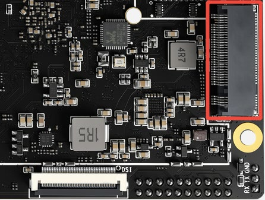

# PCIe Usage

## Introduction [step]

Firefly-R3572A has an on-board M.2 M-KEY connector (U29) configured as PCIe by default, supporting NVMe 2280 SSDs. The slot can also be switched to SATA mode for SATA SSDs by software; the two modes are mutually exclusive. See [SATA Usage](usage_sata.md).

## Hardware Installation [step]

1. Power off the board and insert the NVMe SSD into the M.2 connector at a 45° angle.
2. Press down the end of the SSD and fix it with the screw.

<center>


</center>

<Callout title="Note" type="warn">

The current firmware configures the M.2 slot in PCIe (NVMe) mode by default. To use a SATA SSD, modify the `PCIE1`/`SATA1` switches in the main DTS to switch to SATA mode (the two modes are mutually exclusive). See [SATA Usage](usage_sata.md).

</Callout>

## Checking the Device [step]

After the system boots, confirm that the PCIe device is enumerated:

```bash
lspci
```

List the NVMe block device nodes:

```bash
ls /dev/nvme*
```

Normally `/dev/nvme0` and its partition nodes such as `/dev/nvme0n1` and `/dev/nvme0n1p1` are present.

## Mounting the SSD [step]

Partition the SSD and create a file system for a new device:

```bash
fdisk /dev/nvme0n1                # Create a partition
mkfs.ext4 /dev/nvme0n1p1          # Create an ext4 file system
mount /dev/nvme0n1p1 /mnt         # Mount to /mnt
```

Check the SSD information and health status:

```bash
nvme list
nvme smart-log /dev/nvme0
```

## Read/Write Speed Test [step]

The following commands can be used as a reference for the read/write speed test of the NVMe SSD:

* dd

```bash
# Modify the paths according to the actual mount path
# write 1G file
echo 3 > /proc/sys/vm/drop_caches
dd if=/dev/zero of=/mnt/nvme/test1 bs=1M count=1024 conv=sync
# read 1G file
echo 3 > /proc/sys/vm/drop_caches
dd if=/mnt/nvme/test1 of=/dev/null conv=sync
```

* fio

```bash
# Using fio will format the disk
# write
fio -filename=/dev/nvme0n1 -direct=1 -iodepth 1 -thread -rw=write -ioengine=psync -bs=1M -size=200G -numjobs=30 -runtime=60 -group_reporting -name=mytest
# read
fio -filename=/dev/nvme0n1 -direct=1 -iodepth 1 -thread -rw=read -ioengine=psync -bs=1M -size=200G -numjobs=30 -runtime=60 -group_reporting -name=mytest
```

## Mounting at Boot [step]

To mount the SSD automatically at boot, add the device information to `/etc/fstab`:

```text
/dev/nvme0n1p1  /mnt/nvme  ext4  defaults  0  2
```

Run `blkid /dev/nvme0n1p1` first and use the UUID in the configuration for reliability.
