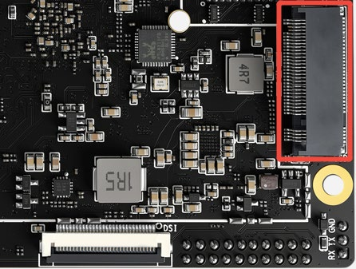

# SATA Usage

## Introduction [step]

Firefly-R3572A has one on-board M.2 M-KEY connector (U29) that can be configured by software into one of two mutually exclusive modes:

* **PCIe mode (NVMe)**: the default configuration, for NVMe protocol SSDs. See [PCIe Usage](usage_pcie.md).
* **SATA mode**: for SATA protocol SSDs, described in this chapter.

<center>


</center>

## Software Configuration (DTS) [step]

The M.2 slot mode is determined by two switches in the main DTS `rk3572-firefly-r3572a.dts`; `SATA1` and `PCIE1` cannot both be 1:

```text
#define PCIE1   1 /* M.2 NVMe */
#define SATA1   0 /* M.2 SATA; mutually exclusive with PCIE1 */
```

To switch to SATA mode, change them to:

```text
#define PCIE1   0
#define SATA1   1
```

In the board-level DTS `rk3572-firefly-r3572a.dtsi`, the SATA node is enabled when `SATA1 && (PCIE1 == 0)`, and is still powered from the slot's `vcc3v3_pcie1`:

```text
#if SATA1 && ( PCIE1 == 0 )
/* M.2 slot in SATA mode: combphy2_ps switches to PHY_TYPE_SATA and
 * vcc3v3_pcie1 still supplies the slot. */
&sata1 {
    ahci-supply = <&vcc3v3_pcie1>;
    status = "okay";
};
#endif
```

<Callout title="Note" type="info">

The chip-level node `sata1: sata@24810000` (`compatible = "rockchip,rk-ahci", "snps,dwc-ahci"`) is defined in `kernel-6.12/arch/arm64/boot/dts/rockchip/rk3572.dtsi` and uses the `PHY_TYPE_SATA` physical layer of `combphy2_ps`. The switches, node names and power supply above are taken from the Firefly-R3572A Linux SDK; refer to the dts in your SDK for the actual code.

</Callout>

After changing the DTS, rebuild the firmware and reflash it. When switching modes, make sure to use an SSD of the matching protocol in the M.2 slot (a SATA SSD in SATA mode, an NVMe SSD in PCIe mode).

## Checking the Device [step]

After the system boots, confirm that the SATA controller is enumerated and the disk is detected:

```bash
# List SATA block device nodes (usually /dev/sda, /dev/sdb, etc. on Linux)
ls /dev/sd*

# Show disk information
fdisk -l

# Check SATA/AHCI messages in the kernel log
dmesg | grep -i -E "sata|ahci|ata"
```

On Android, the block device nodes are usually `/dev/block/sd*`.

## Mounting [step]

### Manual Mounting

Take `/dev/sda` as an example (replace it with the actual device node):

```bash
# Format as EXT4 (this erases data; only run it if the data can be discarded)
mkfs.ext4 /dev/sda

# Create a mount point and mount the disk
mkdir -p /mnt/sata
mount /dev/sda /mnt/sata

# Check the mount result
df -h
```

Get the UUID with `blkid /dev/sda` and write it into `/etc/fstab` for automatic mounting at boot, avoiding mount errors caused by changing device node numbers.
