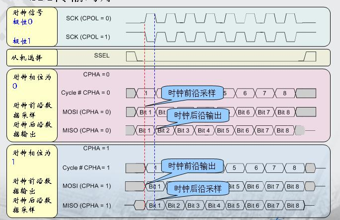

# SPI Usage

## Introduction [step]

SPI is a high-speed, full-duplex, synchronous serial communication interface for connecting microcontrollers, sensors, storage devices and so on. Firefly-R3572A provides the SPI2 interface through the J1 double-row pin header.

## Hardware Connection [step]

The SPI2 pins are defined as follows:

| Pin NO. | Signal | Level |
| --- | --- | --- |
| 12 | SPI2_MISO_M1 | 1.8 V |
| 14 | SPI2_MOSI_M1 | 1.8 V |
| 16 | SPI2_CLK_M1 | 1.8 V |
| 18 | SPI2_CSN0_M1 | 1.8 V |
| 5 / 6 | GND |  |

<center>


</center>

<Callout title="Note" type="warn">

The SPI signal level is 1.8 V. Add a level shifter when connecting 3.3 V devices.

</Callout>

SPI works in a master-slave mode and usually requires 4 signals:

```text
CS       Chip select
SCLK     Clock
MOSI     Master data output, slave data input
MISO     Master data input, slave data output
```

The Linux kernel uses combinations of CPOL and CPHA to represent the four SPI working modes:

```text
CPOL＝0，CPHA＝0    SPI_MODE_0
CPOL＝0，CPHA＝1    SPI_MODE_1
CPOL＝1，CPHA＝0    SPI_MODE_2
CPOL＝1，CPHA＝1    SPI_MODE_3
```

* CPOL: the initial clock level. 0 for low, 1 for high.
* CPHA: the sampling clock edge. 0 for the first edge, 1 for the second edge.

The waveforms of the four working modes are shown below:

<center>


</center>

## DTS Configuration [step]

Enable SPI2 and attach an spidev device in the board-level DTS:

```text
&spi2 {
    status = "okay";
    pinctrl-names = "default";
    pinctrl-0 = <&spi2m1_csn0_pins>, <&spi2m1_pins>;
    max-freq = <50000000>;
    spidev2: spidev@00 {
        compatible = "rockchip,spidev";
        status = "okay";
        reg = <0x0>;
        spi-max-frequency = <50000000>;
    };
};
```

Select `SPI_SPIDEV` in the kernel configuration. Refer to the actual Firefly-R3572A SDK code for the DTS file path and the pinctrl macro names.

## Driver Development [step]

The following takes the XM25QU128C Flash module as an example to briefly introduce the writing of an SPI driver.

### Hardware Connection

The hardware connection between Firefly-R3572A and XM25QU128C is as follows:

| XM25QU128C | Firefly-R3572A |
| ----       | ----        |
| /CS        | SPI2_CSN0_M1 |
| D0         | SPI2_MISO_M1 |
| GND        | GND         |
| VCC        | 1.8V        |
| CLK        | SPI2_CLK_M1  |
| D1         | SPI2_MOSI_M1   |

### Write Makefile/Kconfig

Add the driver file configuration in `kernel-6.12/drivers/spi/Kconfig`:

```text
config SPI_FIREFLY
       tristate "Firefly SPI demo support"
       default y
        help
          Select this option if your Firefly board needs to run SPI demo.
```

Add the driver file name in `kernel-6.12/drivers/spi/Makefile`:

```text
obj-$(CONFIG_SPI_FIREFLY)              += spi-firefly-demo.o
```

### Configure the DTS Node

Add the SPI driver node description in `kernel-6.12/arch/arm64/boot/dts/rockchip/rk3572-firefly-demo.dtsi`:

```text
/* Firefly SPI demo */
&spi2{
    spi_demo: spi_demo@00{
        compatible = "firefly,rk3572-spi";
        status = "okay";
        reg = <0x00>;
        spi-max-frequency = <50000000>;
        //spi-cpha;   /* SPI mode: CPHA=1 */
        //spi-cpol;   /* SPI mode: CPOL=1 */
        //spi-cs-high;
    };
};

&spidev2 {
    status = "disabled";
};
```

* status: set it to `okay` to enable the SPI, or `disabled` to disable it.
* spi_demo@00: this example uses CS0, so it is set to `00`. If CS1 is used, set it to `01`.
* compatible: this property must be consistent with the compatible member in the of_device_id structure in the driver.
* reg: keep it consistent with spi_demo@00; in this example it is set to 0x00.
* spi-max-frequency: set the maximum frequency used by the spi here.
* spi-cpha, spi-cpol: the working mode of the SPI is set here. The working mode of the module used in this example is SPI_MODE_0 or SPI_MODE_3. We choose SPI_MODE_0 here. If SPI_MODE_3 is used, enable spi-cpha and spi-cpol in spi_demo.

### Define the SPI Driver

Create a new driver file in the kernel source directory `kernel-6.12/drivers/spi/`, such as `spi-firefly-demo.c`.

Before defining the SPI driver, the user first needs to define the variable `of_device_id`. `of_device_id` is used to call the device information defined in the DTS file in the driver. Its definition is as follows:

```c
static struct of_device_id firefly_match_table[] = { { .compatible = "firefly,rk3572-spi",},{},};
```

The `compatible` here must be consistent with that in the DTS file.

The spi_driver is defined as follows:

```c
static struct spi_driver firefly_spi_driver = {
	.driver = {
		.name = "firefly-spi",
		.owner = THIS_MODULE,
		.of_match_table = firefly_match_table,},
	.probe = firefly_spi_probe,};
};
```

### Register the SPI Device

Register the SPI driver to the kernel in the initialization function `static int __init firefly_spi_init(void)`: `spi_register_driver(&firefly_spi_driver);`

If the matching succeeds when the kernel starts, the SPI core will configure the SPI parameters (mode, speed, etc.) and call `firefly_spi_probe`.

### Read and Write SPI Data

* `firefly_spi_probe` uses two interfaces to read the ID of `XM25QU128C`:
* The `firefly_spi_read_xm25x_id_0` interface uses `spi_transfer` and `spi_message` to transfer data directly.
* The `firefly_spi_read_xm25x_id_1` interface uses the SPI interface `spi_write_then_read` to read and write data.

After success it prints:

```text
console:/ $  dmesg | grep spi
[    1.791786] [    T1] firefly-spi spi2.0: Firefly SPI demo program
[    1.791788] [    T1] firefly spi demo
[    1.791795] [    T1] firefly-spi spi2.0: firefly_spi_probe: setup mode 0, 8 bits/w, 50000000 Hz max
[    1.791838] [    T1] firefly_spi_read_xm25x_id_0 ID = 20 41 18
[    1.791875] [    T1] firefly_spi_read_xm25x_id_1 ID = 20 41 18
```

### Enable the SPI demo

`spi-firefly-demo` is not enabled by default. If needed, change the `status` property of the demo driver node from `disabled` to `okay`.

### Common SPI Interfaces

The following are the definitions of common SPI APIs:

```c
void spi_message_init(struct spi_message *m);
void spi_message_add_tail(struct spi_transfer *t, struct spi_message *m);
int spi_sync(struct spi_device *spi, struct spi_message *message) ;
int spi_write(struct spi_device *spi, const void *buf, size_t len);
int spi_read(struct spi_device *spi, void *buf, size_t len);
ssize_t spi_w8r8(struct spi_device *spi, u8 cmd);
ssize_t spi_w8r16(struct spi_device *spi, u8 cmd);
ssize_t spi_w8r16be(struct spi_device *spi, u8 cmd);
int spi_write_then_read(struct spi_device *spi, const void *txbuf, unsigned n_tx, void *rxbuf, unsigned n_rx);
```

## User-Space Usage [step]

After the configuration, the system creates the spidev device node. Confirm with:

```bash
ls /dev/spidev*
```

User-space programs control SPI through `ioctl`:

```c
#include <linux/spi/spidev.h>

int fd = open("/dev/spidev2.0", O_RDWR);
ioctl(fd, SPI_IOC_WR_MODE, &mode);           /* Set the working mode */
ioctl(fd, SPI_IOC_WR_BITS_PER_WORD, &bits);  /* Set the data bits */
ioctl(fd, SPI_IOC_WR_MAX_SPEED_HZ, &speed);  /* Set the clock rate */
ret = ioctl(fd, SPI_IOC_MESSAGE(1), &xfer);  /* Full-duplex transfer */
```

For the detailed usage of spidev, refer to `Documentation/spi/spidev.rst` in the SDK kernel.

## FAQ [step]

### SPI data transfer fails?

Confirm that the IOMUX of the 4 SPI pins is configured correctly, the CLK frequency is correct, the CS signal is pulled low, and the working mode matches the slave device.
