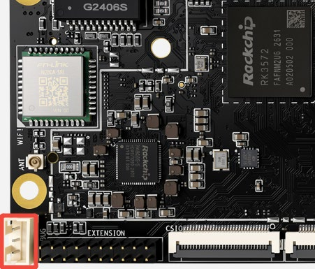
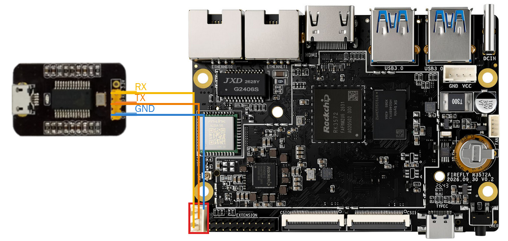
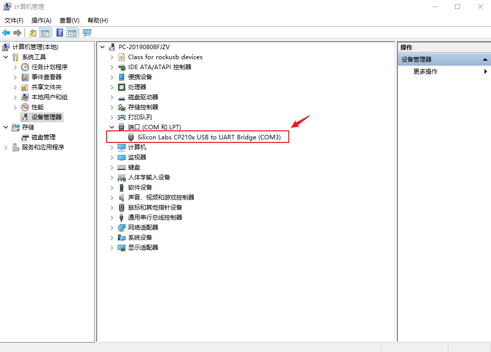

# Debug Usage

If you are doing U-Boot or kernel development, the USB serial adapter (short for USB to serial TTL adapter) is very useful for checking the system startup log, especially when there is no graphical desktop display.

## Hardware Connection [step]

Firefly-R3572A provides an on-board Debug UART (J3, 3Pin-2mm pitch wafer socket) using the m0 pin multiplexing of the UART0 controller, with the following pin definition:

| NO. | Definition | Power/V |
| --- | --- | --- |
| 1 | UART0_RXD | 3.3 |
| 2 | UART0_TXD | 3.3 |
| 3 | GND |  |

Connect the pins of the USB to TTL serial adapter to the Debug UART as follows:

* Adapter 3.3 V power pin (NC): leave unconnected
* Adapter GND: connect to GND of J3
* Adapter TXD: connect to UART0_RXD of J3
* Adapter RXD: connect to UART0_TXD of J3

<Callout title="Note" type="warn">

1. The Debug UART level is 3.3 V. Do not connect a 5 V-level adapter, otherwise the board may be damaged.
2. If TX and RX cannot input or output, try swapping the TX and RX connections.

</Callout>

The location of J3 on the board is marked with a red rectangle below:

<center>


</center>

Firefly-R3572A serial port connection diagram:

<center>



</center>

## Serial Parameters [step]

Firefly-R3572A uses the following serial parameters:

* Baud rate: 1500000
* Data bit: 8
* Stop bit: 1
* Parity check: none
* Flow control: none

## Using Serial Debug [step]

<CodeBlockTabs defaultValue="Windows">
  <CodeBlockTabsList>
    <CodeBlockTabsTrigger value="Windows">Windows</CodeBlockTabsTrigger>
    <CodeBlockTabsTrigger value="Ubuntu">Ubuntu</CodeBlockTabsTrigger>
  </CodeBlockTabsList>

  <CodeBlockTab value="Windows">

    ### Install Driver

    Download driver and install:

    - [CH340](https://www.wch.cn/downloads/CH341SER_EXE.html)
    - [PL2303](https://www.prolific.com.tw/en/portfolio-item/pl2303gl/)
    - [CP210X](https://www.silabs.com/software-and-tools/usb-to-uart-bridge-vcp-drivers)

    After the adapter is inserted, the system will prompt for the discovery of new hardware and initialization, and then the corresponding COM port can be found in the device manager:

    <center>

    
    </center>

    ### Install Software

    Putty or SecureCRT is generally used on Windows; the free version of MobaXterm is recommended. It is a powerful terminal software, and its usage is similar to the tools above.

    [Download MobaXterm](https://mobaxterm.mobatek.net/):

    1. Select `session` as `Serial`.
    2. Modify `Serial port` to the COM port found in the device manager.
    3. Set `Speed (bsp)` to 1500000.
    4. Click `OK` button.

    <center>

    
    </center>

    <center>

    
    </center>

  </CodeBlockTab>

  <CodeBlockTab value="Ubuntu">

    There are many options available on Ubuntu:

    - minicom
    - picocom
    - kermit

    The following shows how to use minicom.

    ### Install minicom

    ```bash
    sudo apt-get install minicom
    ```

    After connecting the serial port line, check the serial port device file. The following example is `/dev/ttyUSB0`:

    ```console
    $ ls /dev/ttyUSB*
    /dev/ttyUSB0
    ```

    Run:

    ```console
    $ sudo minicom
    Welcome to minicom 2.7
    OPTIONS: I18n
    Compiled on Jan  1 2014, 17:13:19.
    Port /dev/ttyUSB0, 15:57:00
    Press CTRL-A Z for help on special keys
    ```

    Based on the above tips: Press `Ctrl-a` and then press `Z` again to bring up the help menu.

    Press `O` to enter the setting interface, select `Serial port setup`, then enter the letter prompted earlier, and set it as follows:

    ```text
       E -    Bps/Par/Bits       : 1500000 8N1
       F - Hardware Flow Control : No
       G - Software Flow Control : No
    ```

    <Callout title="Note" type="warn">

    `Hardware Flow Control` and `Software Flow Control` should be set to `No`, otherwise you may not be able to input.

    </Callout>

    After finishing the setting, go back to the previous menu and select `Save setup as dfl` to save as the default configuration, which will be used by default later.

  </CodeBlockTab>
</CodeBlockTabs>