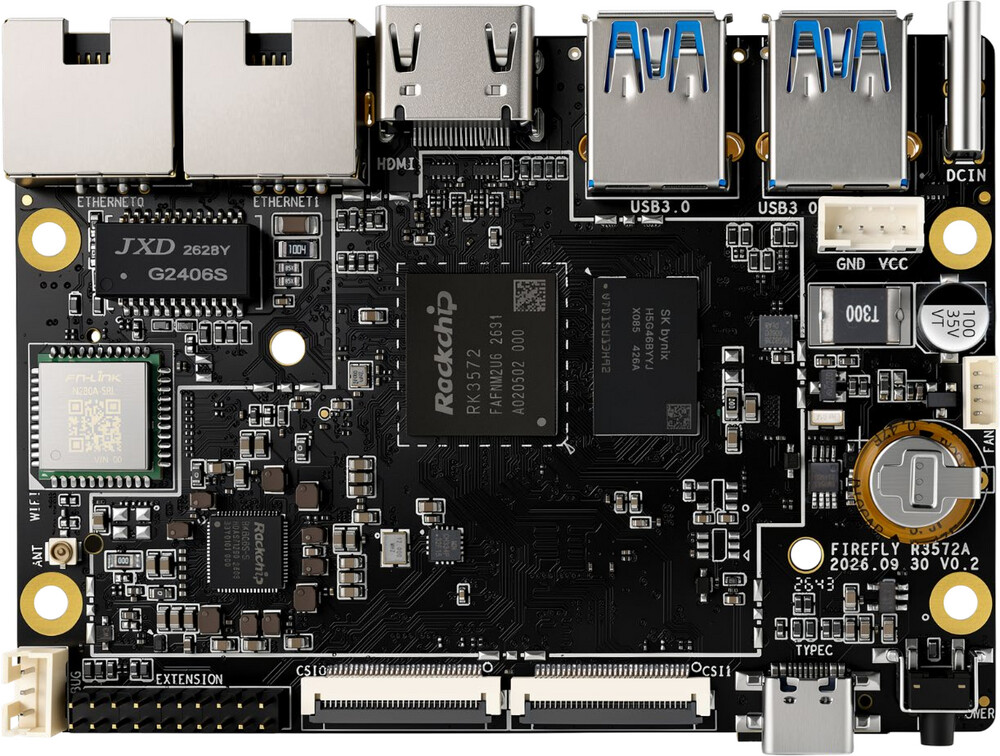
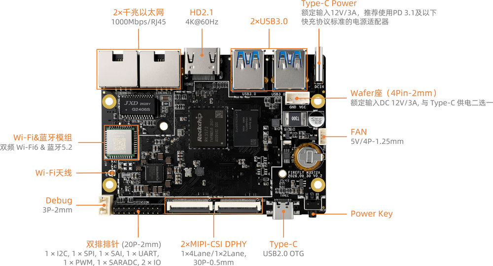
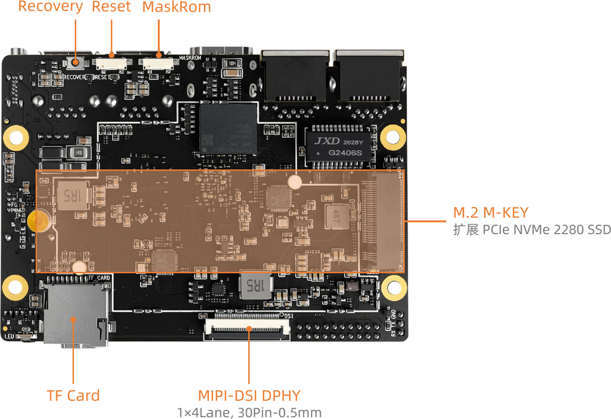
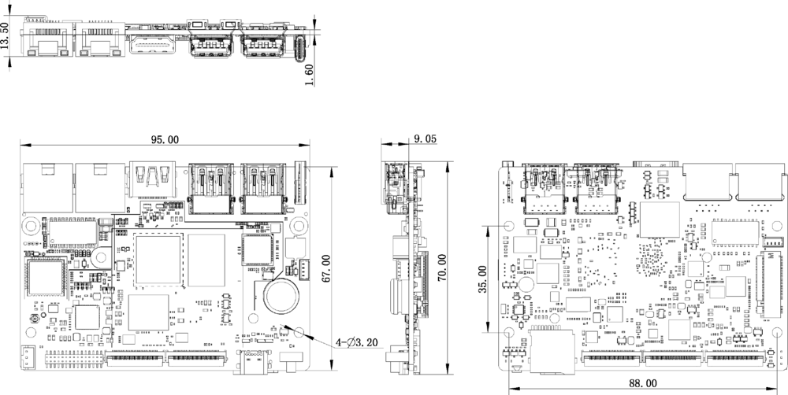

[Specification](https://download.t-firefly.com/Spec/Mainboards/Firefly%20R3572A_Specification_EN.pdf)

# Introduction

**Firefly-R3572A** is an open-source motherboard powered by the Rockchip RK3572 octa-core 64-bit AIoT processor (2 × Cortex-A73 + 6 × Cortex-A53, up to 2.2 GHz) built on an advanced 8nm process, delivering excellent low-power performance.

The board integrates an ARM Mali G310 GPU and a 4 TOPS (Sparse INT8) NPU, supports private deployment of large-parameter Transformer-based LLMs, and is compatible with multiple deep-learning frameworks, custom operator development and Docker container-based management. The motherboard adopts an SBC (Single-Board Computer) all-in-one design with compact dimensions of only 95 mm × 70 mm, which can be easily embedded into various end devices. It is widely applicable to edge computing, AI cameras, intelligent monitoring, NAS, retail devices, digital signage and other scenarios.

## Standard Kit

The standard kit of **Firefly-R3572A** contains the following accessories (for reference only):

* Firefly-R3572A motherboard × 1
* 12V/3A power adapter × 1
* Type-C data cable × 1

Optional accessories:

* Firefly serial module

In addition, the following accessories may be required during use:

* Display device
  * HD monitor or TV with HD cable
* Network
  * 1000M Ethernet cable and wired router
  * Wi-Fi router
* Input device
  * USB wireless/wired mouse and keyboard
* Firmware upgrade, debugging
  * Type-C data cable
  * USB to serial adapter

## Interface Description

**Firefly-R3572A** provides rich expansion interfaces, including:

* 2 × RJ45 (1000 Mbps Gigabit Ethernet)
* 1 × HD2.1 (up to 4K@60Hz output)
* 1 × MIPI DSI DPHY 1.2 (1×4 Lanes, 30Pin-0.5mm)
* 2 × MIPI CSI DPHY (1×4 Lanes or 1×2 Lanes, 30Pin-0.5mm)
* 2 × USB3.0
* 1 × Type-C (USB2.0 OTG)
* 1 × M.2 M-KEY (supports PCIe NVMe 2280 SSD)
* 1 × TF Card
* 1 × Double-row pin header (20Pin-2mm, breakout: I2C, SPI, SAI, UART, PWM, SARADC, IO)
* 1 × Debug (3Pin-2mm)
* 1 × FAN (4Pin-1.25mm)
* On-board Wi-Fi & Bluetooth module (dual-band Wi-Fi 6 & Bluetooth 5.2)

The details are shown below:

## Dimension

## Resources and Support

* [Technical Forum](https://forum.t-firefly.com/): A communication platform with more than 100,000 enterprise customers and users

### Contact

* Email: sales@t-firefly.com
* Mobile: (+86) 186 8811 7175
* Landline: 0760-89881218
* Address: Room 2101, Hongyu Building, No. 57 Zhongshan 4th Road, East District, Zhongshan City, Guangdong Province