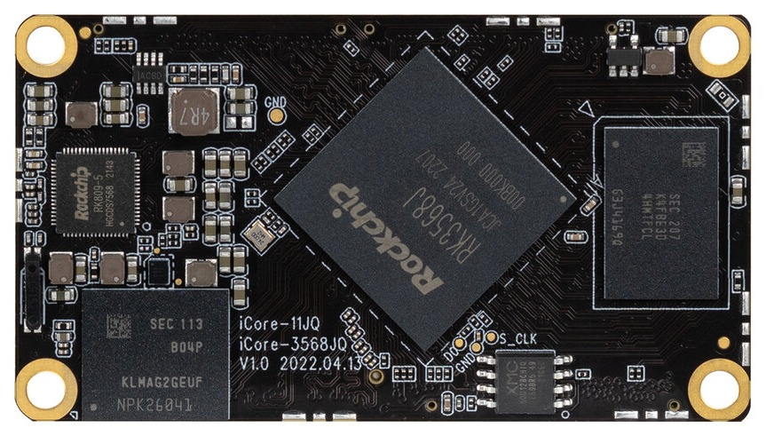
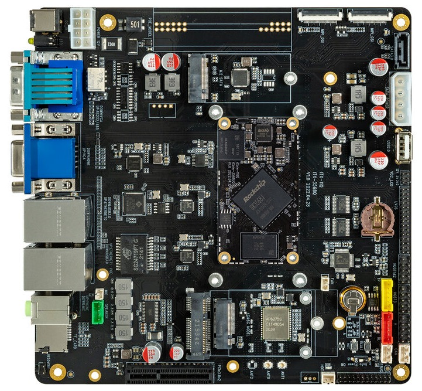
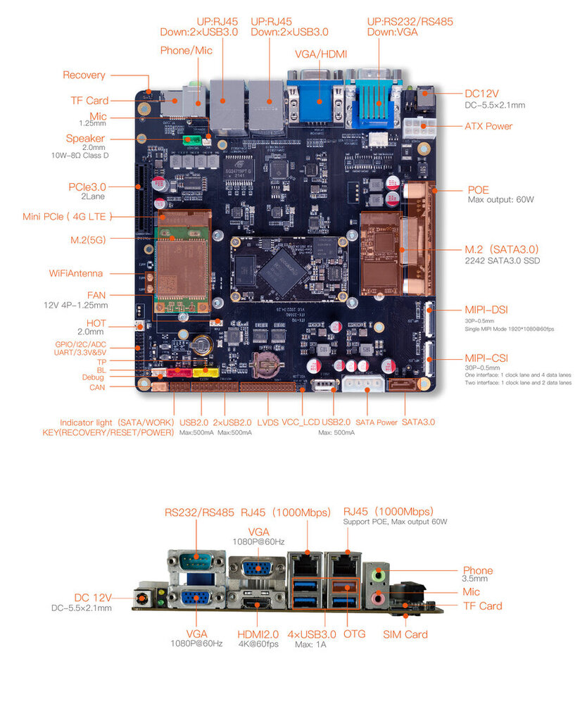

# Introduction

[Specification](https://download.t-firefly.com/%E4%BA%A7%E5%93%81%E8%A7%84%E6%A0%BC%E6%96%87%E6%A1%A3/%E6%A0%B8%E5%BF%83%E6%9D%BF/iCore-3568Q%20Specification.pdf) | [Downloads](https://community.t-firefly.com/en/doc/download/163)

[iCore-3568JQ]() Onboard RK3568J quad-core 64-bit industrial grade processor, supporting 8GB large memory; Support WiFi6, 5G/4G and other high-speed wireless network communication; BTB interface is adopted, with stronger transmission capacity; Industrial-grade stability, stable operation at -40°C to 85°C for a long time; Provide motherboard reference design materials, users can customize independently

[ITX-3568Q]() is composed of core board iCore-3568JQ and baseboard, standard ITX motherboard size, standard interface specification, can be adapted to general ITX computer case. Provide rich expansion interface, so that users can have more imagination space when creating

## Interface Description

ITX-3568Q provides a wealth of interfaces, mainly including:

- 12V power supply interface
- 4 x USB3.0 (OTG x1, HOST x3)
- 4 x USB2.0 (port x1, socket x3)
- HDMI
- VGA
- MIPI screen interface
- LVDS screen interface
- Ethernet
- MIC interface
- 3.5mm Phone Jack
- TF card slot
- SIM card slot
- SATA 3.0 interface
- Fan interface
- Speaker interface
- Power key (socket)
- Reset key
- Recovery key
- Debug serial
- Industrial serial port (RS485, RS232, TTL)
- Expansion port (ADC, I2C, GPIO)
- MIPI camera interface
- MINI-PCIE (4G LTE)
- M.2 (5G LTE)
- PCIe 3.0 interface
- M.2 SATA 3.0 interface
- CAN/CANFD

The interface layout is shown below:

## Resources and Support

- [Technical Forum](https://forum.t-firefly.com/): A communication platform with more than 100,000 enterprise customers and users

### Contact

- Email: sales@t-firefly.com
- Mobile: (+86) 186 8811 7175
- Landline: 0760-89881218
- Address: Room 2101, Hongyu Building, No. 57 Zhongshan 4th Road, East District, Zhongshan City, Guangdong Province
