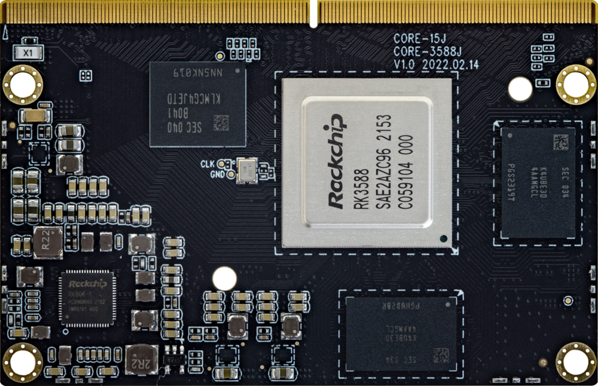
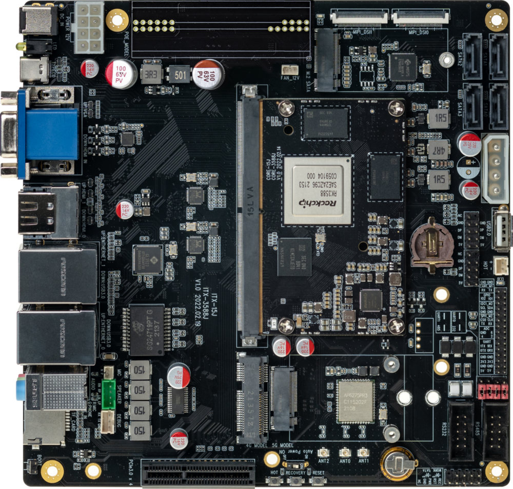
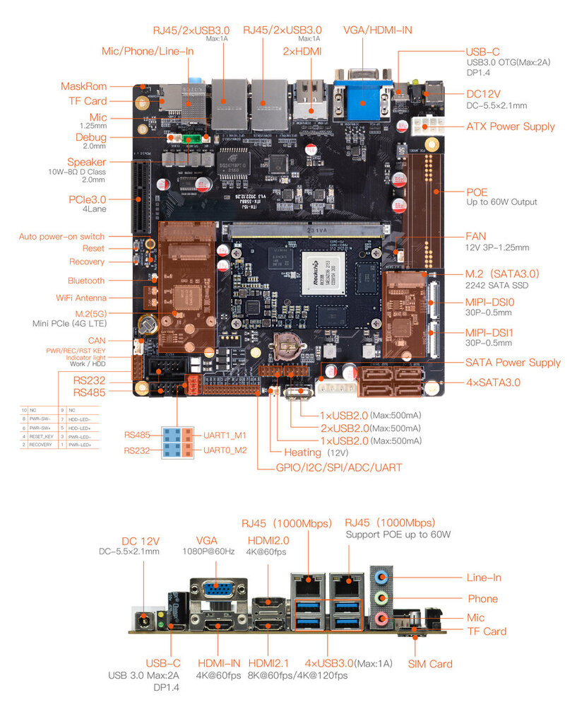
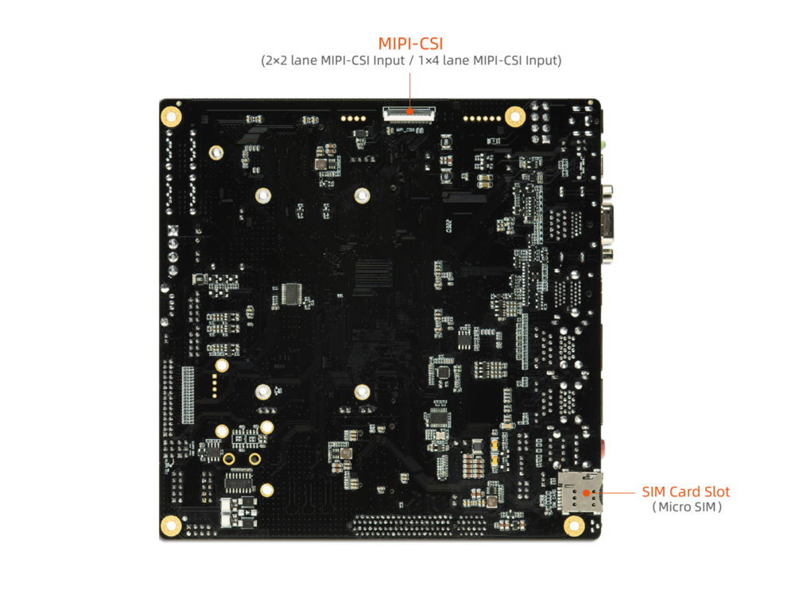

[Specification](https://download.t-firefly.com/%E4%BA%A7%E5%93%81%E8%A7%84%E6%A0%BC%E6%96%87%E6%A1%A3/%E8%A1%8C%E4%B8%9A%E4%B8%BB%E6%9D%BF/ITX-3588J%20-%20Specification.pdf) | [Purchase](https://www.firefly.store/products/core-3588j-8k-ai-core-board-rockchip-rk3588-new-gen-8-core-64-bit-processor) | [Downloads](https://community.t-firefly.com/en/doc/download/161)

# Introduction

Based on Rockchip new generation of flagship AIOT chip -- RK3588, the
[Core-3588J](https://item.taobao.com/item.htm?id=670519903322) features an 8nm LP process and an 8-core (Cortex-A76x4+
Cortex-A55x4) 64-bit CPU with up to 2.4 GHz.

Integrated ARM Mali-G610MP4 quad-core GPU, built-in AI accelerator NPU,
can provide 6Tops computing power, support the mains, support up to 32 GB of memory, support WiFi 6,5G/4G and other
high-speed wireless network communication, support 8K video codec and
multiple formats of video input and output, support multiple operating
systems can be applied to ARM PC, edge computing, cloud server,
intelligent NVR and other fields.

  

The [ITX-3588J](https://item.taobao.com/item.htm?id=670519903322) development board consists of the core board **Core-3588J** + **MB-JM3-
RK3588ITX**. ITX-3588J
has rich interfaces such as RGMII, SATA3.0, CAN, PCIE3.0, USB3.0, I2C,
SPI, UART, GPIO, MIPI-DSI, and MIPI-CSI, provide multiple power supply
modes. It can be directly applied to various intelligent products to
accelerate product implementation. For details, refer to ["interface
definition"](../interface_definition.md).

### The ITX-3588J standard kit contains the following accessories (for reference only): 

-   Core-3588J Core Board x 1
-   12V/7A power adapter x 1
-   MB-JM3-RK3588ITX  x 1
-   Copper tube antenna x 2
-   Type-C data cable x 1

Optional accessories include:

-   Serial port module of Firefly

In addition, you may need the following accessories during use:

-   Display device
    -   Monitor or TV with HDMI connector and HDMI cable
-   Network
    -   100M/1000M Ethernet cable and wired router
    -   WiFi router
-   Input device
    -   USB wireless/wired mouse/keyboard
-   Upgrade firmware, debug
    -   Type-C data cable
    -   Serial to USB adapter 
## Interface Description

**ITX-3588J  V1.3** provides rich interfaces, including:

* 1 x HDMI2.1 (Max output support 8K@60Hz)
* 1 x HDMI2.0
* 1 x HDMIIN2.0 (Max input support 4K@60Hz)
* 1 x Display Port1.4 (Max output support 8K@30Hz)
* 1 x USB3.0 OTG(Type-C)
* 1 x VGA
* 2 x MIPI-DSI
* 1 x MIPI-CSI
* 4 x SATA3.0
* 1 x M.2(SATA3.0)
* 1 x PCIe3.0x4
* 1 x TF Card
* 1 x 4G LTE
* 1 x 5G Mobile Network
* 1 x SIM 卡槽
* 4 x USB3.0
* 4 x USB2.0
* 1 x WIFI (Support wifi6）)
* 1 x Bluetooth
* 1 x FAN (V1.1 version and subsequent versions is 4 PIN, controlled by PWM, ADC detection access)
* 2 x RJ45 (Suport 1Gbps)
* 1 x Speaker
* 1 x Line-In
* 1 x RS485
* 1 x RS232
* 1 x CAN (V1.1 version added, H and L markings reversed, and screen printing correct for V1.2 and subsequent versions)
* Multiple power input interfaces

The details are shown below：

[ITX-3588J  old version interface definition](../interface_definition_old.md)

## Resources and Support

* [[Technical Forum]](https://forum.t-firefly.com/): A communication platform with more than 100,000 enterprise customers and users

### Contact

* Email: sales@t-firefly.com
* Mobile: (+86) 186 8811 7175
* Landline: 0760-89881218
* Address: Room 2101, Hongyu Building, No. 57 Zhongshan 4th Road, East District, Zhongshan City, Guangdong Province