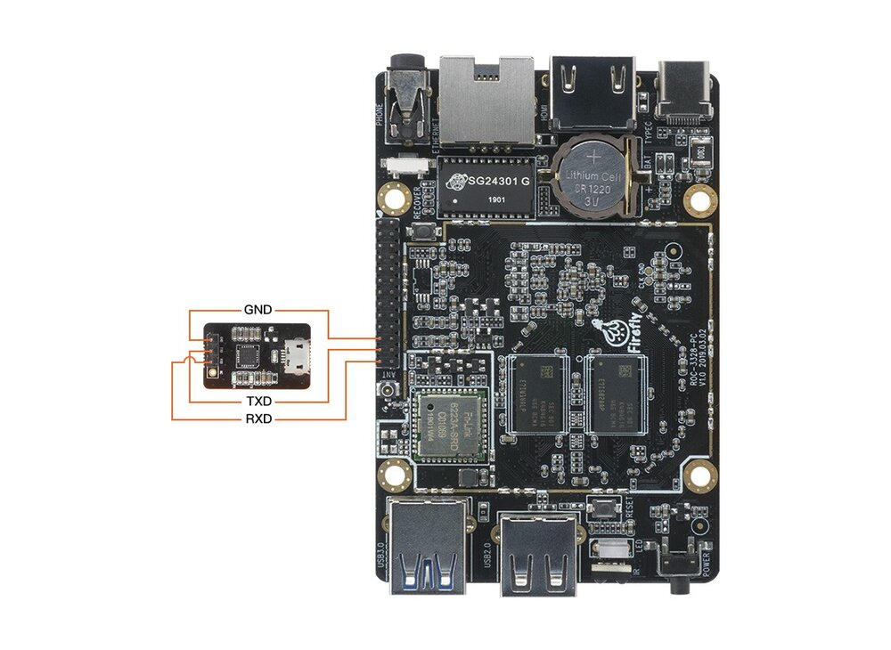
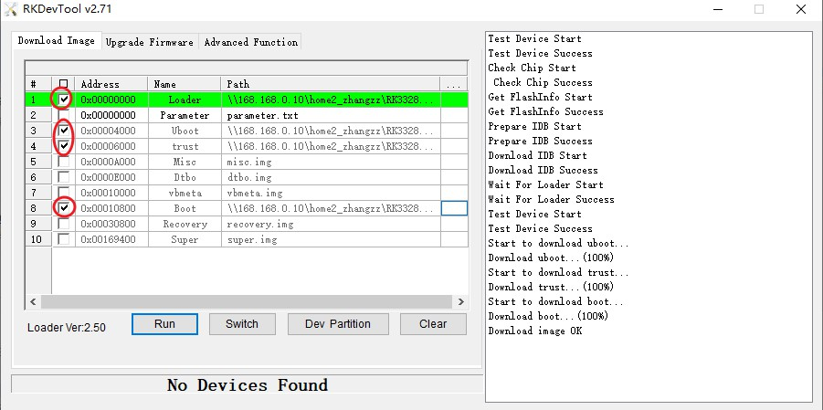

# Debug Usage

If you are doing U-Boot or kernel development, the USB serial adapter (short for USB to serial TTL adapter) is very useful for checking the system startup log, especially when there is no graphical desktop display.

## Hardware Connection [step]

<Callout title="Note" type="warn">

Since the UART2 used for serial port debugging is multiplexed with the serial port used by Bluetooth, the officially released firmware of ROC-RK3328-PC cannot be debugged using the serial port directly. If you use the serial port debugging, Bluetooth will not work properly. Please follow the instructions in "Configure Serial Debugging" below to modify the firmware.

</Callout>

Serial port to USB adapter, there are four pins:

- 3.3V Power, no need to connect.
- GND, Ground, connect to GND pin of the board.
- TXD, Transmit, connect to TX pin of the board.
- RXD, Receive, connect to RX pin of the board.

<Callout title="Note" type="warn">

If you encounter the problem that TX and RX cannot input and output when using other serial adapters, you can try to exchange TX and RX connections.

</Callout>

ROC-RK3328-PC serial port connection diagram:

<center>



</center>

### Configure Serial Debugging

#### Linux Firmware

Before configuring the serial port debugging, you first need to [Compile Linux Firmware], and then modify the following.

Open the configuration file `kernel/arch/arm64/boot/dts/rockchip/rk3328-roc-pc.dts`.

Related configuration nodes for serial port debugging:

```
fiq-debugger {
	status = "disabled";
};
...
&uart2 {
	dma-names = "tx", "rx";
	status = "okay";
};
```

Change into:

```
fiq-debugger {
	status = "okay";
};
...
&uart2 {
	dma-names = "tx", "rx";
	status = "disabled";
};
```

Compile the kernel and then upgrade the firmware.

#### Android 7.1 Firmware

Before configuring the serial port debugging, you first need to [Compile Android Firmware], and then modify the following.

Open the configuration file `kernel/arch/arm64/boot/dts/rk3328-roc-pc-port.dtsi`.

Related configuration nodes for serial port debugging:

```
fiq-debugger {
	status = "disabled";
};
...
&uart_dbg {
	status = "okay";
	dma-names = "tx","rx";
};
```

Change into:

```
fiq-debugger {
	status = "okay";
};
...
&uart_dbg {
	status = "disabled";
	dma-names = "tx","rx";
};
```

Compile the kernel and then upgrade the firmware.

#### Android 10.0 Firmware

U-Boot modification:

```
diff --git a/u-boot/configs/rk3328_defconfig b/u-boot/configs/rk3328_defconfig
index 9e9b7544c1..ae66c2b36d 100644
--- a/u-boot/configs/rk3328_defconfig
+++ b/u-boot/configs/rk3328_defconfig
@@ -19,7 +19,6 @@ CONFIG_FIT=y
 CONFIG_FIT_VERBOSE=y
 CONFIG_SPL_LOAD_FIT=y
 CONFIG_BOOTDELAY=0
-CONFIG_DISABLE_CONSOLE=y
 CONFIG_SYS_CONSOLE_INFO_QUIET=y
 # CONFIG_DISPLAY_CPUINFO is not set
 CONFIG_ANDROID_BOOTLOADER=y
```

```
cp rkbin/bin/rk33/rk3328_ddr_333MHz_v1.16_uart2_debug.bin rkbin/bin/rk33/rk3328_ddr_333MHz_v1.16.bin
cd u-boot
./make.sh rk3328
```

Kernel modification:

```
diff --git a/kernel/arch/arm64/boot/dts/rockchip/roc-rk3328-pc.dtsi b/kernel/arch/arm64/boot/dts/rockchip/roc-rk3328-pc.dtsi
index af29607..d5b9a86 100644
--- a/kernel/arch/arm64/boot/dts/rockchip/roc-rk3328-pc.dtsi
+++ b/kernel/arch/arm64/boot/dts/rockchip/roc-rk3328-pc.dtsi
@@ -176,7 +176,7 @@

 #define UART2_BLUETOOTH 0
 #define UART2_DEBUG 1
-#define UART2_FUNCTION UART2_BLUETOOTH
+#define UART2_FUNCTION UART2_DEBUG
```

```
cd kernel
make ARCH=arm64 BOOT_IMG=../rockdev/Image-roc_rk3328_pc_32/boot.img roc-rk3328-pc.img -j24
```

Finally, update **rk3328_loader_v1.16.250.bin**, **uboot.img** and **trust.img** from the uboot directory, and **boot.img** from the kernel directory:

<center>



</center>

In addition, when the debug serial port output is configured, there will be a lot of Bluetooth printing:

```
[  178.375793] init: Service 'vendor.bluetooth-1-0' (pid 5490) received signal 11
[  178.375865] init: Sending signal 9 to service 'vendor.bluetooth-1-0' (pid 5490) process group...
[  178.376177] libprocessgroup: Successfully killed process cgroup uid 1002 pid 5490 in 0ms
[  178.376448] init: updatable process 'vendor.bluetooth-1-0' exited 4 times in 4 minutes
[  178.376699] init: Init cannot set 'ro.init.updatable_crashing_process_name' to 'vendor.bluetooth-1-0': Read-only property was already set
[  178.376839] init: Init cannot set 'ro.init.updatable_crashing' to '1': Read-only property was already set
[  178.377832] binder: release 5490:5490 transaction 55248 in, still active
[  178.377853] binder: send failed reply for transaction 55248 to 5573:5612
[  178.950182] audit: audit_lost=511 audit_rate_limit=5 audit_backlog_limit=64
[  178.950212] audit: rate limit exceeded
[  180.540002] binder: undelivered death notification, 00000000d4b533c0
[  181.805281] audit: audit_lost=515 audit_rate_limit=5 audit_backlog_limit=64
[  181.805305] audit: rate limit exceeded
```

If you think the printing is too complicated, you can directly turn off the Bluetooth function, and then compile the Android upper layer.

Android upper layer modification:

```
--- a/device/rockchip/common/BoardConfig.mk
+++ b/device/rockchip/common/BoardConfig.mk
@@ -402,8 +402,8 @@ BOARD_TEMPERATURE_SENSOR_SUPPORT ?= false
 BOARD_USB_HOST_SUPPORT ?= false
 BOARD_USB_ACCESSORY_SUPPORT ?= true
 BOARD_CAMERA_SUPPORT ?= false
-BOARD_BLUETOOTH_SUPPORT ?= true
-BOARD_BLUETOOTH_LE_SUPPORT ?= true
+BOARD_BLUETOOTH_SUPPORT ?= false
+BOARD_BLUETOOTH_LE_SUPPORT ?= false
```

```
./FFTools/make.sh -a -j8
```

Finally update **super.img**.


## Serial Parameters [step]

ROC-RK3328-PC uses the following serial parameters:

- Baud rate: 1500000
- Data bit: 8
- Stop bit: 1
- Parity check: none
- Flow control: none

## Using Serial Debug [step]

<CodeBlockTabs defaultValue="Windows">
  <CodeBlockTabsList>
    <CodeBlockTabsTrigger value="Windows">Windows</CodeBlockTabsTrigger>
    <CodeBlockTabsTrigger value="Ubuntu">Ubuntu</CodeBlockTabsTrigger>
  </CodeBlockTabsList>

  <CodeBlockTab value="Windows">

    ### Install Driver

    Download driver and install:

    - [CH340](https://www.wch.cn/downloads/CH341SER_EXE.html)
    - [PL2303](https://www.prolific.com.tw/en/portfolio-item/pl2303gl/)
    - [CP210X](https://www.silabs.com/software-and-tools/usb-to-uart-bridge-vcp-drivers)

    After the adapter is inserted, the system will prompt for the discovery of new hardware and initialization, and then the corresponding COM port can be found in the device manager:

    <center>

    
    </center>

    ### Install Software

    Putty or SecureCRT is generally used on Windows; the free version of MobaXterm is recommended. It is a powerful terminal software, and its usage is similar to the tools above.

    [Download MobaXterm](https://mobaxterm.mobatek.net/):

    1. Select `session` as `Serial`.
    2. Modify `Serial port` to the COM port found in the device manager.
    3. Set `Speed (bsp)` to 1500000.
    4. Click `OK` button.

    <center>

    
    </center>

    <center>

    
    </center>

  </CodeBlockTab>

  <CodeBlockTab value="Ubuntu">

    There are many options available on Ubuntu:

    - minicom
    - picocom
    - kermit

    The following shows how to use minicom.

    ### Install minicom

    ```bash
    sudo apt-get install minicom
    ```

    After connecting the serial port line, check the serial port device file. The following example is `/dev/ttyUSB0`:

    ```console
    $ ls /dev/ttyUSB*
    /dev/ttyUSB0
    ```

    Run:

    ```console
    $ sudo minicom
    Welcome to minicom 2.7
    OPTIONS: I18n
    Compiled on Jan  1 2014, 17:13:19.
    Port /dev/ttyUSB0, 15:57:00
    Press CTRL-A Z for help on special keys
    ```

    Based on the above tips: Press `Ctrl-a` and then press `Z` again to bring up the help menu.

    Press `O` to enter the setting interface, select `Serial port setup`, then enter the letter prompted earlier, and set it as follows:

    ```text
       E -    Bps/Par/Bits       : 1500000 8N1
       F - Hardware Flow Control : No
       G - Software Flow Control : No
    ```

    <Callout title="Note" type="warn">

    `Hardware Flow Control` and `Software Flow Control` should be set to `No`, otherwise you may not be able to input.

    </Callout>

    After finishing the setting, go back to the previous menu and select `Save setup as dfl` to save as the default configuration, which will be used by default later.

  </CodeBlockTab>
</CodeBlockTabs>
