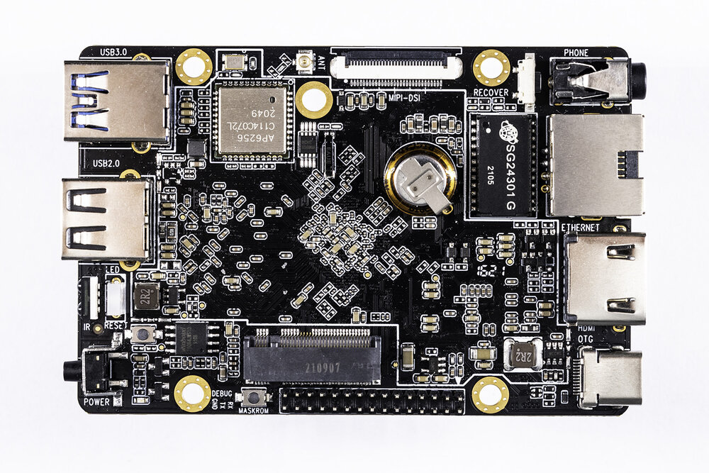
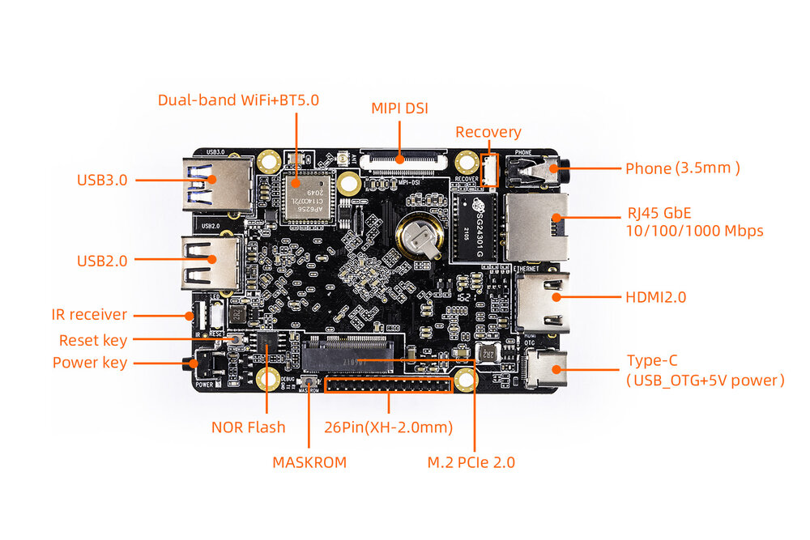
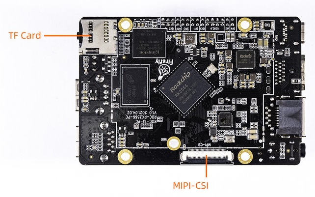

# Introduction

[Specification](https://download.t-firefly.com/%E4%BA%A7%E5%93%81%E8%A7%84%E6%A0%BC%E6%96%87%E6%A1%A3/%E5%BC%80%E6%BA%90%E4%B8%BB%E6%9D%BF/ROC-RK3566-PC%20Specification.pdf) | [Purchase](https://www.firefly.store/products/roc-rk3566-pc-quad-core-64-bit-mini-computer-1) | [Downloads](https://community.t-firefly.com/en/doc/download/106)

ROC-RK3566-PC is a phone sized mini PC board, equipped with Rockchip quad-core processor RK3566 which is configured with dual-core GPU and high-performance NPU, supporting up to 8G RAM. It supports onboard M.2, WiFi 2.4G/5G and 4G mobile network. Providing various interfaces, the mainboard is suitable for scenarios such as smart NVR, cloud terminal, IoT gateway and industrial control.

## Interface Description

ROC-RK3566-PC provides a wealth of interfaces, mainly including:

- 1 x USB3.0 (host)
- 1 x USB2.0 (host)
- 1 x HDMI
- 1 x MIPI DSI
- 1 x 1G Ethernet interface
- 1 x 2.4/5G WiFi
- 1 x 3.5mm Phone Jack
- 1 x Type-C (PD) power interface
- 1 x IR interface
- 1 x TF card slot
- 1 x Power key
- 1 x Reset key
- 1 x Recovery key
- 1 x Debug serial
- 1 x NOR flash
- 1 x MIPI CSI

The interface layout is shown below (front/back):

## Resources and Support

- [[Technical Forum]](https://forum.t-firefly.com/): A communication platform with more than 100,000 enterprise customers and users

### Contact

- Email: sales@t-firefly.com
- Mobile: (+86) 186 8811 7175
- Landline: 0760-89881218
- Address: Room 2101, Hongyu Building, No. 57 Zhongshan 4th Road, East District, Zhongshan City, Guangdong Province
