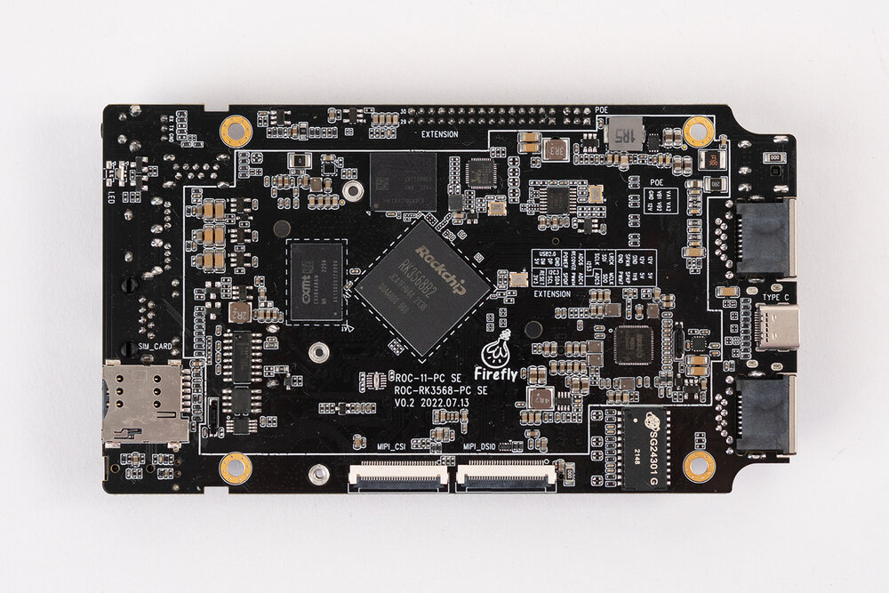
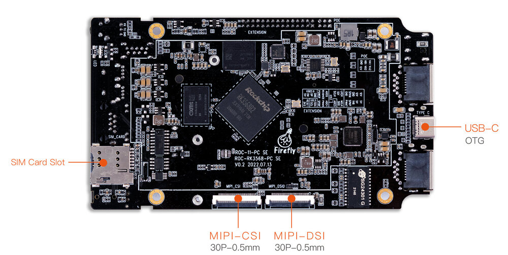
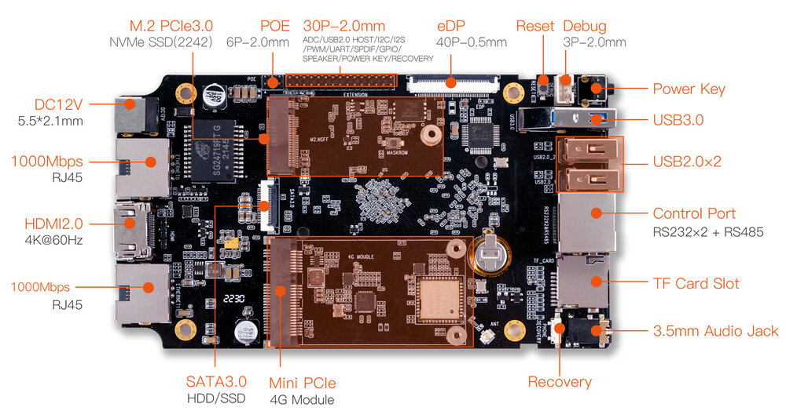

# Introduction

[Specification](https://download.t-firefly.com/Spec/Mainboards/ROC-RK3568-PC%20SE_Specification_EN.pdf) | [Purchase](https://www.firefly.store/products/roc-rk3568-pc-se-quad-core-64-bit-mini-computer) | [Downloads](https://community.t-firefly.com/en/doc/download/180)

ROC-RK3568-PC-SE uses the ROC-RK3568-PC-SE quad-core 64-bit Cortex-A55 processor, with 22nm lithography process and a frequency up to 2.0GHz, with dual-core GPU and high-performance NPU, supporting up to 8G RAM. It supports WiFi 6 and dual Gigabit Ethernet. With rich interface expansion and various video input/output interfaces, it is suitable for scenarios such as smart NVR, cloud terminal, IoT gateway and industrial control.

## Interface definition

### Interface definition of the whole machine

ROC-RK3568-PC-SE provides rich interfaces, including:

- Power interface
- 1 x Type-C (host/device)
- 1 x USB3.0 (host)
- 1 x USB2.0 (host)
- HDMI
- MIPI screen interface
- EDP screen interface
- Ethernet
- 3.5 mm headphone jack
- 12V power supply interface
- TF card slot
- SIM slot
- MINI-PCIE
- SATA 3.0 interface
- Speaker interface
- Power button
- Reset button
- Recovery button
- MaskRom button
- Debugging serial port
- Industrial serial port (RS485, RS232, TTL)
- MIPI camera interface
- M.2 PCIE3.0 interface

The details are as follows:

## Resources and Support

- [Technical Forum](https://forum.t-firefly.com/): A communication platform with more than 100,000 enterprise customers and users

### Contact

- Email: sales@t-firefly.com
- Mobile: (+86) 186 8811 7175
- Landline: 0760-89881218
- Address: Room 2101, Hongyu Building, No. 57 Zhongshan 4th Road, East District, Zhongshan City, Guangdong Province
