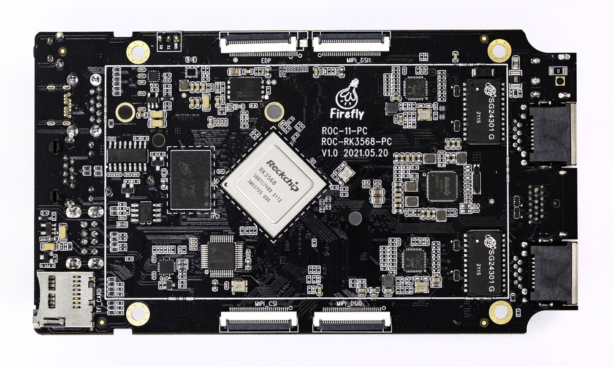
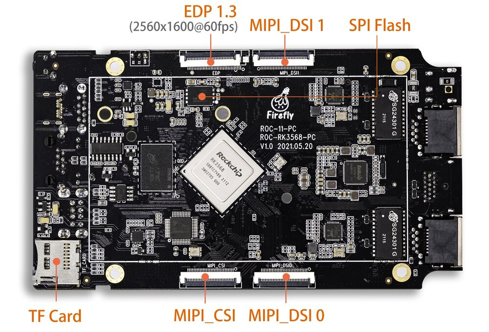
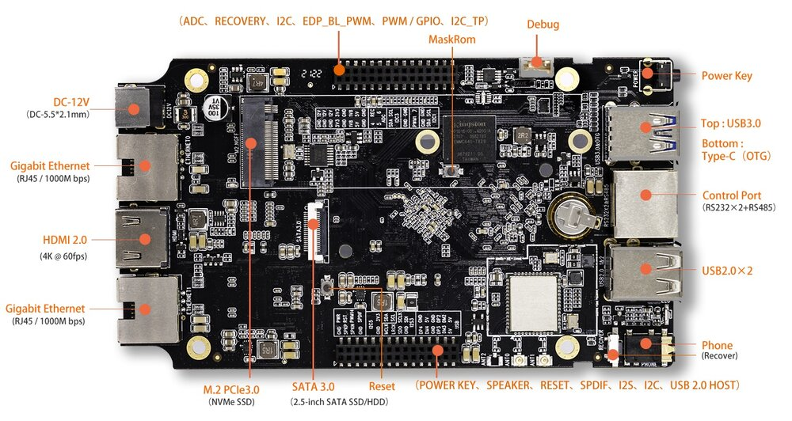

# Introduction

[Specification](https://download.t-firefly.com/%E4%BA%A7%E5%93%81%E8%A7%84%E6%A0%BC%E6%96%87%E6%A1%A3/%E5%BC%80%E6%BA%90%E4%B8%BB%E6%9D%BF/ROC-RK3568-PC%20Specification.pdf) | [Purchase](https://www.firefly.store/products/roc-rk3568-pc-quad-core-64-bit-mini-computer) | [Downloads](https://community.t-firefly.com/en/doc/download/107)

[ROC-RK3568-PC](https://www.firefly.store/products/roc-rk3568-pc-quad-core-64-bit-mini-computer) uses RK3568 quad-core 64-bit Cortex-A55 processor, with 22nm lithography process, has frequency up to 2.0GHz, with dual-core GPU and high-performance NPU, supporting up to 8G RAM. It supports WiFi 6, Dual 1000M ethernets. Having different video input and output interfaces, it is suitable for scenarios such as smart NVR, cloud terminal, IoT gateway and industrial control
, is a Quad-Core High-Performance AI Mainboard, equipped with interfaces such as RGMII, PCIE3.0, USB3.0, I2C, SPI, UART, GPIO, MIPI-DSI, it can be directly used in various intelligent products to facilitate the completion of products.

## Interface Description

ROC-RK3568-PC provides a wealth of interfaces, mainly including:

- Power interface
- 1 x Type-C
- 1 x USB3.0
- 2 x USB2.0
- HDMI
- MIPI screen interface
- EDP screen interface
- Ethernet
- WiFi antenna
- Bluetooth antenna
- 3.5mm Phone Jack
- 12V power interface
- TF card slot
- SATA interface
- Power key
- Reset key
- Recovery key
- MaskRom key
- Debug serial
- Industrial serial port (RS485, RS232, TTL)
- MIPI camera interface
- M.2 PCIE 3.0 interface

The interface layout is shown below (front/back):

## Resources and Support

- [Technical Forum](https://forum.t-firefly.com/): A communication platform with more than 100,000 enterprise customers and users

### Contact

- Email: sales@t-firefly.com
- Mobile: (+86) 186 8811 7175
- Landline: 0760-89881218
- Address: Room 2101, Hongyu Building, No. 57 Zhongshan 4th Road, East District, Zhongshan City, Guangdong Province
