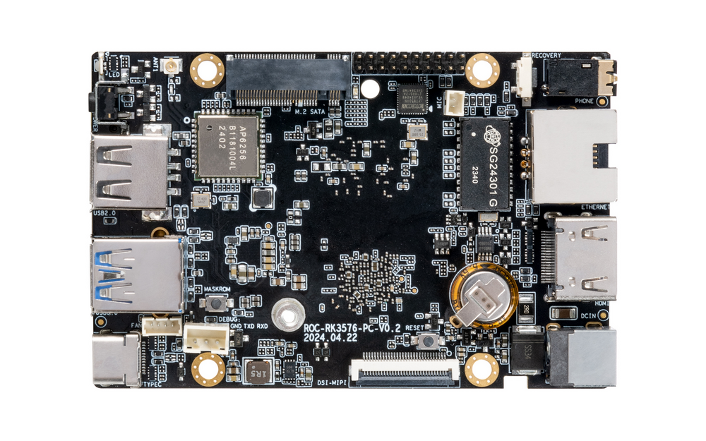
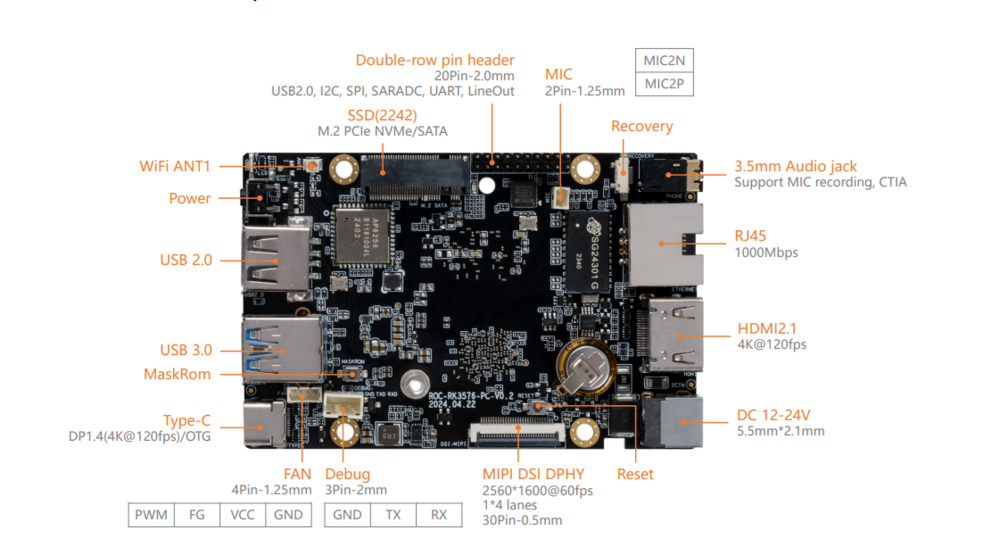
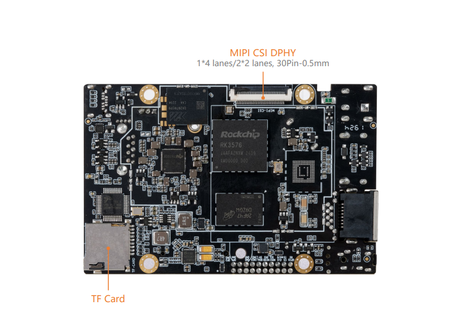

# Introduction

[Specification](https://download.t-firefly.com/%E4%BA%A7%E5%93%81%E8%A7%84%E6%A0%BC%E6%96%87%E6%A1%A3/%E5%BC%80%E6%BA%90%E4%B8%BB%E6%9D%BF/ROC-RK3576-PC_Low-power%20Large-model%20Mainboard_Product%20Introduction.pdf) | [Purchase](https://www.firefly.store/products/roc-rk3576-pc-octa-core-6t-aiot-mini-computer) | [Downloads](https://community.t-firefly.com/en/doc/download/254)

ROC-RK3576-PC is based on the Rockchip second-generation 8nm high-performance AIoT chip -RK3576, equipped with eight-core (Cortex-A72 x 4 + Cortex-A53 x 4) 64-bit CPU, the main frequency of up to 2.2GHz, It provides strong support for high performance computing and multi-task processing.

Built-in ARM Mali G52 MC3 GPU, integrated 6 TOPS computing power NPU, support the privatization of large-scale parameter model deployment under Transformer architecture, support a variety of deep learning frameworks, custom operator development, Docker containerization management technology. The external watchdog provides industrial stability and is widely applicable to local AI deployment scenarios.

  

## Interface Description

**ROC-RK3576-PC V1.1** provides rich interfaces, including:

* 1 x HDMI2.1 (Max output support 4K@120Hz)
* 1 x Display Port1.4 (Max output support 4K@120Hz)
* 1 x USB3.0 OTG(Type-C)
* 2 x MIPI-DSI
* 1 x MIPI-CSI
* 1 x SATA3.0 or PCIe2.0
* 1 x TF Card
* 1 x USB3.0
* 3 x USB2.0 (Two USB2.0 are led by a 20-pin pin row)
* 1 x WIFI
* 1 x Bluetooth
* 1 x FAN
* 2 x RJ45 (Suport 1Gbps)
* 1 × 3.5mm Headphone
* 1 × Mic（2P-1.25mm）

The details are shown below：

If your device is an earlier hardware version, its interface definition may differ from the above. For details, please refer to the [ROC-RK3576-PC old version interface definition](../interface_definition_old.md).

## Resources and Support

* [[Technical Forum]](https://forum.t-firefly.com/): A communication platform with more than 100,000 enterprise customers and users

### Contact

* Email: sales@t-firefly.com
* Mobile: (+86) 186 8811 7175
* Landline: 0760-89881218
* Address: Room 2101, Hongyu Building, No. 57 Zhongshan 4th Road, East District, Zhongshan City, Guangdong Province