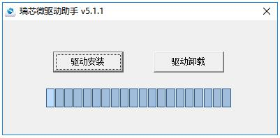
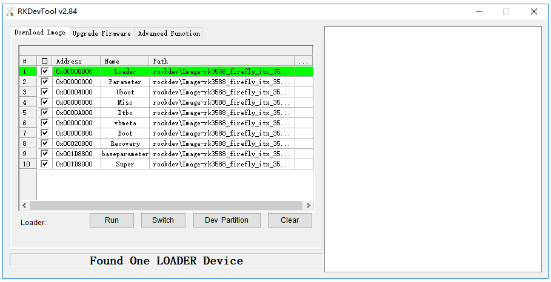
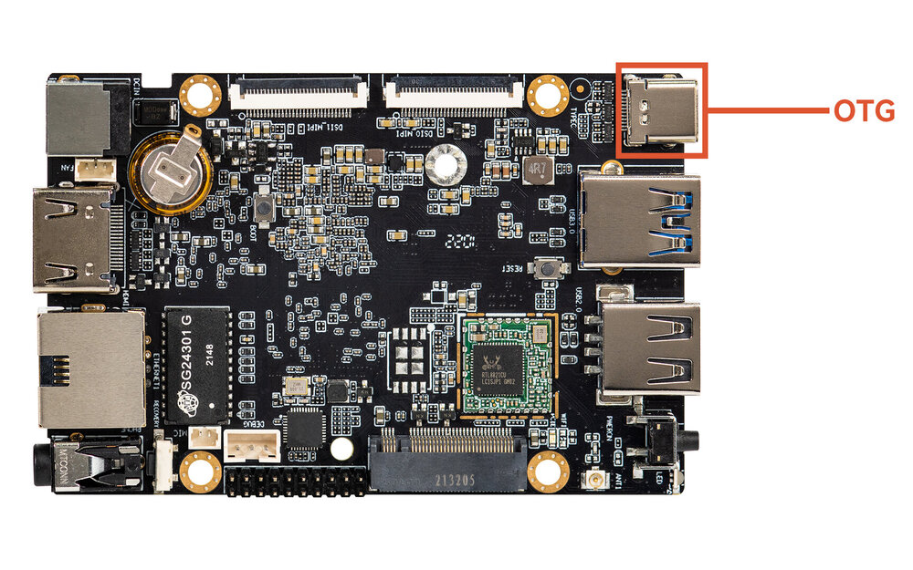
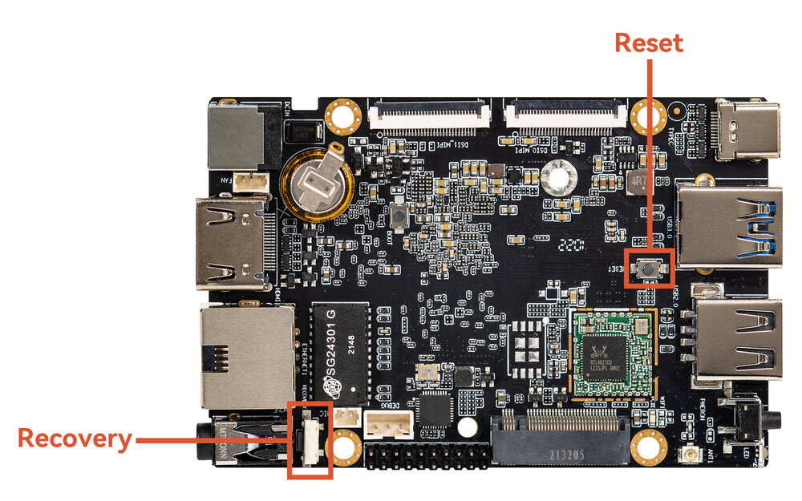
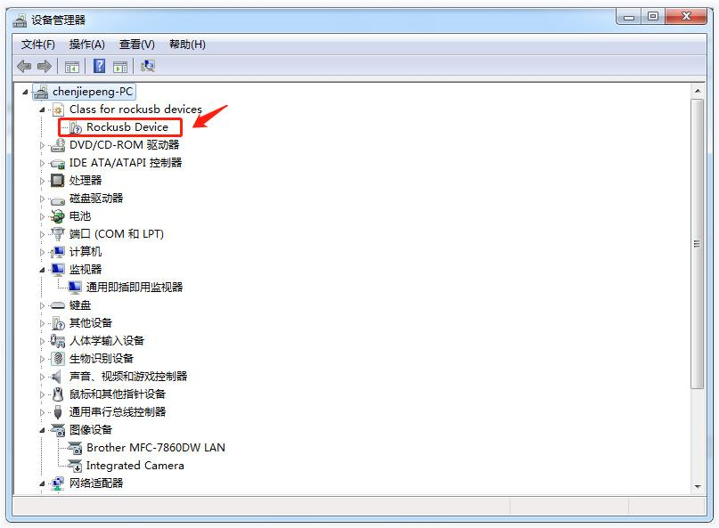
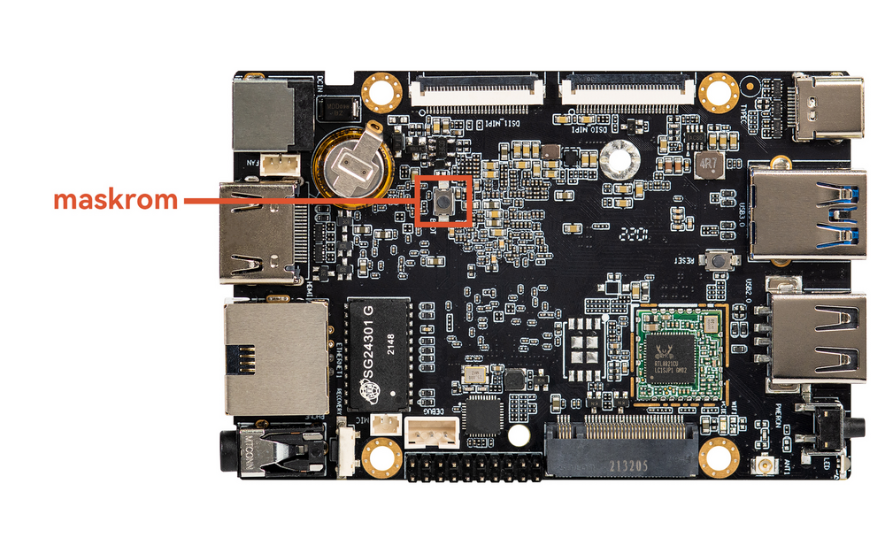
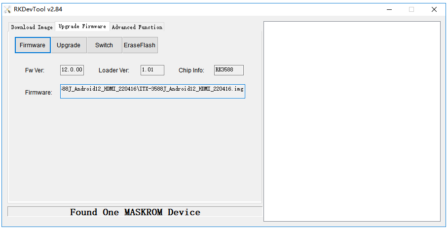
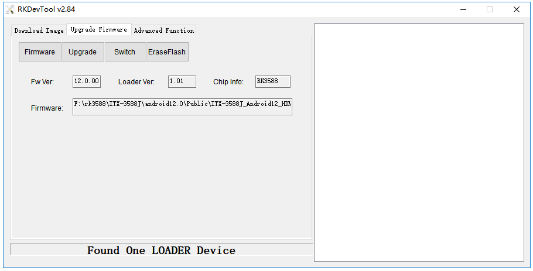

# USB Firmware Upgrade

## Introduction

This article describes how to upgrade the firmware file on the host to the flash memory of the development board through the Type-C data cable. When upgrading, you need to choose the appropriate upgrade mode according to the host operating system and firmware type.

## Preparatory Tools [step]

* ROC-RK3588S-PC development board
* [Firmware](https://community.t-firefly.com/en/doc/download/164)
* host computer
* Type-C data cable

## Prepare Firmware [step]

The firmware can be obtained by compiling the SDK, or you can download the public firmware (unified firmware) from the [Resource download](https://community.t-firefly.com/en/doc/download/164). There are two types of firmware files:

* A single unified firmware

	The unified firmware is a single file packaged and merged by all files such as the partition table, bootloader, uboot, kernel, system and so on. The firmware officially released by Firefly adopts a unified firmware format. Upgrading the unified firmware will update the data and partition table of all partitions on the motherboard, and erase all data on the motherboard.

* Multiple partition images

	That is, files with independent functions, such as partition table, bootloader, and kernel, are generated during the development phase. The independent partition image can only update the specified partition, while keeping other partition data from being destroyed, it will be very convenient to debug during the development process.

>    Through the unified firmware unpacking / packing tool, the unified firmware can be unpacked into multiple partition images, or multiple partition images can be merged into a unified firmware.

## Install the Upgrade Tool [step]
<CodeBlockTabs defaultValue="Windows">
  <CodeBlockTabsList>
    <CodeBlockTabsTrigger value="Windows">Windows</CodeBlockTabsTrigger>
    <CodeBlockTabsTrigger value="Linux">Linux</CodeBlockTabsTrigger>
  </CodeBlockTabsList>

  <CodeBlockTab value="Windows">
    ### Windows Operating System
    * Install RK USB driver

    Download [Release_DriverAssistant.zip](https://community.t-firefly.com/en/doc/download/164), extract, and then run the DriverInstall.exe inside .
    In order for all devices to use the updated driver, first select Driver uninstall(驱动卸载) and then select Driver install(驱动安装).

    <center>

    
    </center>

    * Run AndroidTool's RKDevTool.exe

    <Callout title="Note" type="warn">
      In order to avoid the burning problem caused by the download tool version, it is recommended to use the tool packaged inside the public firmware package for burning.
    </Callout>

    You can also download [AndroidTool](https://community.t-firefly.com/en/doc/download/164) separately, unzip it, and run `RKDevTool.exe` in the `RKDevTool_Release_v2.xx` directory (note that if you are running Windows 7/8, you need to right-click and select Run as administrator), as shown below:

    <center>

    
    </center>
  </CodeBlockTab>

  <CodeBlockTab value="Linux">
    ### Linux Operating System

    There is no need to install device driver under Linux.

    * [Linux_Upgrade_Tool](https://community.t-firefly.com/en/doc/download/164)

    Download [Linux_Upgrade_Tool](https://community.t-firefly.com/en/doc/download/164), And install it into the system as follows for easy invocation:

    ```
    unzip Linux_Upgrade_Tool_xxxx.zip
    cd Linux_UpgradeTool_xxxx
    sudo mv upgrade_tool /usr/local/bin
    sudo chown root:root /usr/local/bin/upgrade_tool
    sudo chmod a+x /usr/local/bin/upgrade_tool
    ```

    * [Linux_adb_fastboot](https://community.t-firefly.com/en/doc/download/164)

    Download [Linux_adb_fastboot](https://community.t-firefly.com/en/doc/download/164), And install it into the system as follows for easy invocation:

    ```
    sudo mv adb /usr/local/bin
    sudo chown root:root /usr/local/bin/adb
    sudo chmod a+x /usr/local/bin/adb
    ```

    ```
    sudo mv fastboot /usr/local/bin
    sudo chown root:root /usr/local/bin/fastboot
    sudo chmod a+x /usr/local/bin/fastboot
    ```
  </CodeBlockTab>
</CodeBlockTabs>

## Enter Upgrade mode [step]
Usually we upgrade firmware in two modes, namely `Loader` mode and `MaskRom` mode. Before we can write the firmware, we need to connect the device and put the board into upgradable mode.

<CodeBlockTabs defaultValue="loader">
  <CodeBlockTabsList>
    <CodeBlockTabsTrigger value="loader">loader</CodeBlockTabsTrigger>
    <CodeBlockTabsTrigger value="maskrom">maskrom</CodeBlockTabsTrigger>
  </CodeBlockTabsList>

  <CodeBlockTab value="loader">
    ### Loader mode


    #### Hardware way into Loader mode

    Connect the device and press the **RECOVERY** button to enter the Loader mode. The steps are as follows:

    * Disconnect the power adapter first:
    * Type-C data cable connects one end to the host and the other end to the development board.

    <center>

    
    </center>

    * Press the `RECOVERY` button on the device and hold.

    <center>

    
    </center>

    * Connect to the power supply.
    * About two seconds later, release the `RECOVERY` button.


    #### Software way into Loader mode

    Type-C data cable is connected, use the command in the serial debugging terminal or `adb shell`:

    ```shell
    reboot loader
    ```

    #### Check the Loader mode

    How to determine whether the board is in Loader mode, we can check through the tool

    **Windows Operating System**

    The AndroidTool displays the prompt Found One LOADER Device at the bottom

    <center>

    
    </center>

    If the “Enter Loader mode” operation is performed, and the LOADER prompted by the upgrade tool is not displayed, check whether the Windows host computer you to discover new hardware and configure the driver. Open the Device manager and a new device `Rockusb Device` will appear, as shown below. If not, you can go back to the previous step to [reinstall the driver](upgrade_firmware.md#install-the-upgrade-tool).

    <center>

    
    </center>

    **Linux Operating System**

    After running upgrade_tool, you can see a Loader prompt in the connected device:

    ```
    firefly@T-chip:~/severdir/down_firmware$ sudo upgrade_tool
    List of rockusb connected
    DevNo=1 Vid=0x2207,Pid=0x330c,LocationID=106    Loader
    Found 1 rockusb,Select input DevNo,Rescan press <R>,Quit press <Q>:q
    ```
  </CodeBlockTab>

  <CodeBlockTab value="maskrom">
    ### MaskRom mode

`MaskRom` pattern is the last line of defense equipment burn out. Forced entry `MaskRom` involved hardware operation, have certain risk, so only in the equipment into the `Loader` mode, can try `MaskRom` mode. The principle of entering `MaskRom` is to artificially short the EMMC data pin to the ground wire, and the system will consider the EMMC data error, thereby clearing the EMMC data.

**Please read carefully and operate carefully!**

The operation steps are as follows:


You can press the MaskROM key and then power on the device  

<center>


</center>


At this point, the device should go into `MaskRom mode`.

<center>


</center>

</CodeBlockTab>
</CodeBlockTabs>

## Upgrade the firmware [step]
<CodeBlockTabs defaultValue="Windows">
  <CodeBlockTabsList>
    <CodeBlockTabsTrigger value="Windows">Windows</CodeBlockTabsTrigger>
    <CodeBlockTabsTrigger value="Linux">Linux</CodeBlockTabsTrigger>
  </CodeBlockTabsList>

  <CodeBlockTab value="Windows">
    ### Windows Operating System

    #### Upgrade unified firmware - update.img

    The steps to update the unified firmware `update.img` are as follows:

    1. Switch to the `Upgrade Firmware` page.
    2. Press the `Firmware` button to open the firmware file to be upgraded. The upgrade tool displays detailed firmware information.
    3. Press the `Upgrade` button to start the upgrade.
    4. If the upgrade fails, you can try to erase the Flash by pressing the `EraseFlash` button first, and then upgrade.

    <center>

    
    </center>

  </CodeBlockTab>

  <CodeBlockTab value="Linux">

    ### Linux Operating System
    #### Upgrade unified firmware - update.img

    ```
    sudo upgrade_tool uf update.img
    ```

    <Callout title="Note" type="warn">
      If the upgrade fails, try erasing before upgrading.
    </Callout>

    ```
    # erase flash : Using the ef parameter requires the loader file or the corresponding update.img to be specified.
    # update.img :The ubuntu firmware you need to upgrade.
    sudo upgrade_tool ef update.img
    # upgrade again
    sudo upgrade_tool uf update.img
    ```

  </CodeBlockTab>
</CodeBlockTabs>

[ROC-RK3588S-PC firmware]: https://community.t-firefly.com/en/doc/download/164
[Androidtool_xxx (version number)]: https://community.t-firefly.com/en/doc/download/164#windows_12
[Release_DriverAssistant.zip]: https://community.t-firefly.com/en/doc/download/164#windows_341
[Linux_Upgrade_Tool]: https://community.t-firefly.com/en/doc/download/164#linux_12
[upgrade_tool_xxx (version number)]: https://community.t-firefly.com/en/doc/download/164#linux_12

