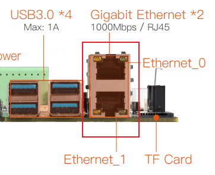

# ETH Usage

{BOARD_with_space} provides two gigabit Ethernet interfaces with the following default configuration:

- The network port marked "1" (near the RS232/RS485 connectors) corresponds to the system `eth0` interface, configured in DHCP mode.
- The network port marked "2" (near the HDMI connector) corresponds to the system `eth1` interface, configured with a static address: `192.168.150.1/24`.

<center>


</center>

## 1. First Access and Login

Port 1 (`eth1`) uses the static IP `192.168.150.1` with subnet mask `255.255.255.0`. For first access, set the PC to an IP in the same subnet (for example `192.168.150.2/24`):

- Windows 10 (administrator mode):

  ```
  netsh int ipv4 add address "Ethernet" 192.168.150.101 255.255.255.0
  ```
  where `"Ethernet"` is the network interface name, `192.168.150.101` is the IP address, and `255.255.255.0` is the subnet mask.

- Linux:

  ```shell
  ifconfig enp4s0:1 192.168.150.89
  ```
  where `enp4s0` is the PC network interface name; run `ifconfig` to check the actual name on your PC.

After the PC can successfully `ping` `192.168.150.1`, log in with `ssh` on port `22` (username and password are both `linaro`):

```
ssh linaro@192.168.150.1
```

## 2. Network IP Configuration

By default, the Core-1684JD4 has a dynamic IP set for network port 0, and a static IP set for network port 1. These configurations are implemented through the `/etc/netplan/01-netcfg.yaml` file in the system.

```shell
linaro@aibox-1684x:~$ cat /etc/netplan/01-netcfg.yaml
network:
        version: 2
        renderer: networkd
        ethernets:
                eth0:
                        dhcp4: yes
                        addresses: []
                        optional: yes
                        dhcp-identifier: mac
                eth1:
                        dhcp4: no
                        addresses: [192.168.150.1/24]
                        optional: yes
```

Users can modify the network configuration by modifying the `/etc/netplan/01-netcfg.yaml` file, for example:

- Set network port 0 to a static IP: Refer to the original setting of `eth1` to modify the `eth0` node, change the `dhcp4` parameter to `no`, and add the IP address to the `addresses` parameter.

- Set network port 1 to a dynamic IP: Refer to the original setting of `eth0` to modify the `eth1` node, change the `dhcp4` parameter to `yes`, and remove the IP address in the `addresses` parameter.

After modifying the `/etc/netplan/01-netcfg.yaml` file, users can make the settings take effect immediately by executing the `sudo netplan apply` command.
