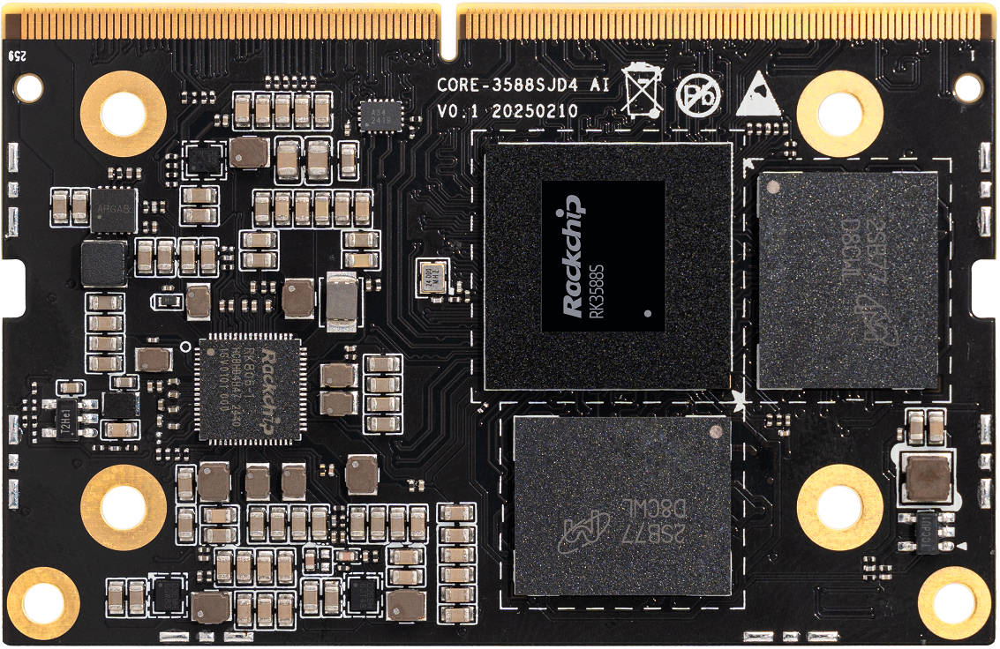
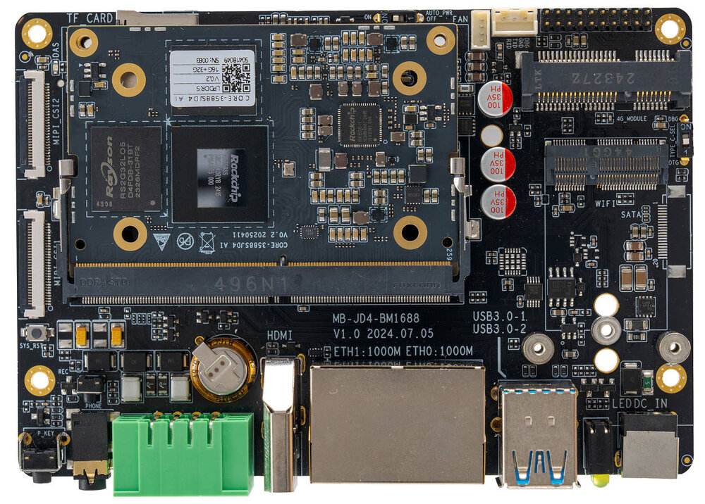
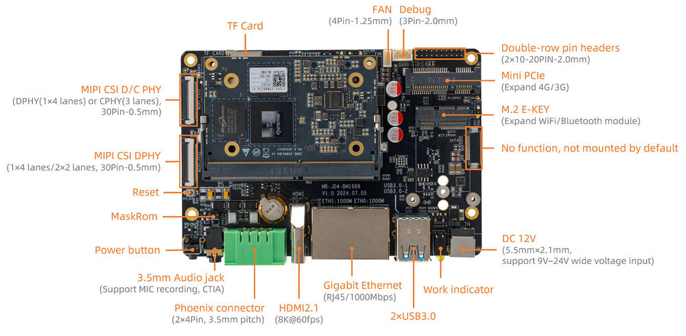
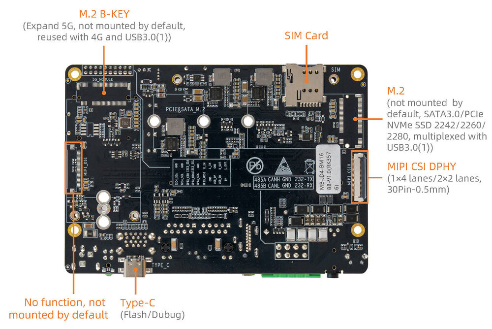
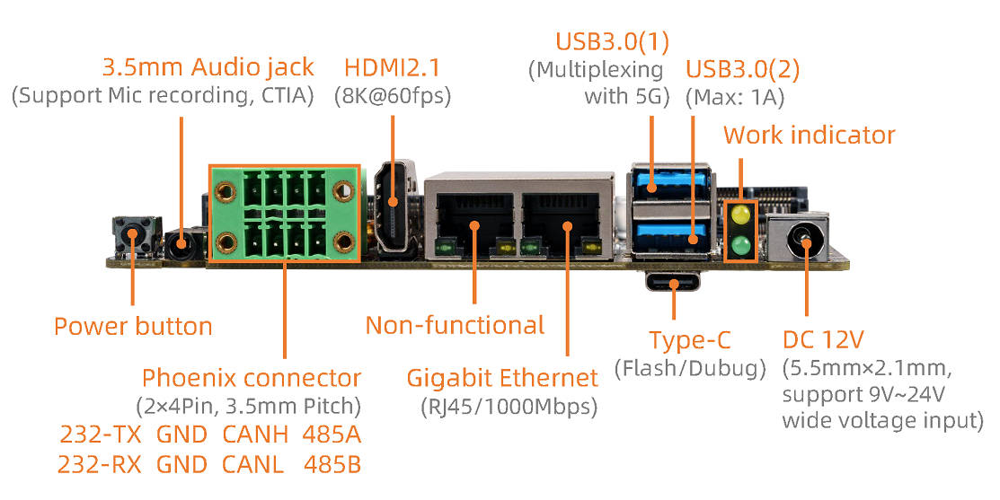

[Specification](https://download.t-firefly.com/Spec/CoreBorads/Core-3588SJD4%20AI_Specification_EN.pdf) | [Purchase](https://www.firefly.store/products/core-3588sjd4-ai-commercial-system-on-moduel) | [Downloads](https://community.t-firefly.com/en/doc/download/323)

# Introduction
 
**Core-3588SJD4-AI** uses Rockchip's flagship AIoT chip RK3588S, built on an advanced 8nm LP process. It features an octa-core 64-bit CPU with a clock speed of up to 2.4GHz, an intergrated ARM Mali-G610 MP4 quad-core GPU, and a built-in AI-accelerator NPU delivering 6 TOPS of computing power. RK3588S optimizes performance for diverse AI applications.

      

AIO-3588SJD4-AI is made up with Core-3588SJD4-AI and Motherboard MB-JD4-BM1688. AIO-3588SJD4-AI is a complete high-performance industrial mainboard with rich expansion interfaces enabling direct intergration into various smart devices to accelerate product deployment. More interface details at [Interface Definition](../interface_definition.md)。
  

  

In addition, you may need the following accessories during use:

* Display device
    * Monitor or TV with HDMI interface and HDMI cable
* Network
    * 100M/1000M Ethernet cable, and wired router
    * WiFi router
* Input devices
    * USB wire/wireless mouse/keyboard
* Firmware upgrade and debugging
    * Usb cable
    * Serial port to serial adapter

## Interface Description

AIO-3588SJD4-AI provides many interfaces, includes:

* 1 x HDMI2.1 (Up to 8K@60Hz)
* 1 x USB Type-C (For download/debug)
* 2 x USB3.0
* 1 x MIPI-DPHY-CSI (CSI0 muxed with CSI1, can not be used at same time)
* 2 x MIPI-D/CPHY-CSI
* 1 x TF Card
* 1 x Mini PCIe (4G module)
* 1 x PCIe M.2 (5G module)
* 1 x SIM Card Slot
* 1 x WIFI (External module)
* 1 x Bluetooth (External module)
* 1 x FAN
* 1 x Headphone （Supports microphone recording, US standard）
* 1 x CAN  (Phoenix connector)
* 1 x RS232 (Phoenix connector)
* 1 x RS485 (Phoenix connector)
* 1 x Line-Out (Through pin header)
* 1 x Line-In (Through pin header)
* 1 x USB2.0 (Through pin header)
* 1 x SPI  (Through pin header)
* 2 x I2C  (Through pin header)

* 1 x RJ45 (Support 1Gbps ethernet)
* 1 x M2.SATA3.0 or M2.PCIe2.0 (It is not supported by default; a socket needs to be soldered and the software needs to be switched.)

Interfaces overview:

## Resources and Support

* [[Technical Forum]](https://forum.t-firefly.com/): A communication platform with more than 100,000 enterprise customers and users

### Contact

* Email: sales@t-firefly.com
* Mobile: (+86) 186 8811 7175
* Landline: 0760-89881218
* Address: Room 2101, Hongyu Building, No. 57 Zhongshan 4th Road, East District, Zhongshan City, Guangdong Province