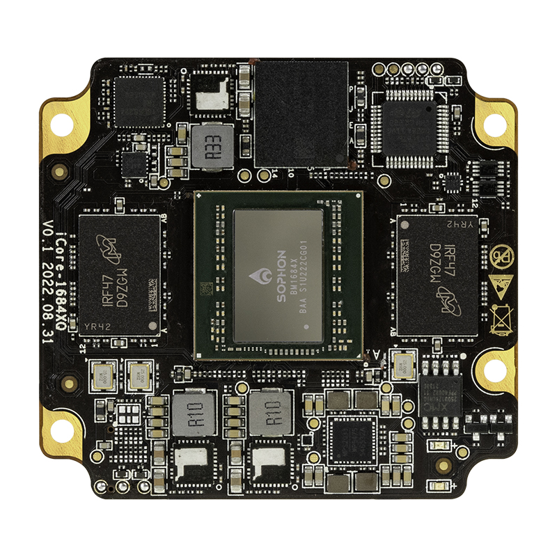
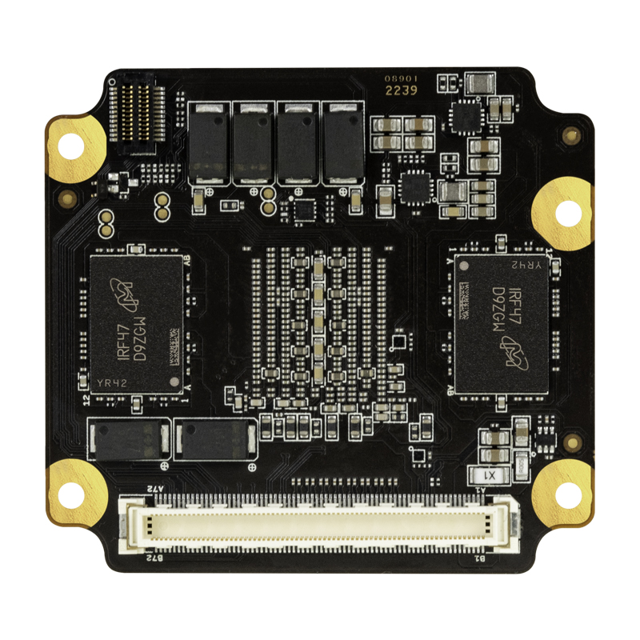
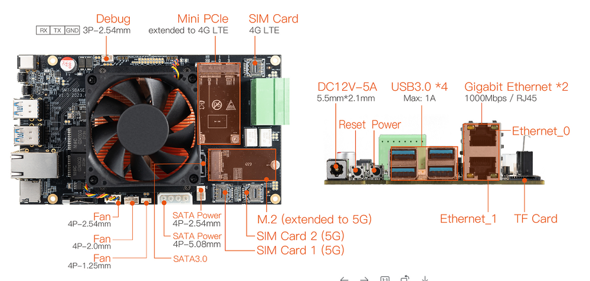
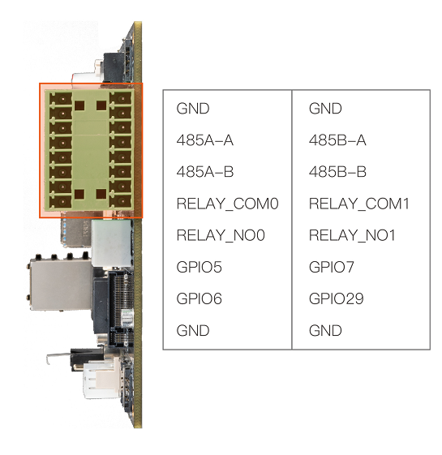

[Specification](https://download.t-firefly.com/%E4%BA%A7%E5%93%81%E8%A7%84%E6%A0%BC%E6%96%87%E6%A1%A3/%E6%A0%B8%E5%BF%83%E6%9D%BF/iCore-1684XQ_Octa-Core%2032TOPS%20High%20Computing%20Power%20AI%20Core%20Board.pdf) | [Purchase](https://www.firefly.store/products/icore-1684xq-core-board) | [Download](https://community.t-firefly.com/en/doc/download/209)

# Introduction

iCore-1684XQ The core board is equipped with the SOPHON AI processing processor BM1684X, which can be configured with 16GB of large memory and 64GB of eMMC storage. It supports 32TOPS (INT8) peak performance, 16TFLOPS (FP16/BF16) performance, and 2TFLOPS (FP32) high precision performance. It also supports 32-channel H.265/H.264 1080p@25fps video decoding.

The core board features a BTB interface with PCIe 3.0, GMAC, SDIO 3.0, I2C, PWM, UART, and GPIO interfaces, making it easy to integrate into various edge embedded products. It supports mainstream programming frameworks and comes with a comprehensive toolchain for easy development, with minimal migration costs for algorithm migration.

The provided reference design material for the baseboard enables users to customize it deeply according to their needs. It efficiently adapts to all AI algorithms available in the market, empowering industries such as visual computing, edge computing, general computing services, artificial intelligence, and industries like smart construction, transportation, education, retail, surveillance, and security with AI capabilities.

**Front View of iCore-1684XQ Core Board:**

**Back View of iCore-1684XQ Core Board:**

## Accessory List

Upon receiving the development board, ensure all the accessories are included:
- If a cased unit, make sure it contains the integrated board, or if not, ensure you have the iCore-1684XQ Core Board and SM7-SBASE-EN4 Baseboard each along with a cooling fan.
- One 12V-5A power adapter.

Optionally purchased accessories include:
- Firefly serial port module.

Additionally, during usage, you might require the following:
- Display device:
    + Monitor or TV with an HDMI interface, along with an HDMI cable.
- Network:
    + 100M/1000M Ethernet cable, wired router.
    + WiFi router.
- Firmware upgrade:
    + TF card, 4GB or larger with a Class 10 rating.
- Debugging:
    + USB to serial adapter.

## Interface Description

AIO-1684XQ The motherboard consists of a core board iCore-1684XQ + baseboard SM7-SBASE-EN4. The AIO-1684XQ comes with onboard interfaces including M.2 (5G), Mini PCIe, SATA 3.0, Gigabit Ethernet, USB 3.0, RS485, RELAY, GPIO, and other rich interfaces.

The interface layout is shown below:

## Resources and Support

* [[Technical Forum]](https://forum.t-firefly.com/): A communication platform with more than 100,000 enterprise customers and users

### Contact

* Email: sales@t-firefly.com
* Mobile: (+86) 186 8811 7175
* Landline: 0760-89881218
* Address: Room 2101, Hongyu Building, No. 57 Zhongshan 4th Road, East District, Zhongshan City, Guangdong Province