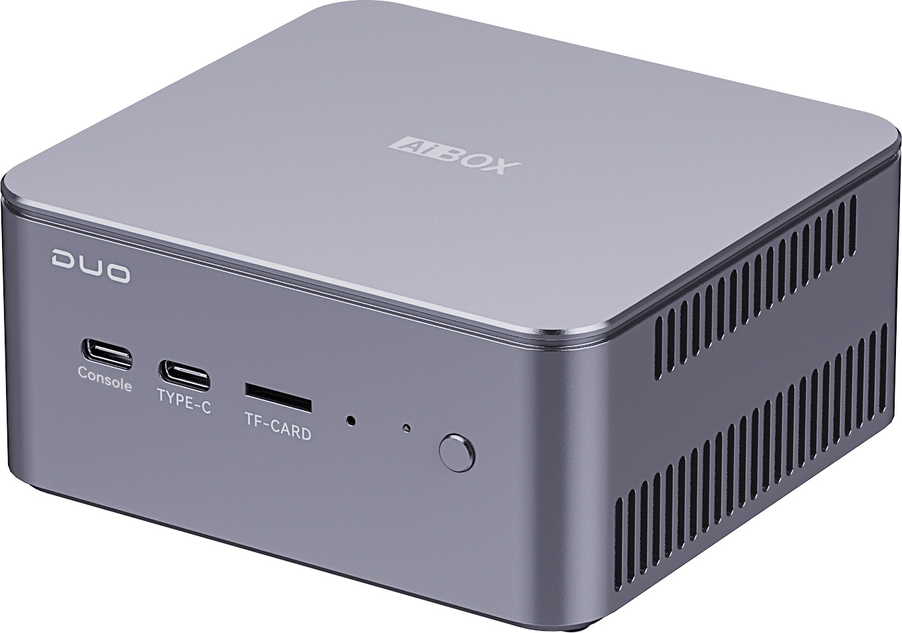
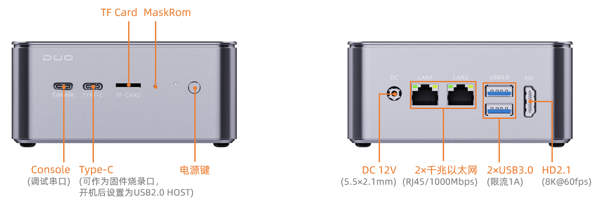
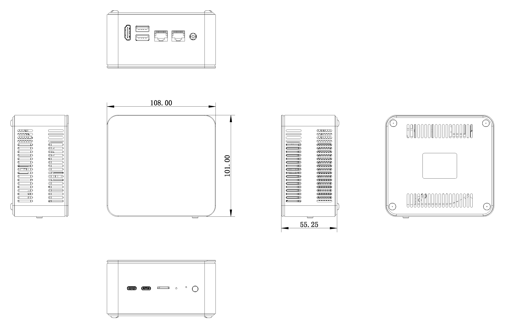

# 简介

[规格书]() | [购买链接]() | [下载资料](https://community.t-firefly.com/doc/download/440)

**AIBOX DUO** 采用“主控 + 双 AI 协处理器”的异构架构。主控核心板 CORE-3588L 采用 Rockchip 八核 64 位处理器 RK3588，先进工艺制程，高性能低功耗，内置 ARM Mali-G610 MP4 四核 GPU，集成 6 TOPS 算力 NPU，支持主流深度学习框架；板载 2 颗 RK1828 AI 协处理器，作为专用 AI 计算加速单元，专注于高性能神经网络推理任务，支持本地部署 Qwen3.5-9B、google/gemma-4-12B-it 等大模型，多路视频识别、目标检测跟踪等 AI 任务可并发执行。大模型完全运行在本地，无需依赖云端算力，数据不出盒子，一个盒子就能满足个性化的本地 AI 部署。

## 接口描述

**AIBOX DUO** 提供了丰富的接口，主要包括：

* 1 x DC 12V 电源接口（5.5mm × 2.5mm）
* 1 x Power 按键
* 1 x MaskRom 按键
* 2 x RJ45（1000Mbps）
* 2 x USB 3.0
* 1 x HDMI
* 1 x TF Card
* 1 x Console（调试串口）
* 1 x Type-C（烧录）
* 1 x 电源指示灯

具体如下图：

## 结构尺寸

## 资源与技术支持

* [技术交流论坛](https://forum.t-firefly.com/)：超过10万企业客户和用户沟通交流平台

### 联系方式

* 邮箱：sales@t-firefly.com
* 手机：(+86) 186 8811 7175
* 座机：0760-89881218
* 地址：广东省中山市东区中山四路 57 号宏宇大厦 2101 室