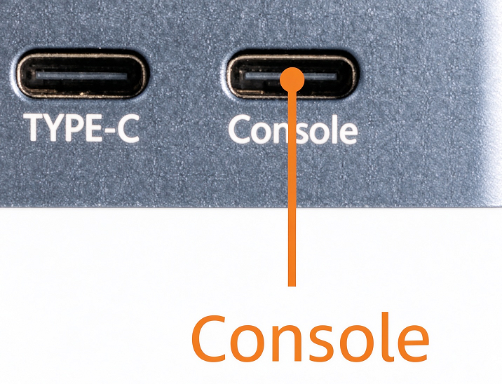

# 硬件功能使用

## 登录 [step]

AIBOX DUO 登录方式有两种：一种是通过 Console（调试串口）进行终端登录，一种是通过 HDMI 登录。

### Console 登录（调试串口）

用 Type-C 数据线将 AIBOX DUO 与电脑连接，登录账号为 `root`，默认没有设置 `root` 密码。串口参数如下：

* 波特率：1500000
* 数据位：8
* 停止位：1
* 奇偶校验：无
* 流控：无

<center>


</center>

#### Windows 下使用串口调试

系统会提示发现新硬件并完成初始化，之后可以在设备管理器中找到对应的 COM 口：

<center>


</center>

Windows 上一般用 putty 或 SecureCRT。这里推荐使用 MobaXterm 免费版本，这是一款功能强大的终端软件，其它串口软件的使用方法与之类似。

1. 选择 `session` 为 `Serial`。
2. 将 `Serial port` 修改为在设备管理器中找到的 COM 端口。
3. 设置 `Speed (bsp)` 为 `1500000`。
4. 点击 `OK` 按钮。

<center>


</center>

<center>


</center>

#### Ubuntu 下使用串口调试

安装 minicom：

```
sudo apt-get install minicom
```

使用 `minicom -s` 打开配置界面，进入 `Serial port setup`，将串口参数设置为 `1500000 8N1`：

* `E - Bps/Par/Bits`：`1500000 8N1`
* `F - Hardware Flow Control`：`No`
* `G - Software Flow Control`：`No`

<Callout title="注意" type="warn">`Hardware Flow Control` 和 `Software Flow Control` 都要设成 No，否则可能导致无法输入。</Callout>

设置完成后选择 `Save setup as dfl` 保存为默认配置，退出后 minicom 即以 1500000-8-N-1 连接调试串口，使用 `root` 账号登录（默认没有设置密码）。

### HDMI 登录

在界面登录时，系统自动登录 `firefly` 用户，`firefly` 用户密码也为 `firefly`。

## AI 协处理器 [step]

AIBOX DUO 板载 2 颗 RK1828 AI 协处理器，与主控 RK3588 协同工作：主控负责系统调度与通用计算，2 颗 RK1828 作为专用 AI 计算加速单元，专注于高性能神经网络推理任务，支持本地部署 Qwen3.5-9B、google/gemma-4-12B-it 等大模型，多路视频识别、目标检测跟踪等 AI 任务可并发执行。

系统提供 `rknn-smi`（System Management Interface）工具，用于 RK1828 设备信息收集、功能配置、日志管理等，常用命令如下：

```shell
sudo rknn-smi -v                      # 查询软件版本信息
sudo rknn-smi info -l                 # 查询硬件版本信息
sudo rknn-smi info -w                 # 状态监控
sudo rknn-smi set -t work_mode -s 2   # 设置性能模式
```

具体使用说明详见 RK182X SDK 里的 `docs/Tools/Rockchip_User_Guide_RKNN-SMI_Tool_CN.pdf`，模型部署与开发流程详见 [AI 协处理器开发](ai_rk182x.md)。

## 看门狗 [step]

### 简介

看门狗（watchdog）实际是一个定时器，启动之后会开始计时。系统或者软件需要在规定时间内与看门狗通信（俗称喂狗）重置计时，如此反复下去，以此来确定系统和软件正常运行。如果规定时间内没有喂狗，看门狗超时，说明系统或应用陷入循环、卡死，此时看门狗会发出复位信号让主控复位，脱离卡死。

### 使用

AIBOX DUO 的外部看门狗设备名称是 `/dev/wdt_crl`，使用方法如下：

```shell
# 写入不同字段来开启看门狗并设置时间
# 数字 0，1，2，3 分别表示 0.64s，2.56s，10.24s，40.96s
# 字母 e 表示开启看门狗，字母 d 表示关闭看门狗

# 开启并定时 10.24 秒，每 10.24 秒之内要写入一次，也可随时写入不同数字更改时间
echo e >/dev/wdt_crl # 开启
echo 2 >/dev/wdt_crl # 设置超时时间为 10.24 秒
```

## RTC [step]

AIBOX DUO 有一路外部 RTC，由外部底板电容进行供电，掉电后短时间内保证 RTC 运行，在 kernel 中表示为 `rtc0`。

Linux 提供了三种用户空间调用接口，对应的路径为（设备编号以实际系统为准）：

* SYSFS 接口：/sys/class/rtc/rtc0/
* PROCFS 接口：/proc/driver/rtc
* IOCTL 接口：/dev/rtc0

同步最新的系统时间到 RTC 内：

```
hwclock -w
```

### SYSFS 接口

可以直接使用 `cat` 和 `echo` 操作 `/sys/class/rtc/rtc0/` 下面的接口。

比如查看当前 RTC 的日期和时间：

```
# cat /sys/class/rtc/rtc0/date
2024-07-10
# cat /sys/class/rtc/rtc0/time
02:36:30
```

### PROCFS 接口

打印 RTC 相关的信息：

```
# cat /proc/driver/rtc
rtc_time        : 02:37:00
rtc_date        : 2024-07-10
alrm_time       : 00:00:00
alrm_date       : 1970-01-01
alarm_IRQ       : no
alrm_pending    : no
update IRQ enabled      : no
periodic IRQ enabled    : no
periodic IRQ frequency  : 1
max user IRQ frequency  : 64
24hr            : yes
```

### IOCTL 接口

可以使用 `ioctl` 控制 `/dev/rtc0`。

详细使用说明请参考文档 `kernel-jammy-src/Documentation/admin-guide/rtc.rst`。

### FAQs

#### Q: 掉电后时间会一直保持吗？

A: 不会。RTC 由外部底板电容供电，仅能在掉电后短时间内维持 RTC 运行；长时间断电后时间会丢失，开机后请重新同步系统时间（`hwclock -w` 或网络对时）。