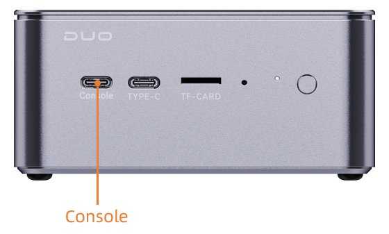
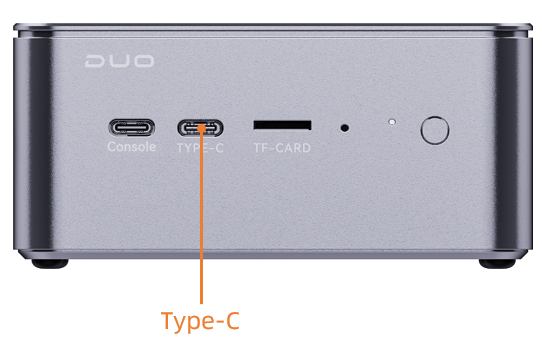
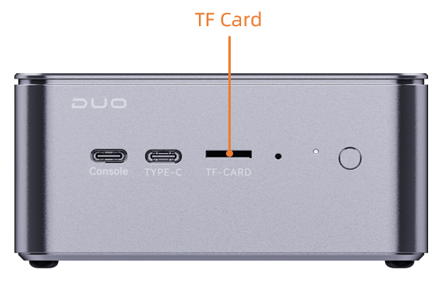
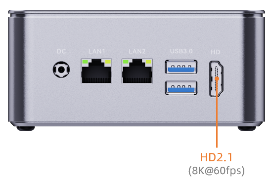
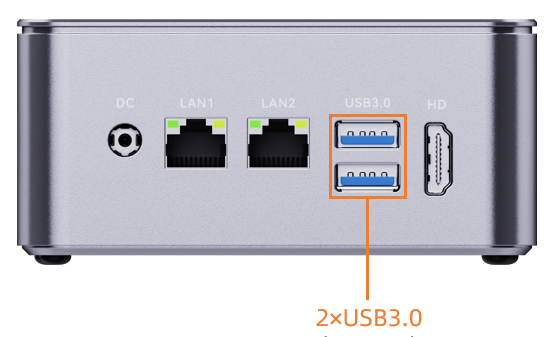
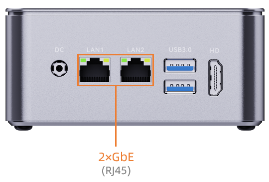

# 硬件功能使用

## 登录 [step]

AIBOX DUO 登录方式有两种：一种是通过 Console（调试串口）进行终端登录，一种是通过 HDMI 登录。

### Console 登录（调试串口）

用 Type-C 数据线将 AIBOX DUO 与电脑连接，登录账号为 `root`，默认没有设置 `root` 密码。串口参数如下：

* 波特率：1500000
* 数据位：8
* 停止位：1
* 奇偶校验：无
* 流控：无

<center>


</center>

#### Windows 下使用串口调试

系统会提示发现新硬件并完成初始化，之后可以在设备管理器中找到对应的 COM 口：

<center>


</center>

Windows 上一般用 putty 或 SecureCRT。这里推荐使用 MobaXterm 免费版本，这是一款功能强大的终端软件，其它串口软件的使用方法与之类似。

1. 选择 `session` 为 `Serial`。
2. 将 `Serial port` 修改为在设备管理器中找到的 COM 端口。
3. 设置 `Speed (bsp)` 为 `1500000`。
4. 点击 `OK` 按钮。

<center>


</center>

<center>


</center>

#### Ubuntu 下使用串口调试

安装 minicom：

```
sudo apt-get install minicom
```

使用 `minicom -s` 打开配置界面，进入 `Serial port setup`，将串口参数设置为 `1500000 8N1`：

* `E - Bps/Par/Bits`：`1500000 8N1`
* `F - Hardware Flow Control`：`No`
* `G - Software Flow Control`：`No`

<Callout title="注意" type="warn">`Hardware Flow Control` 和 `Software Flow Control` 都要设成 No，否则可能导致无法输入。</Callout>

设置完成后选择 `Save setup as dfl` 保存为默认配置，退出后 minicom 即以 1500000-8-N-1 连接调试串口，使用 `root` 账号登录（默认没有设置密码）。

### HDMI 登录

在界面登录时，系统自动登录 `firefly` 用户，`firefly` 用户密码也为 `firefly`,进入 debian13 桌面,显示正常,无异常显示即可,debian13 桌面如下:

<center>


</center>

## 看门狗 [step]

### 简介

看门狗（watchdog）实际是一个定时器，启动之后会开始计时。系统或者软件需要在规定时间内与看门狗通信（俗称喂狗）重置计时，如此反复下去，以此来确定系统和软件正常运行。如果规定时间内没有喂狗，看门狗超时，说明系统或应用陷入循环、卡死，此时看门狗会发出复位信号让主控复位，脱离卡死。

### 使用

AIBOX DUO 的外部看门狗设备名称是 `/dev/wdt_crl`，使用方法如下：

```shell
# 写入不同字段来开启看门狗并设置时间
# 数字 0，1，2，3 分别表示 0.64s，2.56s，10.24s，40.96s
# 字母 e 表示开启看门狗，字母 d 表示关闭看门狗

# 开启并定时 10.24 秒，每 10.24 秒之内要写入一次，也可随时写入不同数字更改时间
echo e >/dev/wdt_crl # 开启
echo 2 >/dev/wdt_crl # 设置超时时间为 10.24 秒
```

## RTC [step]

AIBOX DUO 有一路外部 RTC，由外部底板电容进行供电，掉电后短时间内保证 RTC 运行，在 kernel 中表示为 `rtc0`。

Linux 提供了三种用户空间调用接口，对应的路径为（设备编号以实际系统为准）：

* SYSFS 接口：/sys/class/rtc/rtc0/
* PROCFS 接口：/proc/driver/rtc
* IOCTL 接口：/dev/rtc0

同步最新的系统时间到 RTC 内：

```
hwclock -w
```

### SYSFS 接口

可以直接使用 `cat` 和 `echo` 操作 `/sys/class/rtc/rtc0/` 下面的接口。

比如查看当前 RTC 的日期和时间：

```
root@firefly:/# cat /sys/class/rtc/rtc0/date
2026-11-20
root@firefly:/# cat /sys/class/rtc/rtc0/time
02:55:48
```

### PROCFS 接口

打印 RTC 相关的信息：

```
root@firefly:/# cat /proc/driver/rtc
rtc_time        : 02:56:25
rtc_date        : 2026-11-20
alrm_time       : 02:52:00
alrm_date       : 2026-11-21
alarm_IRQ       : no
alrm_pending    : no
update IRQ enabled      : no
periodic IRQ enabled    : no
periodic IRQ frequency  : 1
max user IRQ frequency  : 64
24hr            : yes
root@firefly:/#
```

### IOCTL 接口

可以使用 `ioctl` 控制 `/dev/rtc0`。

详细使用说明请参考文档 `kernel-jammy-src/Documentation/admin-guide/rtc.rst`。

### FAQs

#### Q: 掉电后时间会一直保持吗？

A: 不会。RTC 由外部底板电容供电，仅能在掉电后短时间内维持 RTC 运行；长时间断电后时间会丢失，开机后请重新同步系统时间（`hwclock -w` 或网络对时）。

## Debug 接口 [step]

### 准备

AIBOX DUO 的 Debug 调试串口采用板载 TTL 串口方案，TTL 芯片已板载，无需外接 USB 转 TTL 调试板。准备一根 Type-C 数据线，将 AIBOX DUO 的 Console 接口与电脑连接即可进行调试。

### 调试

串口参数为 `1500000-8-N-1`（波特率 1500000，数据位 8，停止位 1，无奇偶校验，无流控），串口工具的配置与终端登录方法请参见[Console 登录（调试串口)](#console-登录调试串口)。

## Type-C 接口 [step]

AIBOX DUO 的 Type-C 接口属于全功能接口,支持USB 3.0 数据传输、DP 音视频输出、ADB调试和固件烧录等功能。下面列举演示功能的使用:

<center>


</center>

### USB3.0 数据传输
Type-C 接口接入 OTG 转接线,USB 3.0 接口接入 U 盘,使用 lsblk 指令可以看到列举出 U 盘设备,使用 fio 读写工具,对 U 盘进行读写测速,步骤如下:

```
root@firefly:/# lsblk
NAME         MAJ:MIN RM   SIZE RO TYPE MOUNTPOINTS
sda            8:0    1 115.5G  0 disk 
root@firefly:/# mkdir -p /mnt/user-disk
root@firefly:/# sudo mount /dev/sda /mnt/user-disk/
root@firefly:/# cd /mnt/user-disk/
root@firefly:/# sudo fio --name=write --filename=testfile --rw=write --bs=1M --size=1G --direct=1     # 写入测试
root@firefly:/# sudo fio --name=read --filename=testfile --rw=read --bs=1M --size=1G --direct=1       # 读取测试
```

### DP 音视频输出

Type-C 接口接入 DP 显示屏, 查看显示屏设备是否枚举,查看 DP 声卡是否正常枚举,通过指令或者鼠标点击的方式,播放视频,查看显示屏是否输出视频画面,同时声卡正常出声即可,串口终端播放视频步骤如下:

```
root@firefly:/# cd /home/firefly
root@firefly:/home/firefly# ls /sys/class/drm
card0  card0-DP-1  card0-HDMI-A-1  card0-Writeback-1  card1  renderD128  renderD129  version
root@firefly:/home/firefly# aplay -l
**** List of PLAYBACK Hardware Devices ****
card 0: rockchiphdmi0 [rockchip-hdmi0], device 0: rockchip-hdmi0 i2s-hifi-0 [rockchip-hdmi0 i2s-hifi-0]
  Subdevices: 1/1
  Subdevice #0: subdevice #0
card 1: rockchipdp0 [rockchip-dp0], device 0: rockchip-dp0 spdif-hifi-0 [rockchip-dp0 spdif-hifi-0]
  Subdevices: 1/1
  Subdevice #0: subdevice #0
root@firefly:/home/firefly# 
root@firefly:/home/firefly# sudo -u firefly XDG_RUNTIME_DIR=/run/user/1000 gst-play-1.0 4K_H264_bird.mp4
```

DP 屏幕显示如下:

<center>


</center>

### ADB 调试

Type-C 接口接入电脑,在电脑终端输入adb devices能够检测到 adb 设备,则可以继续下面的测试步骤进行测试,步骤如下:

```
# 1. 查看 adb 设备是否存在
lhj@lhj-TChip:~$ adb devices 
List of devices attached
b38d4440e15767c9	device
lhj@lhj-TChip:~$ 
# 2. 本机 adb_test.txt 文件推向板端 
lhj@lhj-TChip:~$ adb push adb_test.txt /home/firefly
adb_test.txt: 1 file pushed, 0 skipped.
lhj@lhj-TChip:~$ 
# 3. 删除本机 adb_test.txt 文件
lhj@lhj-TChip:~$ rm adb_test.txt 
lhj@lhj-TChip:~$ 
# 4. 拉回板端 adb_test.txt 文件到本机
lhj@lhj-TChip:~$ adb pull /home/firefly/adb_test.txt ./
/home/firefly/adb_test.txt: 1 file pulled, 0 skipped.
lhj@lhj-TChip:~$ 
# 5. 本机查看拉回的 adb_test.txt 文件
lhj@lhj-TChip:~$ ls adb_test.txt 
adb_test.txt
lhj@lhj-TChip:~$ 
# 6. adb 进入板端系统
lhj@lhj-TChip:~$ adb shell
root@firefly:/# cd /home/firefly/
root@firefly:/home/firefly# ls
4K_H264_bird.mp4  Desktop    Downloads	Pictures  Templates
adb_test.txt	  Documents  Music	Public	  Videos
lhj@lhj-TChip:~$ 
# 7. 退出板端系统
root@firefly:/home/firefly# exit
logout
lhj@lhj-TChip:~$ 
```
### 固件烧录

使用 Type-C 数据线将 AIBOX DUO 与电脑连接，配合烧录工具即可完成统一固件或分区映像的烧写，具体步骤请参见[USB升级固件](../getting_started/firmware_upgrade/upgrade_firmware.md)。

## TF-CARD [step]

AIBOX DUO 提供 1 个 TF 卡插槽，可用于 SD 卡升级固件，具体步骤请参见[SD卡升级固件](../getting_started/firmware_upgrade/upgrade_firmware_sd.md)；也可插入 TF 卡作为扩展存储使用，插入后系统会自动识别挂载，可通过 `lsblk` 或 `df -h` 命令查看

```
root@firefly:/# lsblk
NAME         MAJ:MIN RM   SIZE RO TYPE MOUNTPOINTS
mmcblk1      179:96   0  28.9G  0 disk 
└─mmcblk1p1  179:97   0  28.8G  0 part 
root@firefly:/# 
root@firefly:/# mkdir -p /mnt/user-disk
root@firefly:/# sudo mount /dev/mmcblk1p1 /mnt/user-disk/
root@firefly:/# cd /mnt/user-disk/
root@firefly:/# sudo fio --name=write --filename=testfile --rw=write --bs=1M --size=1G --direct=1     # 写入测试
root@firefly:/# sudo fio --name=read --filename=testfile --rw=read --bs=1M --size=1G --direct=1       # 读取测试
```

<center>


</center>

## HDMI 接口 [step]

AIBOX DUO 提供 1 路 HDMI 输出接口。使用 HDMI 线缆连接显示器，开机后即可输出画面；桌面默认自动登录 `firefly` 用户（密码同为 `firefly`），详见[HDMI 登录](#hdmi-登录)。

<center>


</center>

## Type-A(USB3.0) 接口 [step]

AIBOX DUO 提供 2 个 USB 3.0 Type-A 接口，可外接 U 盘、移动硬盘、USB 键盘鼠标等设备，向下兼容 USB 2.0 设备。设备插入后系统会自动识别，可通过 `lsblk` 或 `df -h` 命令查看挂载情况,接入 USB 接口的存储设备时,同样可以进入挂载目录,使用 fio 工具进行读写测试,测试步骤参考[Type-C 接口中的 USB 3.0 数据传输部分](#usb30-数据传输)。

<center>


</center>


## Ethernet 接口 [step]

AIBOX DUO 板载 2 个 RJ45 千兆网口（1000Mbps），接入网线后系统默认通过 DHCP 自动获取 IP 地址，可使用  ifconfig 或者 ip addr 命令查看网络接口与 IP 地址。

<center>


</center>

两个网口可支持接入不同网段，满足多网络接入的应用需求。能 ping 局域网内的设备即可局域网内通信,交换机连接网路的条件下,即可实现网络连接与测试,步骤如下:
```
# 1. 本机 ip 地址查询
root@firefly:/# ifconfig
eth1: flags=4163<UP,BROADCAST,RUNNING,MULTICAST>  mtu 1500
        inet 172.16.11.125  netmask 255.255.0.0  broadcast 172.16.255.255
        inet6 fe80::ae73:2f09:ade3:b163  prefixlen 64  scopeid 0x20<link>
        ether e6:03:f8:b2:fe:44  txqueuelen 1000  (Ethernet)
        RX packets 3660842  bytes 514432339 (490.6 MiB)
        RX errors 0  dropped 35681  overruns 0  frame 0
        TX packets 20942  bytes 1486330 (1.4 MiB)
        TX errors 0  dropped 0 overruns 0  carrier 0  collisions 0
        device interrupt 67
root@firefly:/# 
# 2. ping 局域网内的设备测试连通性
root@firefly:/# ping 172.16.10.222
PING 172.16.10.222 (172.16.10.222) 56(84) bytes of data.
64 bytes from 172.16.10.222: icmp_seq=1 ttl=64 time=0.319 ms
64 bytes from 172.16.10.222: icmp_seq=2 ttl=64 time=0.187 ms
root@firefly:/# 
# 3. ping baidu.com 测试网络连接
root@firefly:/# ping www.baidu.com
PING www.a.shifen.com (103.235.47.188) 56(84) bytes of data.
64 bytes from 103.235.47.188: icmp_seq=1 ttl=47 time=270 ms
64 bytes from 103.235.47.188: icmp_seq=2 ttl=47 time=279 ms
# 4. 局域网中使用 scp 传输文件
root@firefly:/home/firefly# scp gamc_test.txt lhj@172.16.10.222:/home/lhj
The authenticity of host '172.16.10.222 (172.16.10.222)' can't be established.
ED25519 key fingerprint is SHA256:/RlnTm7K/AQQTx2QHyktaYQCHP2LLXXHe27bjpHxSSE.
This key is not known by any other names.
Are you sure you want to continue connecting (yes/no/[fingerprint])? yes       # 交互中输入 yes
Warning: Permanently added '172.16.10.222' (ED25519) to the list of known hosts.
lhj@172.16.10.222's password:
gamc_test.txt                                                                            100%    0     0.0KB/s   00:00    
root@firefly:/home/firefly# 
```