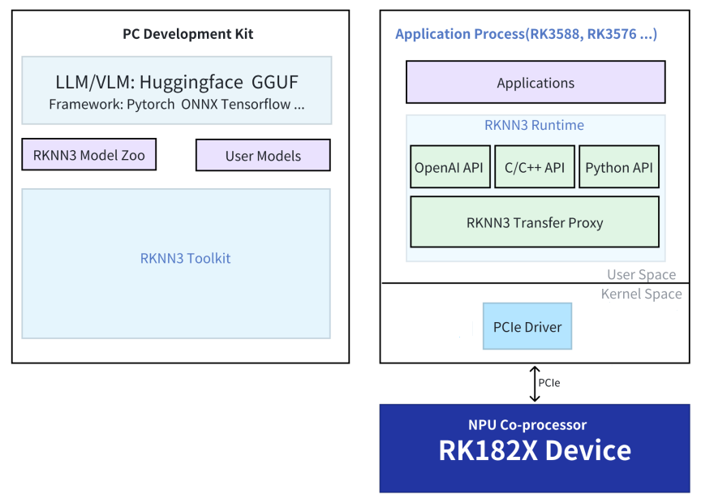

# RK1820/RK1828 平台

本页介绍 RK1820/RK1828 平台上的 RKNN3 软件栈与 rknn-smi 管理工具。

## 架构

主控通过 PCIe 高速接口连接协处理器：

- RK3588/RK3576 主控（Host）：作为系统核心，负责任务调度、资源分配和整体控制。
- RK1820/RK1828 协处理器（Device）：作为 AI 计算加速单元，专注于高性能神经网络推理任务。
- PCIe 高速接口（通信接口）：实现主控与协处理器之间的低延迟、高带宽数据交互。

## RK1820/RK1828 的使用方法

参考 [RK1828 AI 计算模块](/docs/products/accessories/RK182x/started)

## RKNN3 SDK

### SDK 目录

RK182X SDK 的 rknn 目录：

```
rknn/
├── rknn3-model-zoo
├── rknn3-runtime
├── rknn3-toolkit
└── rknn-gstreamer-plugins
```

### SDK 框图

<center>


</center>

### RKNN3 Model Zoo

提供 RK1820/RK1828 平台上经典模型的部署示例。更多详细内容可以参考 [GitHub](https://github.com/airockchip/rknn3-model-zoo)

### RKNN3 Runtime

RKNN3 C API 是 RKNN3 Runtime（运行时库）的 C 语言接口。开发者使用 C/C++ 开发应用程序，通过 RKNN3 C API 部署模型推理。

### RKNN3 Toolkit

RKNN3 Toolkit 是为用户提供在 PC 平台上进行模型转换、推理和性能评估的开发套件。

**RKNN3 Toolkit** 与 [RKNN-Toolkit](https://github.com/airockchip/rknn-toolkit) 和 [RKNN-Toolkit2](https://github.com/airockchip/rknn-toolkit2) **不兼容**。更多内容可以参考 [GitHub](https://github.com/airockchip/rknn3-toolkit)

## rknn-smi

rknn-smi（System Management Interface）工具用于 RK1820/RK1828 设备信息收集、功能配置、日志管理等功能。

| 功能 | 命令 |
| :--- | :--- |
| 查询软件版本信息 | `sudo rknn-smi -v` |
| 查询硬件版本信息 | `sudo rknn-smi info -l` |
| 状态监控 | `sudo rknn-smi info -w` |
| 性能模式 | `sudo rknn-smi set -t work_mode -s 2` |
| 查询功耗（硬件上不支持） | `sudo rknn-smi info -t power` |

具体使用，详见 RK182X SDK 里的 `docs/Tools/Rockchip_User_Guide_RKNN-SMI_Tool_CN.pdf`

### 常见问题

**概率性 "Failed to initialize rknnsmi"**

`/lib/systemd/system/rknn3.service` 适当添加延迟：

```
[Unit]
Description=rknn3 runtime service
DefaultDependencies=no
After=local-fs.target

[Service]
Type=forking
ExecStartPre=/bin/sleep 3 # 延迟 3 秒
ExecStart=/bin/rknn3_startup start
ExecStop=/bin/rknn3_startup stop

[Install]
WantedBy=sysinit.target
```