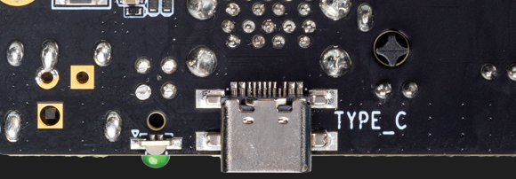
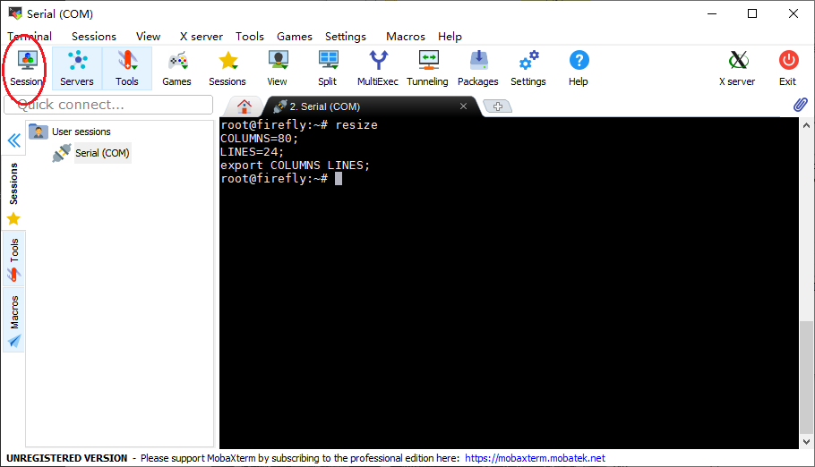
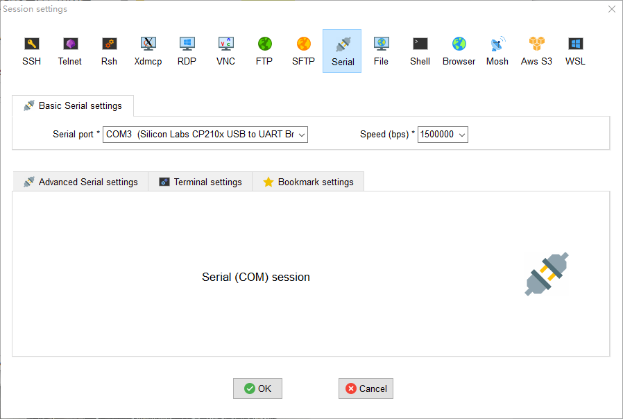
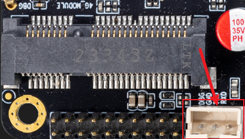
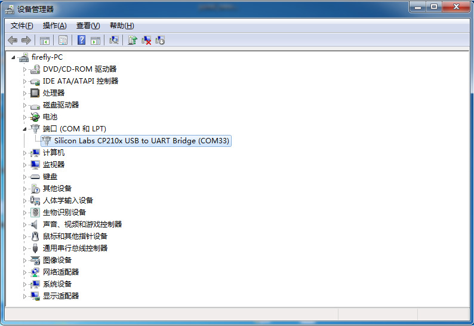

# Debug 使用

AIBOX-1688 的调试串口提供两种连接方式，对应同一个调试串口：一种通过 Type-C 串口连接，另一种通过 DEBUG 口连接（TTL 电平）：

| 调试接口 | 电平 | 连接方式 | Windows 工具 | Linux 工具 | 串口参数 |
| :---: | :---: | :---: | :---: | :---: | :---: |
| Type-C 串口 | USB 直连 | Type-C 数据线 | MobaXterm（推荐）/PuTTY/SecureCRT | minicom/picocom/kermit | 115200 8N1，无流控 |
| DEBUG 口 | TTL 电平 | USB 转 TTL 串口适配器 | 同上（需安装驱动） | 同上（免驱动） | 115200 |

<CodeBlockTabs defaultValue="typec">
<CodeBlockTabsList>
<CodeBlockTabsTrigger value="typec">Type-C</CodeBlockTabsTrigger>
<CodeBlockTabsTrigger value="ttl">TTL</CodeBlockTabsTrigger>
</CodeBlockTabsList>
<CodeBlockTab value="typec">

AIO-1688JD4 可以使用 Type-C 线连接到 PC 机进行串口调试：

### 串口参数配置

AIBOX-1688 使用以下串口参数：

* 波特率：115200
* 数据位：8
* 停止位：1
* 奇偶校验：无
* 流控：无

### 使用串口调试

<CodeBlockTabs defaultValue="windows">
<CodeBlockTabsList>
<CodeBlockTabsTrigger value="windows">Windows</CodeBlockTabsTrigger>
<CodeBlockTabsTrigger value="linux">Linux</CodeBlockTabsTrigger>
</CodeBlockTabsList>
<CodeBlockTab value="windows">

Windows 上一般用 putty 或 SecureCRT 软件，推荐使用免费的 MobaXterm 终端软件：

1. 到[官网](https://mobaxterm.mobatek.net/)下载 MobaXterm 免费版。
2. 选择 session 为 `Serial`。
3. 将 Serial port 修改为在设备管理器中找到的 COM 端口。
4. 设置 Speed (bsp) 为 `115200`。
5. 点击 `OK` 按钮。

</CodeBlockTab>
<CodeBlockTab value="linux">

Linux 上可以有多种选择：minicom、picocom、kermit，以下介绍 minicom 的使用：

1. 安装 minicom：`sudo apt-get install minicom`。
2. 连接好串口线后，查看串口设备文件（下面示例为 `/dev/ttyUSB0`）：`ls /dev/ttyUSB*`。
3. 运行 `sudo minicom`，按 `Ctrl-A Z` 再按 `O` 进入 `Serial port setup`。
4. 将 `Serial Device` 设为 `/dev/ttyUSB0`，`Bps/Par/Bits` 设为 `115200 8N1`。
5. 将 `Hardware Flow Control` 和 `Software Flow Control` 都设为 `No`。
6. 选择 `Save setup as dfl` 保存为默认配置，以后将默认使用该配置。

<Callout title="注意" type="warn">minicom 的 `Hardware Flow Control` 和 `Software Flow Control` 都要设成 No，否则可能导致无法输入。</Callout>

</CodeBlockTab>
</CodeBlockTabs>

</CodeBlockTab>
<CodeBlockTab value="ttl">

如果要进行 U-Boot 或内核开发，需要使用 DEBUG 口进行调试，操作与 Type-C 调试是一致的，需要注意的是适配器及其驱动问题。

### 选购适配器

网店上有许多 USB 转串口的适配器，按芯片来分，有以下几种：

| 串口  | 最高波特率 | 是否推荐 | 评价 | 购买链接 |
| :--------: | :-------: |:-------: | :-------: | :-------: |
| [CP2104](https://item.taobao.com/item.htm?spm=a1z10.5-c.w4002-12605442688.14.aa5e1e8srwECg&id=546045713700) | 2Mbps | 推荐 | 支持高波特率通信，稳定性好耐用 | [点击购买](https://item.taobao.com/item.htm?spm=a1z10.5-c.w4002-12605442688.14.aa5e1e8srwECg&id=546045713700) |
| CH340 | 2Mbps | 不推荐 | 实际使用中发现，市面上很多 CH340 的实际波特率达不到 1.5 Mbps |  |
| PL2303 | 1.2Mbps | 不推荐 | 最高波特率达不到 1.5Mbps |  |

一般来说，采用 CH340 芯片的适配器，性能比较稳定，价格上贵一些。

<Callout title="提示" type="info">AIBOX-1688 默认的波特率是 115200。</Callout>

### 硬件连接

USB 转串口适配器，有四个引脚：

* 3.3V 电源（NC），不需要连接
* GND，串口的地线，接开发板串口的 GND 针
* TXD，串口的输出线，接开发板串口的 TX 针
* RXD，串口的输入线，接开发板串口的 RX 针

<Callout title="注意" type="warn">如使用其它串口适配器遇到 TX 和 RX 不能输入和输出的问题，可以尝试对调 TX 和 RX 的连接。</Callout>

AIO-1688JD4 DEBUG 口：

### 驱动安装

Windows 系统需要安装适配器驱动（Linux 则不需要）：

下载驱动并安装:

* [CH340](https://www.wch.cn/downloads/CH341SER_EXE.html)
* [PL2303](https://www.prolific.com.tw/en/portfolio-item/pl2303gl/)
* [CP210X](https://www.silabs.com/software-and-tools/usb-to-uart-bridge-vcp-drivers)

插入适配器后，系统会提示发现新硬件，并初始化，之后可以在设备管理器找到对应的 COM 口：

</CodeBlockTab>
</CodeBlockTabs>