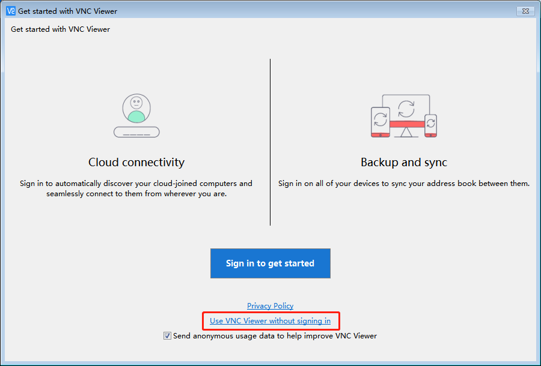
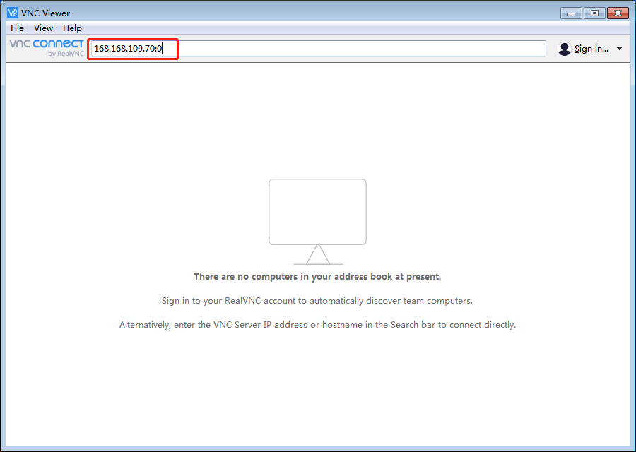
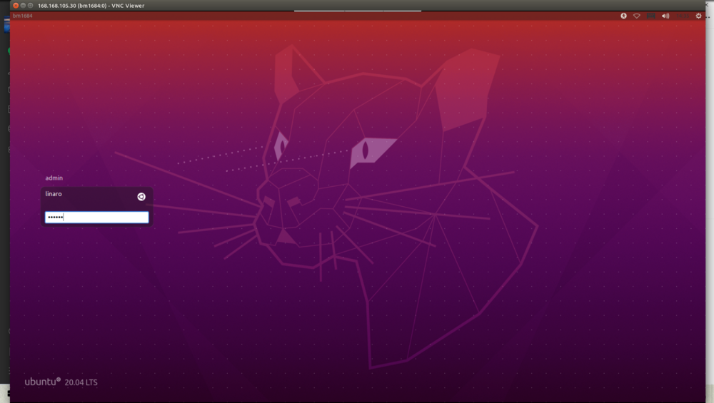
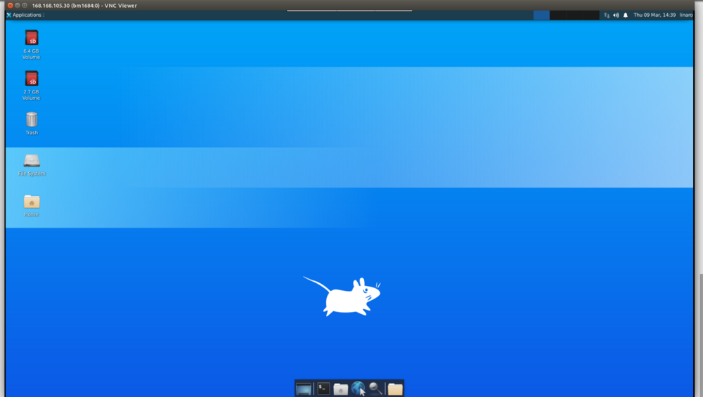

# 软件使用指南

本节汇总 AIBOX-186 的软件相关文档。**不同机型支持的功能不同，以下内容不一定全部被当前机型支持，请以实际机型的 SDK 或固件为准，按需查阅。**

<Callout title="提示" type="info">具体支持情况可参考实际机型的 SDK 源码或固件。</Callout>


## Sophon SDK 开发 [step]


CV186AH 的 SDK 开发依赖于 SOPHONSDK（一站式SDK），其中包含了模型转换、模型量化、算法移植等相关模块。提供了包括文档、视频、论坛、开源仓库等一系列资料帮助用户进行算法移植和开发工作。

目前系统固件适配 SOPHONSDK 的版本为 v1.7，参考以下链接即可获取 SDK 等相关的开发内容：

### SDK 资料获取 [step]

* [SDK 获取](https://developer.sophgo.com/site/index/material/89/all.html)

* [SDK使用手册](https://doc.sophgo.com/bm1688_sdk-docs/v1.7/docs_latest_release/docs/BM1688_CV186AH_SophonSDK_doc/common_test/disclaimer.html)

* [BSP开发参考手册](https://doc.sophgo.com/bm1688_sdk-docs/v1.7/docs_latest_release/docs/athena2-img/)


## 内存管理 [step]

AIBOX-186 的内存有一部分被分配于 NPU、VPP 和 VPU 设备，因此使用 `free -h` 等指令获取的内存数据与 AIBOX-186 的实际内存不一致。

如需查看详细的内存分配设置，或者默认内存分配与实际需求冲突、需调整内存分配的，可参照以下步骤进行相应操作。

### 1. 安装内存分配工具

从[下载中心](https://community.t-firefly.com/doc/download/266)中获取内存分配工具压缩包，并将其传输到 AIBOX-186 上，执行以下命令解压压缩包：

```bash
tar -xvf memory_edit_v2.9.tar.xz
```

### 2. 查看内存分配设置

在完成压缩包解压后，执行以下命令查看内存分配设置：

```bash
cd memory_edit
./memory_edit.sh -p
```

内存分配设置结果示例如下，其中 `Info: get max memory size ...` 显示的结果是每个设备可配置的最大内存，`Info: get now memory size ...` 显示的结果是每个设备目前所分配的内存。

```bash
linaro@aibox-1688x:~/memory_edit$ ./memory_edit.sh -p
INFO: version: 2.9
Info: use dts file /home/linaro/memory_edit/output/bm1688x_se7_v1_mini.dts
Info: =======================================================================
Info: get ddr information ...
Info: ddr12_size 8589934592 Byte [8192 MiB]
Info: ddr3_size 4294967296 Byte [4096 MiB]
Info: ddr4_size 4294967296 Byte [4096 MiB]
Info: ddr_size 16384 MiB
Info: =======================================================================
Info: get max memory size ...
Info: max npu size: 0x1dbf00000 [7615 MiB]
Info: max vpu size: 0xc0000000 [3072 MiB]
Info: max vpp size: 0x100000000 [4096 MiB]
Info: =======================================================================
Info: get now memory size ...
Info: now npu size: 0xf6e00000 [3950 MiB]
Info: now vpu size: 0x80000000 [2048 MiB]
Info: now vpp size: 0xc0000000 [3072 MiB]
```

### 3. 修改内存分配设置

可参考以下命令进行内存分配设置，其中输入的三个参数是需要 NPU、VPU、VPP 配置的大小的十进制数字，单位 MiB；或者为十六进制数值，单位 Byte。

```bash
# 十进制，单位MiB
./memory_edit.sh -c -npu 2048 -vpu 2048 -vpp 2048
# 十六进制，单位Byte
./memory_edit.sh -c -npu 0x80000000 -vpu 0x80000000 -vpp 0x80000000
```

执行以上命令之一后，检查输出中是否有 Error，以及类似于如下输出中三个部分的大小是否与所需要配置的大小相同。

```bash
Info: output configuration results ...
Info: vpu mem area(ddr3): 0x8000000 [128 MiB] 0x20000000 -> 0x27ffffff
Info: ion npu mem area(ddr1): 0x80000000 [2048 MiB] 0x24100000 -> 0xa40fffff
Info: ion vpu mem area(ddr3): 0x80000000 [2048 MiB] 0x80000000 -> 0xffffffff
Info: ion vpp mem area(ddr4): 0x80000000 [2048 MiB] 0x80000000 -> 0xffffffff
Info: =======================================================================
Info: start check memory size ...
Info: check npu size: 0x80000000 [2048 MiB]
Info: check vpu size: 0x80000000 [2048 MiB]
Info: check vpp size: 0x80000000 [2048 MiB]
Info: check edit size ok
Info: en_emmcfile ok
```

如检查无误，请保存当前工作，并参照以下操作将修改后的 `emmcboot.itb` 文件替换启动分区中的启动映像，最后重启机器使修改生效。

```bash
sudo cp emmcboot.itb /boot
sync
sudo reboot
```

## 远程桌面 [step]

x11vnc 是一个可以让管理员直接通过 VNC Viewer 来连接服务器的真实 X 桌面的工具。


### Ubuntu
Ubuntu 系统需要手动安装X桌面环境，安装过程中，Display Manager选择lightdm：
```
sudo apt update
sudo apt install -y xserver-xorg-video-dummy x11vnc xfce4
sudo vim /etc/X11/xorg.conf
sudo reboot
```
/etc/X11/xorg.conf中内容为：
```
Section "Device"
    Identifier  "Configured Video Device"
    Driver      "dummy"
    VideoRam 256000
EndSection

Section "Monitor"
    Identifier  "Configured Monitor"
    HorizSync 5.0 - 1000.0
    VertRefresh 5.0 - 200.0
    ModeLine "1920x1080" 148.50 1920 2448 2492 2640 1080 1084 1089 1125 +Hsync +Vsync
#    Modeline "1280x800" 24.15 1280 1312 1400 1432 800 819 822 841
EndSection

Section "Screen"
    Identifier  "Default Screen"
    Monitor     "Configured Monitor"
    Device      "Configured Video Device"
    DefaultDepth 24
    SubSection "Display"
    Depth 24
    Modes "1920x1080"
#    Modes "1280x800"
    EndSubSection
EndSection
```
安装完成后，启动x11vnc服务：

```shell
sudo x11vnc -display :0 -auth /var/lib/lightdm/.Xauthority &
```

然后就可以在 PC 机上用 `$bm1688_ip:0` 地址来 VNC 远程连接。

以下是 VNC Viewer 的具体操作过程：

（1）用户首先到官方下载 [VNC Viewer](https://www.realvnc.com/en/connect/download/viewer/)，根据自身 PC 机系统选择对应安装包进行下载并安装。

（2）安装完成后打开 VNC Viewer，跳过登录

<center>


</center>

（3）输入 AIBOX-186 的 `$bm1688_ip:0` 地址：

<center>


</center>

（4）点击linao用户名右侧的圆形按钮，选择xfce， 输入用户与密码，均为 `linaro`：

<center>


</center>

（5）成功进入 xfce4 桌面：

<center>


</center>


