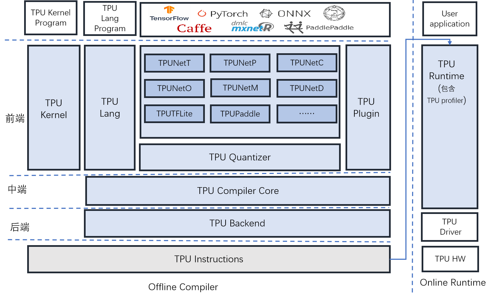
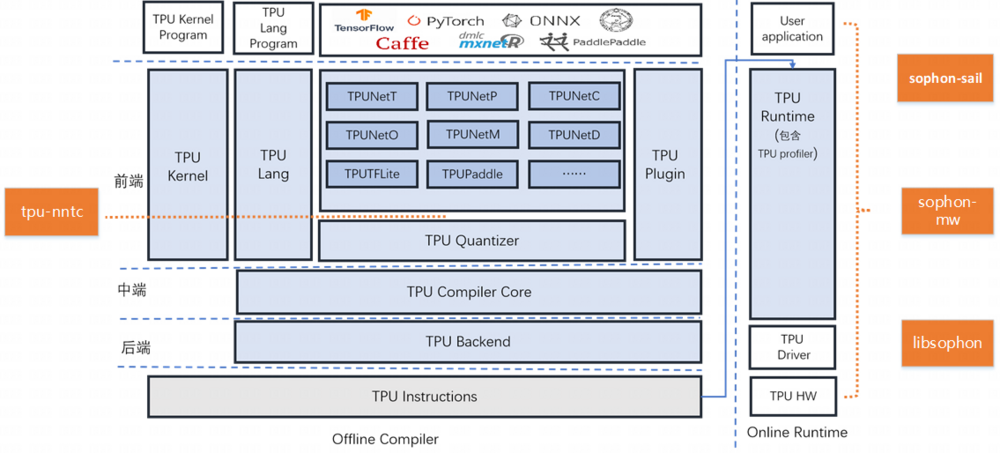
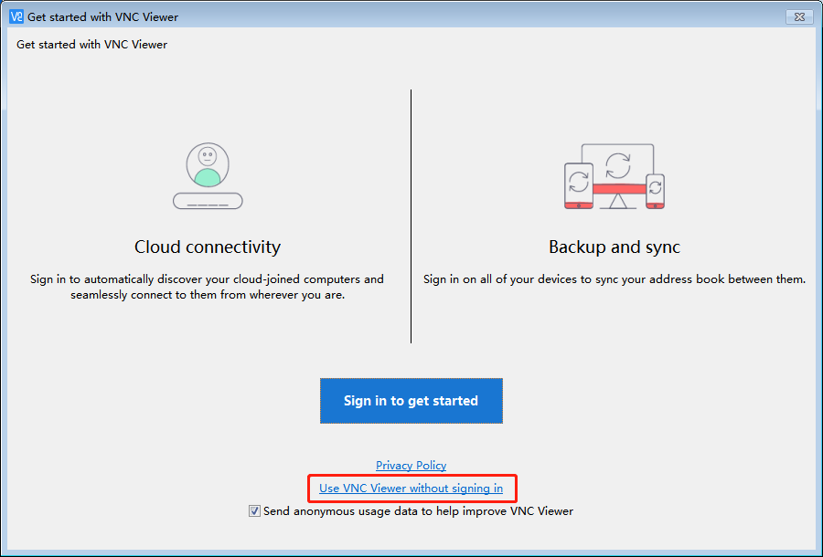
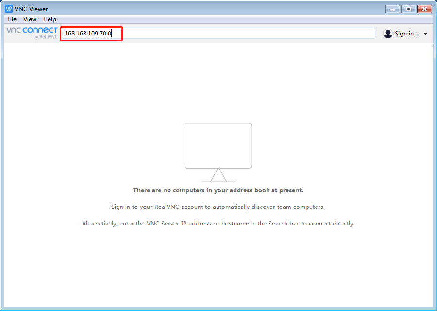
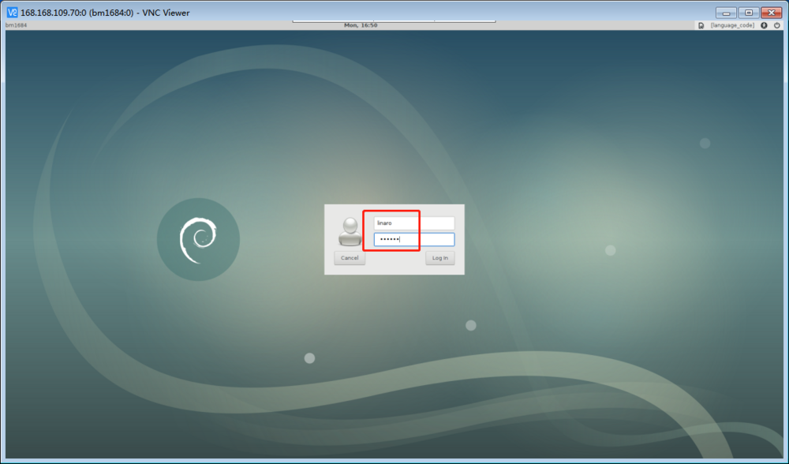
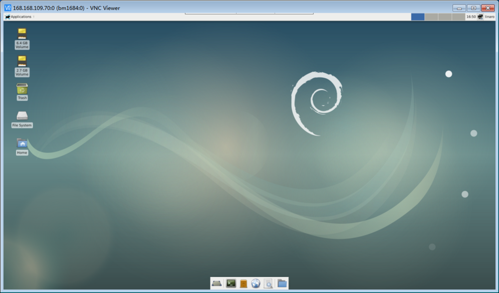
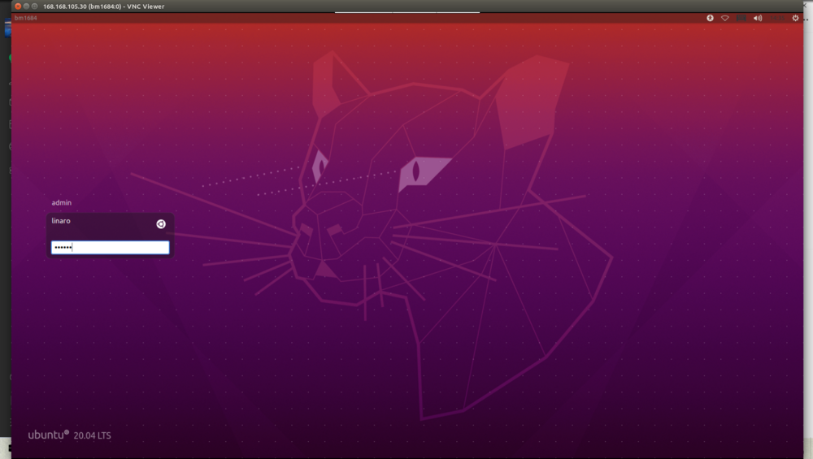
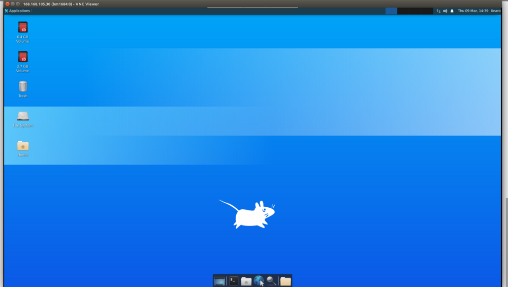

# 软件使用指南

<Callout title="提示" type="info">本页汇总 EC-A1684JD4-FD 的软件使用内容：Sophon SDK 开发、内存管理、远程桌面与 Qt 开发。不同机型支持的功能不同，具体请以实际机型的 SDK 或固件为准。</Callout>


## Sophon SDK 开发 [step]

目前存在两套 Sophon SDK，其中 **SophonSDK3** 是属于旧版本的 SDK，而 **Sophon SDK** 属于新版本的 SDK。
两套 SDK 的主要区别在于：  

| 区别                            | Sophon SDK                                                                                                                                     | SophonSDK3                                    |
| --------------------------------- | ------------------------------------------------------------------------------------------------------------------------------------------------ |----------------------------------------------------------------------------------------------------------------------------------------------- |
| 适配芯片                        | BM1684、BM1684X                                                                                                                                | BM1684、BM1684X                               |
| 发布方式                        | 将各个模块解耦，分别提供tar和deb包。                                                                                                           | 提供统一的tar开发包， 包含Compiler和Library。 | 
| 驱动安装                        | 安装sophon-driver_x.y.z_amd64.deb包                                                                                                            | 使用install_driver_{target}.sh安装            
| NNToolchain、Quantization-Tools | 提供tpu-nntc_vx.y.z-<hash>-<data>.tar.gz安装使用                                                                                               | 包含于SophonSDK3                              | 
| BMCV、BMRuntime、BMLib          | 提供sophon-libsophon_x.x.x_amd64.deb包，安装后位于/opt/sophon/libsophon-current                                                                | 包含于SophonSDK3                              | 
| 多媒体库                        | 提供sophon-mw-x.x.x_amd64.deb包，安装后位于/opt/sophon/sophon-ffmpeg-latest、/opt/sophon/sophon-opencv-latest、/opt/sophon/opencv-bmcpu-latest | 包含于SophonSDK3                              | 
| pipeline例程                    | 开源至github仓库，sophon-pipeline                                                                                                              | [https://github.com/sophon-ai-algo/sophon-inference](https://github.com/sophon-ai-algo/sophon-inference)                                              | 
| 算法例程                        | 开源至github仓库（暂未发布）                                                                                                                   | [https://github.com/sophon-ai-algo/examples/tree/2.7.0](https://github.com/sophon-ai-algo/examples/tree/2.7.0)                                              | 

建议优先使用 `Ubuntu 20.0`的固件以及新版本的 SDK 去做开发。

### SophonSDK3 [step]
SophonSDK 是算能科技基于其自主研发的 AI 芯片所定制的深度学习 SDK，涵盖了神经网络推理阶段所需的模型优化、高效运行时支持等能力，为深度学习应用开发和部署提供易用、高效的全栈式解决方案。

**注意：SophonSDK 是用于在 PC 上直接开发应用程序的，因此用户不会涉及到底层硬件与操作系统开发！**


#### SDK 组成 [step]
SophonSDK 由 Compiler 和 Library 组成：

- **Compiler** 负责对第三方深度学习框架下训练得到的神经网络模型进行离线编译和优化，生成最终运行时需要的 BModel。目前支持 Caffe、Darknet、MXNet、ONNX、PyTorch、PaddlePaddle、TensorFlow 等。

- **Library** 提供 BM-OpenCV、BM-FFmpeg、BMCV、TPURuntime、BMLib 等库，用来驱动 VPP、VPU、JPU、TPU 等硬件，完成视频图像编解码、图像处理、张量运算、模型推理等操作，供用户进行深度学习应用开发。

> Examples 提供了 SoC 和 x86 环境下的多个例子，供用户在深度学习应用开发过程中参考。这部分例程代码从 SDK 中移至 github 仓库开源：[https://github.com/sophon-ai-algo/examples](https://github.com/sophon-ai-algo/examples)

<center>


</center>

#### SDK 开发包 [step]
SophonSDK 提供了两个文件，具体文件如下表所示：

| 文件名 | 备注 |
| :------- | :--------- |
| [sophonsdk_v3.0.0_20220716.zip](https://sophon-file.sophon.cn/sophon-prod-s3/drive/22/07/18/11/sophonsdk_v3.0.0_20220716.zip) | sophonsdk x86 平台开发包，支持 cmodel，pcie，soc 和 arm_pcie 模式 |
| [x86_sophonsdk3_ubuntu18.04_py37_dev_22.06_docker.zip](https://sophon-file.sophon.cn/sophon-prod-s3/drive/22/07/19/10/x86_sophonsdk3_ubuntu18.04_py37_dev_22.06_docker.zip) | sophonsdk v3 编译开发用的 docker |

- **SophonSDK3 开发包**：`sophonsdk_v<x.y.z>.zip`，其中 x.y.z 为版本号。SophonSDK 将以目录映射的方式挂载到 Docker 容器内部供用户使用。SDK 分 Windows 版本和 Linux 版本。Windows 版本的 SDK 的使用方式请参见 SDK 包下的用户文档。

- **基于 x86 的 Ubuntu 开发 Docker**：用于提供统一的 Docker 基础开发镜像以规避环境不一致带来的隐性问题，特别是对于初级用户，强烈建议使用 Docker 镜像作为开发环境进行模型转换和算法迁移工作。

**注意：**

**SophonSDK 是一个支持多种平台的开发包。为了适应不同硬件平台和编译器的需求，开发者拿到 SDK 解压缩后，需要运行一个简单的安装脚本，此安装脚本会根据用户当前的主机环境调整安装适配的程序版本，如 ABI（应用程序二进制接口）版本。因此，不建议拷贝解压缩后的文件夹到其他机器使用，确有拷贝需求时，请拷贝 SDK 原始压缩包，然后重新解压缩再安装。**
- **比如 CentOS 和 Ubuntu 下默认的 ABI 格式不一样，无法通用，拷贝后的文件执行时会报找不到符号的错误；**
- **当使用 NTFS 格式的移动存储设备拷贝解压后的文件时，特别是在 Windows 下和 Linux 之间拷贝文件时，极有可能造成文件链接或 so 文件损坏。**


#### SDK 文件结构 [step]
SDK 解压后的根目录：在宿主机上时，它是解压文件时指定的存放文件的路径；在 docker 容器中时，若没有修改 SDK 下的创建容器脚本，该路径默认为`/workspace`。

解压后的 SDK 文件结构如下：

```shell
SophonSDK3

├── bin                    # 各个平台的相关工具
│   ├── arm                # soc平台，对应SE5/SM5设备
│   ├── arm_pcie           # ARM指令集CPU的服务器主机
│   ├── fib.bin            # 
│   ├── firmware           # BM1684中MCU的固件
│   ├── loongarch64        # loongarch指令集CPU的服务器主机
│   ├── mips64             # MIPS指令集CPU的服务器主机
│   ├── ramboot_rootfs.itb # 
│   ├── spi_flash.bin      #
│   ├── sw64               # SW64指令集CPU的服务器主机
│   └── x86                # intel x86主机
├── bmlang                 # 面向Sophon TPU的高级编程接口
├── bmnet                  # Compiler工具的可执行文件或pip安装whl包或文件
│   ├── bmcompiler         # compiler
│   ├── bmnetc             # Caffe Compiler
│   ├── bmnetd             # Darknet Compiler
│   ├── bmnetm             # MXNet Compiler
│   ├── bmneto             # ONNX Compiler
│   ├── bmnetp             # Pytorch Compiler
│   ├── bmnett             # TensorFlow Compiler
│   ├── bmnetu             # int8 Umodel compiler
│   ├── bmpaddle           # PaddlePaddle Compiler 
│   ├── bmprofile          # 性能分析工具
│   ├── bmtflite           # TFLite Compiler
│   ├── bmusercpu          # 使用A53 arm cpu相关的源文件
│   ├── calibration        # 量化工具ufw安装包
│   └── debugtools         # 调试工具源码
├── driver                 # PCIE卡设备驱动源码
├── include                # 运行库头文件，供二次开发使用，每个模块一个文件夹
├── lib                    # 运行库及第三方库，供运行时和二次开发使用
├── release_version.txt    # SDK发布版本号
├── res                    # 测试图片
├── scripts                # 常用脚本：驱动安装、软件库安装、环境变量设置
├── docker_run_sophonsdk.sh # Docker启动脚本
└── test                   # 测试脚本，用户无需关注
```

#### SDK 主要模块 [step]
主要模块如下：

- **编解码库 Multimedia**：支持 Sophon 设备硬件加速的 BM-OpenCV 和 BM-FFmpeg，支持 RTSP流、GB28181 流的解析、视频及图片的编解码。
- **张量运算及图像处理库 BMCV**：色彩空间转换、尺度变换、仿射变换、投射变换、线性变换、画框、JPEG 编码、BASE64 编码、NMS、排序、特征匹配。
- **设备管理 BMLib**：基础接口：设备 Handle 的管理，内存管理、数据搬运、API 的发送和同步、A53 使能等。
- **模型转换工具链 NNToolchain**：支持 Caffe、Tensorflow、Pytorch、MXNet、 Darknet、Paddle Paddle、ONNX 等框架模型；提供 BMRuntime 用于模型推理；提供 BMProfile 工具用于性能分析。
- **模型量化工具 Quantization-Tools**：原始模型 -> FP32 UModel -> INT8 UModel -> INT8 BModel；提供 auto-calib 自动量化工具。
- **算丰 AI 加速库 SAIL**：支持 Python/C++ 的高级接口，是对 BMRuntime、BMCV、BMDecoder 等底层库接口的封装。
- **自定义算子高级编程库 BMLang**：基于 C++ 的面向 Sophon TPU 的高级编程库，与硬件信息解耦，无需了解硬件架构，使用张量数据（bmlang::Tensor）和计算操作（bmlang::Operator）编写代码，最后使用 bmlang::compile 或 bmlang::compile_with_check 来生成 TPU 可以运行的 BModel；此外也支持使用 BM168X 中的 arm cpu 来实现 TPU 尚不支持的算子。
- **算法并行加速编程库 OKKernel（TPUKernel）**：基于 Sophon 芯片底层原子操作接口的底层编程接口，需要熟悉硬件架构和指令集。

#### 环境配置 [step]
限于篇幅，这里主要介绍 Ubuntu 环境下的配置。

需要安装好 Docker 且开发用户帐号有 docker 权限，关于安装 Docker 环境，可参考《[Docker 官方教程](https://docs.docker.com/engine/install)》。

下载 [sophonsdk](https://developer.sophgo.com/site/index/material/17/45.html) 与 [docker 开发镜像](https://developer.sophgo.com/site/index/material/11/all.html)并解压：

```shell
unzip sophonsdk_v3.0.0_20220716.zip
unzip x86_sophonsdk3_ubuntu18.04_py37_dev_22.06_docker.zip
cd sophonsdk_v3.0.0_20220716
tar xzvf sophonsdk_v3.0.0.tar.gz
```

加载 docker 镜像：

```shell
cd x86_sophonsdk3_ubuntu18.04_py37_dev_22.06_docker
docker load -i x86_sophonsdk3_ubuntu18.04_py37_dev_22.06.docker
```

创建 docker 容器进入 docker：

```shell
cd sophonsdk_v3.0.0
# 若没有执行关于docker命令免root执行的配置操作，需在命令前添加sudo
./docker_run_sophonsdk.sh
```

执行后可以看到进入到 docker 的`workspace`目录：

```shell
root@t-firefly:/workspace#
```

工作在 CModel 模式：

```shell
cd /workspace/scripts/
./install_lib.sh nntc
# 设置环境变量，注意此命令只对当前终端有效，重新进入需要重新执行
source envsetup_cmodel.sh
```

验证开发环境中的交叉编译工具链是否配置成功：

```shell
which aarch64-linux-gnu-g++
# 终端输出内容
# /data/release/toolchains/gcc/gcc-linaro-6.3.1-2017.05-x86_64_aarch64-linux-gnu/bin//aarch64-linux-gnu-g++
```

如果终端输出了 aarch64 编译的路径，则说明交叉编译工具链正确，开发环境是可以正常使用的。

#### 详细资料 [step]
更多详细资料可参考：[https://developer.sophgo.com/site/index/document/all/all.html](https://developer.sophgo.com/site/index/document/all/all.html)

### Sophon SDK [step]
Sophon SDK是算能科技基于其自主研发的 AI 芯片所定制的深度学习 SDK，涵盖了神经网络推理阶段所需的模型优化、高效运行支持等能力，为深度学习应用开发和部署提供易用、高效的全栈式解决方案。

Sophon SDK既兼容第三代BM1684芯片，也支持第四代BM1684X芯片。


#### Sophon SDK 包组成 [step]
Sophon SDK 包括基础工具包与高阶工具包。

##### 基础工具包

包括：

* tpu-nntc 负责对第三方深度学习框架下训练得到的神经网络模型进行离线编译和优化，生成最终运行时需要的BModel。目前支持Caffe、Darknet、MXNet、ONNX、PyTorch、PaddlePaddle、TensorFlow等。
* libsophon 提供BMCV、BMRuntime、BMLib等库，用来驱动VPP、TPU等硬件，完成图像处理、张量运算、模型推理等操作，供用户进行深度学习应用开发。
* sophon-mw 封装了BM-OpenCV、BM-FFmpeg等库，用来驱动VPU、JPU等硬件，支持RTSP流、GB28181流的解析，视频图像编解码加速等，供用户进行深度学习应用开发。
* sophon-sail 提供了支持Python/C++的高级接口，是对BMRuntime、BMCV、BMDecoder、BMLib等底层库接口的封装，供用户进行深度学习应用开发。

##### 高阶工具包
包括：
* tpu-mlir 为TPU编译器工程提供一套完整的工具链，可以将不同框架下预训练的神经网络，转化为可以在算能TPU上高效运行的二进制文件BModel。目前直接支持的框架包括tflite、onnx和Caffe。
* tpu-perf 为模型性能和精度验证提供了一套完整工具包。
* tpu-kernel 是芯片底层开发接口，既可以调用专用指令实现深度学习业务逻辑的加速，又可以调用通用指令实现客制的各种算法加速。

<center>


</center>

#### Sophon SDK 目录 [step]
Sophon SDK 提供了十一个文件夹模块，具体如下表所示：

| 文件夹名        | 备注                                                      |
| ----------------- | ----------------------------------------------------------- |
| libsophon       | 支持sophon设备硬件加速的图像处理、张量运算、模型推理等库  |
| sophon-mw       | 支持sophon设备硬件加速的多媒体库                          |
| tpu-kernel      | 底层开发接口                                              |
| tpu-nntc        | TPU编译器工具链                                           |
| tpu-mlir        | TPU编译器工具链                                           |
| tpu-perf        | 模型性能和精度验证工具包                                  |
| sophon-pipeline | 基于pipeline的高性能推理框架                              |
| sophon-img      | SoC模式安装包                                             |
| sophon-demo     | 针对单模型或者场景的综合例程                              |
| sophon-sail     | 对底层接口进行C++/Python API封装的接口库                  |
| sophon-rpc      | 在PCIe卡产品上将一些计算任务offload到卡上的ARM CPU 上进行 |

注：sophon-sail 的安装包可从[下载中心](https://community.t-firefly.com/doc/download/212)获取。

#### Sophon SDK 解压后的目录 [step]
解压后的 SDK 文件结构如下：

```
SophonSDK

├── libsophon_<date>_<hash>
│   ├── BMCV_Technical_Reference_Manual.pdf
│   ├── BMCV开发参考手册.pdf
│   ├── BMLib_Technical_Reference_Manual.pdf
│   ├── BMLIB开发参考手册.pdf
│   ├── BMRuntime Technical Reference Manual.pdf
│   ├── BMRUNTIME开发参考手册.pdf
│   ├── libsophon_<x.y.z>_aarch64.tar.gz                           #arm64机器，其他LINUX系统对应的libsophon安装包
│   ├── libsophon_<x.y.z>_x86_64.tar.gz                            #x86_64机器，其他LINUX系统对应的libsophon安装包
│   ├── libsophon_dockerfile
│   ├── libsophon.MD5
│   ├── LIBSOPHON_User_Guide.pdf
│   ├── LIBSOPHON使用手册.pdf
│   ├── release_version.txt
│   ├── sophon-driver_<x.y.z>_amd64.deb                            #x86_64机器，Debian/Ubuntu系统对应的PCIe卡驱动安装文件
│   ├── sophon-driver_<x.y.z>_arm64.deb                            #arm64机器，Debian/Ubuntu系统对应的PCIe卡驱动安装文件
│   ├── sophon-libsophon_<x.y.z>_amd64.deb                         #x86_64机器，Debian/Ubuntu系统对应的libsophon运行时环境安装文件
│   ├── sophon-libsophon_<x.y.z>_arm64.deb                         #arm64机器，Debian/Ubuntu系统对应的libsophon运行时环境安装文件
│   ├── sophon-libsophon-dev_<x.y.z>_amd64.deb                     #x86_64机器，Debian/Ubuntu系统对应的libsophon开发环境安装文件
│   └── sophon-libsophon-dev_<x.y.z>_arm64.deb                     #arm64机器，Debian/Ubuntu系统对应的libsophon开发环境安装文件
├── sophon-demo_<date>_<hash>
│   ├── release_version.txt
│   ├── sophon-demo.MD5
│   └── sophon-demo_v<x.y.z>_b909566_20221027.tar.gz               #针对单模型或场景的综合例程
├── sophon-img_<date>_<hash>
│   ├── bsp-debs
│   ├── bsp_update.tgz
│   ├── libsophon_soc_<x.y.z>_aarch64.tar.gz                       #交叉编译所需文件
│   ├── release_version.txt
│   ├── sdcard.tgz                                                 #SoC卡刷包
│   ├── SOPHON_BSP_Technical_Reference_Manual.pdf
│   ├── SOPHON BSP开发参考手册.pdf
│   ├── sophon-img.MD5
│   ├── sophon-soc-libsophon_<x.y.z>_arm64.deb                     #SoC平台对应的libsophon安装文件
│   ├── sophon-soc-libsophon-dev_<x.y.z>_arm64.deb                 #SoC平台对应的libsophon安装文件
│   ├── system.tgz
│   └── tftp.tgz
├── sophon-mw_<date>_<hash>
│   ├── Multimedia FAQ.pdf
│   ├── Multimedia Technical Reference Manual.pdf
│   ├── Multimedia User Guide.pdf
│   ├── MULTIMEDIA使用手册.pdf
│   ├── MULTIMEDIA常见问题手册.pdf
│   ├── MULTIMEDIA开发参考手册.pdf
│   ├── release_version.txt
│   ├── sophon-mw_<x.y.z>_aarch64.tar.gz                          #arm64机器，其他LINUX系统对应的sophon-mw安装包
│   ├── sophon-mw_<x.y.z>_x86_64.tar.gz                           #x86_64机器，其他LINUX系统对应的sophon-mw安装包
│   ├── sophon-mw.MD5
│   ├── sophon-mw-soc_<x.y.z>_aarch64.tar.gz
│   ├── sophon-mw-soc-sophon-ffmpeg_<x.y.z>_arm64.deb             #SoC平台，ffmpeg运行时环境安装文件
│   ├── sophon-mw-soc-sophon-ffmpeg-dev_<x.y.z>_arm64.deb         #SoC平台，ffmpeg开发环境安装文件
│   ├── sophon-mw-soc-sophon-opencv_<x.y.z>_arm64.deb             #SoC平台，opencv运行时环境安装文件
│   ├── sophon-mw-soc-sophon-opencv-dev_<x.y.z>_arm64.deb         #SoC平台，opencv开发环境安装文件
│   ├── sophon-mw-soc-sophon-sample_<x.y.z>_arm64.deb             #SoC平台，多媒体程序示例文件
│   ├── sophon-mw-sophon-ffmpeg_<x.y.z>_amd64.deb                 #x86_64机器，Debian/Ubuntu系统对应的ffmpeg运行时环境安装文件
│   ├── sophon-mw-sophon-ffmpeg_<x.y.z>_arm64.deb                 #arm64机器，Debian/Ubuntu系统对应的ffmpeg运行时环境安装文件
│   ├── sophon-mw-sophon-ffmpeg-dev_<x.y.z>_amd64.deb             #x86_64机器，Debian/Ubuntu系统对应的ffmpeg开发环境安装文件
│   ├── sophon-mw-sophon-ffmpeg-dev_<x.y.z>_arm64.deb             #arm64机器，Debian/Ubuntu系统对应的ffmpeg运行时环境安装文件
│   ├── sophon-mw-sophon-opencv_<x.y.z>_amd64.deb                 #x86_64机器，Debian/Ubuntu系统对应的opencv运行时环境安装文件
│   ├── sophon-mw-sophon-opencv_<x.y.z>_arm64.deb                 #arm64机器，Debian/Ubuntu系统对应的opencv运行时环境安装文件
│   ├── sophon-mw-sophon-opencv-abi0_<x.y.z>_amd64.deb            #x86_64机器，CenterOS系统对应的opencv运行时环境安装文件
│   ├── sophon-mw-sophon-opencv-abi0_<x.y.z>_arm64.deb            #arm64机器，CenterOS系统对应的opencv运行时环境安装文件
│   ├── sophon-mw-sophon-opencv-abi0-dev_<x.y.z>_amd64.deb        #x86_64机器，CenterOS系统对应的opencv开发环境安装文件
│   ├── sophon-mw-sophon-opencv-abi0-dev_<x.y.z>_arm64.deb        #arm64机器，CenterOS系统对应的opencv开发环境安装文件
│   ├── sophon-mw-sophon-opencv-dev_<x.y.z>_amd64.deb             #x86_64机器，Debian/Ubuntu系统对应的opencv开发环境安装文件
│   ├── sophon-mw-sophon-opencv-dev_<x.y.z>_arm64.deb             #arm64机器，Debian/Ubuntu系统对应的opencv开发环境安装文件
│   ├── sophon-mw-sophon-sample_<x.y.z>_amd64.deb                 #x86_64机器，多媒体程序示例文件
│   └── sophon-mw-sophon-sample_<x.y.z>_arm64.deb                 #arm64机器，多媒体程序示例文件
├── sophon-pipeline_<date>_<hash>
│   ├── release_version.txt
│   ├── sophon-pipeline.MD5
│   └── sophon-pipeline_v<x.y.z>_586366b_20221027.tar.gz          #基于pipeline的高性能推理框架
├── sophon-rpc_<date>_<hash>
│   ├── release_version.txt
│   ├── sophon-rpc_<x.y.z>_amd64.deb                              #x86_64机器，Debian/Ubuntu系统对应的sophon-rpc安装文件
│   ├── sophon-rpc_<x.y.z>_arm64.deb                              #arm64机器，Debian/Ubuntu系统对应的sophon-rpc安装文件
│   ├── sophon-rpc_<x.y.z>.tar.gz                                 #其他系统对应的sophon-rpc安装包
│   ├── sophon-rpc.MD5
│   └── sophon-rpc使用指南.pdf
├── sophon-sail_<date>_<hash>
│   ├── release_version.txt
│   ├── Sophon_Inference_zh.pdf
│   ├── sophon-sail_<x.y.z>.tar.gz                                #封装了BMLib、BMDecoder、BMCV、BMRuntime的高级接口库
│   └── sophon-sail.MD5
├── Sophon SDK文件清单.docx
├── tpu-kernel_<date>_<hash>
│   ├── release_version.txt
│   ├── tpu-kernel-1684x_v<x.y.z>-0d0e513e-221027.tar.gz          #自定义算子开发工具
│   └── tpu-kernel.MD5
├── tpu-mlir_<date>_<hash>
│   ├── release_version.txt
│   ├── tpu-mlir.MD5
│   └── tpu-mlir_v<x.y.z>-<hash>-<date>.tar.gz                    #编译器工具链
├── tpu-nntc_<date>_<hash>
│   ├── release_version.txt
│   ├── tpu-nntc.MD5
│   └── tpu-nntc_v<x.y.z>-<hash>-<date>.tar.gz                    #模型编译量化工具链
└── tpu-perf_v<x.y.z>
    ├── md5sum.txt
    ├── tpu_perf-<x.y.z>-py3-none-manylinux2014_aarch64.whl
    ├── tpu_perf-<x.y.z>-py3-none-manylinux2014_x86_64.whl
    └── tpu-perf-<x.y.z>.tar.gz                                   #模型的性能分析和精度验证工具
```
#### SDK主要模块 [step]
* **硬件驱动及运行时库 LIBSOPHON** ： 包含BMCV、BMRuntime、BMLib等库，用来驱动VPP、TPU等硬件，完成图像处理、张量运算、模型推理等操作。
* **多媒体库 SOPHON-MW** : 支持Sophon设备硬件加速的BM-OpenCV和BM-FFmpeg，支持RTSP流、GB28181流的解析，视频及图片的编解码。
* **模型编译量化工具链 TPU-NNTC** ： 支持Caffe、Tensorflow、Pytorch、MXNet、 Darknet、Paddle Paddle、ONNX等框架模型的模型转换；支持模型量化：原始模型 -> FP32 UModel -> INT8 UModel -> INT8 BModel， 同时提供 auto-cali 自动量化工具。
* **张量运算及图像处理库 BMCV** ： 色彩空间转换、尺度变换、仿射变换、投射变换、线性变换、画框、JPEG编码、BASE64编码、NMS、排序、特征匹配。
* **设备管理 BMLib** ： 基础接口：设备Handle的管理，内存管理、数据搬运、API的发送和同步、A53使能等
* **算丰AI加速库 SAIL** ： 支持Python/C++的高级接口，是对BMRuntime、BMCV、BMDecoder等底层库接口的封装。
* **自定义算子高级编程库 BMLang**：基于C++的面向Sophon TPU的高级编程库，与硬件信息解耦，无需了解硬件架构，使用张量数据（bmlang::Tensor）和计算操作（bmlang::Operator）编写代码，最后使用bmlang::compile或bmlang::compile_with_check来生成TPU可以运行的BModel；此外也支持使用BM168X中的arm cpu来实现TPU尚不支持的算子。
* **算法并行加速编程库 TPUKernel**：基于Sophon芯片底层原子操作接口的底层编程接口，需要熟悉硬件架构和指令集。
* **模型性能和精度验证工具 TPUPerf** : 可对模型进行性能分析和精度验证。

#### 详细资料 [step]
* [获取SDK 与 详细资料](https://developer.sophgo.com/site/index/material/all/all.html)

## 内存管理 [step]

EC-A1684JD4 FD 的内存有一部分被分配于 NPU、VPP 和 VPU 设备，因此使用 `free -h` 等指令获取的内存数据与 EC-A1684JD4 FD 的实际内存不一致。

如需查看详细的内存分配设置，或者默认内存分配与实际需求冲突、需调整内存分配的，可参照以下步骤进行相应操作。

### 1. 安装内存分配工具

从[下载中心](https://community.t-firefly.com/doc/download/212)中获取内存分配工具压缩包，并将其传输到 EC-A1684JD4 FD 上，执行以下命令解压压缩包：

```bash
tar -xvf memory_edit_v2.9.tar.xz
```

### 2. 查看内存分配设置

在完成压缩包解压后，执行以下命令查看内存分配设置：

```bash
cd memory_edit
./memory_edit.sh -p
```

内存分配设置结果示例如下，其中 `Info: get max memory size ...` 显示的结果是每个设备可配置的最大内存，`Info: get now memory size ...` 显示的结果是每个设备目前所分配的内存。

```bash
linaro@aibox-1684x:~/memory_edit$ ./memory_edit.sh -p
INFO: version: 2.9
Info: use dts file /home/linaro/memory_edit/output/bm1684x_se7_v1_mini.dts
Info: =======================================================================
Info: get ddr information ...
Info: ddr12_size 8589934592 Byte [8192 MiB]
Info: ddr3_size 4294967296 Byte [4096 MiB]
Info: ddr4_size 4294967296 Byte [4096 MiB]
Info: ddr_size 16384 MiB
Info: =======================================================================
Info: get max memory size ...
Info: max npu size: 0x1dbf00000 [7615 MiB]
Info: max vpu size: 0xc0000000 [3072 MiB]
Info: max vpp size: 0x100000000 [4096 MiB]
Info: =======================================================================
Info: get now memory size ...
Info: now npu size: 0xf6e00000 [3950 MiB]
Info: now vpu size: 0x80000000 [2048 MiB]
Info: now vpp size: 0xc0000000 [3072 MiB]
```

### 3. 修改内存分配设置

可参考以下命令进行内存分配设置，其中输入的三个参数是需要 NPU、VPU、VPP 配置的大小的十进制数字，单位 MiB；或者为十六进制数值，单位 Byte。

```bash
# 十进制，单位MiB
./memory_edit.sh -c -npu 2048 -vpu 2048 -vpp 2048
# 十六进制，单位Byte
./memory_edit.sh -c -npu 0x80000000 -vpu 0x80000000 -vpp 0x80000000
```

执行以上命令之一后，检查输出中是否有 Error，以及类似于如下输出中三个部分的大小是否与所需要配置的大小相同。

```bash
Info: output configuration results ...
Info: vpu mem area(ddr3): 0x8000000 [128 MiB] 0x20000000 -> 0x27ffffff
Info: ion npu mem area(ddr1): 0x80000000 [2048 MiB] 0x24100000 -> 0xa40fffff
Info: ion vpu mem area(ddr3): 0x80000000 [2048 MiB] 0x80000000 -> 0xffffffff
Info: ion vpp mem area(ddr4): 0x80000000 [2048 MiB] 0x80000000 -> 0xffffffff
Info: =======================================================================
Info: start check memory size ...
Info: check npu size: 0x80000000 [2048 MiB]
Info: check vpu size: 0x80000000 [2048 MiB]
Info: check vpp size: 0x80000000 [2048 MiB]
Info: check edit size ok
Info: en_emmcfile ok
```

如检查无误，请保存当前工作，并参照以下操作将修改后的 `emmcboot.itb` 文件替换启动分区中的启动映像，最后重启机器使修改生效。

```bash
sudo cp emmcboot.itb /boot
sync
sudo reboot
```

## 远程桌面 [step]

x11vnc 是一个可以让管理员直接通过 VNC Viewer 来连接服务器的真实 X 桌面的工具。

### Debian
Debian 系统已默认安装 xfce4 桌面以及配置好 x11vnc 相关环境。

启动x11vnc服务：

```shell
sudo x11vnc -display :0 -auth /var/lib/lightdm/.Xauthority &
```

然后就可以在 PC 机上用 `$bm1684_ip:0` 地址来 VNC 远程连接。

以下是 VNC Viewer 的具体操作过程：

（1）用户首先到官方下载 [VNC Viewer](https://www.realvnc.com/en/connect/download/viewer/)，根据自身 PC 机系统选择对应安装包进行下载并安装。

（2）安装完成后打开 VNC Viewer，跳过登录：

<center>


</center>

（3）输入 EC-A1684JD4 FD 的 `$bm1684_ip:0` 地址：

<center>


</center>

（4）输入用户与密码，均为 `linaro`：

<center>


</center>

（5）成功进入 xfce4 桌面：

<center>


</center>


### Ubuntu
Ubuntu 系统需要手动安装X桌面环境，安装过程中，Display Manager选择lightdm：
```
sudo apt update
sudo apt install -y xserver-xorg-video-dummy x11vnc xfce4
sudo vim /etc/X11/xorg.conf
sudo reboot
```
/etc/X11/xorg.conf中内容为：
```
Section "Device"
    Identifier  "Configured Video Device"
    Driver      "dummy"
    VideoRam 256000
EndSection

Section "Monitor"
    Identifier  "Configured Monitor"
    HorizSync 5.0 - 1000.0
    VertRefresh 5.0 - 200.0
    ModeLine "1920x1080" 148.50 1920 2448 2492 2640 1080 1084 1089 1125 +Hsync +Vsync
#    Modeline "1280x800" 24.15 1280 1312 1400 1432 800 819 822 841
EndSection

Section "Screen"
    Identifier  "Default Screen"
    Monitor     "Configured Monitor"
    Device      "Configured Video Device"
    DefaultDepth 24
    SubSection "Display"
    Depth 24
    Modes "1920x1080"
#    Modes "1280x800"
    EndSubSection
EndSection
```
安装完成后，启动x11vnc服务：

```shell
sudo x11vnc -display :0 -auth /var/lib/lightdm/.Xauthority &
```

然后就可以在 PC 机上用 `$bm1684_ip:0` 地址来 VNC 远程连接。

以下是 VNC Viewer 的具体操作过程：

（1）用户首先到官方下载 [VNC Viewer](https://www.realvnc.com/en/connect/download/viewer/)，根据自身 PC 机系统选择对应安装包进行下载并安装。

（2）安装完成后打开 VNC Viewer，跳过登录

<center>


</center>

（3）输入 EC-A1684JD4 FD 的 `$bm1684_ip:0` 地址：

<center>


</center>

（4）点击linao用户名右侧的圆形按钮，选择xfce， 输入用户与密码，均为 `linaro`：

<center>


</center>

（5）成功进入 xfce4 桌面：

<center>


</center>


## Qt 开发 [step]

### 如何开发 Qt 程序，并通过 HDMI 接口进行显示

整体分为两个步骤：
1. 交叉编译 Qt 程序
2. 设置 Qt 运行环境并运行程序

#### 1. 交叉编译

以系统为 `Ubuntu18.04` 的交叉编译主机为例，步骤如下：

##### 1.1 获取资源

通过 `git clone` 获取该 [git](https://github.com/sophon-ai-algo/sophon-qt) 包  

系统内新建并命名文件 `se-build-server.yml`，并填写以下内容：  

```
version: "3.3"
services:
    se-build-server:
        image: huangzhenming/se-build-server:V1.0
        container_name: sophon_build 
        privileged: true 
        network_mode: host 
        restart: always 
        volumes:
            - /data/your_working_dir:/workspace 
            - /data/toolchains/gcc-linaro-6.3.1-2017.05-x86_64_aarch64-linux-gnu:/toolchains 
            - /etc/timezone:/etc/timezone:ro 
            - /etc/localtime:/etc/localtime:ro 
        command: ["/bin/ping", "localhost"] 
        user: linaro 
        working_dir: /workspace 
        environment: 
        - "PATH=$PATH:/toolchains/bin"
```    

 下载交叉编译所需要的工具链：[gcc-linaro-6.3.1-2017.05-x86_64_aarch64-linux-gnu](https://pan.baidu.com/s/1bvaenEKbHFNHgGTXKMpJxg)。  

 在PC机系统上安装docker运行环境，安装docker 和 docker compose工具。各个平台有所不同，请在网上搜索相关公开资料安装，此处不再缀
述。    

运行 docker（运行时会自动从docker hub 上下载镜像文件，所需时间同网速相关，请确保外网连接畅通）：    

            
```
docker-compose -f se-build-server.yml  up -d
```  
  

运行之后，会自动在系统内创建 `/data/your_working_dir` 以及 `/data/toolchains/` 文件夹 ，你也可以通过修改 `yml` 文件去生成其他路径的文件夹。


拷贝并解压 `git` 包以及交叉编译工具链到指定路径：    
```
cp -r path/to/sophon-qt/qt-lib/qtbase-5.14.tgz /data/your_working_dir
cp -r path/to/sophon-qt/qt-example/SophUI/* /data/your_working_dir
cd /data/your_working_dir/ && tar xvf qtbase-5.14.tgz
cp -r path/to/gcc-linaro-6.3.1-2017.05-x86_64_aarch64-linux-gnu.7z /data/toolchains/
cd /data/toolchains/ && 7z x gcc-linaro-6.3.1-2017.05-x86_64_aarch64-linux-gnu.7z
```  

* 进行交叉编译（以 `SophUI` 源码为例）：    


    * 进入 docker：     


    ```
    docker ps -a  # 获取 docker 镜像以及容器信息，镜像名应该带有 `huangzhenming` 字样
    docker exec -it  container_id  /bin/bash # 进入 docker 
    ```  


    * 进行编译（在 docker 内）：    


    ```
    cd  /workspace
    ./install/bin/qmake SophUI.pro -spec linux-aarch64-gnu-g++ CONFIG+=qtquickcompiler
    make
    ```  


    编译之后便会生成 `SophUI` 的可执行文件，可以直接放到设备上面去执行。            

#### 2. 运行 Qt 程序

通过以上的步骤，可以获得可执行文件 `SophUI` ,可以通过 `scp` 的方式拷贝到 1684 设备中。

运行之前需要先编写脚本去设置环境变量，内容如下：  

```
#!/bin/sh
export QTDIR=/usr/lib/aarch64-linux-gnu 
export QT_QPA_FONTDIR=$QTDIR/fonts 
export QT_QPA_PLATFORM_PLUGIN_PATH=$QTDIR/qt5/plugins/
export LD_LIBRARY_PATH=/system/lib:$LD_LIBRARY_PATH
export QT_QPA_PLATFORM=linuxfb:fb=/dev/fl2000-0 
export QWS_MOUSE_PROTO=/dev/input/event3
./SophUI 
```  
之后给予脚本运行权限，在接入 HDMI 显示器的前提下执行即可。


**需要注意的是，如果1684 设备的系统是 `Debian` 系统，则需要另外导入 Qt 的运行库以及一些其他文件，否则运行会报错，而 Ubuntu 系统则不会有这些问题**

通过 `scp` 的方式，从 PC 端导入，在 1684 设备上面执行：  

```
scp PC@IP:/path/to/qtbase-5.14/lib/* /usr/lib/aarch64-linux-gnu/ 
mkdir -p /usr/lib/aarch64-linux-gnu/qt5
scp  PC@IP:/path/to/qtbase-5.14/plugins/ /usr/lib/aarch64-linux-gnu/qt5/
```
如果 `Qt` 程序中还包含了字体，还需要在此处[下载](https://pan.baidu.com/s/1bvaenEKbHFNHgGTXKMpJxg) 字体文件，下载后，拷贝到 1684 设备的 `/usr/lib/aarch64-linux-gnu/font` 目录，如：`/usr/lib/aarch64-linux-gnu/fonts/wqy-microhei.ttc`

