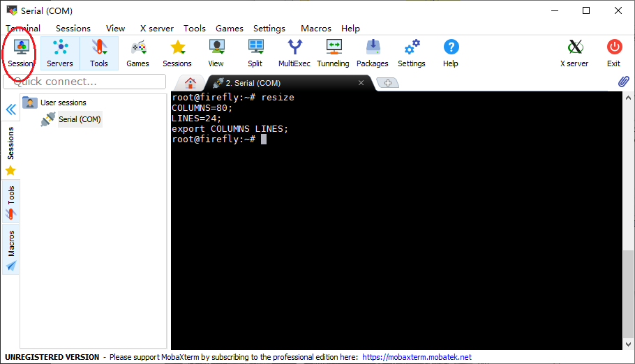
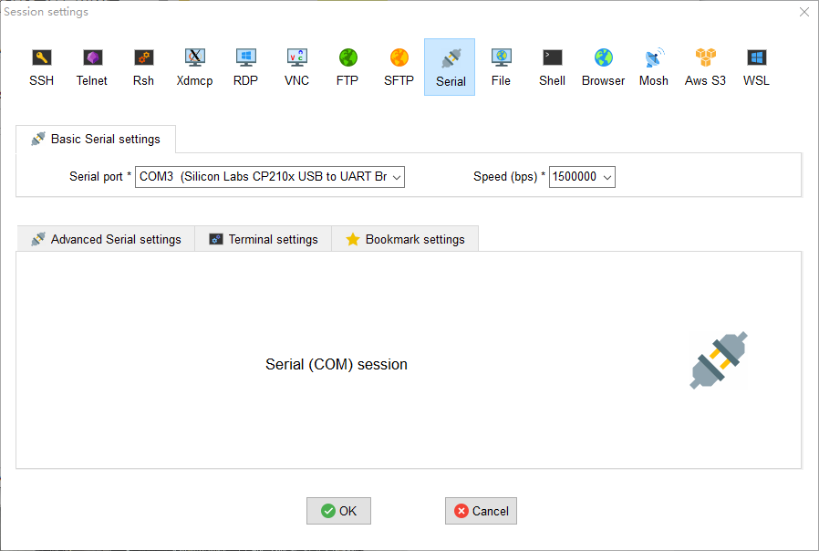
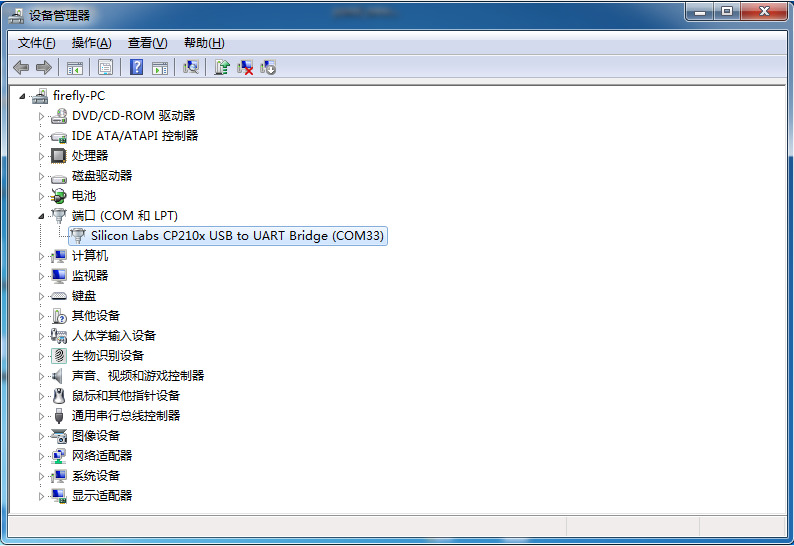
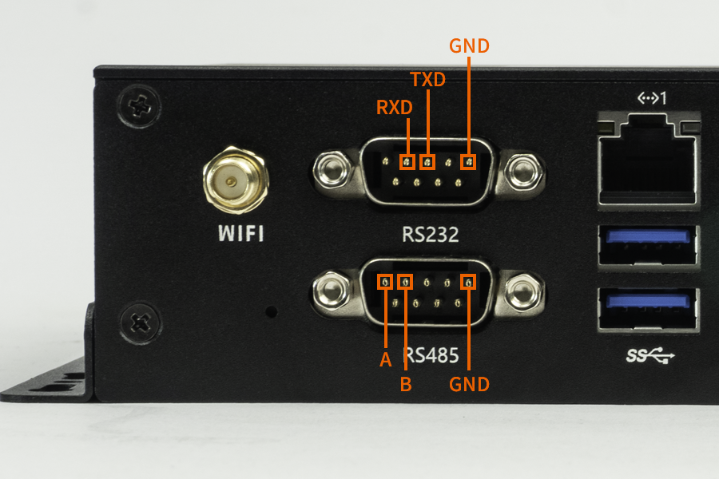
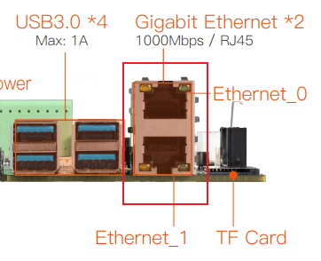
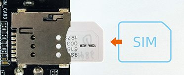
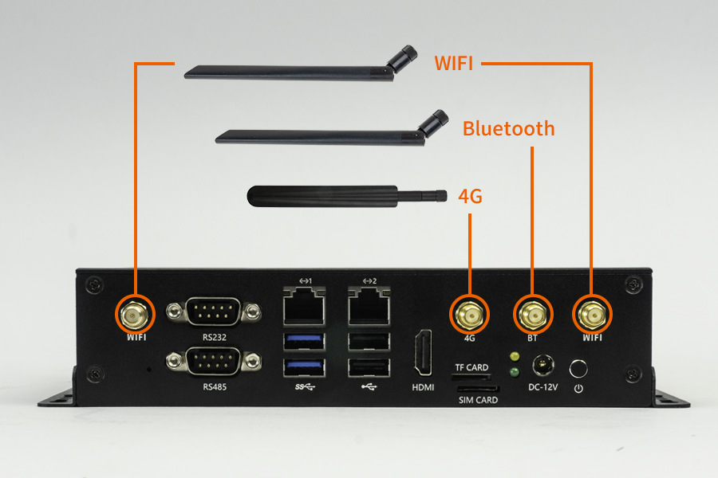

# 硬件功能使用
## 调试串口 [step]

EC-A1684JD4 需要外接 RS232 串口线连接调试串口进行调试。
AIO-1684JD4 可以使用 RS232 转 USB 接到 PC 机进行串口调试，登录账号、密码均为 `linaro`。

串口参数为：

* 波特率：115200
* 数据位：8
* 停止位：1
* 奇偶校验：无
* 流控：无

### Windows 上使用串口调试

Windows 上一般用 putty 或 SecureCRT 软件，这里推荐使用 MobaXterm 免费版本，这是一款功能强大的终端软件，其它串口软件的使用方法与之类似。

到这里[下载 MobaXterm](https://mobaxterm.mobatek.net/)：

1. 选择 `session` 为 `Serial`。
2. 将 `Serial port` 修改为在设备管理器中找到的 COM 端口。
3. 设置 `Speed (bsp)` 为 `115200`。
4. 点击 `OK` 按钮。

<center>


</center>
<center>


</center>

### Linux 上使用串口调试

在 Linux 上可以有多种选择：minicom、picocom、kermit。篇幅关系，以下介绍 minicom 的使用。

安装 minicom：

```
sudo apt-get install minicom
```

连接好串口线后，看一下串口设备文件是什么，下面示例是 `/dev/ttyUSB0`：

```
$ ls /dev/ttyUSB*
/dev/ttyUSB0
```

运行：

```
$ sudo minicom
Welcome to minicom 2.7
OPTIONS: I18n
Compiled on Jan  1 2014, 17:13:19.
Port /dev/ttyUSB0, 15:57:00
Press CTRL-A Z for help on special keys
```

以上提示 `CTRL-A Z` 是转义键，按 `Ctrl-a` 然后再按 `z` 就可以调出菜单：

```
   +-------------------------------------------------------------------+
                         Minicom Command Summary                      |
  |                                                                    |
  |              Commands can be called by CTRL-A <key>                |
  |                                                                    |
  |               Main Functions                  Other Functions      |
  |                                                                    |
  | Dialing directory..D  run script (Go)....G | Clear Screen.......C  |
  | Send files.........S  Receive files......R | cOnfigure Minicom..O  |
  | comm Parameters....P  Add linefeed.......A | Suspend minicom....J  |
  | Capture on/off.....L  Hangup.............H | eXit and reset.....X  |
  | send break.........F  initialize Modem...M | Quit with no reset.Q  |
  | Terminal settings..T  run Kermit.........K | Cursor key mode....I  |
  | lineWrap on/off....W  local Echo on/off..E | Help screen........Z  |
  | Paste file.........Y  Timestamp toggle...N | scroll Back........B  |
  | Add Carriage Ret...U                                               |
  |                                                                    |
  |             Select function or press Enter for none.               |
  +--------------------------------------------------------------------+
```

根据提示按 `O` 进入设置界面：

```
           +-----[configuration]------+
           | Filenames and paths      |
           | File transfer protocols  |
           | Serial port setup        |
           | Modem and dialing        |
           | Screen and keyboard      |
           | Save setup as dfl        |
           | Save setup as..          |
           | Exit                     |
           +--------------------------+
```

把光标移动到 `Serial port setup`，按 enter 进入串口设置界面，再输入前面提示的字母，选择对应的选项，设置成如下：

```
   +-----------------------------------------------------------------------+
   | A -    Serial Device      : /dev/ttyUSB0                              |
   | B - Lockfile Location     : /var/lock                                 |
   | C -   Callin Program      :                                           |
   | D -  Callout Program      :                                           |
   | E -    Bps/Par/Bits       : 115200 8N1                                |
   | F - Hardware Flow Control : No                                        |
   | G - Software Flow Control : No                                        |
   |                                                                       |
   |    Change which setting?                                              |
   +-----------------------------------------------------------------------+
```

<Callout title="注意" type="warn">`Hardware Flow Control` 和 `Software Flow Control` 都要设成 No，否则可能导致无法输入。</Callout>

设置完成后回到上一菜单，选择 `Save setup as dfl` 即可保存为默认配置，以后将默认使用该配置。

### 使用 DEBUG 口调试

如果要进行 U-Boot 或内核开发，需要使用 DEBUG 口进行调试，操作与 RS232 调试是一致的，需要注意的是适配器及其驱动问题。

#### 选购适配器

网店上有许多 USB 转串口的适配器，按芯片来分，有以下几种：

| 串口  | 最高波特率 | 是否推荐 | 评价 | 购买链接 |
| :--------: | :-------: |:-------: | :-------: | :-------: |
| [CP2104](https://item.taobao.com/item.htm?spm=a1z10.5-c.w4002-12605442688.14.aa5e1e8srwECg&id=546045713700) | 2Mbps | 推荐 | 支持高波特率通信，稳定性好耐用 | [点击购买](https://item.taobao.com/item.htm?spm=a1z10.5-c.w4002-12605442688.14.aa5e1e8srwECg&id=546045713700) |
| CH340 | 2Mbps | 不推荐 | 实际使用中发现，市面上很多 CH340 的实际波特率达不到 1.5 Mbps |  |
| PL2303 | 1.2Mbps | 不推荐 | 最高波特率达不到 1.5Mbps |  |

一般来说，采用 CH340 芯片的适配器，性能比较稳定，价格上贵一些。

<Callout title="提示" type="info">EC-A1684JD4 默认的波特率是 115200。</Callout>

#### 硬件连接

USB 转串口适配器，有四个引脚：

* 3.3V 电源（NC），不需要连接
* GND，串口的地线，接开发板串口的 GND 针
* TXD，串口的输出线，接开发板串口的 TX 针
* RXD，串口的输入线，接开发板串口的 RX 针

<Callout title="注意" type="warn">如使用其它串口适配器遇到 TX 和 RX 不能输入和输出的问题，可以尝试对调 TX 和 RX 的连接。</Callout>

#### 驱动安装

Windows 系统需要安装适配器驱动（Linux 则不需要），下载驱动并安装:

* [CH340](https://www.wch.cn/downloads/CH341SER_EXE.html)
* [PL2303](https://www.prolific.com.tw/en/portfolio-item/pl2303gl/)
* [CP210X](https://www.silabs.com/software-and-tools/usb-to-uart-bridge-vcp-drivers)

插入适配器后，系统会提示发现新硬件，并初始化，之后可以在设备管理器找到对应的 COM 口：

<center>


</center>

## UART [step]

EC-A1684JD4 板载串口的 Pinout 如下图所示：

<center>


</center>

板载串口即调试串口（RS232 电平），对应设备节点 `/dev/ttyS1`，默认波特率 `115200`。

### 串口回环测试

短接串口的 TXD 与 RXD 引脚后，在设备上运行下列命令：

```shell
stty -F /dev/ttyS1 115200
cat /dev/ttyS1 &
echo "firefly test" > /dev/ttyS1
```

终端输出 `firefly test` 即表示串口收发正常。


## 登录与网络配置 [step]

### 登录

EC-A1684JD4 支持调试串口登录和以太网 SSH 登录两种方式，登录账号与密码均为 `linaro`。

* 调试串口（RS232）登录：使用方法见上文「调试串口」。
* 以太网 SSH 登录：EC-A1684JD4 拥有两个以太网接口，默认出厂时网口 0（靠近串口）设置了动态 IP，而网口 1（靠近 HDMI 口）设置了静态 IP `192.168.150.1`，子网掩码 `255.255.255.0`，可以将 PC 设置成 `192.168.150.2/24` 来做初次登录。网口 0 是由路由器分配 IP，事先一般是不清楚 IP 地址信息，因此用户初次登录最好选择网口 1。

在网口灯闪烁正常后，打开终端使用 `ssh` 登录，端口号为 `22`，用户名密码同样均为 `linaro`:

```shell
ssh linaro@192.168.150.1
```

若登录失败，可以尝试使用 PC 机是否可以 `ping` 通 EC-A1684JD4 网口 1 的 IP 地址，注意的是 PC 机要添加同网段 IP，原因是 PC 机的 IP 地址不一定处于同一网段。

以下是 PC 添加同网段 IP 的方法（使用管理员模式）：

- windows 10

  ```
  netsh int ipv4 add address "以太网" 192.168.150.101 255.255.255.0
  ```
  其中 `"以太网"` 指的是网络接口，`192.168.150.101` 是 IP 地址，`255.255.255.0` 则为子网掩码。

- linux

  ```shell
  ifconfig enp4s0:1 192.168.150.89
  ```
  其中 `enp4s0` 是 PC 机的网卡驱动名称，具体需要执行 `ifconfig` 命令查看。

### 网络 IP 配置

#### Debian 系统

在 Debian 9 系统，双网口中的 `eth0` 默认是动态获取 IP 的（即 DHCP），`eth1` 是固定成了 `192.168.150.1`。

`eth1` 的配置是通过 `/etc/network/interfaces.d/eth1` 文件完成的，这个文件是对 Debian 原始网络配置唯一的修改。

```shell
linaro@bm1684:~$ cat /etc/network/interfaces.d/eth1
auto eth1
iface eth1 inet static
      address 192.168.150.1
      netmask 255.255.255.0
      dns-nameservers 192.168.150.1
```

如果用户删掉这个文件，那么 `eth1` 会变成跟 `eth0` 一样的 DHCP 方式获取 IP；如果用户想要把 `eth0` 也固定 IP，就只需在 `/etc/network/interafces.d` 文件夹下创建一个 `eth0` 文件，重启后生效。

注意的是最好不要把两个网卡配置成同一网段，否则可能会出现问题。

#### Ubuntu 系统

在 Ubuntu20.0 系统，双网口中的 `eth0` 默认是动态获取 IP 的（即 DHCP），`eth1` 是固定成了 `192.168.150.1`。

`eth1` 的配置是通过 `/etc/netplan/01-netcfg.yaml` 文件完成的，这个文件可对 Ubuntu 系统原始网络配置进行修改。

```shell
linaro@bm1684:~$ cat /etc/netplan/01-netcfg.yaml  | more
network:
        version: 2
        renderer: networkd
        ethernets:
                eth1:
                        dhcp4: no
                        addresses: [192.168.150.1/24]
                        optional: yes
```

如果用户删掉这个文件，那么 `eth1` 会变成跟 `eth0` 一样的 DHCP 方式获取 IP；如果用户想要把 `eth0` 也固定 IP，就只需在 `/etc/netplan/01-netcfg.yaml` 文件中添加 `eth0` 节点（参考 `eth1`），重启生效即可。

## ETH 使用 [step]

EC-A1684JD4 提供两个千兆以太网接口，默认网络配置如下：

- 外壳标有 “1”，靠近 RS232/RS485 接口的网口，对应系统 `eth0` 网络接口，设置为 DHCP 模式。
- 外壳标有 “2”，靠近 HDMI 接口的网口，对应系统 `eth1` 网络接口，设置为静态地址模式：`192.168.150.1/24`。

<center>


</center>

### 1. 初次访问与登录

网口 1（`eth1`）为静态 IP `192.168.150.1`，子网掩码 `255.255.255.0`。初次访问建议先将 PC 设置成同网段 IP（如 `192.168.150.2/24`）：

- Windows 10（管理员模式）：

  ```
  netsh int ipv4 add address "以太网" 192.168.150.101 255.255.255.0
  ```
  其中 `"以太网"` 指的是网络接口，`192.168.150.101` 是 IP 地址，`255.255.255.0` 则为子网掩码。

- Linux：

  ```shell
  ifconfig enp4s0:1 192.168.150.89
  ```
  其中 `enp4s0` 是 PC 机的网卡驱动名称，具体需要执行 `ifconfig` 命令查看。

PC 能成功 `ping` 通 `192.168.150.1` 后，即可使用 `ssh` 登录，端口号为 `22`，用户名密码均为 `linaro`：

```
ssh linaro@192.168.150.1
```

### 2. 网络 IP 配置说明

在默认情况中，EC-A1684JD4 的网口 0 设置了动态 IP，网口 1 设置了静态 IP。这些配置都是通过系统中的 `/etc/netplan/01-netcfg.yaml` 文件实现的。

```shell
linaro@bm1684:~$ cat /etc/netplan/01-netcfg.yaml
network:
        version: 2
        renderer: networkd
        ethernets:
                eth0:
                        dhcp4: yes
                        addresses: []
                        optional: yes
                        dhcp-identifier: mac
                eth1:
                        dhcp4: no
                        addresses: [192.168.150.1/24]
                        optional: yes
```

用户可通过修改 `/etc/netplan/01-netcfg.yaml` 文件达到修改网络配置的目的，举例如：

- 配置网口 0 为静态 IP：参考原 `eth1` 设置修改 `eth0` 节点，将 `dhcp4` 参数修改为 `no`，并添加 IP 地址进 `addresses` 参数中。

- 配置网口 1 为动态 IP：参考原 `eth0` 设置修改 `eth1` 节点，将 `dhcp4` 参数修改为 `yes`，并去除 `addresses` 参数中的 IP 地址。

在完成 `/etc/netplan/01-netcfg.yaml` 文件的修改后，用户可以通过执行 `sudo netplan apply` 命令使设置立即生效。

## RS232 / RS485 [step]

EC-A1684JD4 提供 RS232 和 RS485 各一个接口：

* RS485：设备名称为 `/dev/ttyS2`，支持全双工，默认波特率为 `9600`。
* RS232：设备名称为 `/dev/ttyS1`，支持全双工，默认波特率为 `115200`。需要注意的是 RS232 默认是用作登录使用，若要作为普通通讯串口使用，需先禁用串口登录服务：

  ```shell
  sudo systemctl disable --now serial-getty@ttyS1.service
  ```

### RS485 收发测试

（1）连接硬件：将 RS485 的 A、B、GND 引脚分别和 PC 机串口适配器（USB 转 485 转串口模块）的 A、B、GND 引脚相连。

（2）打开 PC 机串口终端，在终端打开 kermit，并设置波特率：

```shell
$ sudo kermit
C-Kermit> set line /dev/ttyUSB0
C-Kermit> set speed 9600
C-Kermit> set flow-control none
C-Kermit> connect
```

其中 `/dev/ttyUSB0` 为 USB 转串口适配器的设备文件，注意要以实际 PC 机识别的为准。

（3）发送数据：RS485 的设备文件为 `/dev/ttyS2`，在设备上运行下列命令：

```shell
sudo -s
stty -F /dev/ttyS2 9600 -echo
echo firefly RS485 test... > /dev/ttyS2
```

PC 机中的串口终端即可接收到字符串 "firefly RS485 test…"。

（4）接收数据：首先在设备上运行下列命令：

```shell
sudo -s
cat /dev/ttyS2
```

然后在 PC 机的串口终端输入字符串 "Firefly RS485 test…"，设备端即可见到相同的字符串。

RS232 的测试方法与 RS485 的步骤是类似的，只需要注意设备名称（`/dev/ttyS1`）与波特率（`115200`）即可。

## 显示接口 [step]

EC-A1684JD4 提供 1 个 HDMI 显示输出接口。EC-A1684JD4 不带有显卡芯片，且主控 HDMI 输出部分并没有使用标准的 framebuffer 驱动，出厂情况下接入 HDMI 是没有显示的。

若用户要测试 HDMI 显示，可接入 HDMI 接口，然后执行 `test-hdmi` 脚本：

```shell
linaro@bm1684:~$ sudo -i
root@bm1684:~# test-hdmi 
found (1024, 768) @ 60 fps
entry [0] = (1024, 768) added
found (1024, 768) @ 60 fps
found (1024, 768) @ 60 fps
found (1024, 768) @ 60 fps
found (1024, 768) @ 60 fps
found (1024, 768) @ 60 fps
found (1024, 768) @ 60 fps
found (1024, 768) @ 60 fps
found (1920, 1080) detailed timing desc
entry [1] = (1920, 1080) added
found (1920, 1080) detailed timing desc
found (1920, 1080) detailed timing desc
found (1920, 1080) detailed timing desc
```

## USB 接口 [step]

EC-A1684JD4 提供 2 个 USB 3.0 接口和 2 个 USB 2.0 接口。插入 U 盘后，存储设备会被识别为 `/dev/sdb1` 之类的节点，系统不支持自动挂载，需要手工进行 `mount` 挂载操作。

插入 U 盘，使用 `dmesg` 可知道 U 盘对应的 `sd` 设备：

```shell
[15460.953423] [5]  sdb: sdb1
```

挂载 U 盘：

```shell
# 创建挂载目录
mkdir disk
# 挂载
sudo mount /dev/sdb1 disk
# 查看 U 盘内的文件
ls disk
```

完成数据写入后，请及时使用 `sync` 或 `umount` 操作，关机时请使用 `sudo poweroff` 命令，避免暴力下电关机，以免数据丢失。

## GPIO 使用 [step]

BM1684 芯片包含 3 组 GPIO 控制器，每个控制 32 根 GPIO，与 Linux 的设备节点对应如下：

| GPIO控制器 | Linux设备节点 | GPIO 物理编号 | GPIO 逻辑编号 |
| :-------: | :---------: | :---------: | :--------: |
| #0 | /sys/class/gpio/gpiochip480 | 0到31  | 480到511 |
| #1 | /sys/class/gpio/gpiochip448 | 32到63 | 448到479 |
| #2 | /sys/class/gpio/gpiochip416 | 64到95 | 416到447 |

比如要操作 `GPIO6`，则需要：

1. 编号转换：物理编号是 `6`， 对应的逻辑编号是 `(480 + (6 - 0)) = 486`，这里的 `0` 代表 GPIO 物理编号的开始
2. 导出该 GPIO, 以 root 用户运行:
    ```
    echo 486 >/sys/class/gpio/export
    ```
3. 操作 GPIO，设定读取输入或输出指定值：
    ```
    cd /sys/class/gpio/gpio486
    # 设置输入模式
    echo in >direction
    cat value

    # 设置输出模式
    echo out >direction
    # 输出低电平
    echo 0 >value
    # 输出高电平
    echo 1 >value
    ```

有以下注意事项：
- 如果 GPIO 已经被其他驱动申请了的话，是无法导出 (export) 成功的，也就无法进行后续的读写操作。
- 涉及到 IO 功能的复用，如果该引脚的功能已经是 GPIO 的话，才可以用上面的方法；否则要在设备树里指定 pinctrl 状态。

一般来说，如果要简易地在用户层操作 GPIO，可在设备树里添加为 GPIO-LED。详情请参考 `linux-linaro-stable/arch/arm64/boot/dts/bitmain/bm1684_firefly.dtsi`。

## LED 使用 [step]

AIO-1684JD4 开发板上有 2 个 LED 灯:

| 颜色 | 位置 | 标号 | 描述 |
| ---- | :--: | ---- | ---- |
| 黄色 |  上 | DIY_LED | 用户控制 |
| 绿色 |  下 | WORK_LED | 上电打开 |

控制 LED 灯状态的命令示例（需要 root 权限）：

```
# 黄灯亮
echo 1 >/sys/class/leds/DIY_LED/brightness
# 黄灯灭
echo 0 >/sys/class/leds/DIY_LED/brightness

# 绿灯亮
echo 1 >/sys/class/leds/WORK_LED/brightness
# 绿灯灭
echo 0 >/sys/class/leds/WORK_LED/brightness
```

## RTC 使用 [step]

AIO-1684JD4 开发板上有 `HYM8563` 的 RTC (Real Time Clock) 芯片，在开发板断电的情况下也能通过纽扣电池保持时钟的运行。

### 1. 查看 RTC 时间

```
$ sudo hwclock
2022-08-09 10:53:15.268874+0800
```

### 2. 查看系统时间

```
$ date
Tue Aug  9 10:57:03 CST 2022
```

### 3. 设置系统时间为 RTC 时间

```
$ sudo hwclock -s
```

### 4. 将当前系统时间保存到 RTC

```
$ sudo hwclock -w
```

## TF 卡 [step]

EC-A1684JD4 提供 1 个 TF 卡座，可用于挂载 TF 卡扩展存储，也可以通过 TF 卡升级固件。

TF 卡挂载与 U 盘是类似的，使用 `dmesg` 可知道 TF 卡对应的 `mmcblk` 设备：

```shell
[16220.776440] [4]  mmcblk1: p1
```

挂载 TF 卡：

```shell
# 创建挂载目录
mkdir media
# 挂载
sudo mount /dev/mmcblk1p1 media
# 查看 TF 卡内的文件
ls media
```

TF 卡升级固件的方法请参阅[固件升级](fw_upgrade.md)。

## SIM 卡 [step]

EC-A1684JD4 的 SIM 卡槽用于配合 4G 模块实现移动网络连接。**4G 模块为选配**，需要在机箱内部安装 4G 模块后，SIM 卡功能才能正常使用。SIM 卡插入方向如下图所示，插拔前请先断电。

<center>


</center>

## 天线连接 [step]

EC-A1684JD4 的天线连接如下图所示：

<center>


</center>


## 风扇 [step]

EC-A1684JD4 风扇工作分为 4 个等级：

| 主控当前温度 | 风扇工作等级 |
|:----------:|:----------:|
| ≥ 33℃ | 1 |
| ≥ 45℃ | 2 |
| ≥ 55℃ | 3 |
| ≥ 60℃ | 4 |

风扇工作等级越高，转速越快，如果主控当前温度低于 33℃，风扇默认是关闭状态。

用户可通过执行以下命令查看当前主控的工作温度：

```shell
cat /sys/class/thermal/thermal_zone1/temp
```

例如以下是 45.5 ℃：

```shell
linaro@bm1684:~$ cat /sys/class/thermal/thermal_zone1/temp
45500
```

另外，用户也可以自己手动打开风扇（写入 0-4， 0 是关闭， 4 是最大等级）：

```
sudo -i
echo 4 > /sys/class/thermal/cooling_device0/cur_state
```

## 设备 ID [step]

### 查看设备 ID

需要查看设备 ID 可通过读取核心板序列号，读取成功后会返回 json 格式的字符串：

```shell
linaro@bm1684:~$ cat /sys/bus/i2c/devices/1-0017/information
{
	"model": "SA5",
	"chip": "BM1684",
	"mcu": "STM32",
	"product sn": "HQDZKETBWY2100012",
	"board type": "0x01",
	"mcu version": "0x38",
	"pcb version": "0x12",
	"reset count": 0
}
```

### 更新设备 ID

设备 ID 更新一般用于更新产品 SN 号，它存放在 MCU 的 EEPROM 中。

用户需要修改，可以通过如下方式：

（1）首先需要解锁 MCU EEPROM：

```shell
sudo -i
echo 0 > /sys/devices/platform/5001c000.i2c/i2c-1/1-0017/lock
```

（2）写入 SN 号：

```shell
echo "HQATEVBAIAIAI0001" > sn.txt
dd if=sn.txt of=/sys/bus/nvmem/devices/1-006a0/nvmem count=17 bs=1
```

（3）最后重新对 MCU EEPROM 加锁，以避免意外改写：

```shell
echo 1 > /sys/devices/platform/5001c000.i2c/i2c-1/1-0017/lock
```

