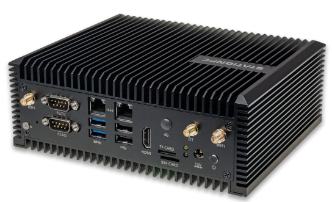
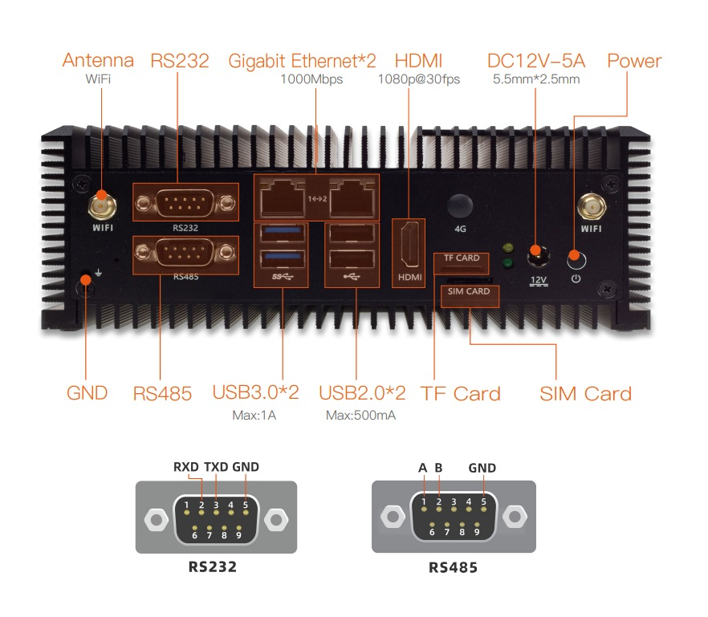

# 简介

[规格书](https://download.t-firefly.com/Spec/Computers/EC-A1684XJD4%20FD_Specification_CN.pdf) | [购买链接](https://item.taobao.com/item.htm?id=724600191824) | [下载资料](https://community.t-firefly.com/doc/download/208)

EC-A1684XJD4 FD 采用 SOPHON 算能 AI 处理器 BM1684X，可配置 16GB 大内存以及 128GB eMMC；工业级全金属外壳，铝合金导热，高效散热，无风扇设计，零噪音。运行稳定，满足工业级应用需求；支持 32TOPS（INT8）峰值算力，16TFLOPS（FP16/BF16）算力，2TFLOPS（FP32）高精度算力；支持 32 路 H.265/H.264 1080p@25fps 视频解码；支持主流编程框架，工具链完备易用度高，算法迁移代价小；适用于视觉计算、边缘计算、通用算力服务、智慧交通、无人超市、无人机等多种 AI 计算场景。

## 接口描述

**EC-A1684XJD4 FD** 提供了丰富的接口，具体如下图：

## 资源与技术支持

* [核心板 Core-1684XJD4 Wiki](https://community.t-firefly.com/docs/products/system-on-modules/Core-1684XJD4/started)：包含调试串口、系统固件等开发资料
* [技术交流论坛](https://forum.t-firefly.com/)：超过10万企业客户和用户沟通交流平台

### 联系方式

* 邮箱：sales@t-firefly.com
* 手机：(+86) 186 8811 7175
* 座机：0760-89881218
* 地址：广东省中山市东区中山四路 57 号宏宇大厦 2101 室