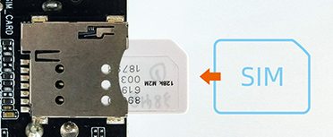
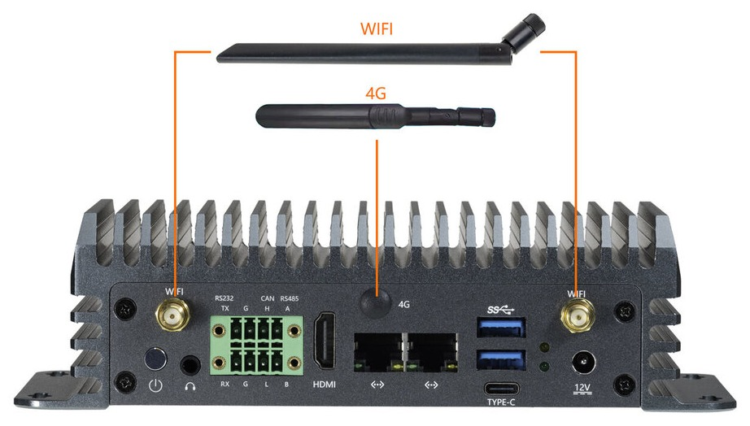
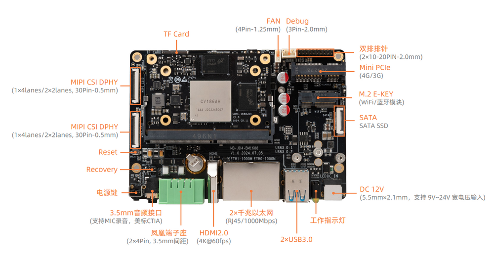
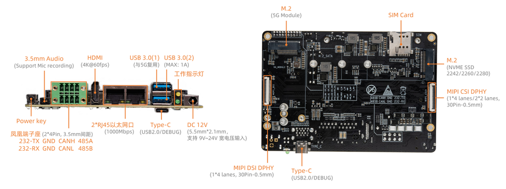

# 硬件功能使用
## 调试串口 [step]

EC-A186JD4 板载 Type-C 调试串口，使用 Type-C 转 USB 数据线连接机器的 Type-C 口和 PC 的 USB 口即可直连调试。

串口参数为：

* 波特率：115200
* 数据位：8
* 停止位：1
* 奇偶校验：无
* 流控：无

登录终端的用户名、密码均为 `linaro`。

## 显示接口 [step]

EC-A186JD4 提供 1 路 HDMI 输出接口，支持标准 HDMI 2.0 输出。

可以使用以下命令测试 HDMI 接口：

```shell
insmod /mnt/system/ko/soph_drm.ko # 安装显示框架驱动
systemctl stop SophonHDMI.service # 关闭 HDMI 的显示界面
systemctl restart SophonHDMI.service  # 恢复 HDMI 的显示界面
```

也可以通过 `modetest` 去测试：

```shell
modetest -M cvitek -s 42@40:1920x1080-60@RG24
```

其中 `42@40:1920x1080-60@RG24` 根据实际接的显示器的分辨率来修改。

## UART [step]

EC-A186JD4 板载 RS232 串口对应设备节点 `/dev/ttyS2`，默认波特率 `115200`。

### 串口回环测试

短接串口的 TXD 与 RXD 引脚后，在设备上运行下列命令：

```shell
stty -F /dev/ttyS2 115200
cat /dev/ttyS2 &
echo "firefly test" > /dev/ttyS2
```

终端输出 `firefly test` 即表示串口收发正常。


## 登录与网络配置 [step]

除通过 Type-C 调试串口登录（见上文调试串口一节）外，EC-A186JD4 还提供 2 个千兆以太网口，可以通过以太网 SSH 远程登录。

### 以太网 SSH 登录

EC-A186JD4 默认出厂时网口 0（靠近 USB 座子）设置了动态 IP，而网口 1（靠近 HDMI 口）设置了静态 IP `192.168.150.1`，子网掩码 `255.255.255.0`，可以将 PC 设置成 `192.168.150.2/24` 来做初次登录。

网口 0 是由路由器分配 IP，事先一般是不清楚 IP 地址信息，因此用户初次登录最好选择网口 1。

在网口灯闪烁正常后，打开终端使用 `ssh` 登录，端口号为 `22`，用户名密码均为 `linaro`:

```shell
ssh linaro@192.168.150.1
```

若登录失败，可以尝试使用 PC 机是否可以 `ping` 通 EC-A186JD4 网口 1 的 IP 地址，注意的是 PC 机要添加同网段 IP，原因是 PC 机的 IP 地址不一定处于同一网段。

以下是 PC 添加同网段 IP 的方法（使用管理员模式）：

- windows 10

  ```
  netsh int ipv4 add address "以太网" 192.168.150.101 255.255.255.0
  ```
  其中`"以太网"`指的是网络接口，`192.168.150.101` 是 IP 地址，`255.255.255.0`则为子网掩码。

- linux

  ```shell
  ifconfig enp4s0:1 192.168.150.89
  ```
  其中 `enp4s0` 是 PC 机的网卡驱动名称，具体需要执行 `ifconfig` 命令查看。

### 网络 IP 配置（netplan）

在 Ubuntu 系统，双网口中的 `eth0` 默认是动态获取 IP 的（即 DHCP），`eth1` 是固定成了 `192.168.150.1`。

网络配置是通过 `/etc/netplan/01-netcfg.yaml` 文件完成的，这个文件可对 Ubuntu 系统原始网络配置进行修改。

```shell
linaro@sophon:~$ cat /etc/netplan/01-netcfg.yaml
network:
        version: 2
        renderer: networkd
        ethernets:
                eth0:
                        dhcp4: yes
                        addresses: []
                        optional: yes
                        dhcp-identifier: mac
                eth1:
                        dhcp4: no
                        addresses: [192.168.150.1/24]
                        optional: yes
```

如果用户删掉这个文件，那么 `eth1` 会变成跟 `eth0` 一样的 DHCP 方式获取 IP；如果用户想要把 `eth0` 也固定 IP，就只需在 `/etc/netplan/01-netcfg.yaml` 文件中修改 `eth0` 节点（参考 `eth1`），重启生效即可。

## USB 接口 [step]

EC-A186JD4 提供 2 个 USB 3.0 接口。

插入 U 盘等存储设备后，存储设备会被识别为 `/dev/sdb1` 之类的节点。系统不支持自动挂载，需要手工进行 `mount` 挂载：

```shell
# 创建挂载目录
mkdir disk
# 挂载
sudo mount /dev/sdb1 disk
# 查看 U 盘内的文件
ls disk
```

完成数据写入后，请及时使用 `sync` 或 `umount` 操作，关机时请使用 `sudo poweroff` 命令，避免暴力下电关机，以免数据丢失。

## TF 卡 [step]

EC-A186JD4 提供 TF 卡座。TF 卡的挂载方法与 U 盘类似：

```shell
# 创建挂载目录
mkdir media
# 挂载
sudo mount /dev/mmcblk1p1 media
# 查看 TF 卡内的文件
ls media
```

TF 卡同时也可用于固件升级，请参阅[固件升级](fw_upgrade.md)。

## SIM 卡 [step]

EC-A186JD4 的 SIM 卡槽用于配合 4G 模块实现移动网络连接。**4G 模块为选配**，需要在机箱内部安装 4G 模块后，SIM 卡功能才能正常使用。SIM 卡插入方向如下图所示，插拔前请先断电。

<center>


</center>

## 天线连接 [step]

EC-A186JD4 的天线连接如下图所示：

<center>


</center>


## NVMe SSD [step]

EC-A186JD4 提供 NVME 接口（PCIE3.0 x 1）。一般可挂载的 PCIE 节点为：`/dev/nvme0n1p1`。

```shell
# 创建挂载目录
mkdir nvme_dir
# 挂载
sudo mount /dev/nvme0n1p1 nvme_dir
# 查看 PCIE SSD 的文件
ls nvme_dir
```


## 串口（RS232 / RS485） [step]

EC-A186JD4 有一个 RS485 接口，设备名称为 `/dev/ttyS4`，支持半双工，默认波特率为 `9600`。

还有一个 RS232 接口，设备名称为 `/dev/ttyS2`，支持全双工，默认波特率为 `115200`。

接口位置参见页首整机图。

### RS485 调试方法

用户可以根据不同的接口使用不同的主机的 USB 转串口适配器向开发板的串口收发数据，例如 RS485 的调试步骤如下：

(1) 连接硬件

将 EC-A186JD4 的 RS485 的 A、B、GND 引脚分别和主机串口适配器（USB 转 485 转串口模块）的 A、B、GND 引脚相连。

(2) 打开主机的串口终端

在终端打开 kermit，并设置波特率：

```
$ sudo kermit
C-Kermit> set line /dev/ttyUSB0
C-Kermit> set speed 9600
C-Kermit> set flow-control none
C-Kermit> connect
```

* `/dev/ttyUSB0` 为 USB 转串口适配器的设备文件

(3) 发送数据

RS485 的设备文件为 `/dev/ttyS4`。在设备上运行下列命令：

<Callout title="注意" type="warn">在运行命令之前，需要打开 RS485 的发送功能，因为机器有一个 gpio 切换开关，可以切换 RS485 为发送状态还是接受状态。</Callout>

```
sudo -s
echo 1 > /sys/class/leds/RS485_H_SEND_L_RECV/brightness # 1 -> TX ， 0 -> RX
stty -F /dev/ttyS4 9600 -echo
echo firefly RS485 test... > /dev/ttyS4
```

主机中的串口终端即可接收到字符串 "firefly RS485 test..."

(4) 接收数据

首先在设备上运行下列命令：

```
sudo -s
cat /dev/ttyS4
```

然后在主机的串口终端输入字符串 "Firefly RS485 test..."，设备端即可见到相同的字符串。

### RS232 调试方法

测试方法与 RS485 的步骤是类似的，只需要注意设备名称与波特率即可。唯一不同的是， RS232 **不需要**去做发送和接收的开关切换。

## CAN [step]

### CAN 简介

CAN(Controller Area Network)总线，即控制器局域网总线，是一种有效支持分布式控制或实时控制的串行通信网络。CAN总线是一种在汽车上广泛采用的总线协议，被设计作为汽车环境中的微控制器通讯。如果想了解更多的内容可以参考[CAN应用报告](https://www.ti.com/lit/an/sloa101b/sloa101b.pdf)。

### 硬件连接

EC-A186JD4 的 CAN 接口位置参见页首整机图。由于只有一个 CAN，所以默认在内核中，第一个创建的设备为 `can0`。

### CAN 通信测试

使用 candump 和 cansend 工具进行收发报文测试即可：

```
#在收发端关闭can0设备
ip link set can0 down
#在收发端设置比特率为250Kbps
ip link set can0 type can bitrate 250000
#在收发端打开can0设备
ip link set can0 up
#在接收端执行candump,阻塞等待报文
candump can0
#在发送端执行cansend，发送报文
cansend can0 123#1122334455667788
```

### FAQS

总结调试过程中遇到的几个问题及解决方法：

#### 报文发送后很久才接收到，或者接收不到。

检查总线 CAN_H 和 CAN_L，杜邦线是否松动或者接反。

## 音频（耳机） [step]

EC-A186JD4 支持美标耳机接口。

播放测试：

```
$ aplay -D hw:CARD=cv186xdac,DEV=1 /usr/share/sounds/alsa/Front_Center.wav
```

录音测试：

```
$ arecord -D hw:CARD=cv186xadc,DEV=0  -c 2 -r 48000  -f S16_LE test.wav # 录制音频（单声道）
$ aplay -D hw:CARD=cv186xdac,DEV=1  test.wav # 播放录制好的音频
```

## ADC 使用 [step]

AIO-186JD4 开发板上并没有引出外部的 ADC, 但 Core-186JD4 的金手指引出了多路 ADC， 在控制台下运行 ADC 读写命令或者自行在内核态或者用户态编写 ADC 读写程序，就
可以对 ADC 进行输入输出操作。

用户层通过访问 IIO 接口来实现 5 通道，12-bit ADC 的触发、采样等操作。

* 参考电压为 1.5v ref 
* adc 引脚和 sysfs 文件对应关系如下：
    * adc1 对应 sysfs 文件为 in_voltage1_raw
    * adc2 对应 sysfs 文件为 in_voltage2_raw
    * adc3 对应 sysfs 文件为 in_voltage3_raw
    * sar0 对应 sysfs 文件为 in_voltage4_raw
    * sar1 对应 sysfs 文件为 in_voltage5_raw
* 电压值计算公式：vol = val * 1500 / 4096，单位：mV

### 操作示例 [step]
#### ADC 操作命令示例
1. 指定 ADC 通道 1~5, 此例为 ADC1:
```
echo 1 > /sys/bus/iio/devices/iio:device0/in_voltage1_raw
```

2. 读出刚才指定的 ADC channel 值:
```
cat /sys/bus/iio/devices/iio:device0/in_voltage1_raw
```

#### 用户态 ADC 读取操作程序示例
参考如下：
```
fd = open("/sys/bus/iio/devices/iio:device0/in_voltage1_raw", O_RDWR|
O_NOCTTY|O_NDELAY);
if (fd < 0)
printf("open adc err!\n");
write(fd, "1", 1);
lseek(fd, -1, SEEK_CUR);
char buffer[512] = {0};
int len = 0;
unsigned int adc_value = 0;
len = read(fd, buffer, 5);
if (len != 0) {
printf("read buf: %s\n", buffer);
adc_value= atoi(buffer);
printf("adc value is %d\n", adc_value);
}
write(fd, "0", 1);
close(fd);
```

## CAMERA 使用 [step]

EC-A186JD4 引出 3 个 `MIPI CSI` 接口（1*4 lanes / 2*2 lanes），单一 sensor 最大支持 8K@15fps 线性输入或 12M@60fps HDR 输入。

###  MIPI CSI [step]
接口位置如图所示





#### 使用命令抓图

以 Firefly 的 [CAM-8MS1M](https://community.t-firefly.com/docs/products/accessories/CAM-8MS1M/started) 摄像头为例（连接 MIPI CSI0）：
进入系统之后，通过 `sudo -s`获取 root 权限，并执行以下抓图命令。
```
insmod /mnt/system/ko/v4l2_xc7160.ko # 安装驱动
systemctl stop SophonHDMI.service # 关闭 HDMI 的显示界面
/opt/sophon/sophon-soc-libisp_1.0.0/bin/ispv4l2_ut 5 # 抓取 v4l2 流
/opt/sophon/sophon-ffmpeg-latest/bin/ffmpeg -s 1920x1080 -pix_fmt yuyv422 -i v4l2_video0_7.yuv -hide_banner -loglevel error  -vf format=rgb24 -c:v rawvideo -f rawvideo -vframes 1 -  | sudo dd of=/dev/fb0 bs=1920x1080x3 # 这里假设你接的 HDMI 屏幕是 1920 x 1080 分辨率的
systemctl restart SophonHDMI.service  # 恢复 HDMI 的显示界面
```

目前系统默认只打开了 MIPI CSI0，如果需要使用 MIPI CSI1/2 ，则需要修改 SDK 配置以及 ko 文件。 

## DISPLAY 使用 [step]

EC-A186JD4 引出了一路 HDMI 接口（支持 4K@60fps）以及 MIPS DSI 接口（最大输出能力 1440P (2560 * 1440)@60fps，接口位置如图所示  。


<Callout title="注意" type="warn">`/mnt/system/ko/soph_drm.ko` 为整个显示框架的驱动，诸如 HDMI 以及 MIPI DSI 等模块驱动都是打包进这个驱动里面的。</Callout>

### HDMI [step]
EC-A186JD4 在开机之后，没有内置桌面环境，只跑一个显示程序：
```
insmod /mnt/system/ko/soph_drm.ko # 安装显示框架驱动
systemctl stop SophonHDMI.service # 关闭 HDMI 的显示界面
systemctl restart SophonHDMI.service  # 恢复 HDMI 的显示界面
```

### MIPI DSI [step]

目前系统只能存在一个显示，当你接着 HDMI 的时候，MIPI DSI 默认没有输出。
但你拔掉 HDMI ，你所接入的 MIPI 显示模组会以播放彩条的形式进行显示。

目前已适配 Firelfy 的 DM-M10R800 V2 显示模组。

## GPIO 使用 [step]

CV186AH 芯片包含 7 组 GPIO 控制器，每个控制 32 根 GPIO，与 Linux 的设备节点对应如下：

| GPIO控制器 | Linux设备节点 | GPIO 物理编号 | GPIO 逻辑编号 |
| :-------: | :---------: | :---------: | :--------: |
| #porta | /sys/class/gpio/gpiochip464 | 0到31  | 464到495 |
| #portb | /sys/class/gpio/gpiochip432 | 32到63 | 432到463 |
| #portc | /sys/class/gpio/gpiochip400 | 64到95 | 400到431 |
| #portd | /sys/class/gpio/gpiochip368 | 96到127 | 368到399 |
| #porte | /sys/class/gpio/gpiochip336 | 128到159 | 336到367 |
| #portf | /sys/class/gpio/gpiochip304 | 160到191 | 304到335 |
| #portg（RTCSYS_GPIO） | /sys/class/gpio/gpiochip272 | 0到31 | 272到303 |

其中 AIO-186JD4 支持扩展出一组 gpio 接口（I2C 扩展 GPIO）:

| GPIO控制器 | Linux设备节点 | GPIO 物理编号 | GPIO 逻辑编号 |
| :-------: | :---------: | :---------: | :--------: |
| #portx | /sys/class/gpio/gpiochip496 | 0到15 | 496到511 |

比如要操作 `porta` 的 `GPIO6`，则需要：

1. 编号转换：物理编号是 `6`， 对应的逻辑编号是 `(464 + (6 - 0)) = 470`，这里的 `0` 代表 GPIO 物理编号的开始
2. 导出该 GPIO, 以 root 用户运行:
    ```
    echo 470 >/sys/class/gpio/export
    ```
3. 操作 GPIO，设定读取输入或输出指定值：
    ```
    cd /sys/class/gpio/gpio470
    # 设置输入模式
    echo in >direction
    cat value
    
    # 设置输出模式
    echo out >direction
    # 输出低电平
    echo 0 >value
    # 输出高电平
    echo 1 >value
    ```

<Callout title="注意" type="warn">如果 GPIO 已经被其他驱动申请了的话，是无法导出 (export) 成功的，也就无法进行后续的读写操作。</Callout>

## LED 使用 [step]

AIO-186JD4 开发板上有 2 个 LED 灯（如图所示 ）:


| 颜色 | 位置 | 标号 | 描述 |
| ---- | :--: | ---- | ---- |
| 黄色 |  上 | DIY_LED | 用户控制 |
| 绿色 |  下 | WORK_LED | 上电打开 |

控制 LED 灯状态的命令示例（需要 root 权限）：

```
# 黄灯亮
echo 1 >/sys/class/leds/DIY_LED/brightness
# 黄灯灭
echo 0 >/sys/class/leds/DIY_LED/brightness

# 绿灯亮
echo 1 >/sys/class/leds/WORK_LED/brightness
# 绿灯灭
echo 0 >/sys/class/leds/WORK_LED/brightness
```

## STORAGE 使用 [step]

AIO-186JD4 开发板上有 1 个 PCIE3.0 x 1  接口，1 个 SATA 3.0 接口以及一个 TF-Card 接口。

接口位置如图所示


### PCIE 的使用 [step]

PCIE3.0  接口(该接口与 SATA 3.0 接口复用，默认系统使用 PCIE 接口)默认支持接 NVME SSD 2242/2260/2280 ,在系统默认的名字为 `nvme0n1`。

### SATA 的使用 [step]
如果想切换使用 SATA3.0 接口，需要做软件上的配置（bm1688_1688jd4.dtsi）:

```
#if 0
&pcie0{
	reset-gpio = <&porte 3 GPIO_ACTIVE_HIGH>; 
	status = "okay";
};
&sata{
	status = "disabled";
};
#else
&pcie0{
	reset-gpio = <&porte 3 GPIO_ACTIVE_HIGH>; 
	status = "disabled";
};
&sata{
	status = "okay";
};
#endif
```

## RTC 使用 [step]

AIO-186JD4 开发板上有 `TT8563RH` 的 RTC (Real Time Clock) 芯片，可通过该芯片去设置系统时钟。

### 1. 查看 RTC 时间

```
$ sudo hwclock
2024-05-09 10:53:15.268874+0800
```

### 2. 查看系统时间

```
$ date
```

### 3. 设置系统时间为 RTC 时间

```
$ sudo hwclock -s
```

### 4. 将当前系统时间保存到 RTC

```
$ sudo hwclock -w
```

## PWM 使用 [step]

AIO-186JD4 开发板上对外只引出一个 PWM（FAN）, 但 Core-186JD4 的金手指引出了多路 PWM， 在控制台下运行 PMW 读写命令或者自行在内核态或者用户态编写 PWM 读写程序，
就可以对 PWM 进行输入输出操作;

*  PWM 操作在定频时钟 100MHz，共有 20 路，每路可单独控制;
* CV186AH共有 5 个 PWM IP (pwmchip0/ pwmchip4/ pwmchip8/ pwmchip12/ pwmchip16), 各 IP 控制 4 路讯号, 总共可控制 20 路讯号；

在 Linux sysfs 中, pwm0~pwm3 的 device node 各自如下:
```
/sys/class/pwm/pwmchip0/pwm0~3
```
在 Linux sysfs 中, pwm4~pwm7 的 device node 各自如下:
```
/sys/class/pwm/pwmchip4/pwm0~3
```
以风扇的设备树配置为例：
```
&fan0 {
		compatible = "pwm-fan";
		#cooling-cells = <2>;
		pwms = <&pwm2 3 1000000 0>; 
		cooling-levels = <255 170 100 1>; // max 1
};
```
其中的 `pwms = <&pwm2 3 1000000 0>; ` 表示使用 PIN 脚中的 `PWM11`, 因为 `pwm2` 为第三组，`3` 表示第四个通道，由此得出：`3 x 4 = 12(0~11)`

以此类推
### 操作示例 [step]
#### PWM 操作命令示例：

1.在控制面板使用 echo 命令，配置待操作的 PWM 编号, 此例为 PWM1：
```
echo 1 > /sys/class/pwm/pwmchip0/export
```
2.设置 PWM 一个周期的持续时间，单位为 ns：
```
echo 1000000 >/sys/class/pwm/pwmchip0/pwm1/period
```
3.设置一个周期中的 "ON" 时间，单位为 ns，即占空比 `=duty_cycle/period=50%` ：
```
echo 500000 >/sys/class/pwm/pwmchip0/pwm1/duty_cycle
```
4.设置 PWM 使能
```
echo 1 >/sys/class/pwm/pwmchip0/pwm1/enable
```
#### 通过文件 IO 操作程序示例：

1.配置待操作的 PWM 编号, 以 PWM1 为例：  

```
fd = open("/sys/class/pwm/pwmchip0/export", O_WRONLY);
if(fd < 0)
{
dbmsg("open export error\n");
return -1;
}
ret = write(fd, "1", strlen("0"));
if(ret < 0)
{
dbmsg("Export pwm1 error\n");
return -1;
}
```

2.设置 PWM 一个周期的持续时间，单位为 ns：  

```
fd_period = open("/sys/class/pwm/pwmchip0/pwm1/period", O_RDWR);
ret = write(fd_period, "1000000”,strlen("1000000”));
if(ret < 0)
{
dbmsg("Set period error\n");
return -1;
}
```  

3.设置一个周期中的”ON”时间，单位为 ns: (此例占空比为 50%)

```
fd_duty = open("/sys/class/pwm/pwmchip0/pwm1/duty_cycle", O_RDWR);
ret = write(fd_duty, "500000", strlen("500000"));
if(ret < 0)
{
dbmsg("Set period error\n");
return -1;
}
```  

4.设置 PWM 使能  

```
fd_enable = open("/sys/class/pwm/pwmchip0/pwm1/enable", O_RDWR);
ret = write(fd_enable, "1", strlen("1"));
if(ret < 0)
{
dbmsg("enable pwm0 error\n");
return -1;
}
```

## NETWORK 使用 [step]

EC-A186JD4  一共有 三种网络：
* 蜂窝网络（4G/5G）
* 无线网络（WIFI/BT）
* 千兆网口

EC-A186JD4 默认使能了这三种网络，取决于用户的使用，各接口位置见产品简介的接口描述。

### 1. 蜂窝网络

EC-A186JD4 只打开了 4G 的接口（因为 5G 网络硬件上和 USB3 座子有冲突，需要修改硬件去打开 5G 接口）。假若你做了修改，在硬件支持了 5G，也只能在 4G / 5G 接口之间去选择其中一个去使用。
接入步骤：
* SIM 卡
* [EC20](https://community.t-firefly.com/docs/products/accessories/EC20/started) /RM500U-CN
* 设备上电

在系统中，模块的网卡名字为 `wwan0`。

### 2. 无线网络
EC-A186JD4 的无线网络接口为 PCIE M.2 接口。目前系统已编译并内置好的 ko 文件有：
```
$ ls /mnt/system/ko/3rd/
$ 8852be.ko  8852ce.ko  88x2ce.ko  hci_uart.ko  rtk_btusb.ko
```
用以支持相关型号的 WIFI 以及蓝牙。其余型号的模块需要通过 SDK 进行编译生成。
驱动加载后，默认的网卡名字为 `wlan0`。

### 3. 千兆网口

系统采取 `netplan` 去管理配置规则，默认靠近 HDMI 的网口（eth1）为 `192.168.150.1` 网段，用以 `ssh` 登录，账号密码均为` linaro` 。而靠近 USB3 座子的网口（eth0）使用 DHCP 来获取 IP。如想修改网卡配置规则，可参考设备端的 `/etc/netplan/` 文件。

## 调试与常见问题 [step]

**系统默认的用户名和密码是什么？**

* 用户名：`linaro`
* 密码：`linaro`
* 切换超级用户： `sudo -s`

**开机异常并循环重启怎么办？**

有可能是电源电流不够，请使用电压为 12V，电流为 5A 以上的电源。

# HDMI 显示测试

EC-A186JD4  支持标准的 HDMI2.0 输出。

可以通过以下命令去测试 HDMI 接口：

```shell
insmod /mnt/system/ko/soph_drm.ko # 安装显示框架驱动
systemctl stop SophonHDMI.service # 关闭 HDMI 的显示界面
systemctl restart SophonHDMI.service  # 恢复 HDMI 的显示界面
```
也可以通过 `modetest` 去测试：

```shell
modetest -M cvitek -s 42@40:1920x1080-60@RG24
```
其中 `42@40:1920x1080-60@RG24` 根据实际接的显示器的分辨率来修改。# 音频接口测试

EC-A186JD4  支持美标耳机接口。

播放测试：
```
$ aplay -D hw:CARD=cv186xdac,DEV=1 /usr/share/sounds/alsa/Front_Center.wav
```
录音测试：
```
$ arecord -D hw:CARD=cv186xadc,DEV=0  -c 2 -r 48000  -f S16_LE test.wav # 录制音频（单声道）
$ aplay -D hw:CARD=cv186xdac,DEV=1  test.wav # 播放录制好的音频
```
