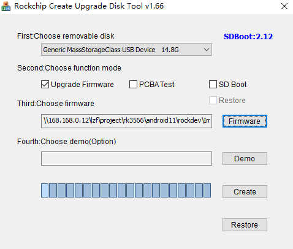

# SD卡升级固件

本文主要介绍如何通过 MicroSD 卡，升级主板上的固件。

使用 MicroSD 升级固件，需要在电脑上，通过做卡工具，将统一固件写入 MicroSD 卡，目前此操作只支持在 Windows 操作系统上完成。

## 准备工具 [step]

- 主板
- 电脑
- SD 卡
- USB 读卡器
- [**SD_Firmware_Tool**](https://community.t-firefly.com/doc/download/106)

## 操作步骤 [step]
- 下载需要升级到主板上的统一固件。
- 打开 SD_Firmware_Tool，勾选 `Upgrade Firmware` 框，点击 `Firmware` 选择正确升级固件。
- 将 MicroSD 插入 USB 读卡器，再插入到电脑 USB 口上，在列表式组合框中选择正确的 USB 设备。
- 点击 `Create` 之后，等待创建结束。
- 取出 MicroSD 卡，插入主板的 MicroSD 卡插槽，对主板上电开机，主板自动开始升级。
- 升级完成后，取出 MicroSD 卡，主板自动重启，完成整个升级固件的流程。

