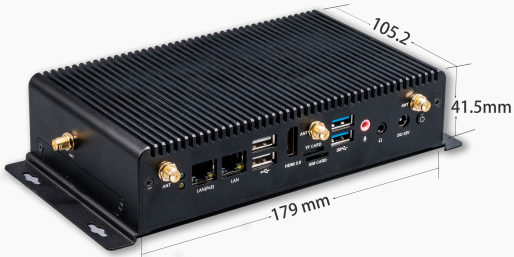
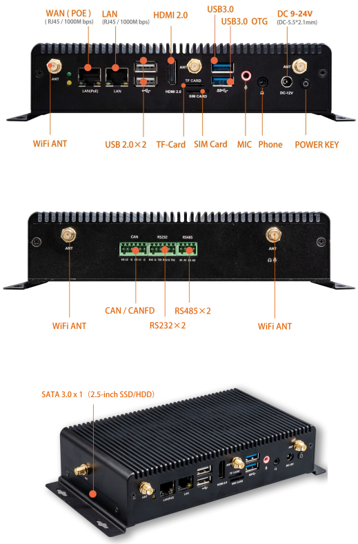
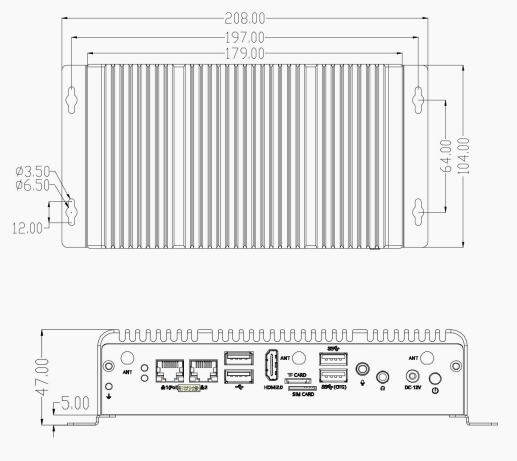

# 简介

[规格书](https://download.t-firefly.com/Spec/Computers/EC-A3568J_Specification_CN.pdf) | [购买链接](https://item.taobao.com/item.htm?id=646557508332) | [下载资料](https://community.t-firefly.com/doc/download/108)

EC-A3568J 嵌入式主机，基于 AIO-3568J 高性能开源平台，配置工业级外壳，防尘防干扰，长时间稳定运行，支持 4K 硬解，丰富的接口方便连接各种工业设备。搭载 ARM 全新 Cortex-A55 架构、四核 64 位高性能处理器，主频高达 2.0GHz，ARM G52 2EE 图形处理器，RKNN NPU AI 加速器（SoC 集成）。

## 接口描述

EC-A3568J 提供了丰富的接口，主要包括：

- WAN (POE) / LAN：RJ45 千兆以太网 x2
- HDMI 2.0
- USB 3.0 OTG
- USB 2.0 x2
- TF 卡槽
- SIM 卡槽
- MIC / Phone 3.5mm 音频接口
- DC 9-24V（5.5*2.1mm）
- Power Key 电源按键
- WiFi 天线 x2
- CAN / CANFD
- RS232 x2 / RS485 x2
- SATA 3.0 x1（2.5 英寸 SSD/HDD）

整机接口分布如下图：

## 结构尺寸

## 资源与技术支持

- [技术交流论坛](https://forum.t-firefly.com/)：超过 10 万企业客户和用户沟通交流平台

### 联系方式

- 邮箱：sales@t-firefly.com
- 手机：(+86) 186 8811 7175
- 座机：0760-89881218
- 地址：广东省中山市东区中山四路 57 号宏宇大厦 2101 室
