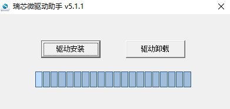
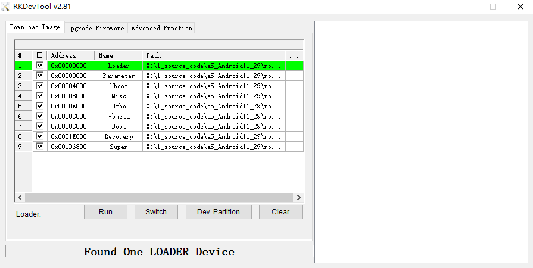
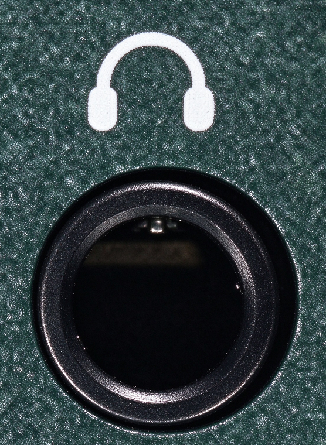
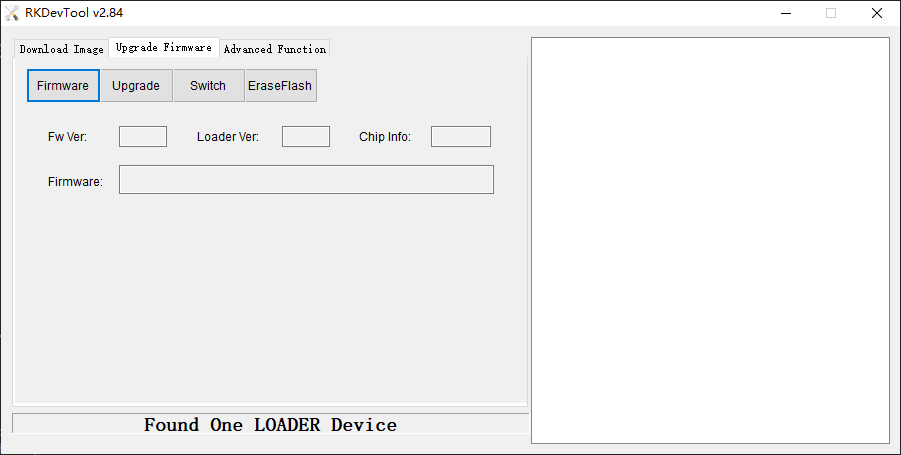
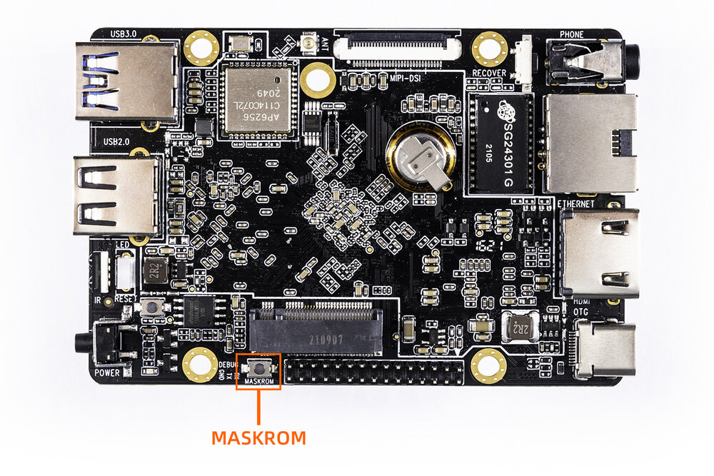
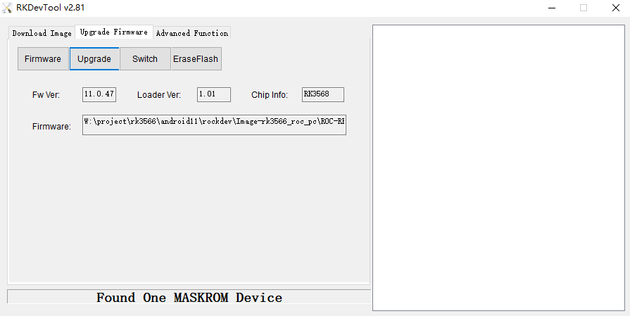
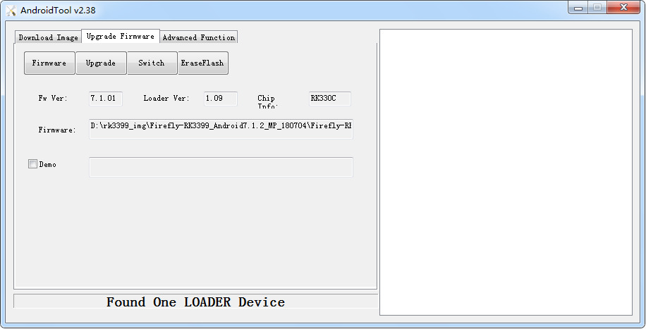

# USB升级固件

## 前言

本文介绍了如何将主机上的固件，通过 Type-C 数据线烧录到 EC-R3566PC 开发板的存储器中。升级时，需要根据主机操作系统和固件类型来选择合适的升级方式。

## 准备工具 [step]
- ROC-RK3566-PC 开发板
- [固件](https://community.t-firefly.com/doc/download/109)
- 主机
- 良好的 Type-C 数据线

## 准备固件 [step]
固件可以通过编译 SDK 获得，也可以通过[资源下载](https://community.t-firefly.com/doc/download/109)处下载公版固件（统一固件）。固件文件一般有两种：

- 单个统一固件

    统一固件是由分区表、bootloader、uboot、kernel、system 等所有文件打包合并成的单个文件。Firefly 正式发布的固件都是采用统一固件格式，升级统一固件将会更新主板上所有分区的数据和分区表，并且擦除主板上所有数据。

- 多个分区镜像

    即各个功能独立的文件，如分区表、bootloader、kernel 等，在开发阶段生成。独立分区镜像可以只更新指定的分区，而保持其它分区数据不被破坏，在开发过程中会很方便调试。

> 通过统一固件解包/打包工具，可以把统一固件解包为多个分区镜像，也可以将多个分区镜像合并为一个统一固件。

## 安装烧写工具 [step]
<CodeBlockTabs defaultValue="Windows">
  <CodeBlockTabsList>
    <CodeBlockTabsTrigger value="Windows">Windows</CodeBlockTabsTrigger>
    <CodeBlockTabsTrigger value="Linux">Linux</CodeBlockTabsTrigger>
  </CodeBlockTabsList>

  <CodeBlockTab value="Windows">
    ### Windows操作系统
    - 安装 RK USB 驱动

    下载 [Release_DriverAssistant.zip]()，解压，然后运行里面的 DriverInstall.exe。为了所有设备都使用更新的驱动，请先选择 `驱动卸载`，然后再选择 `驱动安装`。
    <center>

    

    </center>


    - 运行 AndroidTool 的 RKDevTool.exe

    <Callout title="注意" type="warn">
      为避免由下载工具版本引起的烧写问题，推荐使用公版固件压缩包内部打包好的工具进行烧写
    </Callout>

    例如安卓公版固件压缩包解压后如下：
    ```shell
    XXXX_Android11_HDMI_XXXX
    ├── XXXX_Android11_HDMI_XXXX.img
    ├── linux
    │   └── Linux_Upgrade_Tool_v1.59.zip
    └── windows
        ├── DriverAssitant_v5.1.1.zip
        └── RKDevTool_Release_v2.81.zip
    ```
    也可以单独下载 [AndroidTool]()，解压，运行 `RKDevTool_Release_v2.xx` 目录里面的 `RKDevTool.exe`（注意，如果是 Windows 7/8，需要按鼠标右键，选择以管理员身份运行），如下图：

    <center>

    

    </center>
  </CodeBlockTab>

  <CodeBlockTab value="Linux">
    ### Linux操作系统
    Linux 下无须安装设备驱动
    - [Linux_Upgrade_Tool]() 工具

    下载 [Linux_Upgrade_Tool]()，并按以下方法安装到系统中，方便调用：

    ```bash
    unzip Linux_Upgrade_Tool_xxxx.zip
    cd Linux_UpgradeTool_xxxx
    sudo mv upgrade_tool /usr/local/bin
    sudo chown root:root /usr/local/bin/upgrade_tool
    sudo chmod a+x /usr/local/bin/upgrade_tool
    ```


    - [Linux_adb_fastboot](https://community.t-firefly.com/doc/download/109#other_615) 工具

    下载 [Linux_adb_fastboot](https://community.t-firefly.com/doc/download/109#other_615)，并按以下方法安装到系统中，方便调用：

    ```bash
    sudo mv adb /usr/local/bin
    sudo chown root:root /usr/local/bin/adb
    sudo chmod a+x /usr/local/bin/adb
    ```

    ```bash
    sudo mv fastboot /usr/local/bin
    sudo chown root:root /usr/local/bin/fastboot
    sudo chmod a+x /usr/local/bin/fastboot
    ```
  </CodeBlockTab>
</CodeBlockTabs>

## 进入升级模式 [step]
通常升级固件的模式有两种，分别是 Loader 模式和 MaskRom 模式。烧写固件前，需要连接好设备，并让板子进入到可升级模式。

<CodeBlockTabs defaultValue="loader">
  <CodeBlockTabsList>
    <CodeBlockTabsTrigger value="loader">loader</CodeBlockTabsTrigger>
    <CodeBlockTabsTrigger value="maskrom">maskrom</CodeBlockTabsTrigger>
  </CodeBlockTabsList>
  <CodeBlockTab value="loader">
    ### Loader模式
    #### 硬件方式进入Loader模式 [step]
    连接设备并通过 **RECOVERY** 按键进入 Loader 升级模式步骤如下：

1. 设备断开电源
2. 用针状物捅住 EC-R3566PC 上的耳机孔位并保持
3. 设备插入电源上电

耳机孔位位置如下图所示：

<center>


</center>

此时设备就会进入 Recovery 模式。主机识别到设备后，升级工具显示如下：

<center>


</center>
    #### 软件方式进入Loader模式 [step]
    Type-C 数据线接好后在串口调试终端或 adb shell 给板子运行以下命令

    ```shell
    reboot loader
    ```


  </CodeBlockTab>

  <CodeBlockTab value="maskrom">
    ### MaskRom模式

`MaskRom` 模式是设备变砖的最后一条防线。强行进入 `MaskRom` 涉及硬件操作，有一定风险，因此仅在设备进入不了 `Loader` 模式的情况下，方可尝试 `MaskRom` 模式。进入 `MaskRom` 的原理是人为的把 EMMC 的数据脚与地线短接，系统会认为 EMMC 数据出错，从而清除 EMMC 数据。

<Callout title="警告" type="error">

请小心阅读，并谨慎操作！

</Callout>

#### 进入 MaskRom 模式的方式 [step]

操作步骤如下：


- 设备断开 Type-C 数据线（电源）
- EC-R3566PC 需要拆开外壳（盒子）后操作
- 按住设备上的 Maskrom 按键
- 设备插入 Type-C 数据线（电源）
- 稍候片刻，之后松开按键

<center>



</center>


#### 确认进入 MaskRom 模式 [step]

此时设备就会进入 MaskRom 模式。

<center>



</center>
    <a id="rk_upgrade_maskrom_nor_flash"></a>

    #### 使用 Firefly 方法升级固件 [step]

    烧写最新官方固件 / 最新 SDK 编译的固件，此方法无需切换存储器。在 MaskRom 模式下直接烧写整包固件，无论成功与否，设备断电或重启后，NOR Flash 中如有数据都会被自动擦除（约需 30~60 秒），完成后设备自动进入 Loader 模式，再按「烧写固件」章节烧写整包固件即可。

    固件可通过 [资源下载](https://community.t-firefly.com/doc/download/109) 页面下载。

  </CodeBlockTab>
</CodeBlockTabs>

## 烧写固件 [step]
<CodeBlockTabs defaultValue="Windows">
  <CodeBlockTabsList>
    <CodeBlockTabsTrigger value="Windows">Windows</CodeBlockTabsTrigger>
    <CodeBlockTabsTrigger value="Linux">Linux</CodeBlockTabsTrigger>
  </CodeBlockTabsList>

  <CodeBlockTab value="Windows">
    ### windows操作系统

    #### 烧写统一固件 update.img

    烧写统一固件 update.img 的步骤如下：

    1. 切换至 `Upgrade Firmware` 页。
    2. 按 `Firmware` 按钮，打开要升级的固件文件。升级工具会显示详细的固件信息。
    3. 按 `Upgrade` 按钮开始升级。
    4. 如果升级失败，可以尝试先按 `EraseFlash` 按钮来擦除 Flash，然后再升级。
    <center>

    

    </center>
  </CodeBlockTab>

  <CodeBlockTab value="Linux">

    ### Linux操作系统
    #### 烧写统一固件 update.img

    ```bash
    sudo upgrade_tool uf update.img
    ```

    <Callout title="注意" type="warn">
      如果升级失败，可以尝试先擦除后再升级。
    </Callout>

    ```bash
    # 擦除 flash 使用 ef 参数需要指定 loader 文件或者对应的 update.img
    sudo upgrade_tool ef update.img   #update.img :你需要烧写的 Ubuntu 固件
    # 重新烧写
    sudo upgrade_tool uf update.img
    ```

  </CodeBlockTab>
</CodeBlockTabs>