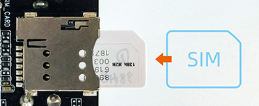

# 硬件功能使用

## 调试串口 [step]

EC-R3588SPC 整机未引出调试串口接口，需要拆开主机后接入底板上的调试串口并外接 USB 转 TTL 串口模块进行调试。

调试串口的连接方式与使用方法详见：[调试串口](usb_to_ttl.md)。

## SIM 卡 [step]

EC-R3588SPC 的 SIM 卡槽用于配合 4G 模块实现移动网络连接。**4G 模块为选配**，需要在机箱内部安装 4G 模块后，SIM 卡功能才能正常使用。SIM 卡插入方向如下图所示，插拔前请先断电。

- [Adb 使用](android_adb_use.md)
- [CAN 使用](usage_can.md)
- [Display 使用](usage_display.md)
- [Ethernet 使用](usage_ethernet.md)
- [LED 使用](usage_led.md)
- [Relay 使用](usage_relay.md)
- [DIN 使用](usage_din.md)
- [RTC 使用](usage_rtc.md)
- [SATA 使用](usage_sata.md)
- [UART 使用](usage_uart.md)
- [Watchdog 使用](usage_watchdog.md)
