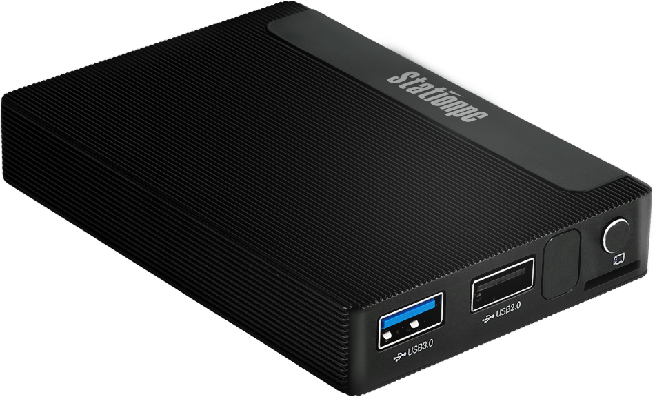
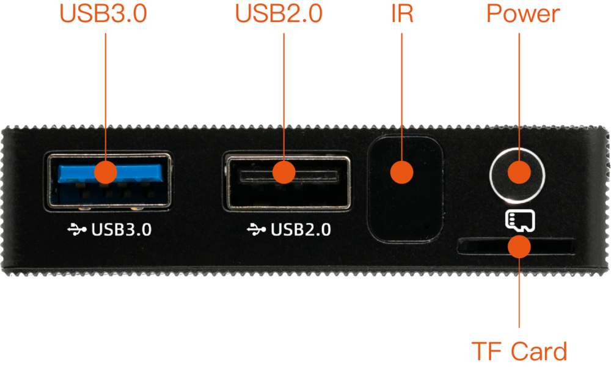
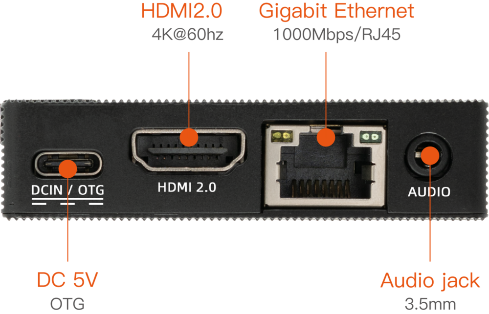
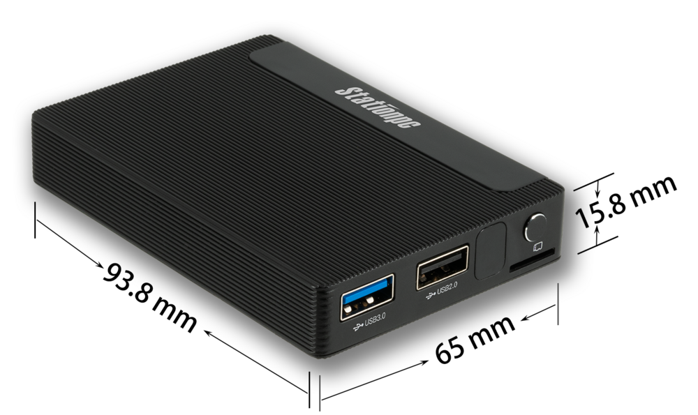

# 简介

[规格书](https://download.t-firefly.com/%E4%BA%A7%E5%93%81%E8%A7%84%E6%A0%BC%E6%96%87%E6%A1%A3/%E5%B0%8F%E5%9E%8B%E4%B8%BB%E6%9C%BA/Station%20M2_AI%20mini%20PC_Specification.pdf) | [购买链接](https://detail.tmall.com/item.htm?abbucket=10&id=672829987217&rn=8ca52d2a036185dff9e4f1e66938e406&spm=a1z10.3-b-s.w4011-24319052084.47.71c54186SsmDr8&sku_properties=5919063:6536025) | [下载资料](https://community.t-firefly.com/doc/download/215)

Station M2 极客主机，基于 ROC-RK3566-PC 超薄机身，小巧便携；支持 8 GB 大内存；支持 M.2 接口，可扩展大容量硬盘；支持多种操作系统，极客玩法层出不穷；配套移动端应用，可远程控制设备，无论在何地都可畅玩主机。搭载 ARM 全新 Cortex-A55 架构、四核 64 位高性能处理器，主频高达 1.8GHz，ARM G52 2EE 图形处理器，RKNN NPU AI 加速器（SoC 集成）。

## 接口描述

ROC-RK3566-PC 提供了丰富的接口，主要包括：

- 1 x USB3.0（host）
- 1 x USB2.0（host）
- HDMI
- MIPI 屏幕接口
- TP 触摸接口
- 以太网
- WIFI 天线
- 3.5mm 耳机接口
- Type-C（PD）电源接口
- IR 接口
- TF 卡槽
- Power 按键
- Reset 按键
- Recovery 按键
- 调试串口
- NOR flash
- MIPI 摄像头接口

整机接口分布如下图：

## 结构尺寸

## 资源与技术支持

- [[技术交流论坛]](https://forum.t-firefly.com/)：超过 10 万企业客户和用户沟通交流平台

### 联系方式

- 邮箱：sales@t-firefly.com
- 手机：(+86) 186 8811 7175
- 座机：0760-89881218
- 地址：广东省中山市东区中山四路 57 号宏宇大厦 2101 室
