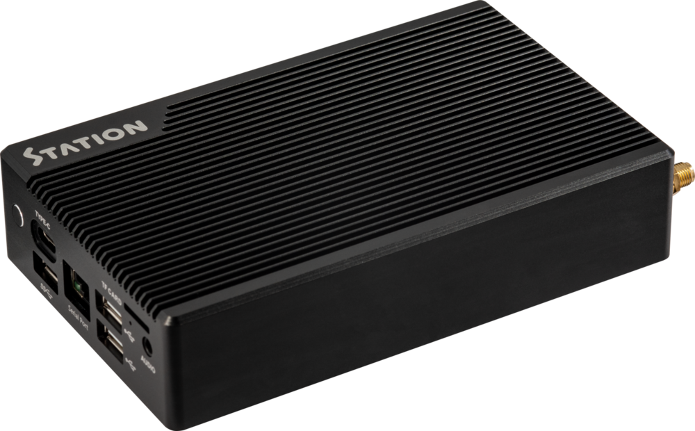
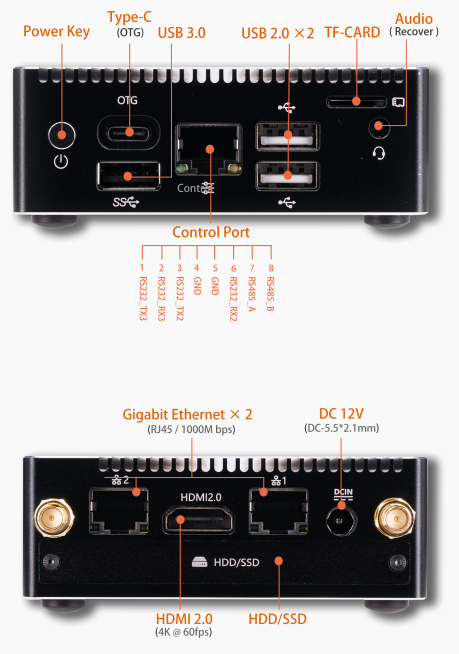
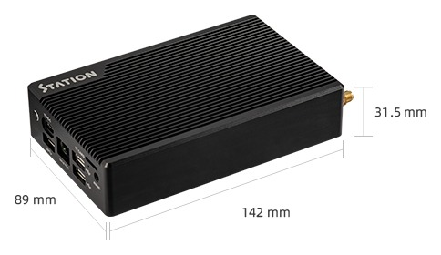

# 简介

[规格书](https://download.t-firefly.com/%E4%BA%A7%E5%93%81%E8%A7%84%E6%A0%BC%E6%96%87%E6%A1%A3/Station/Station%20P2%20Specification.pdf) | [购买链接](https://item.taobao.com/item.htm?spm=a1z10.5-c-s.w4002-24968523314.19.13b64299TtB9fd&id=724363215947) | [下载资料](https://community.t-firefly.com/doc/download/217)

Station P2 嵌入式主机，基于 ROC-RK3568-PC 高性能开源平台，支持 4K 硬解，丰富的接口方便连接各种设备。搭载 ARM Cortex-A55 架构、四核64位高性能处理器，主频高达 2.0GHz，ARM G52 2EE 图形处理器，RKNN NPU AI 加速器（SoC 集成）。

## 接口描述

Station-P2 提供了丰富的接口，主要包括：

- 电源按键（Power Key）
- Type-C 接口（OTG）
- USB 3.0 接口
- USB 2.0 接口 ×2
- TF 卡槽
- 3.5mm 耳机接口（兼 Recovery）
- Control Port 控制端口（RS232 / RS485）
- 千兆以太网 ×2（RJ45，1000M bps）
- HDMI 2.0 输出（最高支持 4K@60fps）
- HDD/SSD 接口
- DC 12V 电源接口（DC-5.5×2.1mm）
- WiFi 天线接口 ×2

整机接口分布如下图：

## 结构尺寸

## 资源与技术支持

- [技术交流论坛](https://forum.t-firefly.com/)：超过 10 万企业客户和用户沟通交流平台

### 联系方式

- 邮箱：sales@t-firefly.com
- 手机：(+86) 186 8811 7175
- 座机：0760-89881218
- 地址：广东省中山市东区中山四路 57 号宏宇大厦 2101 室
