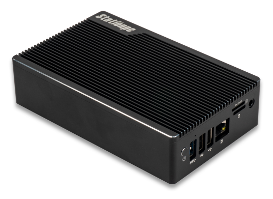
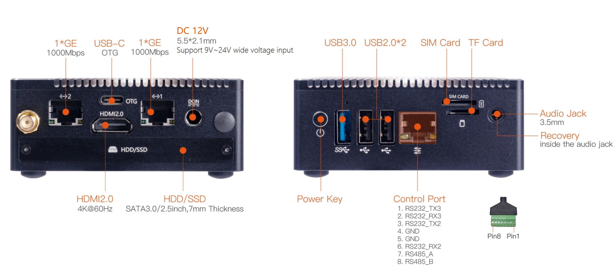
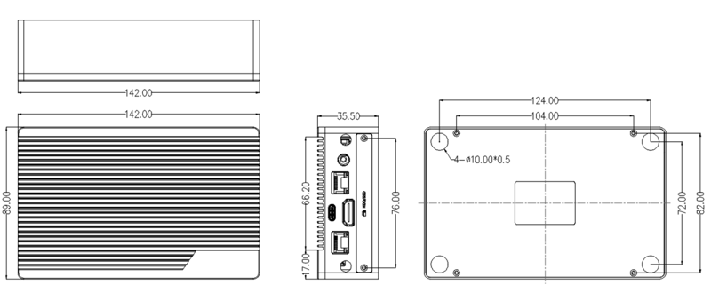

# 简介

[规格书](https://download.t-firefly.com/%E4%BA%A7%E5%93%81%E8%A7%84%E6%A0%BC%E6%96%87%E6%A1%A3/%E5%B0%8F%E5%9E%8B%E4%B8%BB%E6%9C%BA/Station%20P2S_Specification.pdf) | [购买链接](https://item.taobao.com/item.htm?spm=a1z10.5-c-s.w4002-24614730371.11.18435c47KlWMgK&id=687407527036) | [下载资料](https://community.t-firefly.com/doc/download/218)

Station P2S 采用 ROC-RK3568-PC-SE 四核 64 位 Cortex-A55 处理器，22nm 先进工艺，主频最高 2.0GHz，集成双核心架构 GPU 以及高效能 NPU（1TOPS）；最大支持 8G 大内存；支持 WiFi6、双千兆以太网；拥有丰富的接口扩展，支持多种视频输入输出接口，可适用于智能 NVR、云终端、物联网网关、工业控制、边缘计算等场景。

## 接口描述

Station P2S 提供了丰富的接口，主要包括：

- 2 x 千兆以太网（RJ45 1000Mbps）
- USB-C（OTG）
- HDMI 2.0（4K@60Hz）
- DC 12V（5.5*2.1mm，支持 9V~24V 宽压输入）
- HDD/SSD（SATA 3.0，2.5 英寸，7mm 厚）
- Power Key 电源按键
- USB 3.0
- USB 2.0 x2
- Control Port 控制端口（8pin：RS232 x3 / RS485 x1）
- SIM 卡槽
- TF 卡槽
- 3.5mm Audio Jack（Recovery 按键位于耳机孔内）

整机接口分布如下图：

## 结构尺寸

## 资源与技术支持

- [技术交流论坛](https://forum.t-firefly.com/)：超过 10 万企业客户和用户沟通交流平台

### 联系方式

- 邮箱：sales@t-firefly.com
- 手机：(+86) 186 8811 7175
- 座机：0760-89881218
- 地址：广东省中山市东区中山四路 57 号宏宇大厦 2101 室
