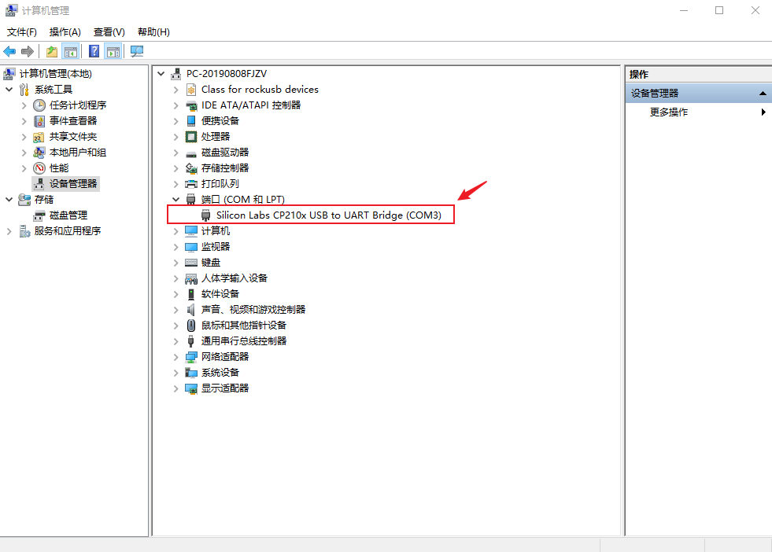
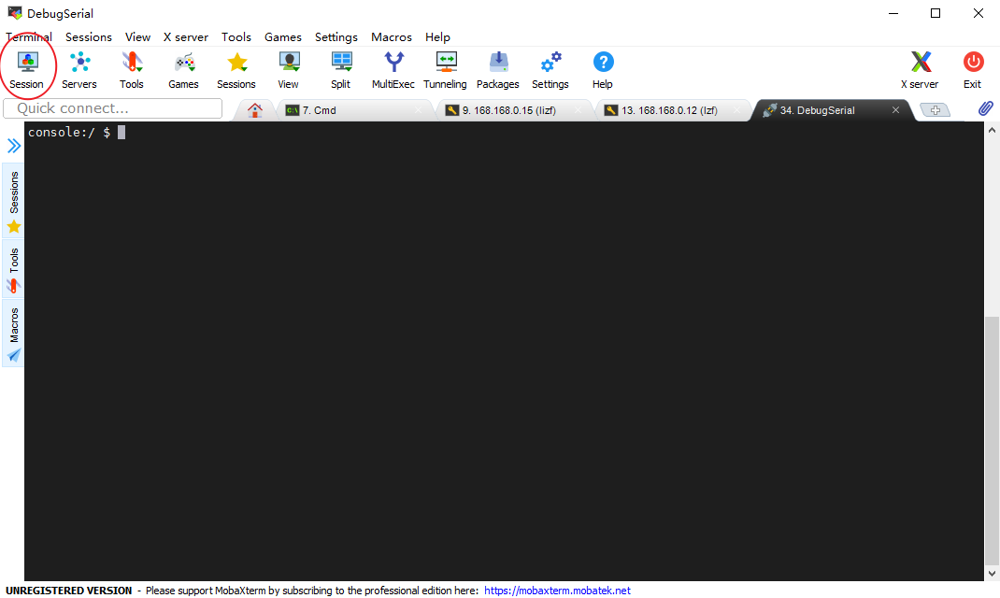
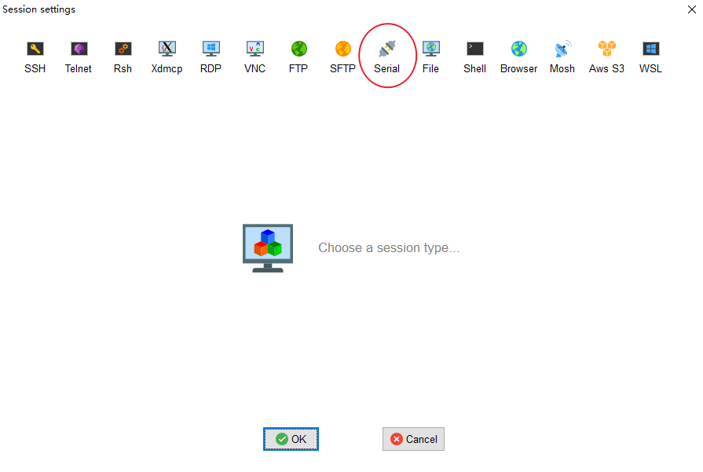
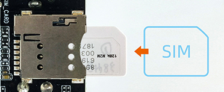

# 硬件功能使用
## 登录

AIBOX PRO KIT 登录方式有两种，一种是通过 Console（调试串口）进行终端登录，一种是通过 HDMI 登录。

### Console 登录
Type-C 线接入 Console 口，登录账号为`root`，默认没有设置`root`密码。<br>
接口请参考[硬件接口介绍](interface_definition.md)。
使用以下串口参数：
* 波特率：115200
* 数据位：8
* 停止位：1
* 奇偶校验：无
* 流控：无

#### Windows 下使用串口调试

用 Type-C 数据线将板卡与电脑连接后，系统会提示发现新硬件并完成初始化，之后可以在设备管理器中找到对应的 COM 口：

<center>


</center>

Windows 上一般用 putty 或 SecureCRT。这里推荐使用 MobaXterm 免费版本，这是一款功能强大的终端软件，其它串口软件的使用方法与之类似。

1. 选择 `session` 为 `Serial`。
2. 将 `Serial port` 修改为在设备管理器中找到的 COM 端口。
3. 设置 `Speed (bsp)` 为 `115200`。
4. 点击 `OK` 按钮。

<center>


</center>


<center>


</center>

#### Ubuntu 下使用串口调试

安装 minicom：

```
sudo apt-get install minicom
```

使用 `minicom -s` 打开配置界面，进入 `Serial port setup`，将串口参数设置为 `115200 8N1`：

* `E - Bps/Par/Bits`：`115200 8N1`
* `F - Hardware Flow Control`：`No`
* `G - Software Flow Control`：`No`

**注意：** `Hardware Flow Control` 和 `Software Flow Control` 都要设成 No，否则可能导致无法输入。

设置完成后选择 `Save setup as dfl` 保存为默认配置，退出后 minicom 即以 115200-8-N-1 连接调试串口，使用 `root` 账号登录（默认没有设置密码）。

### HDMI 登录
在界面登录的时候，自动登录`firefly`用户，`firefly` 用户密码也为`firefly`。

## 看门狗
### 主模组 Core-3588JD4
#### 核心模组上的看门狗
看门狗的设备名称是`/dev/wdt_core`，使用方法如下:
```shell
# 写入不同字段来开启看门狗并设置时间
# 数字 0，1，2，3 分别表示 0.64s，2.56s，10.24s，40.96s
# 字母 e 表示开启看门狗，字母 d 表示关闭看门狗

# 开启并定时 10.24 秒，每 10.24 秒之内要写入一次，也可随时写入不同数字更改时间
echo e >/dev/wdt_core //开启
echo 2 >/dev/wdt_core //设置超时时间为10秒
```
#### 主板上的看门狗
看门狗的设备名称是`/dev/wdt_base`，使用方法如下:
```shell
# 写入不同字段来开启看门狗并设置时间
# 数字 0，1，2，3 分别表示 0.64s，2.56s，10.24s，40.96s
# 字母 e 表示开启看门狗，字母 d 表示关闭看门狗

# 开启并定时 10.24 秒，每 10.24 秒之内要写入一次，也可随时写入不同数字更改时间
echo e >/dev/wdt_base //开启
echo 2 >/dev/wdt_base //设置超时时间为10秒
```

## RTC

### 简介

AIBOX PRO KIT 有一路外部的 RTC，由外部的底板电容进行供电，掉电后短时间内保证RTC运行。在 kernel 中表示为 `rtc0`。

### 接口使用

Linux 提供了三种用户空间调用接口。路径为：

*    SYSFS接口：/sys/class/rtc/rtc0/
*    PROCFS接口： /proc/driver/rtc
*    IOCTL接口： /dev/rtc0

同步最新的系统时间到 RTC 内：
```
hwclock -w
```

#### SYSFS接口

可以直接使用 `cat` 和 `echo` 操作 `/sys/class/rtc/rtc0/` 下面的接口。

比如查看当前 RTC 的日期和时间：

```
# cat /sys/class/rtc/rtc0/date
2024-07-10
# cat /sys/class/rtc/rtc0/time
02:36:30

```

#### PROCFS 接口

打印 RTC 相关的信息：

```
# cat /proc/driver/rtc
rtc_time        : 02:37:00
rtc_date        : 2024-07-10
alrm_time       : 00:00:00
alrm_date       : 1970-01-01
alarm_IRQ       : no
alrm_pending    : no
update IRQ enabled      : no
periodic IRQ enabled    : no
periodic IRQ frequency  : 1
max user IRQ frequency  : 64
24hr            : yes
```

#### IOCTL接口

可以使用 `ioctl` 控制 `/dev/rtc0`。

详细使用说明请参考文档 `kernel-jammy-src/Documentation/admin-guide/rtc.rst` 。

## RS485
AIBOX PRO KIT 有一个 RS485 接口，如果CPU是3588，则设备名称为 `/dev/ttyS6`， 如果CPU是3576，则为`/dev/ttyS3`，支持半双工，默认波特率为 `9600`。该接口为凤凰端子座，因此需要对应的端子接口接入，接入后，即可按照常规串口方法进行调试。

## CAN

### CAN 简介

CAN(Controller Area Network)总线，即控制器局域网总线，是一种有效支持分布式控制或实时控制的串行通信网络。CAN 总线在汽车上广泛采用，被设计作为汽车环境中的微控制器通讯。如果想了解更多的内容可以参考[CAN 应用报告](https://www.ti.com/lit/an/sloa101b/sloa101b.pdf)。

### 硬件连接

AIBOX PRO KIT 有一个 CAN 接口，该接口为凤凰端子座，接线时 CAN_H 接 CAN_H，CAN_L 接 CAN_L，接口位置见[硬件接口介绍](interface_definition.md)。

由于只有一个 CAN，所以默认在内核中，第一个创建的设备为 `can0`。

### CAN 通信测试

使用 `candump` 和 `cansend` 工具进行收发报文测试即可。工具包含在 SDK 中，也可以从 [GitHub](https://github.com/linux-can/can-utils) 下载。

```
# 在收发端关闭 can0 设备
ip link set can0 down
# 在收发端设置比特率为 250Kbps
ip link set can0 type can bitrate 250000
# 在收发端打开 can0 设备
ip link set can0 up
# 在接收端执行 candump，阻塞等待报文
candump can0
# 在发送端执行 cansend，发送报文
cansend can0 123#1122334455667788
```

通信两端的比特率必须配置一致，否则接收不到报文。

#### 更多指令

```
1、ip link set canX down                      //关闭 can 设备
2、ip link set canX up                        //开启 can 设备
3、ip -details link show canX                 //显示 can 设备详细信息
4、ip link set canX type can bitrate 250000   //设置 can 波特率
5、candump canX                               //接收 can 总线数据
6、cansend canX --identifier=ID#数据           //发送数据
7、candump canX,ID:mask                       //使用滤波器接收 ID 匹配的数据
```

### 常见问题

#### 报文发送后很久才接收到，或者接收不到

检查总线 CAN_H 和 CAN_L 是否松动或者接反。

## DI/DO 光耦隔离

AIBOX PRO KIT 提供 1 路光耦隔离的数字输入（DI）和 1 路光耦隔离的数字输出（DO），均从凤凰端子座引出，端子引脚与芯片引脚的对应关系如下：

| 端子引脚 | 芯片引脚 | 说明 |
| --- | --- | --- |
| DI | GPIO47 | 数字输入 |
| DI_COM | - | DI 的参考地（电平基准） |
| DO | GPIO46 | 数字输出 |
| DO_COM | - | DO 的参考地（电平基准） |

### DI（数字输入）

DI_COM 为 DI 的参考电平。当 DI 相对 DI_COM 施加高电平时，光耦导通，芯片侧 GPIO47 被拉低，此时读到的电平为 `0`；DI 与 DI_COM 之间无输入时，GPIO47 为高电平，读到的电平为 `1`。

读取 DI 电平（以 GPIO47 为例）：

```
# 导出 GPIO47 并配置为输入
echo 47 > /sys/class/gpio/export
echo in > /sys/class/gpio/gpio47/direction
# 读取电平：DI 施加高电平时读到 0
cat /sys/class/gpio/gpio47/value
```

### DO（数字输出）

DO_COM 接外部地，DO 侧接上拉电阻到外部电源（VCC），数据从 DO 读取。当芯片侧 GPIO46 输出低电平时，光耦导通，DO 被拉低到 DO_COM 的电平；GPIO46 输出高电平时，光耦截止，DO 由外部上拉电阻拉高。

输出 DO 电平（以 GPIO46 为例）：

```
# 导出 GPIO46 并配置为输出
echo 46 > /sys/class/gpio/export
echo out > /sys/class/gpio/gpio46/direction
# 输出低电平：光耦导通，DO 被拉低
echo 0 > /sys/class/gpio/gpio46/value
# 输出高电平：光耦截止，DO 由上拉电阻拉高
echo 1 > /sys/class/gpio/gpio46/value
```

不同内核的 GPIO 编号规则可能不同，若系统中 GPIO47、GPIO46 对应的节点与上例不一致，以 `cat /sys/kernel/debug/gpio` 的输出为准。

## SIM 卡

AIBOX PRO KIT 的 SIM 卡槽用于配合 4G 模块实现移动网络连接。**4G 模块为选配**，需要在机箱内部安装 4G 模块后，SIM 卡功能才能正常使用。SIM 卡插入方向如下图所示，插拔前请先断电。

<center>


</center>