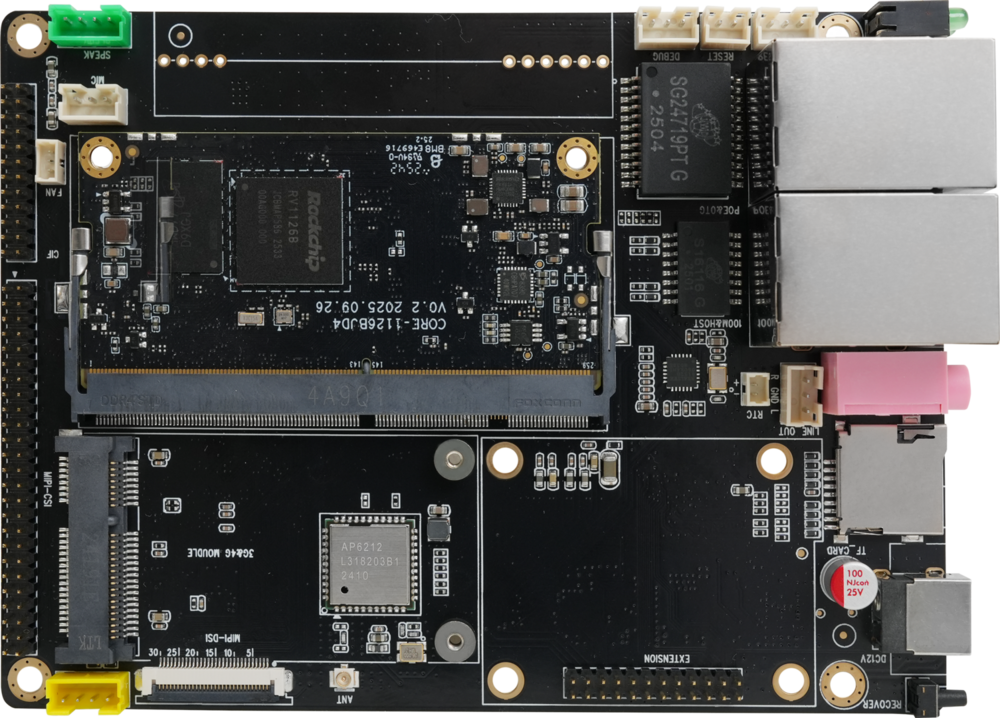
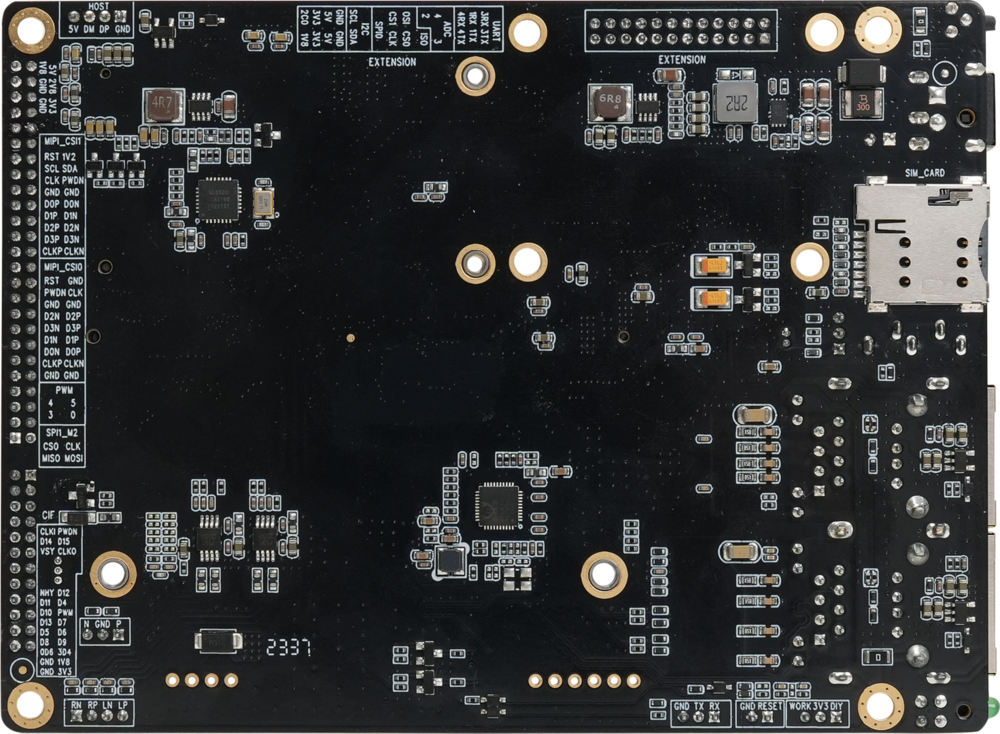
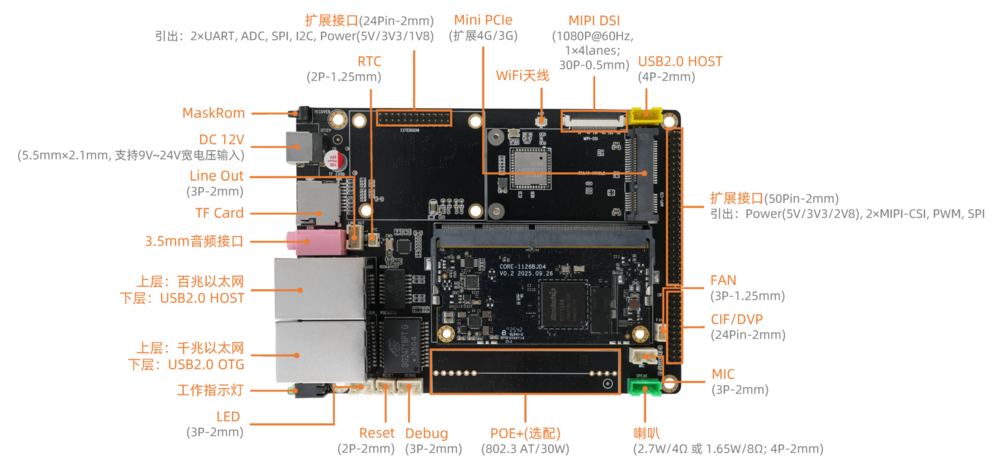
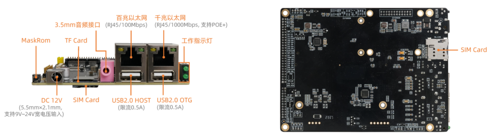

# 简介

**AIO-1126BJD4V0** 采用 Rockchip 四核 AI 视觉处理器 RV1126B，集成 3 TOPS NPU，支持轻量级 AI 大模型和深度学习框架。内置 12M ISP、8MP AI-ISP、集成多种算法加速器。支持 12M 视频编码，4K 视频解码，支持 3 个摄像头同时输入。采用 260P 金手指接口，尺寸小巧。广泛适用于人脸识别、闸机门禁、智能安防、智能网络摄像头等行业领域。

**AIO-1126BJD4V0** 开发板由核心板 Core-1126BJD4 + 底板 MB-JD4-RV11091126 组成,。AIO-1126BJD4V0 拥有 RGMII、USB2.0、I2C、UART、GPIO、MIPI-DSI 以及 MIPI-CSI 等丰富接口，可直接应用到各种智能产品中，加速产品落地。接口定义详见下文。

正面：

背面：

 
## 接口描述

### 整机接口定义

## 资源与技术支持

* [[技术交流论坛]](https://forum.t-firefly.com/)：超过10万企业客户和用户沟通交流平台

### 联系方式

* 邮箱：sales@t-firefly.com
* 手机：(+86) 186 8811 7175
* 座机：0760-89881218
* 地址：广东省中山市东区中山四路 57 号宏宇大厦 2101 室
