# USB升级固件

## 前言

本文介绍了如何将主机上的固件，通过USB 数据线烧录到 CORE-1126BJD4 开发板的存储器中。升级时，需要根据主机操作系统和固件类型来选择合适的升级方式。

## 准备工具 [step]
* CORE-1126BJD4 开发板
* [固件](https://community.t-firefly.com/doc/download/333)
* 主机
* 良好的USB 数据线

## 准备固件 [step]
固件可以通过编译SDK获得，也可以通过[资源下载](https://community.t-firefly.com/doc/download/333)处下载公版固件（统一固件）。固件文件一般有两种：

* 单个统一固件

    统一固件是由分区表、bootloader、uboot、kernel、system等所有文件打包合并成的单个文件。Firefly正式发布的固件都是采用统一固件格式，升级统一固件将会更新主板上所有分区的数据和分区表，并且擦除主板上所有数据。

* 多个分区镜像

    即各个功能独立的文件，如分区表、bootloader、kernel等，在开发阶段生成。独立分区镜像可以只更新指定的分区，而保持其它分区数据不被破坏，在开发过程中会很方便调试。

>    通过统一固件解包/打包工具，可以把统一固件解包为多个分区镜像，也可以将多个分区镜像合并为一个统一固件。

## 安装烧写工具 [step]
<CodeBlockTabs defaultValue="Windows">
  <CodeBlockTabsList>
    <CodeBlockTabsTrigger value="Windows">Windows</CodeBlockTabsTrigger>
    <CodeBlockTabsTrigger value="Linux">Linux</CodeBlockTabsTrigger>
  </CodeBlockTabsList>

  <CodeBlockTab value="Windows">
### Windows操作系统
* 安装RK USB驱动

下载 [Release_DriverAssistant.zip](https://community.t-firefly.com/doc/download/333)，解压，然后运行里面的 DriverInstall.exe 。为了所有设备都使用更新的驱动，请先选择`驱动卸载`，然后再选择`驱动安装`。
<center>

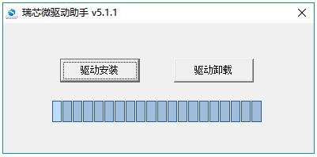
</center>

* 运行AndroidTool的RKDevTool.exe

<Callout title="注意" type="warn">

为避免由下载工具版本引起的烧写问题，推荐使用公版固件压缩包内部打包好的工具进行烧写

</Callout>

也可以单独下载 [AndroidTool](https://community.t-firefly.com/doc/download/333)，解压，运行 `RKDevTool_Release_v2.xx` 目录里面的 `RKDevTool.exe`（注意，如果是 Windows 7/8,需要按鼠标右键，选择以管理员身份运行），如下图：

<center>

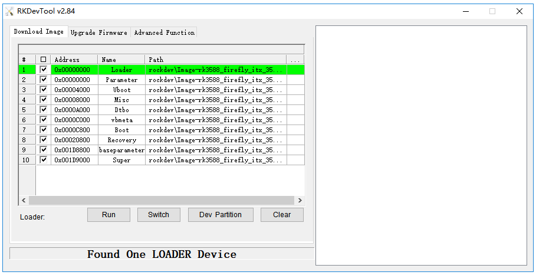
</center>
  </CodeBlockTab>

  <CodeBlockTab value="Linux">
### Linux操作系统

Linux 下无须安装设备驱动

* [Linux_Upgrade_Tool](https://community.t-firefly.com/doc/download/333)工具

下载 [Linux_Upgrade_Tool](https://community.t-firefly.com/doc/download/333), 并按以下方法安装到系统中，方便调用：

```
unzip Linux_Upgrade_Tool_xxxx.zip
cd Linux_UpgradeTool_xxxx
sudo mv upgrade_tool /usr/local/bin
sudo chown root:root /usr/local/bin/upgrade_tool
sudo chmod a+x /usr/local/bin/upgrade_tool
```

* [Linux_adb_fastboot](https://community.t-firefly.com/doc/download/160)工具

下载 [Linux_adb_fastboot](https://community.t-firefly.com/doc/download/160), 并按以下方法安装到系统中，方便调用：

```
sudo mv adb /usr/local/bin
sudo chown root:root /usr/local/bin/adb
sudo chmod a+x /usr/local/bin/adb
```
```
sudo mv fastboot /usr/local/bin
sudo chown root:root /usr/local/bin/fastboot
sudo chmod a+x /usr/local/bin/fastboot
```
  </CodeBlockTab>
</CodeBlockTabs>

## 进入升级模式 [step]

通常我们升级固件的模式有两种，分别是Loader模式和MaskRom模式。烧写固件前，我们需要连接好设备，并让板子进入到可升级模式。

使用 USB 数据线一端连接主机，一端连接开发板，如下图所示：

<center>

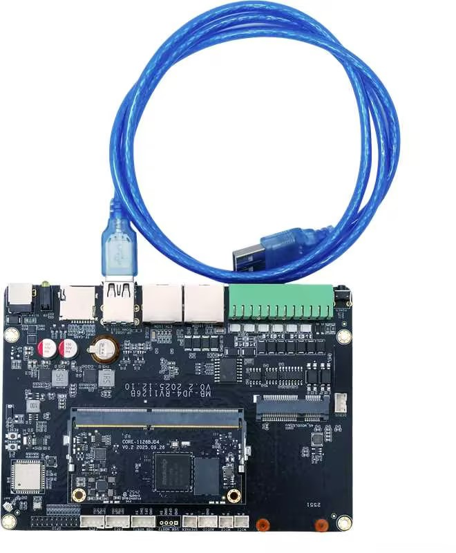
</center>

<CodeBlockTabs defaultValue="loader">
  <CodeBlockTabsList>
    <CodeBlockTabsTrigger value="loader">loader</CodeBlockTabsTrigger>
    <CodeBlockTabsTrigger value="maskrom">maskrom</CodeBlockTabsTrigger>
  </CodeBlockTabsList>

  <CodeBlockTab value="loader">
### Loader模式

#### 软件方式进入Loader模式
USB 数据线接好后在串口调试终端或adb shell给板子运行以下命令

```shell
reboot loader
```

#### 查看Loader模式
如何确定板子是否进入Loader模式，我们可以通过工具去查看

**Windows操作系统**

通过AndroidTool工具可以看到下方提示`Found One LOADER Device`
<center>


</center>

如果有进行"进入Loader模式"的操作，仍旧没有看到烧写工具提示LOADER，此时可以可以看一下Windows主机是否有提示发现新硬件并配置驱动。打开设备管理器，会见到新设备 `Rockusb Device` 出现，如下图。如果没有，可返回上一步重新[安装驱动](upgrade_firmware.md#windows-cao-zuo-xi-tong)。

<center>

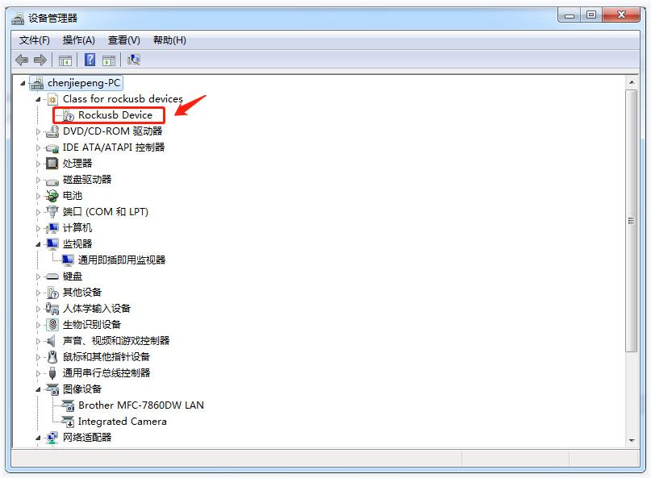
</center>

**Linux操作系统**

运行upgrade_tool后可以看到连接设备中有个`Loader`的提示

```shell
firefly@T-chip:~/severdir/down_firmware$ sudo upgrade_tool
List of rockusb connected
DevNo=1 Vid=0x2207,Pid=0x330c,LocationID=106    Loader
Found 1 rockusb,Select input DevNo,Rescan press <R>,Quit press <Q>:q
```
  </CodeBlockTab>

  <CodeBlockTab value="maskrom">
### MaskRom模式
`MaskRom` 模式是设备变砖的最后一条防线。强行进入 `MaskRom` 涉及硬件操作，有一定风险，因此仅在设备进入不了 `Loader` 模式的情况下，方可尝试 `MaskRom` 模式。进入 `MaskRom` 的原理是人为的把 EMMC 的数据脚与地线短接，系统会认为 EMMC 数据出错，从而清除 EMMC 数据。

**请小心阅读，并谨慎操作！**

操作步骤如下：

1. 设备断开电源
2. 按住底板 MASKROM 按键
3. 设备插入电源上电

<center>

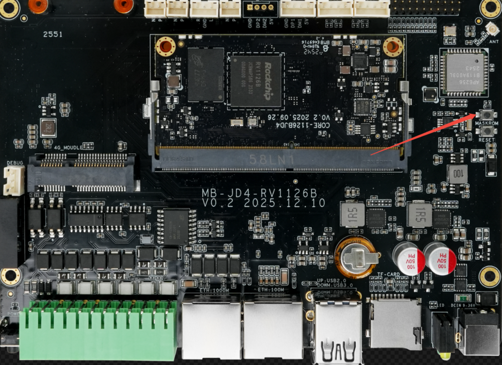
</center>


此时设备就会进入 MaskRom 模式。

<center>

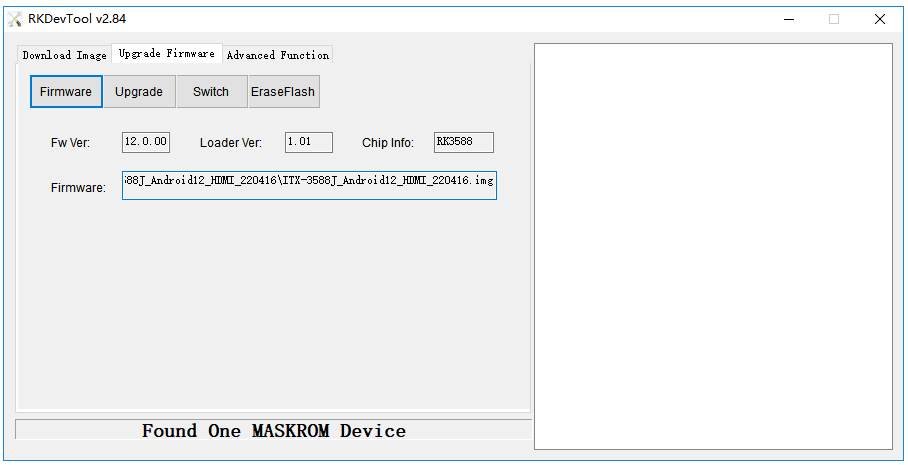
</center>

注意：如果按照上述操作执行，最终 Windows PC 烧写工具还是没发现到 MASKROM 设备，这就要检查下 Windows PC 的软件驱动是否安装到最新版本。

点击：[驱动下载](https://community.t-firefly.com/doc/download/333)

先点 1 驱动卸载，再点 2 驱动安装。安装好驱动后，再按照上述步骤顺序执行操作，Windows PC 烧写工具就能识别到 MASKROM 设备了。

<center>

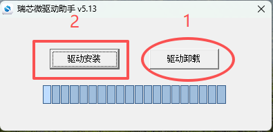
</center>

  </CodeBlockTab>
</CodeBlockTabs>

## 烧写固件 [step]
<CodeBlockTabs defaultValue="Windows">
  <CodeBlockTabsList>
    <CodeBlockTabsTrigger value="Windows">Windows</CodeBlockTabsTrigger>
    <CodeBlockTabsTrigger value="Linux">Linux</CodeBlockTabsTrigger>
  </CodeBlockTabsList>

  <CodeBlockTab value="Windows">
### windows操作系统

#### 烧写统一固件 update.img

烧写统一固件 update.img 的步骤如下:

1. 切换至`Upgrade Firmware`页。
2. 按`Firmware`按钮，打开要升级的固件文件。升级工具会显示详细的固件信息。
3. 按`Upgrade`按钮开始升级。
4. 如果升级失败，可以尝试先按`EraseFlash `按钮来擦除 Flash，然后再升级。

<center>

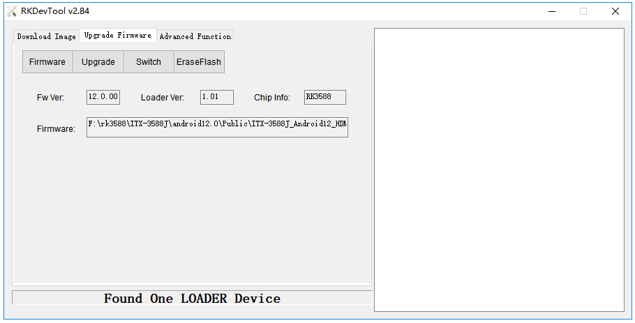
</center>

#### 烧写分区映像
烧写分区映像的步骤如下：

1. 切换至`Upgrade Firmware`页。
2. 勾选需要烧录的分区，可以多选。
3. 确保映像文件的路径正确，需要的话，点路径右边的空白表格单元格来重新选择。
4. 点击`Run`按钮开始升级，升级结束后设备会自动重启。

<center>


</center>

烧写工具使用技巧：

1. 获取设备分区表信息

使 rv1126 设备进入 loader 模式。然后点击图片的 Dev Partition 按钮即可获取到设备的分区信息。

<center>

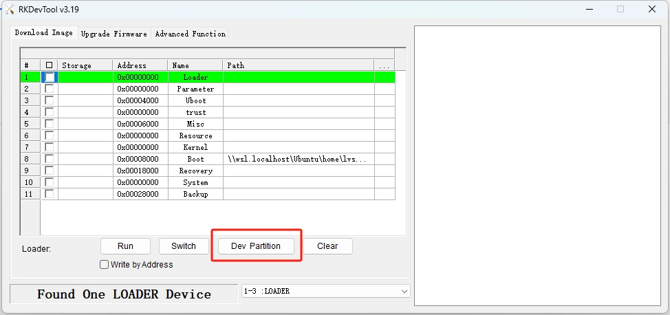
</center>

点击更新即可获取到设备的分区信息如下：

<center>

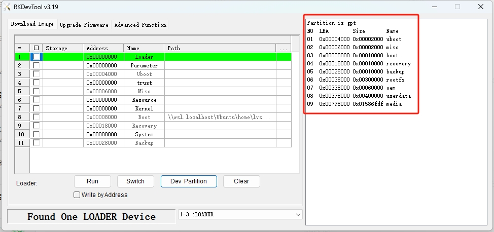
</center>

2. 导出设备分区表信息

点击鼠标右键弹出菜单，选择 export config 导出分区表配置：

<center>

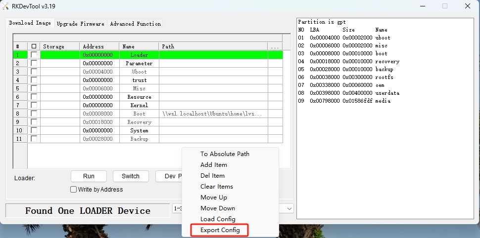
</center>

3. 加载设备分区表信息

点击鼠标右键弹出菜单，选择 load config 加载分区表配置：

<center>

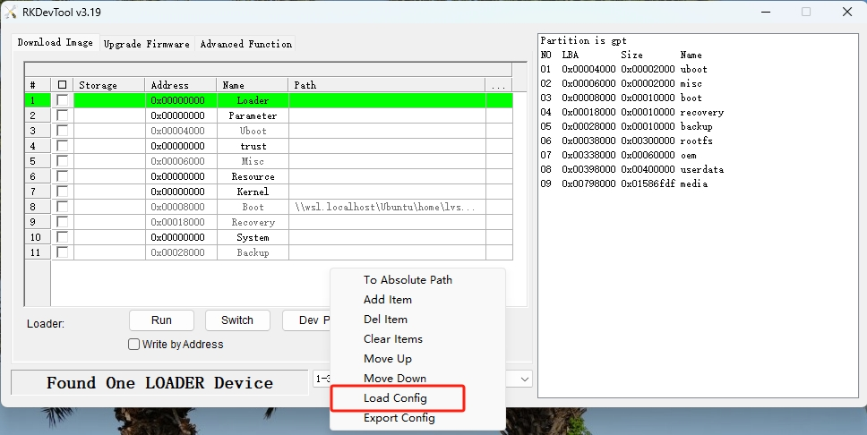
</center>
  </CodeBlockTab>

  <CodeBlockTab value="Linux">
### Linux操作系统

#### 烧写统一固件 update.img

```
sudo upgrade_tool uf update.img
```

<Callout title="注意" type="warn">

如果升级失败，可以尝试先擦除后再升级。

</Callout>

```
# 擦除 flash 使用 ef 参数需要指定 loader 文件或者对应的 update.img
sudo upgrade_tool ef update.img   #update.img :你需要烧写的 update.img 固件
# 重新烧写
sudo upgrade_tool uf update.img
```

#### 烧写分区镜像

查看 SDK 编译输出目录 output。可以看到这个目录下的 boot.img 是链接到 /path/to/sdk/kernel/boot.img 的。
```bash
lvsx@amd-epyc:~/project/rv1126b $ ll output/firmware/
total 12
drwxrwxr-x  2 lvsx lvsx 4096 Dec 25 17:40 ./
drwxrwxr-x 11 lvsx lvsx 4096 Dec 25 20:06 ../
lrwxrwxrwx  1 lvsx lvsx   25 Dec 25 17:35 boot.img -> ../../kernel-6.1/boot.img
lrwxrwxrwx  1 lvsx lvsx   45 Dec 25 15:51 MiniLoaderAll.bin -> ../../u-boot/rv1126b_spl_loader_v1.06.105.bin
lrwxrwxrwx  1 lvsx lvsx   11 Dec 25 15:50 misc.img -> ../misc.img
lrwxrwxrwx  1 lvsx lvsx   22 Dec 25 15:53 oem.img -> ../extra-parts/oem.img
lrwxrwxrwx  1 lvsx lvsx   61 Dec 25 15:53 parameter.txt -> ../../device/rockchip/.chips/rv1126b/parameter-debian-fit.txt
lrwxrwxrwx  1 lvsx lvsx   23 Dec 25 17:38 recovery.img -> ../recovery/ramboot.img
lrwxrwxrwx  1 lvsx lvsx   47 Dec 25 15:52 rootfs.img -> ../../prebuilt_rootfs/rv1126b_debian_rootfs.img
lrwxrwxrwx  1 lvsx lvsx   22 Dec 25 15:51 uboot.img -> ../../u-boot/uboot.img
lrwxrwxrwx  1 lvsx lvsx   26 Dec 25 17:40 update.img -> ../update/Image/update.img
lrwxrwxrwx  1 lvsx lvsx   27 Dec 25 15:53 userdata.img -> ../extra-parts/userdata.img
```

所以实际需要烧录的内核固件是 boot.img 。如果在 output/firmware/ 目录则执行以下命令烧录内核固件：
```bash
sudo upgrade_tool di -b /path/to/sdk/output/firmware/boot.img
```

如果是在 /path/to/sdk/kernel 目录则需要执行以下命令烧录内核固件：
```bash
sudo upgrade_tool di -b /path/to/sdk/kernel/boot.img
```

常用的烧写命令如下：
```
sudo upgrade_tool di -b /path/to/boot.img
sudo upgrade_tool di -r /path/to/recovery.img
sudo upgrade_tool di -m /path/to/misc.img
sudo upgrade_tool di -u /path/to/uboot.img
sudo upgrade_tool di -p paramater   #烧写 parameter
sudo upgrade_tool ul bootloader.bin # 烧写 bootloader
```


如果因 flash 问题导致升级时出错，可以尝试低级格式化、擦除 emmc：
```
sudo upgrade_tool lf update.img	# 低级格式化
sudo upgrade_tool ef update.img	# 擦除
```

fastboot 烧写动态分区

```
adb reboot fastboot # 进入bootloader
sudo fastboot flash vendor vendor.img
sudo fastboot flash system system.img
sudo fastboot reboot # 烧写成功后,重启
```
  </CodeBlockTab>
</CodeBlockTabs>

[Androidtool_xxx(版本号)]: http://www.t-firefly.com/share/index/index/id/2ea171f2235fe841e89734ca5189da8b.
[AndroidTool]: http://www.t-firefly.com/share/index/index/id/2ea171f2235fe841e89734ca5189da8b.html
[Release_DriverAssistant.zip]: http://www.t-firefly.com/share/index/index/id/1f98ebd663ed09a32e9ebf3fa893dfc0.html
[Linux_Upgrade_Tool]: http://www.t-firefly.com/share/index/index/id/f756718dd2bbf82eb405926549e75ef3.html
[Linux_adb_fastboot]: http://www.t-firefly.com/share/index/index/id/c64b7d743d9368de521a6ced87813dc5.html
