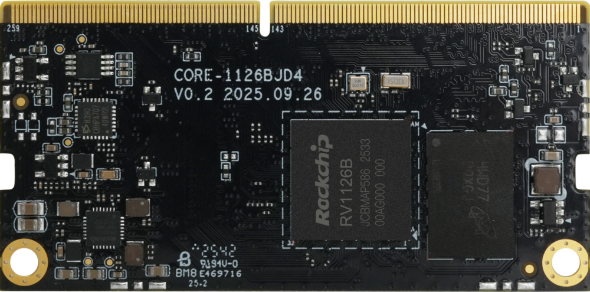
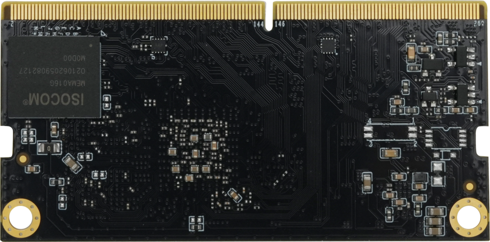
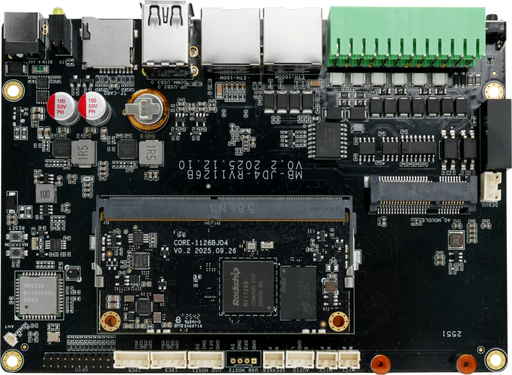
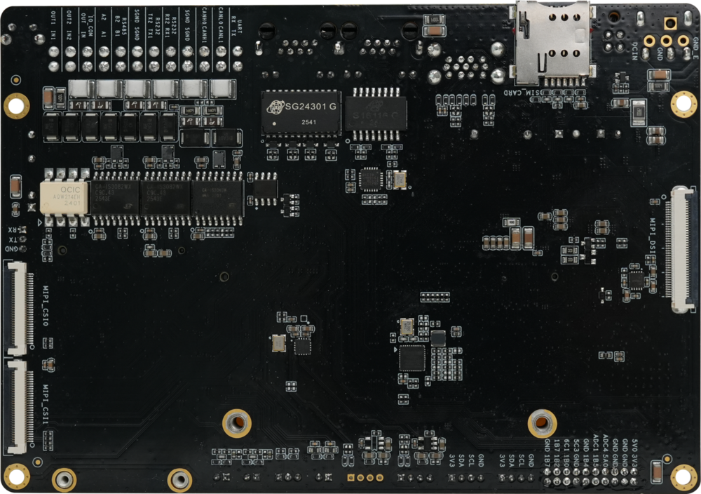
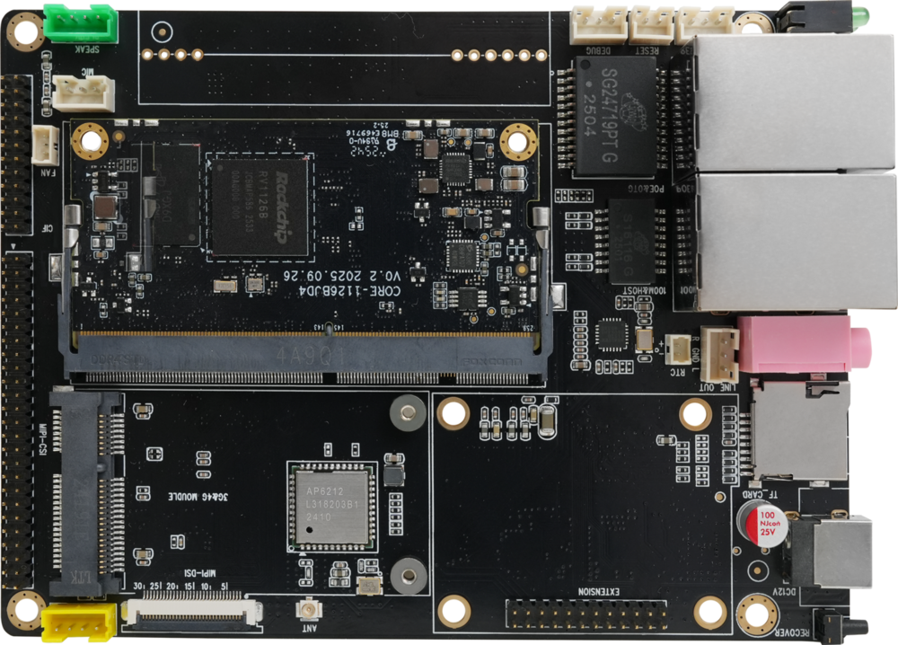
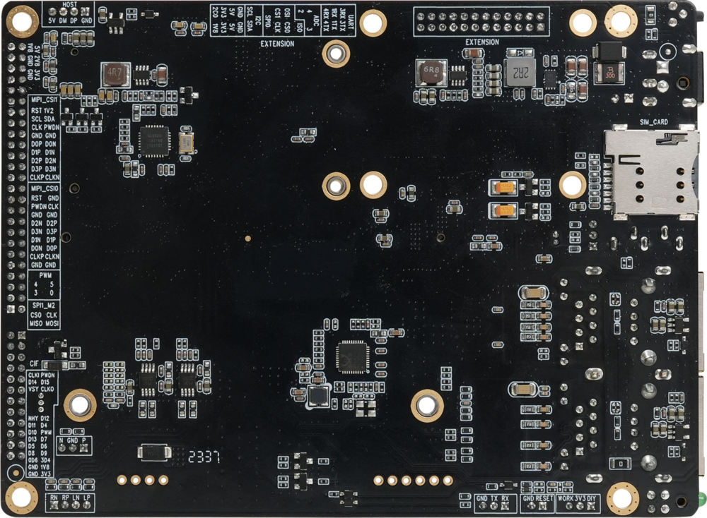
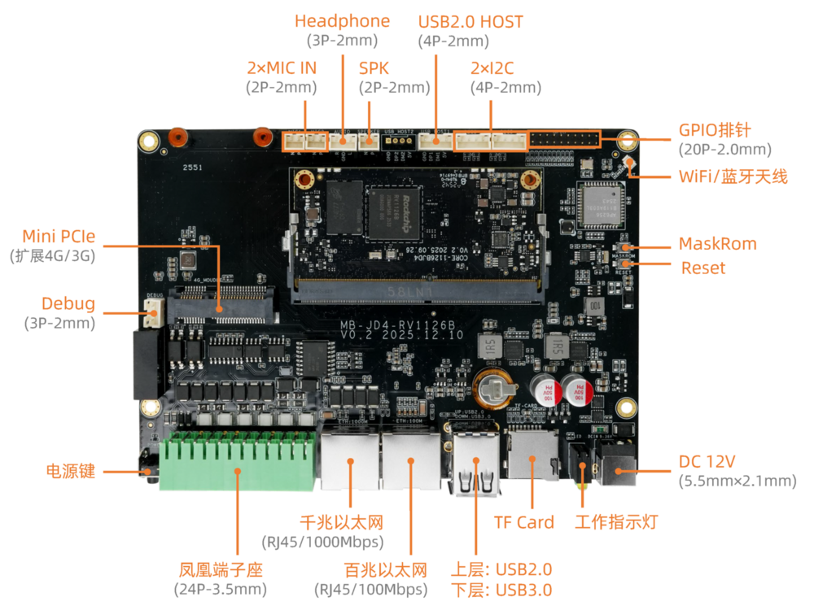
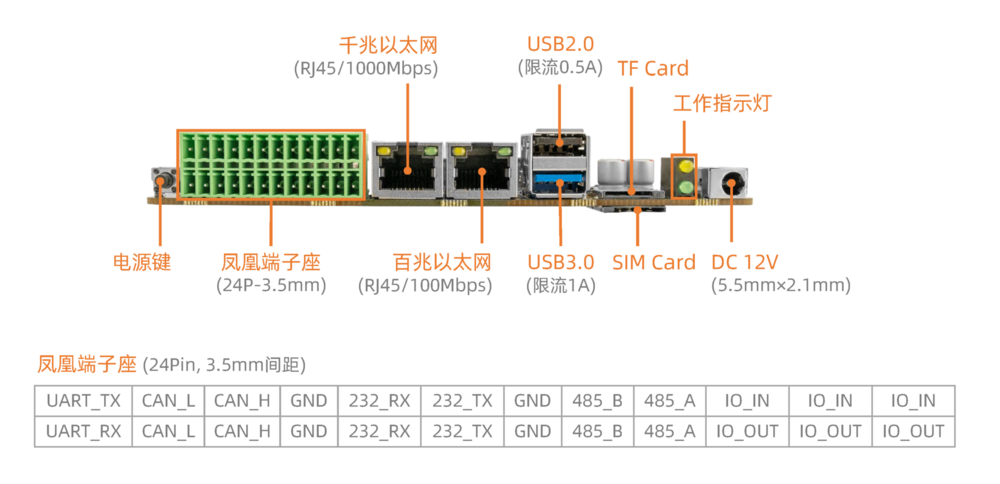
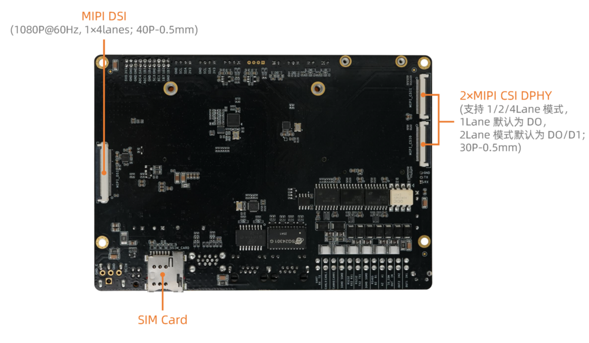

[规格书](https://download.t-firefly.com/Spec/Mainboards/AIO-1126BJD4_Specification_CN.pdf) | [购买链接](https://item.taobao.com/item.htm?id=980958226136&pisk=fOzSOZViALv5TZiJbWC2hYYhkWuBA8_ayBGLsWLy943-9rw_FXrPtJ7Lc52IU6jozoMQH-MJz_jovvwo3J8UayZDR5V3z_0FZ4Vo-2BNQNyQZ70n3Wgw_zOYMfPvJpnLgO0aD2BNQwGpSr6EJ7unkR-rDxcByvHLpmFx_xh-93eKHmht9U3KJUoOE6J6w7WXoE-aUinjP9civrGSDiP-H-ycTbn5z7MvJOUjNdDTwxTpJYfNx8PbaTTgg4qUCfyPkUw_95qKcy9ACv4bMzELiL1x5SZ4b0ZfeeM4zxogyVOdySgSFcUxqQTuBSNLbmaV6N0SyYEErWR1USa7U74bTBKxP4rjfzgO4sLZCGypAIiMRjMNGstHxm9uKvqEZqJZ2jcS0s1Xekm-ijMNGstHx0hmNx5fGLEh.&spm=a1z10.3-c-s.w4002-25768776041.9.390826b9T5fKTC&sku_properties=5919063%3A6536025%3B-1%3A-2) | [下载资料](https://community.t-firefly.com/doc/download/333)

# 简介

**CORE-1126BJD4** 采用 Rockchip 四核 AI 视觉处理器 RV1126B，集成 3 TOPS NPU，支持轻量级 AI 大模型和深度学习框架。内置 12M ISP、8MP AI-ISP、集成多种算法加速器。支持 12M 视频编码，4K 视频解码，支持 4 个摄像头同时输入。采用 260P 金手指接口，尺寸小巧。广泛适用于人脸识别、闸机门禁、智能安防、智能网络摄像头等行业领域。

**CORE-1126BJD4** 可搭配不同的底板组合成不同形态的产品。分别可以组成 AIO-1126BJD4 套板和 AIO-1126BJD4V0 套板。

**CORE-1126BJD4** 正面：

**CORE-1126BJD4** 背面：

### AIO-1126BJD4

AIO-1126BJD4 开发板由核心板 CORE-1126BJD4 + 新底板 MB-JD4-RV1126B 组成。本维基介绍该套板的使用。

AIO-1126BJD4 正面：

AIO-1126BJD4 背面：

### AIO-1126BJD4V0

AIO-1126BJD4V0 开发板由核心板 CORE-1126BJD4 + 旧底板 MB-JD4-RV11091126 组成。

点击跳转 AIO-1126BJD4V0 套板的维基教程：[AIO-1126BJD4V0 维基教程](../../../主板/AIO-1126BJD4%20V0/product_introduction/started.md)

AIO-1126BJD4V0 正面：

AIO-1126BJD4V0 背面：

 
## 接口描述

### 整机接口定义

## 资源与技术支持

* [[技术交流论坛]](https://forum.t-firefly.com/)：超过10万企业客户和用户沟通交流平台

### 联系方式

* 邮箱：sales@t-firefly.com
* 手机：(+86) 186 8811 7175
* 座机：0760-89881218
* 地址：广东省中山市东区中山四路 57 号宏宇大厦 2101 室
