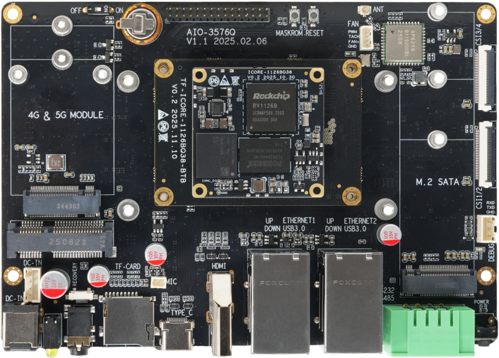
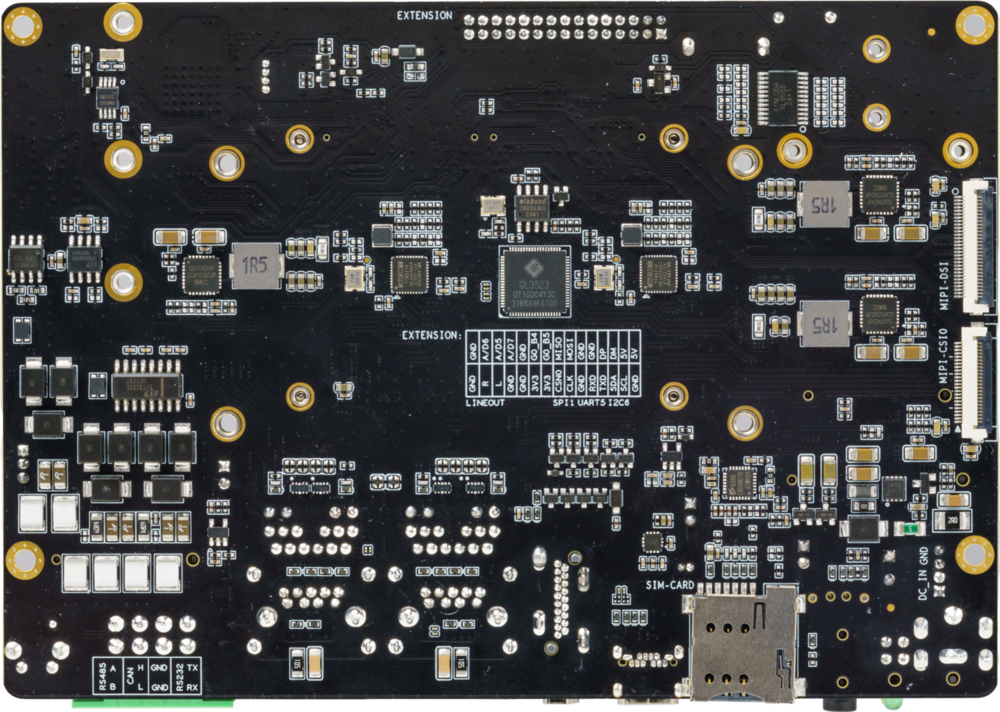
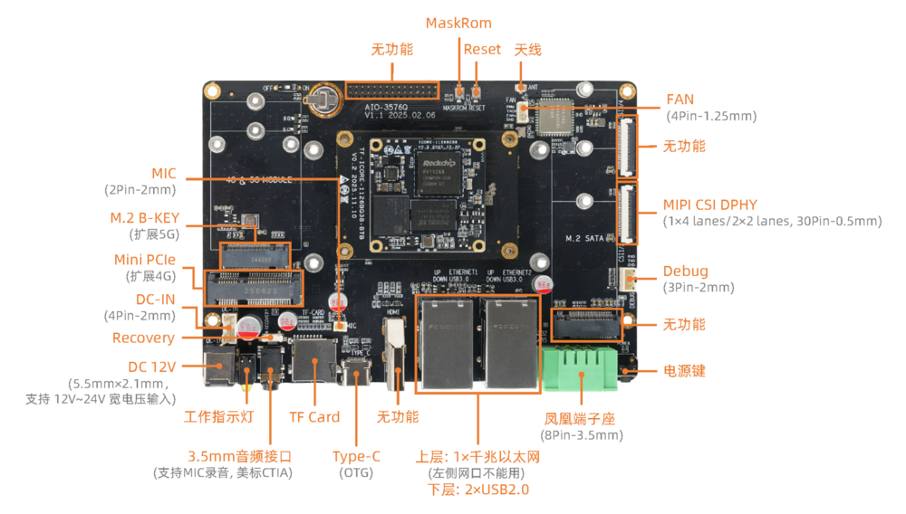
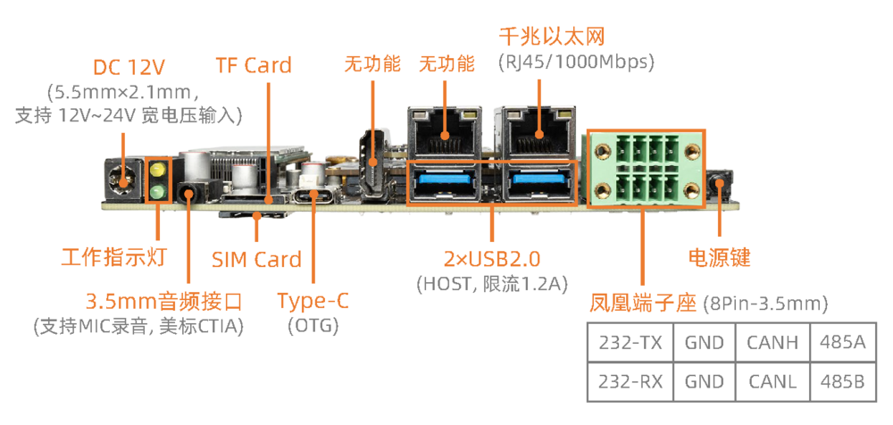
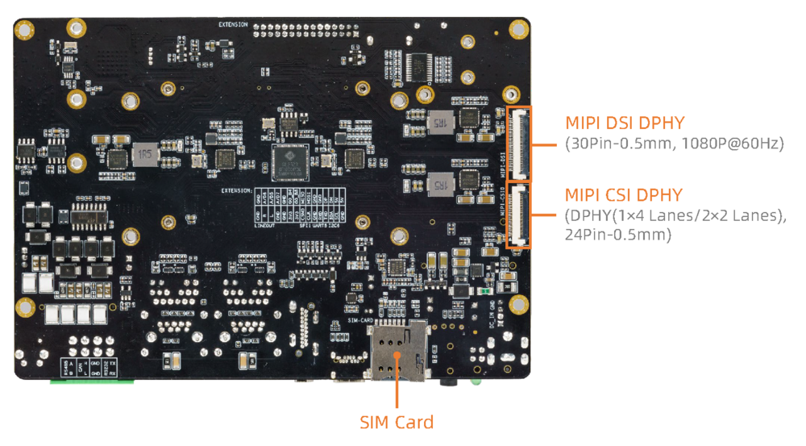

# 简介

**AIO-1126BQ38** 采用 Rockchip 四核 AI 视觉处理器 RV1126B，集成 3 TOPS NPU，支持 2B 多模态大模型和深度学习框架。支持 12M 视频编码，4K 视频解码。内置 12M ISP / 8MP AI-ISP，功耗低。硬件 AI Remosaic, 白天超高清，夜晚超低照，支持多目 AI 动态拼接、流畅自然无割裂感，AI 视频 6 轴数字防抖、多光源融合（RGB 与红外热成像融合、可见光与结构光、ToF 融合），内置更安全的国密级 SM2/SM3/SM4 加密算法。尺寸仅 38mm × 38mm，广泛适用于人脸识别、闸机门禁、智能安防、智能网络摄像头等行业领域。

正面：

背面：

 
## 接口描述

### 整机接口定义

## 资源与技术支持

* [[技术交流论坛]](https://forum.t-firefly.com/)：超过10万企业客户和用户沟通交流平台

### 联系方式

* 邮箱：sales@t-firefly.com
* 手机：(+86) 186 8811 7175
* 座机：0760-89881218
* 地址：广东省中山市东区中山四路 57 号宏宇大厦 2101 室
