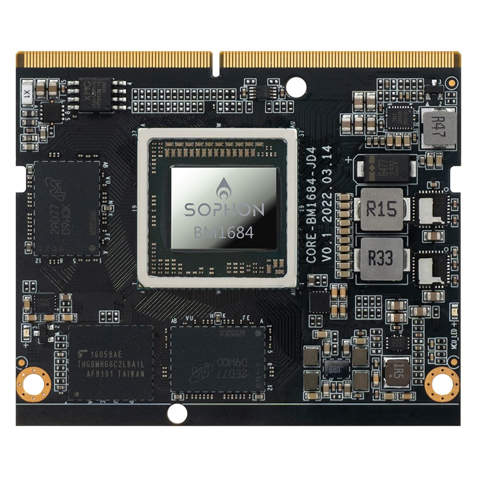
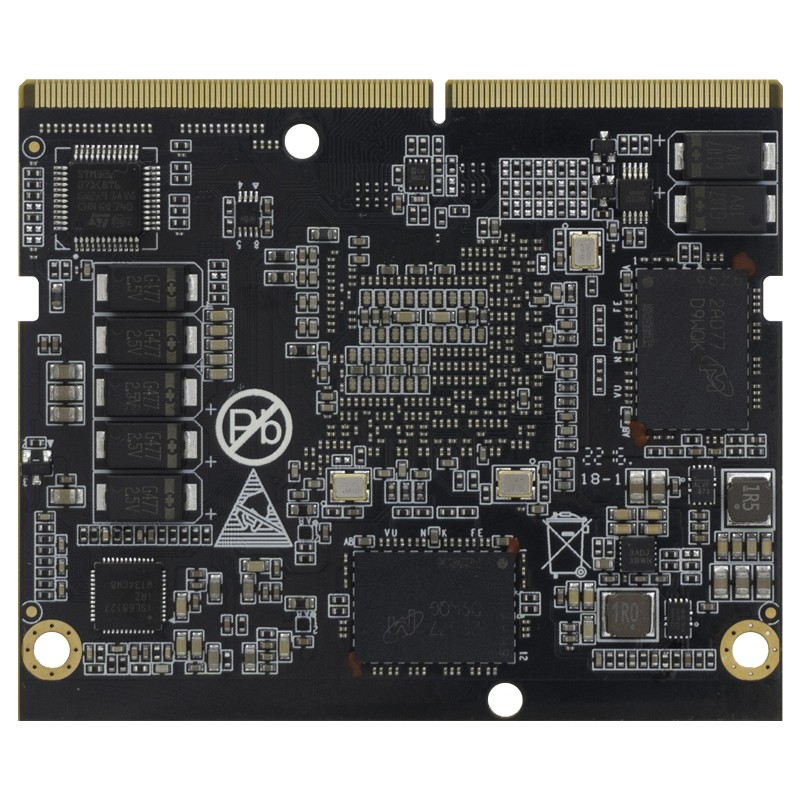
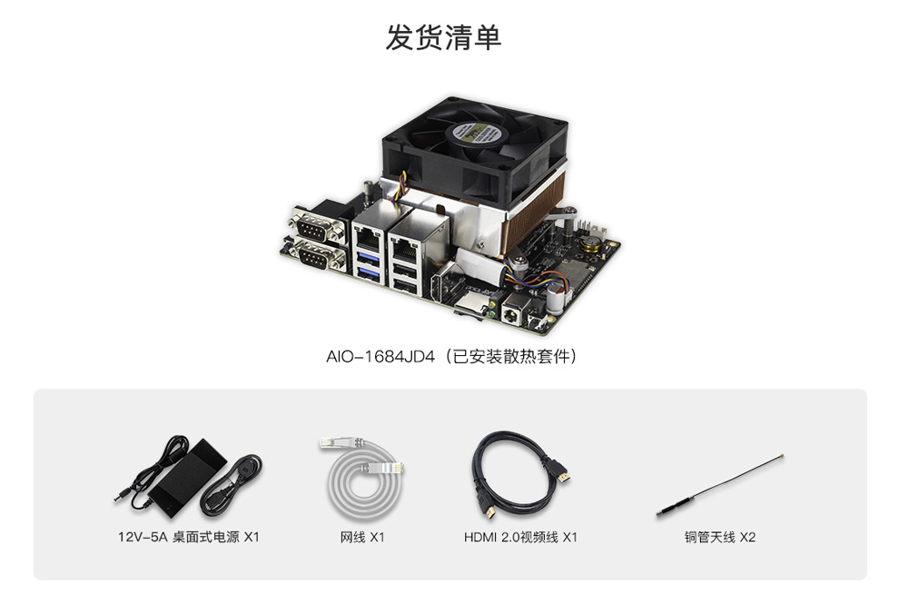
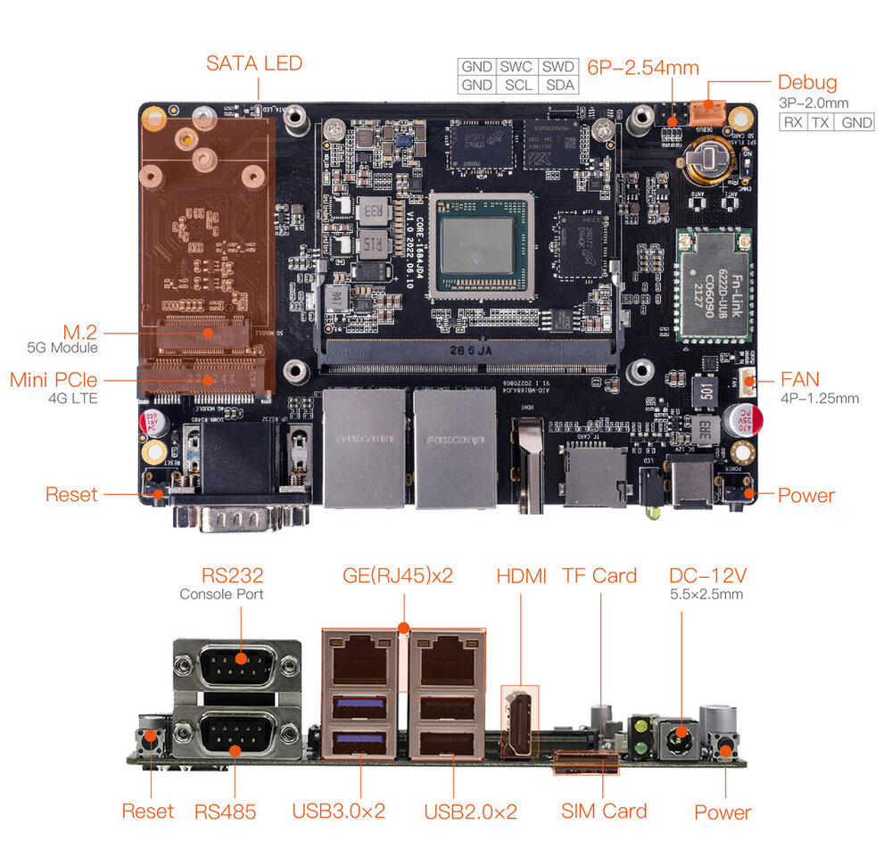
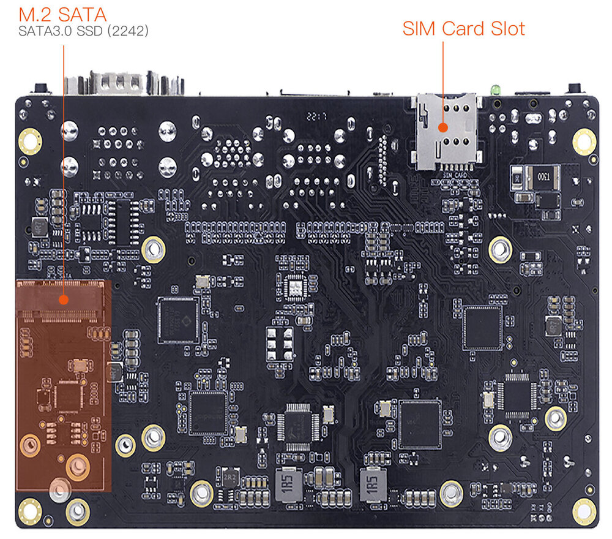

[规格书](https://download.t-firefly.com/%E4%BA%A7%E5%93%81%E8%A7%84%E6%A0%BC%E6%96%87%E6%A1%A3/%E8%A1%8C%E4%B8%9A%E4%B8%BB%E6%9D%BF/AIO-1684JD4%E5%85%AB%E6%A0%B8%E9%AB%98%E7%AE%97%E5%8A%9BAI%E4%B8%BB%E6%9D%BF%20-%20%E4%BA%A7%E5%93%81%E4%BB%8B%E7%BB%8D.pdf) | [购买链接](https://item.taobao.com/item.htm?spm=a1z10.3-c-s.w4002-25052033196.13.7b2426b9sfzIHr&id=689345758328) | [下载资料](https://community.t-firefly.com/doc/download/179)

# 简介

Core-1684JD4 核心板采用 SOPHON 算能 AI 处理器 BM1684，可配置 12GB 大内存；INT8 算力高达 17.6TOPS，支持主流编程框架，工具链完备易用度高，算法迁移代价小；提供底板参考设计资料，用户可自主深度化定制；适用于视觉计算、边缘计算、通用算力服务、智慧交通、无人超市、无人机等多种 AI 计算场景。

**Core-1684JD4 核心板正面：**

**Core-1684JD4 核心板反面：**

## 配件清单

收到开发板后就检查配件清单是否齐全：
- 带壳的整机，或核心板 Core-1684JD4 和底板 MB-JD4-BM1684 各一块及散热风扇
- 12V-5A 电源适配器一个

选购的配件有：
- Firefly 串口模块

另外，在使用过程中，你可能需要以下配件：
- 显示设备
     + 带 HDMI 接口的显示器或电视，及 HDMI 连接线
- 网络
     + 100M/1000M 以太网线缆，有线路由器
     + WiFi 路由器
- 升级固件
     + TF 卡，4GB/Class 10 以上
- 调试
     + USB 转串口适配器

- 发货清单参考

## 接口描述

AIO-1684JD4 主板由核心板 Core-1684JD4 + 底板 MB-JD4-BM1684 组成，AIO-1684JD4 板载 HDMI、mSATA、USB3.0、USB2.0、RS485、RS232 等丰富接口，可直接应用到 AI 边缘计算产品中。

具体如下图：

## 资源与技术支持

* [[技术交流论坛]](https://forum.t-firefly.com/)：超过10万企业客户和用户沟通交流平台

### 联系方式

* 邮箱：sales@t-firefly.com
* 手机：(+86) 186 8811 7175
* 座机：0760-89881218
* 地址：广东省中山市东区中山四路 57 号宏宇大厦 2101 室