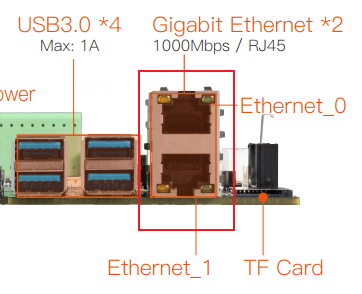

# ETH 使用

AIO-1684XQ 提供两个千兆以太网接口，默认网络配置如下：

- 外壳标有 “1”，靠近 RS232/RS485 接口的网口，对应系统 `eth0` 网络接口，设置为 DHCP 模式。
- 外壳标有 “2”，靠近 HDMI 接口的网口，对应系统 `eth1` 网络接口，设置为静态地址模式：`192.168.150.1/24`。

<center>


</center>

## 1. 初次访问与登录

网口 1（`eth1`）为静态 IP `192.168.150.1`，子网掩码 `255.255.255.0`。初次访问建议先将 PC 设置成同网段 IP（如 `192.168.150.2/24`）：

- Windows 10（管理员模式）：

  ```
  netsh int ipv4 add address "以太网" 192.168.150.101 255.255.255.0
  ```
  其中 `"以太网"` 指的是网络接口，`192.168.150.101` 是 IP 地址，`255.255.255.0` 则为子网掩码。

- Linux：

  ```shell
  ifconfig enp4s0:1 192.168.150.89
  ```
  其中 `enp4s0` 是 PC 机的网卡驱动名称，具体需要执行 `ifconfig` 命令查看。

PC 能成功 `ping` 通 `192.168.150.1` 后，即可使用 `ssh` 登录，端口号为 `22`，用户名密码均为 `linaro`：

```
ssh linaro@192.168.150.1
```

## 2. 网络 IP 配置说明

在默认情况中，AIO-1684XQ 的网口 0 设置了动态 IP，网口 1 设置了静态 IP。这些配置都是通过系统中的 `/etc/netplan/01-netcfg.yaml` 文件实现的。

```shell
linaro@aibox-1684x:~$ cat /etc/netplan/01-netcfg.yaml
network:
        version: 2
        renderer: networkd
        ethernets:
                eth0:
                        dhcp4: yes
                        addresses: []
                        optional: yes
                        dhcp-identifier: mac
                eth1:
                        dhcp4: no
                        addresses: [192.168.150.1/24]
                        optional: yes
```

用户可通过修改 `/etc/netplan/01-netcfg.yaml` 文件达到修改网络配置的目的，举例如：

- 配置网口 0 为静态 IP：参考原 `eth1` 设置修改 `eth0` 节点，将 `dhcp4` 参数修改为 `no`，并添加 IP 地址进 `addresses` 参数中。

- 配置网口 1 为动态 IP：参考原 `eth0` 设置修改 `eth1` 节点，将 `dhcp4` 参数修改为 `yes`，并去除 `addresses` 参数中的 IP 地址。

在完成 `/etc/netplan/01-netcfg.yaml` 文件的修改后，用户可以通过执行 `sudo netplan apply` 命令使设置立即生效。
