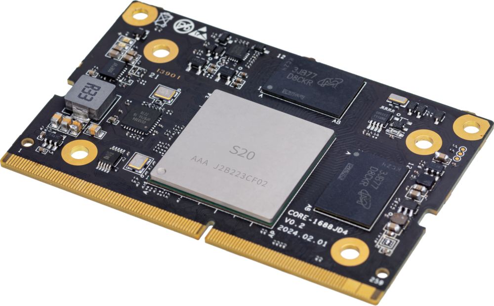
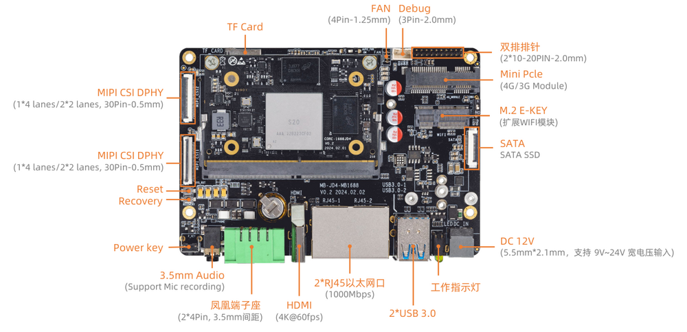

[规格书](https://download.t-firefly.com/%E4%BA%A7%E5%93%81%E8%A7%84%E6%A0%BC%E6%96%87%E6%A1%A3/%E6%A0%B8%E5%BF%83%E6%9D%BF/Core-1688JD4_16T%E7%AE%97%E5%8A%9BAI%E6%A0%B8%E5%BF%83%E6%9D%BF_%E4%BA%A7%E5%93%81%E4%BB%8B%E7%BB%8D.pdf) | [购买链接](https://item.taobao.com/item.htm?id=684554897228) | [下载资料](https://community.t-firefly.com/doc/download/251)

# 简介

Core-1688JD4 核心板,采用算能智算芯片 BM1688，是面向 AI 推理、计算机视觉等高集成视觉算力芯片。可集成于智算服务器、边缘智算盒、工控机、专业智能网络摄像机、AIOT 等多种类型产品。高效适配市场上所有 AI 算法，实现图片分类、目标检测、实例分割、语义分割、行为分析、文字识别、自然语言处理、语音识别、语音合成、搜索推荐等应用，为各个行业进行 AI 赋能；并集成图像处理硬件 : 支持 HDR 宽动态、3D 降噪、3A、去雾等多种图像增强及鱼眼展开、影像拼接、双目融合等计算机视觉算法 ，为客户提供专业级的
视频图像质量和硬件图像算法加速。

**Core-1688JD4 核心板正面：**

## 配件清单
在使用过程中，你可能需要以下配件：
- 显示设备
     + 带 HDMI 接口的显示器或电视，及 HDMI 连接线
- 网络
     + 100M/1000M 以太网线缆，有线路由器
     + WiFi 路由器
- 升级固件
     + TF 卡，8GB/Class 10 以上
- 调试
     + USB 转串口适配器（Firefly UART 串口模块）
     + Type-C （可做 Type-C 串口）

## 接口描述

AIO-1688JD4 主板由核心板 Core-1688JD4 + 底板 MB-JD4-BM1688 组成，AIO-1688JD4 板载 HDMI2.0、PCIE 3.0 x 1、USB3.0 x 2 、RS485、RS232、CAN、CSI 以及 DSI 等丰富接口，可直接应用到 AI 边缘计算产品中。

## 资源与技术支持

* [[技术交流论坛]](https://forum.t-firefly.com/)：超过10万企业客户和用户沟通交流平台

### 联系方式

* 邮箱：sales@t-firefly.com
* 手机：(+86) 186 8811 7175
* 座机：0760-89881218
* 地址：广东省中山市东区中山四路 57 号宏宇大厦 2101 室