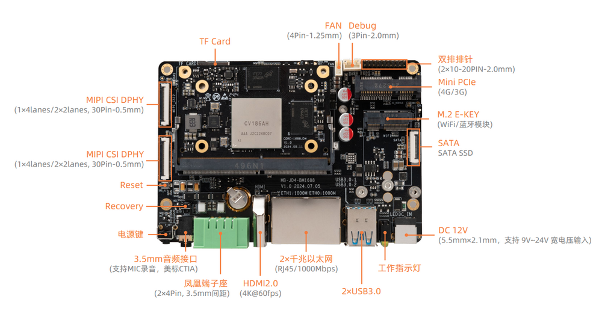

# LED 使用

AIO-186JD4 开发板上有 2 个 LED 灯（如图所示 ）:




| 颜色 | 位置 | 标号 | 描述 |
| ---- | :--: | ---- | ---- |
| 黄色 |  上 | DIY_LED | 用户控制 |
| 绿色 |  下 | WORK_LED | 上电打开 |

控制 LED 灯状态的命令示例（需要 root 权限）：

```
# 黄灯亮
echo 1 >/sys/class/leds/DIY_LED/brightness
# 黄灯灭
echo 0 >/sys/class/leds/DIY_LED/brightness

# 绿灯亮
echo 1 >/sys/class/leds/WORK_LED/brightness
# 绿灯灭
echo 0 >/sys/class/leds/WORK_LED/brightness
```

