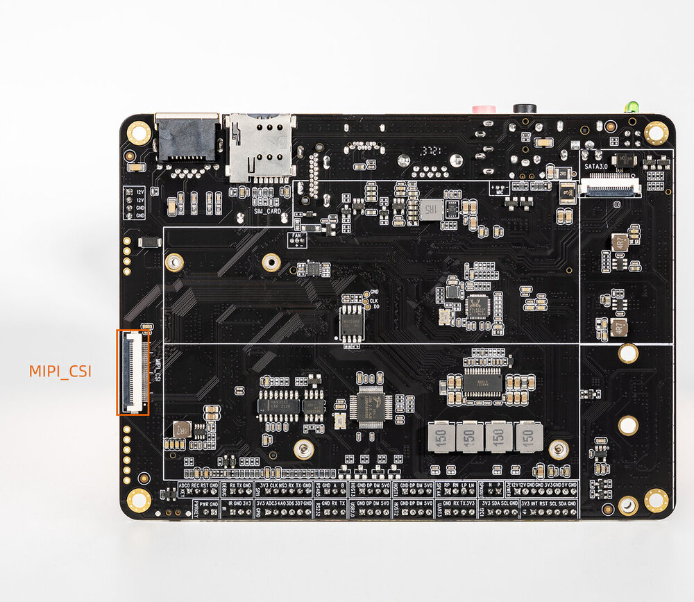
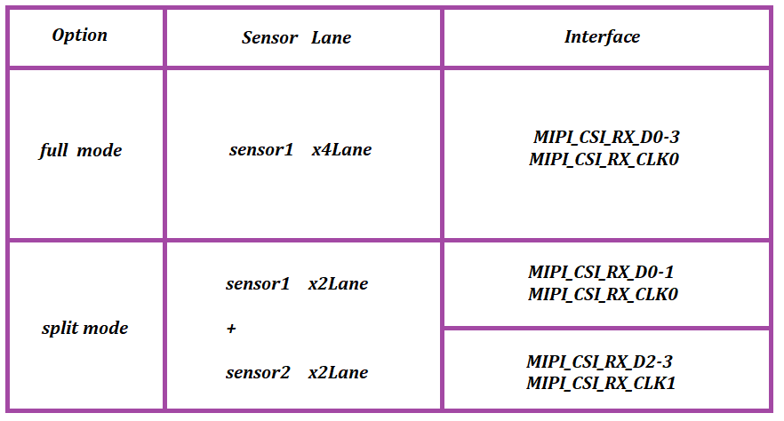

# Camera 使用

- 接口效果图

<center>



</center>

## MIPI CSI用法 [step]
RK3566/RK3568 平台仅有一个标准物理 mipi csi2 dphy，可以工作在两个模式：full mode 和 split mode，拆分为 csi2_dphy0/csi2_dphy1/csi2_dphy2 三个逻辑 dphy（参见 rk3568.dtsi）。

### Full Mode
- 仅使用 csi2_dphy0，csi2_dphy0 与 csi2_dphy1/csi2_dphy2 互斥，不可同时使用；
- data lane 最大 4 lanes；
- 最大速率 2.5Gbps/lane；

### Split Mode
- 仅使用 csi2_dphy1 和 csi2_dphy2，与 csi2_dphy0 互斥，不可同时使用；
- csi2_dphy1 和 csi2_dphy2 可同时使用；
- csi2_dphy1 和 csi2_dphy2 各自的 data lane 最大是 2 lanes；
- csi2_dphy1 对应物理 dphy 的 lane0/lane1；
- csi2_dphy2 对应物理 dphy 的 lane2/lane3；
- 最大速率 2.5Gbps/lane。

<center>



</center>

简单点来讲，如果用单目摄像头可以配置 full mode，若使用双目摄像头可以配置 split mode。

## Full Mode配置 [step]
**链接关系**：sensor->csi2_dphy0->isp

### Full Mode设备树配置要点

### 配置sensor端
根据板子原理图的 MIPI CSI 接口找到 sensor 是挂在哪个 I2C 总线上，然后在对应的 I2C 节点配置 camera 节点，正确配置 camera 模组的 I2C 设备地址、引脚等属性。如下 Core-3566JD4 的 xc7160 配置：
```dts
&i2c4 {
        status = "okay";
        XC7160: XC7160b@1b{
                status = "okay";
                compatible = "firefly,xc7160";
                reg = <0x1b>;
                clocks = <&cru CLK_CIF_OUT>;
                clock-names = "xvclk";
                power-domains = <&power RK3568_PD_VI>;
                pinctrl-names = "default";
                pinctrl-0 = <&cif_clk>;
                power-gpios = <&gpio4 RK_PB1 GPIO_ACTIVE_LOW>;
                reset-gpios = <&gpio3 RK_PD5 GPIO_ACTIVE_HIGH>;
                pwdn-gpios = <&gpio3 RK_PD4 GPIO_ACTIVE_HIGH>;
                firefly,clkout-enabled-index = <0>;
                rockchip,camera-module-index = <0>;
                rockchip,camera-module-facing = "back";
                rockchip,camera-module-name = "NC";
                rockchip,camera-module-lens-name = "NC";
                port {
                        xc7160_out: endpoint {
                                remote-endpoint = <&mipi_in_ucam4>;
                                data-lanes = <1 2 3 4>;
                        };
                };
        };
};

```

### csi2_dphy0相关配置
csi2_dphy0 与 csi2_dphy1/csi2_dphy2 互斥，不可同时使用。另外需要使能 csi2_dphy_hw 节点。
```dts
&csi2_dphy0 {
        status = "okay";
        /*
        * dphy0 only used for full mode,
        * full mode and split mode are mutually exclusive
        */
        ports {
                #address-cells = <1>;
                #size-cells = <0>;
                port@0 {
                        reg = <0>;
                        #address-cells = <1>;
                        #size-cells = <0>;
...
                        mipi_in_ucam4: endpoint@5 {
                                reg = <5>;
                                remote-endpoint = <&xc7160_out>;
                                data-lanes = <1 2 3 4>;
                        };
                };
                port@1 {
                        reg = <1>;
                        #address-cells = <1>;
                        #size-cells = <0>;

                        csidphy_out: endpoint@0 {
                                reg = <0>;
                                remote-endpoint = <&isp0_in>;
                        };
                };
        };
};

&csi2_dphy_hw {
   status = "okay";
};

&csi2_dphy1 {
        status = "disabled";
};

&csi2_dphy2 {
        status = "disabled";
};
```

### isp相关配置
其中 rkisp_vir0 节点的`remote-endpoint`指向`csidphy_out`
```dts
&rkisp {
   status = "okay";
};

&rkisp_mmu {
   status = "okay";
};

&rkisp_vir0 {
   status = "okay";
   port {
      #address-cells = <1>;
      #size-cells = <0>;

      isp0_in: endpoint@0 {
         reg = <0>;
         remote-endpoint = <&csidphy_out>;
      };
   };
};
```


## Split Mode配置 [step]
**链接关系**：

sensor1->csi_dphy1->isp_vir0

sensor2->csi_dphy2->mipi_csi2->vicap->isp_vir1

### Split Mode设备树配置要点

### 配置sensor端
根据板子原理图的 MIPI CSI 接口找到两个 sensor 是挂在哪个 I2C 总线上，然后在对应的 I2C 节点配置两个 camera 节点，正确配置 camera 模组的 I2C 设备地址、引脚等属性。如下 Core-3566JD4 的 gc2053/gc2093 配置：
```dts
&i2c4 {
            status = "okay";
           gc2053: gc2053@37 { //IR
                status = "okay";
                compatible = "galaxycore,gc2053";
                reg = <0x37>;

                avdd-supply = <&vcc_camera>;
                power-domains = <&power RK3568_PD_VI>;
                clock-names = "xvclk";
                pinctrl-names = "default";
                clocks = <&cru CLK_CIF_OUT>;
                pinctrl-0 = <&cif_clk>;
                power-gpios = <&gpio3 RK_PD5 GPIO_ACTIVE_HIGH>;//IR_PWR_EN
                pwdn-gpios = <&gpio4 RK_PB1 GPIO_ACTIVE_LOW>;
                firefly,clkout-enabled-index = <1>;
                rockchip,camera-module-index = <0>;
                rockchip,camera-module-facing = "back";
                rockchip,camera-module-name = "YT-RV1109-2-V1";
                rockchip,camera-module-lens-name = "40IR-2MP-F20";
                port {
                        gc2053_out: endpoint {
                                        remote-endpoint = <&dphy1_in>;
                                        data-lanes = <1 2>;
                        };
                };
        };
        gc2093: gc2093b@7e{ //RGB
                status = "okay";
                compatible = "galaxycore,gc2093";
                reg = <0x7e>;

                avdd-supply = <&vcc_camera>;
                power-domains = <&power RK3568_PD_VI>;
                clock-names = "xvclk";
                pinctrl-names = "default";
                flash-leds = <&flash_led>;
		pwdn-gpios = <&gpio3 RK_PD4 GPIO_ACTIVE_HIGH>;
                firefly,clkout-enabled-index = <0>;
                rockchip,camera-module-index = <1>;
                rockchip,camera-module-facing = "front";
                rockchip,camera-module-name = "YT-RV1109-2-V1";
                rockchip,camera-module-lens-name = "40IR-2MP-F20";
                port {
                        gc2093_out: endpoint {
                                        remote-endpoint = <&dphy2_in>;
                                        data-lanes = <1 2>;
                        };
                };
        };

};
```

### csi2_dphy1/csi2_dphy2相关配置
csi2_dphy0 与 csi2_dphy1/csi2_dphy2 互斥，不可同时使用。
```dts
&csi2_dphy0 {
         status = "disabled";
};

&csi2_dphy1 {
        status = "okay";
        /*
        * dphy1 only used for split mode,
        * can be used  concurrently  with dphy2
        * full mode and split mode are mutually exclusive
        */
        ports {
                #address-cells = <1>;
                #size-cells = <0>;

                port@0 {
                        reg = <0>;
                        #address-cells = <1>;
                        #size-cells = <0>;

                        dphy1_in: endpoint@1 {
                                        reg = <1>;
                                        remote-endpoint = <&gc2053_out>;
                                        data-lanes = <1 2>;
                        };
                };

                port@1 {
                        reg = <1>;
                        #address-cells = <1>;
                        #size-cells = <0>;

                        dphy1_out: endpoint@1 {
                                        reg = <1>;
                                        remote-endpoint = <&isp0_in>;
                        };
                };
        };
};

&csi2_dphy2 {
        status = "okay";
        /*
        * dphy2 only used for split mode,
        * can be used  concurrently  with dphy1
        * full mode and split mode are mutually exclusive
        */
        ports {
                #address-cells = <1>;
                #size-cells = <0>;

                port@0 {
                        reg = <0>;
                        #address-cells = <1>;
                        #size-cells = <0>;

                        dphy2_in: endpoint@1 {
                                        reg = <1>;
                                        remote-endpoint = <&gc2093_out>;
                                        data-lanes = <1 2>;
                        };
                };

                port@1 {
                        reg = <1>;
                        #address-cells = <1>;
                        #size-cells = <0>;

                        dphy2_out: endpoint@1 {
                                        reg = <1>;
                                        remote-endpoint = <&mipi_csi2_input>;
                        };
                };
        };
};

&csi2_dphy_hw {
      status = "okay";
};

&mipi_csi2 {
        status = "okay";

        ports {
                #address-cells = <1>;
                #size-cells = <0>;

                port@0 {
                        reg = <0>;
                        #address-cells = <1>;
                        #size-cells = <0>;

                        mipi_csi2_input: endpoint@1 {
                                        reg = <1>;
                                        remote-endpoint = <&dphy2_out>;
                                        data-lanes = <1 2>;
                        };
                };

                port@1 {
                        reg = <1>;
                        #address-cells = <1>;
                        #size-cells = <0>;

                        mipi_csi2_output: endpoint@0 {
                                        reg = <0>;
                                        remote-endpoint = <&cif_mipi_in>;
                                        data-lanes = <1 2>;
                        };
                };
        };
};


&rkcif_mipi_lvds {
        status = "okay";
        port {
                cif_mipi_in: endpoint {
                        remote-endpoint = <&mipi_csi2_output>;
                        data-lanes = <1 2>;
                };
        };
};

&rkcif_mipi_lvds_sditf {
        status = "okay";
        port {
                mipi_lvds_sditf: endpoint {
                        remote-endpoint = <&isp1_in>;
                        data-lanes = <1 2>;
                };
        };
};

```

### isp相关配置
其中 rkisp_vir0 节点的`remote-endpoint`指向`dphy1_out`
```dts
&rkisp {
        status = "okay";
};

&rkisp_mmu {
        status = "okay";
};

&rkisp_vir0 {
        status = "okay";
        port {
                #address-cells = <1>;
                #size-cells = <0>;

                isp0_in: endpoint@0 {
                        reg = <0>;
                        remote-endpoint = <&dphy1_out>;
                };
        };
};

&rkisp_vir1 {
        status = "okay";

        port {
                reg = <0>;
                #address-cells = <1>;
                #size-cells = <0>;

                isp1_in: endpoint@0 {
                        reg = <0>;
                        remote-endpoint = <&mipi_lvds_sditf>;
                };
        };
};


&rkcif_mmu {
    status = "okay";
};

&rkcif {
    status = "okay";
};
```

## 软件相关目录 [step]
```text
Linux Kernel-4.19
|-- arch/arm/boot/dts #DTS配置文件
|-- drivers/phy/rockchip
|-- phy-rockchip-mipi-rx.c #mipi dphy驱动
|-- phy-rockchip-csi2-dphy-common.h
|-- phy-rockchip-csi2-dphy-hw.c
|-- phy-rockchip-csi2-dphy.c
|-- drivers/media
|-- platform/rockchip/cif #RKCIF驱动
|-- platform/rockchip/isp #RKISP驱动
|-- dev #包含 probe、异步注册、clock、pipeline、 iommu及media/v4l2 framework
|-- capture #包含 mp/sp/rawwr的配置及 vb2,帧中断处理
|-- dmarx #包含 rawrd的配置及 vb2,帧中断处理
|-- isp_params #3A相关参数设置
|-- isp_stats #3A相关统计
|-- isp_mipi_luma #mipi数据亮度统计
|-- regs #寄存器相关的读写操作
|-- rkisp #isp subdev和entity注册
|-- csi #csi subdev和mipi配置
|-- bridge #bridge subdev,isp和ispp交互桥梁
|-- platform/rockchip/ispp #rkispp驱动
|-- dev #包含 probe、异步注册、clock、pipeline、 iommu及media/v4l2 framework
|-- stream #包含 4路video输出的配置及 vb2,帧中断处理
|-- rkispp #ispp subdev和entity注册
|-- params #TNR/NR/SHP/FEC/ORB参数设置
|-- stats #ORB统计信息
|-- i2
```

## 单目CAM-8MS1M/双目CAM-2MS2MF摄像头的使用 [step]
firefly 已经配置好相应的 dts，单目摄像头 CAM-8MS1M 和双目摄像头 CAM-2MS2MF 使用互斥，只需包含相应的 dtsi 文件即可使用单目摄像头 CAM-8MS1M 或双目摄像头 CAM-2MS2MF。

Linux 已经配置好各种组合的 dts 和 mk 文件，编译前按需选择，不用修改文件。

Android 需要如下修改：

### 使用单目摄像头CAM-8MS1M
dts 的配置默认使用单目摄像头。
```diff
diff --git a/kernel/arch/arm64/boot/dts/rockchip/rk3566-firefly-aiojd4.dts b/kernel/arch/arm64/boot/dts/rockchip/rk3566-firefly-aiojd4.dts
index 7e2a8b2..14fa027 100755
--- a/kernel/arch/arm64/boot/dts/rockchip/rk3566-firefly-aiojd4.dts
+++ b/kernel/arch/arm64/boot/dts/rockchip/rk3566-firefly-aiojd4.dts
@@ -7,6 +7,15 @@
+#include "rk3566-firefly-aiojd4-cam-8ms1m.dtsi"
+//#include "rk3566-firefly-aiojd4-cam-2ms2m.dtsi"
```
### 使用双目摄像头CAM-2MS2MF
```diff
diff --git a/kernel/arch/arm64/boot/dts/rockchip/rk3566-firefly-aiojd4.dts b/kernel/arch/arm64/boot/dts/rockchip/rk3566-firefly-aiojd4.dts
index 7e2a8b2..14fa027 100755
--- a/kernel/arch/arm64/boot/dts/rockchip/rk3566-firefly-aiojd4.dts
+++ b/kernel/arch/arm64/boot/dts/rockchip/rk3566-firefly-aiojd4.dts
@@ -7,6 +7,15 @@
- #include "rk3566-firefly-aiojd4-cam-8ms1m.dtsi"
+//#include "rk3566-firefly-aiojd4-cam-8ms1m.dtsi"
- //#include "rk3566-firefly-aiojd4-cam-2ms2m.dtsi"
+ #include "rk3566-firefly-aiojd4-cam-2ms2m.dtsi"
```

## Camera底层调试 [step]
使用 v4l2-ctl 抓取 camera 数据帧。
```bash
v4l2-ctl --verbose -d /dev/video0 --set-fmt-video=width=1920,height=1080,pixelformat='NV12' --stream-mmap=4 --set-selection=target=crop,flags=0,top=0,left=0,width=1920,height=1080 --stream-to=/data/out.yuv
```

把 out.yuv 文件拷贝出来通过 Ubuntu 去查看。
```bash
ffplay -f rawvideo -video_size 1920x1080 -pix_fmt nv12 out.yuv
```

## Android系统使用camera应用 [step]
Android 系统使用 camera 的 apk 打开摄像头需要配置 camera3_profiles*.xml，具体可参考 Android SDK `hardware/rockchip/camera/etc/camera` 目录下的文件。

## Linux系统预览摄像头 [step]
Buildroot 直接使用 qcamera 打开摄像头，可进行拍摄与录制，详细参考 [Buildroot 使用手册](/docs/software/os-guide/Buildroot/buildroot)。

Ubuntu 单目摄像头预览可以使用如下脚本：
```bash
#!/bin/bash

export DISPLAY=:0
export XAUTHORITY=/home/firefly/.Xauthority
export LD_LIBRARY_PATH=$LD_LIBRARY_PATH:/usr/lib/aarch64-linux-gnu/gstreamer-1.0
WIDTH=1920
HEIGHT=1080
SINK=xvimagesink

gst-launch-1.0 v4l2src device=/dev/video0 ! video/x-raw,format=NV12,width=${WIDTH},height=${HEIGHT}, framerate=30/1 ! videoconvert ! $SINK &

wait
```
也可以使用之前提到的抓帧方法，抓到数据后用 mpv 播放：
```bash
mpv test.yuv --demuxer=rawvideo --demuxer-rawvideo-w=1920 --demuxer-rawvideo-h=1080
```

对于双目摄像头预览，则使用如下脚本：
```bash
#!/bin/bash

export DISPLAY=:0
export XAUTHORITY=/home/firefly/.Xauthority
export LD_LIBRARY_PATH=$LD_LIBRARY_PATH:/usr/lib/aarch64-linux-gnu/gstreamer-1.0
WIDTH=640
HEIGHT=480
SINK=xvimagesink

gst-launch-1.0 v4l2src device=/dev/video14 ! video/x-raw,format=NV12,width=${WIDTH},height=${HEIGHT}, framerate=30/1 ! videoconvert ! $SINK &
gst-launch-1.0 v4l2src device=/dev/video5 ! video/x-raw,format=NV12,width=${WIDTH},height=${HEIGHT}, framerate=30/1 ! videoconvert ! $SINK &

wait
```

## IQ文件 [step]
raw 摄像头支持的 iq 文件路径 `external/camera_engine_rkaiq/iqfiles/isp21`，与以前不一样的地方是 iq 文件不再采用 `.xml` 的方式，而是采用 `.json` 的方式。虽有提供 xml 转 json 的工具，但 isp20 的 xml 配置转换后也不适用 isp21。

若使用 raw 摄像头 sensor，请留意 isp21 目录所支持的 iq 文件。

