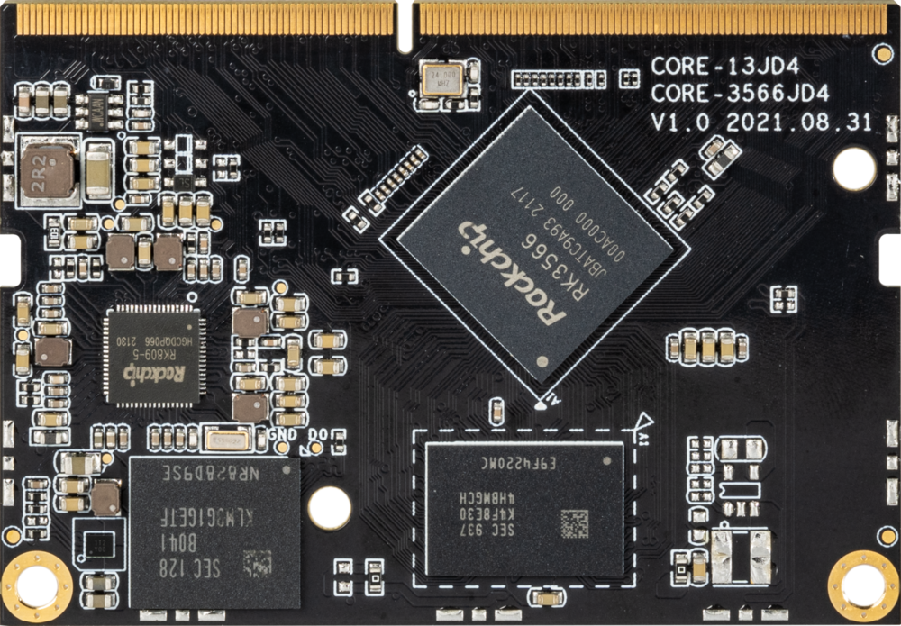
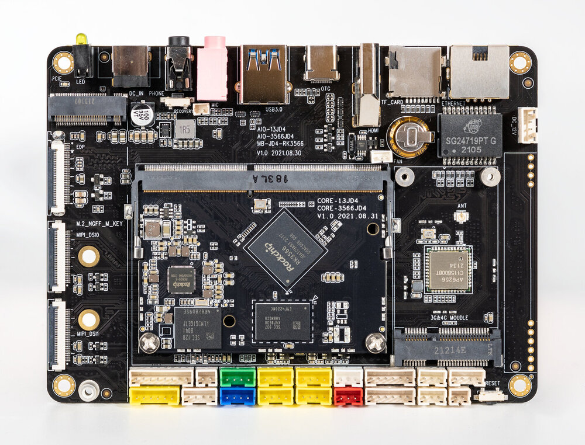
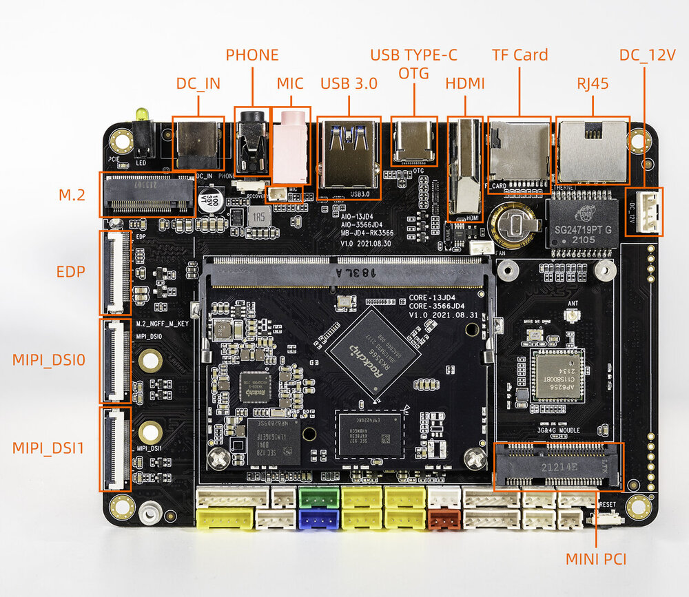
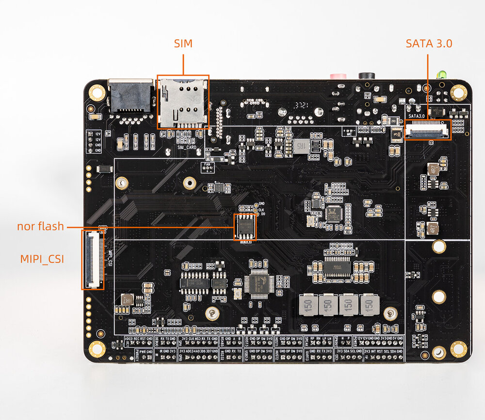

# 简介

[规格书](https://download.t-firefly.com/%E4%BA%A7%E5%93%81%E8%A7%84%E6%A0%BC%E6%96%87%E6%A1%A3/%E6%A0%B8%E5%BF%83%E6%9D%BF/Core-3566JD4%20%E6%A0%B8%E5%BF%83%E6%9D%BF%E4%BA%A7%E5%93%81%E8%A7%84%E6%A0%BC%E4%B9%A6.pdf) | [购买链接](https://item.taobao.com/item.htm?spm=a1z10.5-c-s.w4002-24099170634.61.2f0d3f47aGZmRO&id=660974808418) | [下载资料](https://community.t-firefly.com/doc/download/136)

Core-3566JD4 主控采用 Rockchip RK3566 四核处理器，集成双核心架构 GPU 以及高效能 NPU，支持 8G 大内存，板载 M.2，支持 2.4/5G WIFI，4G 无线网络通讯，拥有丰富的接口扩展，支持多种视频输入输出接口，可应用于智能 NVR、云终端、物联网网关、工业控制等场景。

AIO-3566JD4 开发板由核心板 Core-3566JD4 + 底板 MB-JD4-RK3566 组成，AIO-3566JD4 拥有 RGMII、PCIE3.0、USB3.0、I2C、SPI、UART、GPIO、MIPI-DSI 等丰富接口，可直接应用到各种智能产品中，加速产品落地，详细内容可参考下方接口描述。

## 接口描述

AIO-3566JD4 提供了丰富的接口，主要包括：

- 1 x DC 12V 电源接口
- 1 x RJ45（RGMII，支持千兆以太网）
- 1 x HDMI 输出
- 1 x USB3.0
- 1 x USB Type-C（OTG，下载/Debug）
- 1 x TF Card
- 1 x M.2 (NGFF, M Key)
- 1 x Mini PCIe（4G 模块）
- 1 x SIM 卡槽
- 1 x SATA 3.0
- 1 x MIPI-CSI
- 2 x MIPI-DSI（MIPI_DSI0 和 MIPI_DSI1）
- 1 x EDP
- 1 x PHONE（耳机输出）
- 1 x MIC（麦克风输入）
- 1 x RS232（端子座）
- 1 x RS485（端子座）
- 2 x UART（端子座，3V3/TX/RX/GND）
- I2C、SPI、GPIO（由端子座引出）

整机接口分布如下图（正面/背面）：

## 资源与技术支持

- [[技术交流论坛]](https://forum.t-firefly.com/)：超过 10 万企业客户和用户沟通交流平台

### 联系方式

- 邮箱：sales@t-firefly.com
- 手机：(+86) 186 8811 7175
- 座机：0760-89881218
- 地址：广东省中山市东区中山四路 57 号宏宇大厦 2101 室
