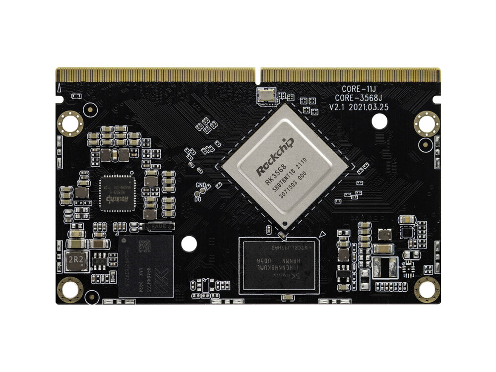
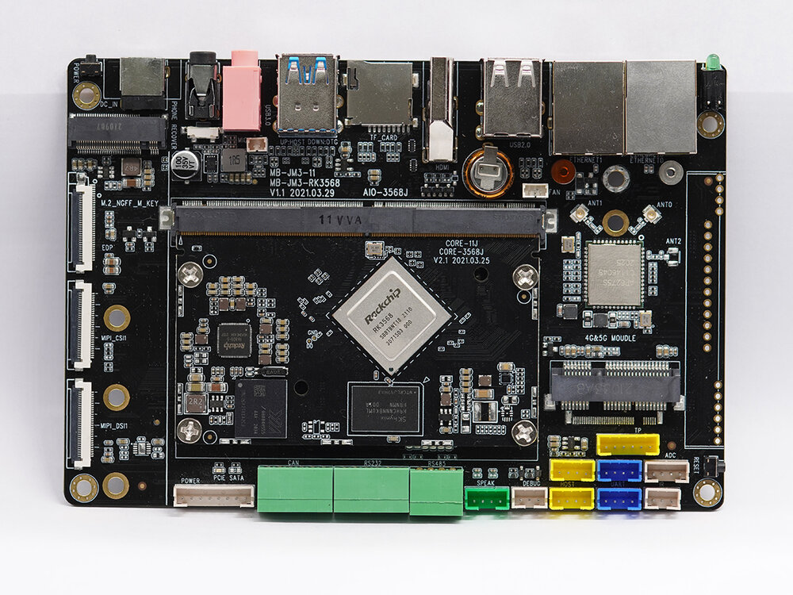
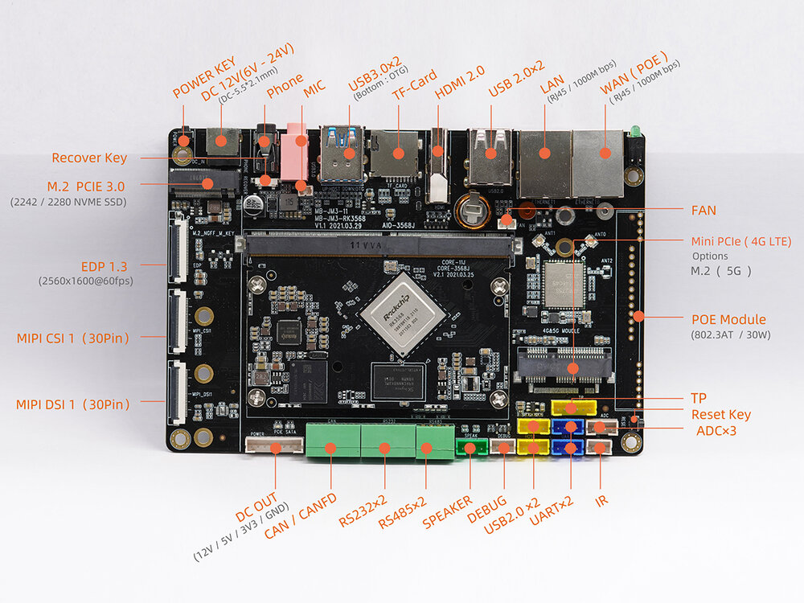
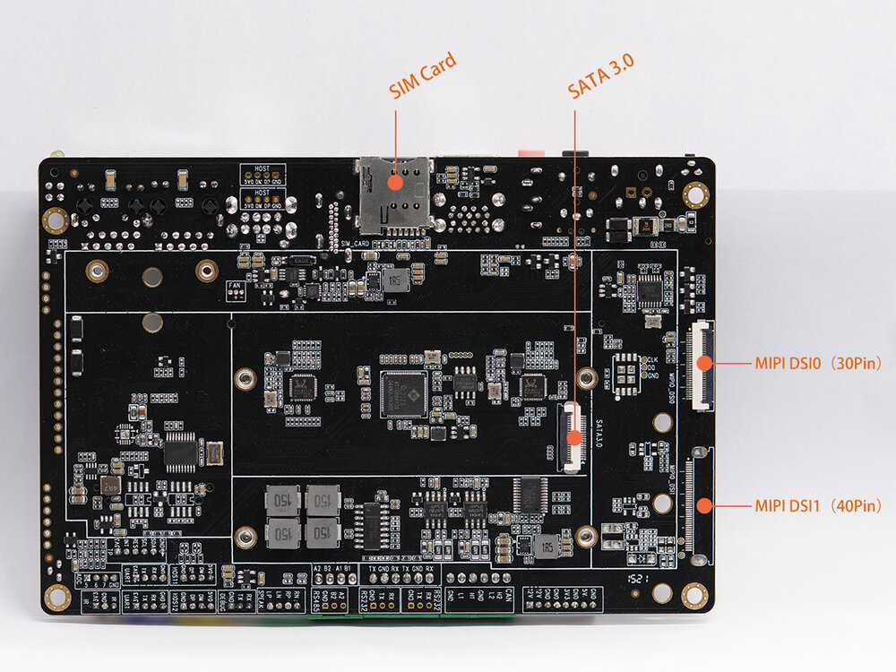

# 简介

[规格书](https://download.t-firefly.com/%E4%BA%A7%E5%93%81%E8%A7%84%E6%A0%BC%E6%96%87%E6%A1%A3/%E6%A0%B8%E5%BF%83%E6%9D%BF/Core-3568J-%E5%9B%9B%E6%A0%B8%E9%AB%98%E6%80%A7%E8%83%BDAI%E6%A0%B8%E5%BF%83%E6%9D%BF-%E8%A7%84%E6%A0%BC%E4%B9%A6.pdf?v=1620639527) | [购买链接](https://store.t-firefly.com/goods.php?id=145) | [下载资料](https://community.t-firefly.com/doc/download/103)

[Core-3568J](https://store.t-firefly.com/goods.php?id=145)采用 RK3568 四核 64 位 Cortex-A55 处理器，22 nm 先进工艺，主频最高 2.0GHz，集成双核心架构 GPU 以及高效能 NPU；最大支持 8G 大内存；支持 WiFi6，5G/4G 等高速无线网络通讯；拥有丰富的接口扩展，支持多种视频输入输出接口，可适用于智能 NVR、云终端、物联网网关、工业控制等场景

[AIO-3568J](https://store.t-firefly.com/goods.php?id=146)开发板由核心板 Core-3568J + 底板 MB-JM3-RK3568 组成，AIO-3568J 拥有 RGMII、PCIE3.0、USB3.0、I2C、SPI、UART、GPIO、MIPI-DSI 等丰富接口，可直接应用到各种智能产品中，加速产品落地

## 接口描述

AIO-3568J 提供了丰富的接口，主要包括：

- 电源接口
- 1 x USB3.0（host/device）
- 1 x USB3.0（host）
- 4 x USB2.0（接口×2，座子×2）
- HDMI
- MIPI 屏幕接口
- EDP 屏接口
- TP 触摸接口
- 以太网
- WIFI 天线
- 蓝牙天线
- MIC 接口
- 音频输入（linein）
- 3.5mm 耳机接口
- 12V 电源接口
- IR 接口
- TF 卡槽
- SIM 卡槽
- SATA 接口
- 喇叭接口
- Power 按键
- Reset 按键
- Recovery 按键
- 调试串口
- 工业级串口（RS485，RS232，TTL）
- MIPI 摄像头接口
- MINI-PCIE（可选 M2 NGFF 5G 座子）
- M.2 PCIE 3.0 接口
- CAN/CANFD

整机接口分布如下图（正面/背面）：

## 资源与技术支持

- [技术交流论坛](https://forum.t-firefly.com/)：超过 10 万企业客户和用户沟通交流平台

### 联系方式

- 邮箱：sales@t-firefly.com
- 手机：(+86) 186 8811 7175
- 座机：0760-89881218
- 地址：广东省中山市东区中山四路 57 号宏宇大厦 2101 室
