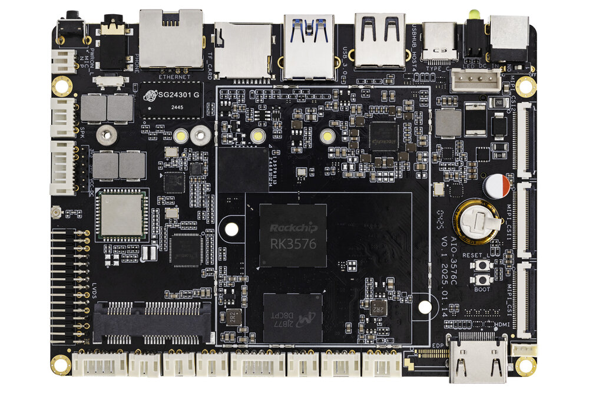
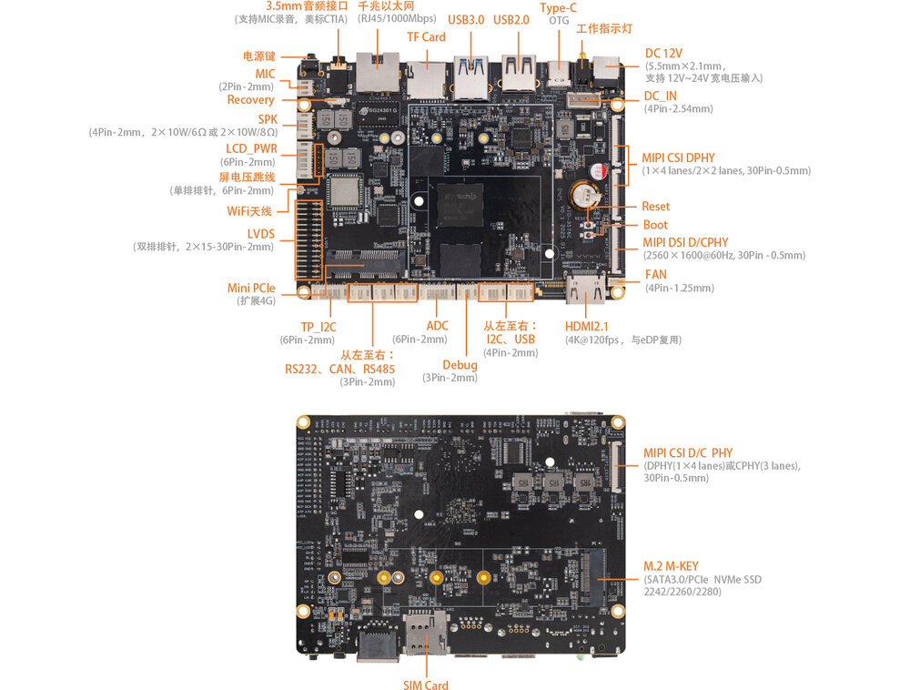

# 介绍

[规格书](https://download.t-firefly.com/%E4%BA%A7%E5%93%81%E8%A7%84%E6%A0%BC%E6%96%87%E6%A1%A3/%E8%A1%8C%E4%B8%9A%E4%B8%BB%E6%9D%BF/AIO-3576C_%E5%A4%A7%E6%A8%A1%E5%9E%8B%E5%B7%A5%E4%B8%9A%E4%B8%BB%E6%9D%BF_%E4%BA%A7%E5%93%81%E4%BB%8B%E7%BB%8D.pdf) | [购买链接](https://item.taobao.com/item.htm?ft=t&id=902727124992) | [下载资料](https://community.t-firefly.com/doc/download/320)

**AIO-3576C**配置 Rockchip 八核 64 位 AIOT 处理器 RK3576，采用先进工艺制程，高性能低功耗，内置 ARM Mali G52 MC3 GPU，集成6 TOPS算力NPU，支持主流大模型的私有化部署。同时支持4K@120fps解码/4K@60fps 编码，具备 4K@120fps 高清高帧率显示能力，支持外部看门狗，具有实时网络、Flexbus、硬件资源隔离、DSMC等工业新特性，满足不同的工业应用需求。

## 接口描述

**AIO-3576C V1.0** 使用的接口，主要包括：

* 1 x HDMI2.1（最大支持 4K@120Hz 输出）
* 1 x USB3.0 OTG(Type-C)
* 1 x USB3.0
* 2 x USB2.0 (其中一个4P-1.25mm)
* 1 x MIPI-DSI
* 1 x MIPI-D/CPHY-CSI
* 2 x MIPI-DPHY-CSI
* 1 x TF Card
* 1 x M.2 (SATA3.1 / NVME)
* 1 x WIFI
* 1 x Bluetooth
* 1 x FAN
* 1 x RJ45（支持 1Gbps）
* 1 × 3.5mm 耳机接口
* 1 × Mic输入（2P-1.25mm）
* 1 × SPEAKER（4P-1.25mm）
* 1 x DEBUG TTL
* 1 x RS485
* 1 x RS232
* 1 x CAN
* 1 x Mini PCIe (4G 模块)
* 1 x eDP 40Pin/30Pin (默认不支持，与HDMI复用)

具体如下图：

## 特殊接口说明
MIPI-DSI 和 LVDS 不能同时使用。

eDP 和 HDMI 复用，默认HDMI，如有需要eDP支持，可联系官方咨询。

## 资源与技术支持

* [[技术交流论坛]](https://forum.t-firefly.com/)：超过10万企业客户和用户沟通交流平台

### 联系方式

* 邮箱：sales@t-firefly.com
* 手机：(+86) 186 8811 7175
* 座机：0760-89881218
* 地址：广东省中山市东区中山四路 57 号宏宇大厦 2101 室