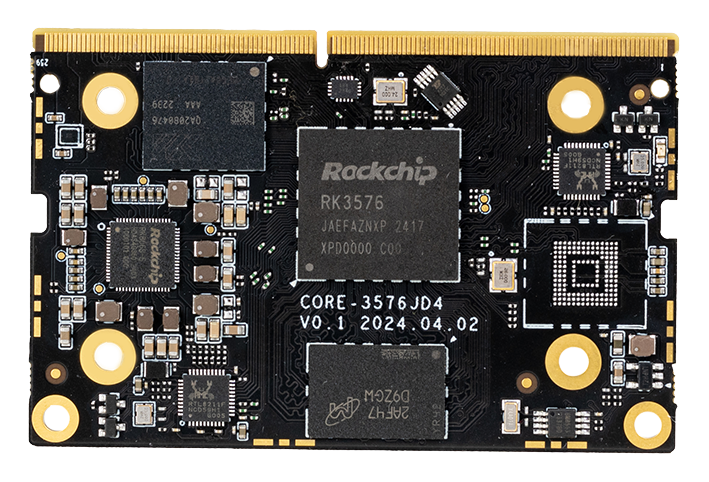
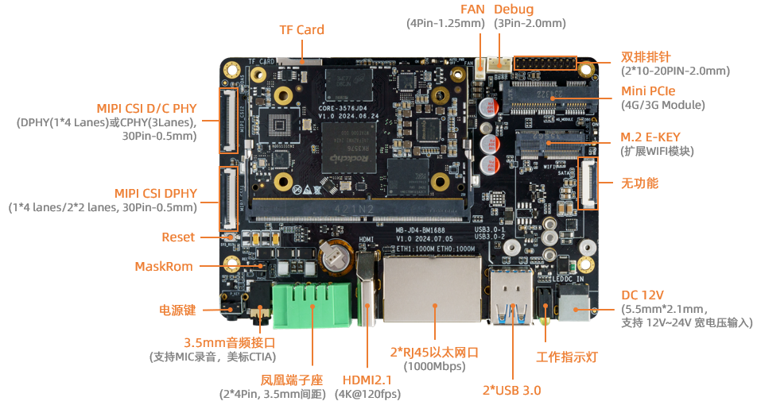
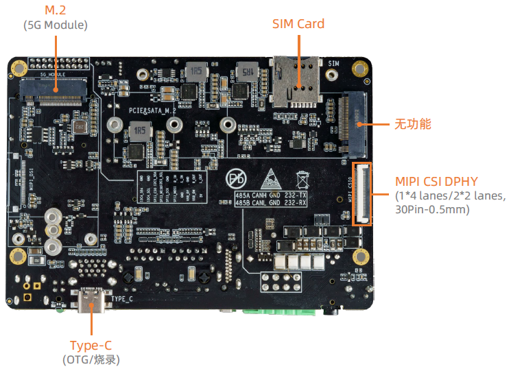
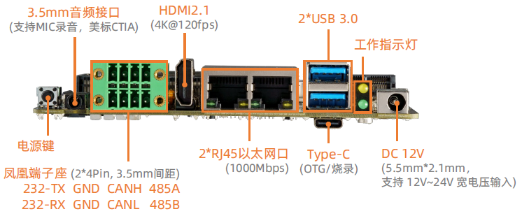

# 介绍

[规格书](https://download.t-firefly.com/%E4%BA%A7%E5%93%81%E8%A7%84%E6%A0%BC%E6%96%87%E6%A1%A3/%E6%A0%B8%E5%BF%83%E6%9D%BF/Core-3576JD4_%E4%BD%8E%E5%8A%9F%E8%80%97%E5%A4%A7%E6%A8%A1%E5%9E%8B%E6%A0%B8%E5%BF%83%E6%9D%BF_%E4%BA%A7%E5%93%81%E4%BB%8B%E7%BB%8D.pdf) | [购买链接](https://item.taobao.com/item.htm?ft=t&id=828628486461) | [下载资料](https://community.t-firefly.com/doc/download/255)

**Core-3576JD4** 配置 Rockchip 八核 64 位 AIOT 处理器 RK3576，采用先进工艺制程，高性能低功耗，内置 ARM Mali G52 MC3 GPU，集成 6 TOPS 算力 NPU，支持 Transformer 架构下超大规模参数模型的私有化部署，并支持自定义算子开发，支持 Docker 容器化管理技术。同时支持 4K@120fps 解码/4K@60fps 编码，具备 4K@120fps 高清高帧率显示能力，支持外部看门狗，拥有工业级的稳定性。提供底板参考设计资料，用户可自主深度化定制。

## 接口描述

**AIO-3576JD4 V1.0** 使用的接口，主要包括：

* 1 x HDMI2.1（最大支持 4K@120Hz 输出）
* 1 x USB Type-C (下载/Debug)
* 2 x USB3.0
* 2 x MIPI-DPHY-CSI (CSI0 和 CSI1 不能同时使用)
* 1 x TF Card
* 1 x Mini PCIe (4G 模块)
* 1 x PCIe M.2 (5G 模块)
* 1 x SIM 卡槽
* 1 x WIFI (外置模块)
* 1 x Bluetooth (外置模块)
* 1 x FAN
* 1 x Headphone （支持MIC录音，美标）
* 1 x CAN  (凤凰端子座)
* 1 x RS232 (凤凰端子座)
* 1 x RS485 (凤凰端子座)
* 1 x Line-Out (由排针引出)
* 1 x Line-In (由排针引出)
* 1 x USB2.0 (由排针引出)
* 1 x SPI  (由排针引出)
* 2 x I2C  (由排针引出)

* 1 x MIPI-D/CPHY-CSI
* 2 x RJ45 (支持 1Gbps 以太网)

具体如下图：

## 特殊接口说明
Mini PCIe (4G 模块) 和 PCIe M.2 (5G 模块) 共用了一路 USB，所以不能同时使用。

默认是 4G 模块，如需使用 5G 需要调整底板电阻位置。

## 资源与技术支持

* [[技术交流论坛]](https://forum.t-firefly.com/)：超过10万企业客户和用户沟通交流平台

### 联系方式

* 邮箱：sales@t-firefly.com
* 手机：(+86) 186 8811 7175
* 座机：0760-89881218
* 地址：广东省中山市东区中山四路 57 号宏宇大厦 2101 室