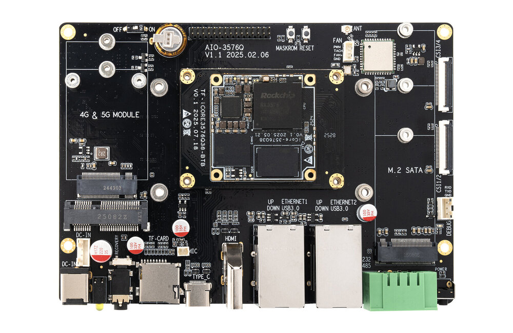
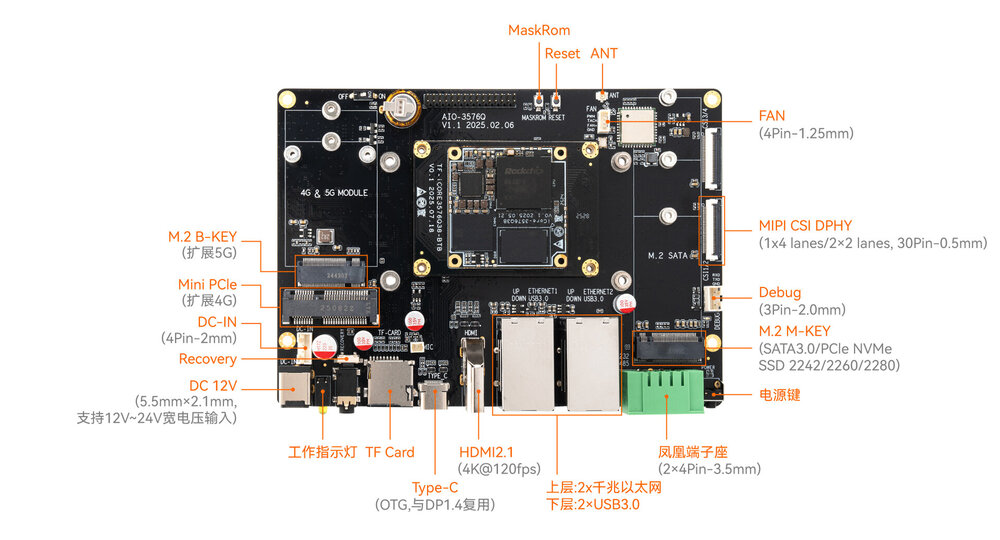
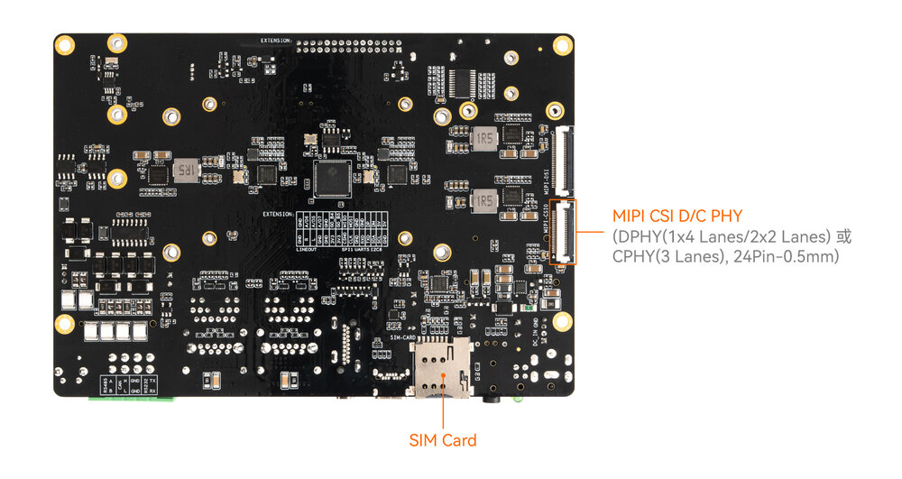

# 介绍

[规格书](https://download.t-firefly.com/Spec/CoreBorads/ICORE-3576Q38_ICORE-3576JQ38_ICORE-3576MQ38_Specification_CN.pdf) | [购买链接](https://item.taobao.com/item.htm?id=961156815691) | [下载资料](https://community.t-firefly.com/doc/download/327)

**AIO-3576Q38**配置 Rockchip 八核 64 位 AIOT 处理器 RK3576，采用先进工艺制程，高性能低功耗，内置 ARM Mali G52 MC3 GPU，集成6 TOPS算力NPU，支持主流大模型的私有化部署。同时支持4K@120fps解码/4K@60fps 编码，具备 4K@120fps 高清高帧率显示能力，支持外部看门狗，具有实时网络、Flexbus、硬件资源隔离、DSMC等工业新特性，满足不同的工业应用需求。

## 接口描述

**AIO-3576Q38 V1.1** 使用的接口，主要包括：

* 1 x HDMI2.1（最大支持 4K@120Hz 输出）
* 1 x USB3.0 OTG(Type-C)
* 2 x USB3.0
* 1 x MIPI-D/CPHY-CSI
* 1 x MIPI-DPHY-CSI
* 1 x TF Card
* 1 x M.2(SATA3.1)
* 1 x WIFI
* 1 x Bluetooth
* 1 x FAN
* 2 x RJ45（支持 1Gbps）
* 1 x RS485
* 1 x RS232
* 1 x CAN
* 1 x Mini PCIe (4G 模块)
* 1 x PCIe M.2 (5G 模块)

具体如下图：

## 特殊接口说明
Mini PCIe (4G 模块) 和 PCIe M.2 (5G 模块) 共用了一路 USB，所以不能同时使用。

以下接口功能不可用:
* 1 x MIPI-DSI
* 1 x MIPI-DPHY-CSI (CSI3/4)
* 1 × 3.5mm 耳机接口
* 1 × Mic输入（2P-1.25mm）
* 1 x Bluetooth(语音)
* 排针功能不可用

## 资源与技术支持

* [[技术交流论坛]](https://forum.t-firefly.com/)：超过10万企业客户和用户沟通交流平台

### 联系方式

* 邮箱：sales@t-firefly.com
* 手机：(+86) 186 8811 7175
* 座机：0760-89881218
* 地址：广东省中山市东区中山四路 57 号宏宇大厦 2101 室