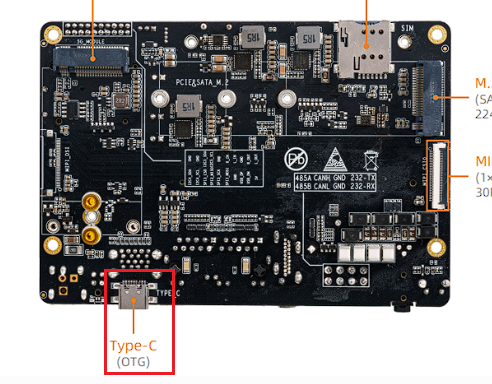
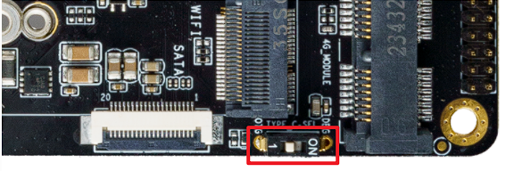
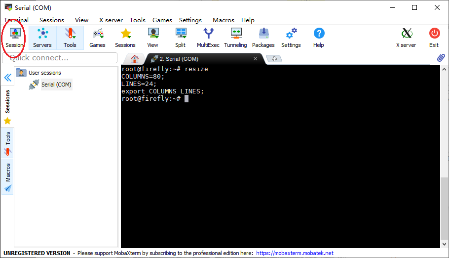
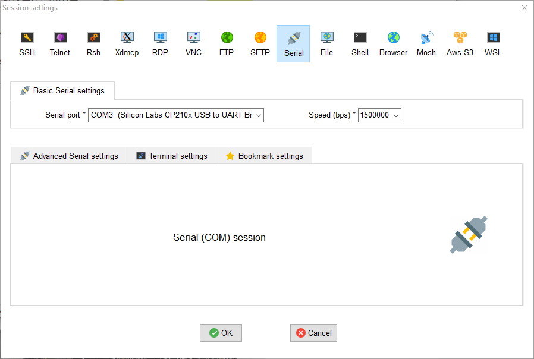

# 串口调试

## 硬件连接 [step]

连接设备 typec 和电脑，AIO-3588JD4 typec 有两种功能（串口/OTG升级）通过拨码开关控制，串口调试时候请将拨码开关拨向 "DBG"。


<center>


</center>
<center>


</center>


## 串口参数 [step]

* 波特率：115200
* 数据位：8
* 停止位：1
* 奇偶校验：无
* 流控：无

## 使用串口调试 [step]

<CodeBlockTabs defaultValue="Windows">
  <CodeBlockTabsList>
    <CodeBlockTabsTrigger value="Windows">Windows</CodeBlockTabsTrigger>
    <CodeBlockTabsTrigger value="Ubuntu">Ubuntu</CodeBlockTabsTrigger>
  </CodeBlockTabsList>

  <CodeBlockTab value="Windows">
    ### Windows 下使用串口调试

    Windows 上一般用 putty 或 SecureCRT 软件。其中我们推荐使用 MobaXterm 免费版本。这是一款功能强大的终端软件，在这里介绍一下，其他软件的使用方法与之类似。

    到这里[下载 MobaXterm](https://mobaxterm.mobatek.net/)：

    1. 选择 `session` 为 `Serial`。
    2. 将 `Serial port` 修改为在设备管理器中找到的 COM 端口。
    3. 设置 `Speed (bsp)` 为 `115200`。
    4. 点击 `OK` 按钮。

    <center>

    
    </center>
    <center>

    
    </center>
  </CodeBlockTab>

  <CodeBlockTab value="Ubuntu">
    ### Ubuntu 下使用串口调试

    在 Ubuntu 上可以有多种选择：

    * minicom
    * picocom
    * kermit

    篇幅关系，以下就介绍 minicom 的使用。

    安装 minicom：

    ```
    sudo apt-get install minicom
    ```

    连接好串口线后，查看串口设备文件：

    <Callout title="注意" type="info">

      本设备的调试串口由 Type-C 接口引出，在 Ubuntu 系统下的设备文件为 `/dev/ttyACM0`；若使用普通 USB 转串口适配器，则设备文件为 `/dev/ttyUSBx`。

    </Callout>

    ```
    $ ls /dev/ttyACM*
    /dev/ttyACM0
    ```

    运行：

    ```
    $ sudo minicom
    Welcome to minicom 2.7
    OPTIONS: I18n
    Compiled on Jan  1 2014, 17:13:19.
    Port /dev/ttyACM0, 15:57:00
    Press CTRL-A Z for help on special keys
    ```

    以上提示 `CTRL-A Z` 是转义键，按 `Ctrl-a` 然后再按 `z` 就可以调出菜单：

    ```
       +-------------------------------------------------------------------+
                              Minicom Command Summary                      |
      |                                                                    |
      |              Commands can be called by CTRL-A <key>                |
      |                                                                    |
      |               Main Functions                  Other Functions      |
      |                                                                    |
      | Dialing directory..D  run script (Go)....G | Clear Screen.......C  |
      | Send files.........S  Receive files......R | cOnfigure Minicom..O  |
      | comm Parameters....P  Add linefeed.......A | Suspend minicom....J  |
      | Capture on/off.....L  Hangup.............H | eXit and reset.....X  |
      | send break.........F  initialize Modem...M | Quit with no reset.Q  |
      | Terminal settings..T  run Kermit.........K | Cursor key mode....I  |
      | lineWrap on/off....W  local Echo on/off..E | Help screen........Z  |
      | Paste file.........Y  Timestamp toggle..N  | scroll Back........B  |
      | Add Carriage Ret...U                                               |
      |                                                                    |
      |             Select function or press Enter for none.               |
      +--------------------------------------------------------------------+
    ```

    根据提示按 `O` 进入设置界面，如下：

    ```
           +-----[configuration]------+
           | Filenames and paths      |
           | File transfer protocols  |
           | Serial port setup        |
           | Modem and dialing        |
           | Screen and keyboard      |
           | Save setup as dfl        |
           | Save setup as..          |
           | Exit                     |
           +--------------------------+
    ```

    把光标移动到"Serial port setup"，按enter进入串口设置界面，再输入前面提示的字母，选择对应的选项，设置成如下：

    ```
       +-----------------------------------------------------------------------+
       | A -    Serial Device      : /dev/ttyACM0                              |
       | B - Lockfile Location     : /var/lock                                 |
       | C -   Callin Program      :                                           |
       | D -  Callout Program      :                                           |
       | E -    Bps/Par/Bits       : 115200 8N1                                |
       | F - Hardware Flow Control : No                                        |
       | G - Software Flow Control : No                                        |
       |                                                                       |
       |    Change which setting?                                              |
       +-----------------------------------------------------------------------+
    ```

    <Callout title="注意" type="warn">

      `Hardware Flow Control` 和 `Software Flow Control` 都要设成 No，否则可能导致无法输入。

    </Callout>

    设置完成后回到上一菜单，选择 `Save setup as dfl` 即可保存为默认配置，以后将默认使用该配置。
  </CodeBlockTab>
</CodeBlockTabs>