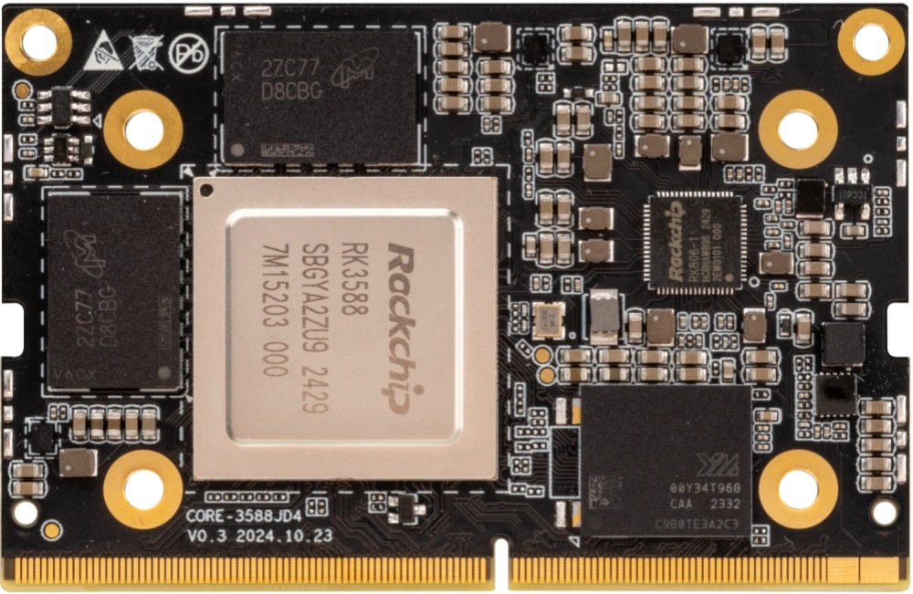
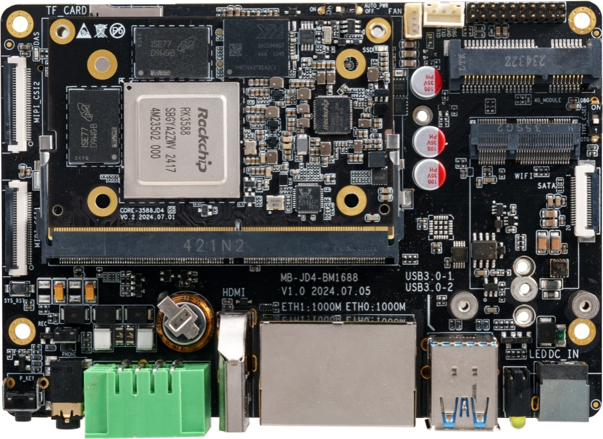
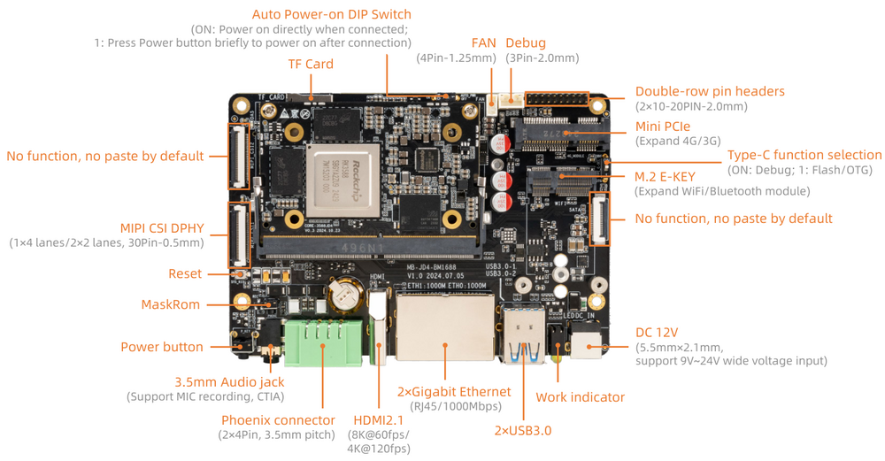
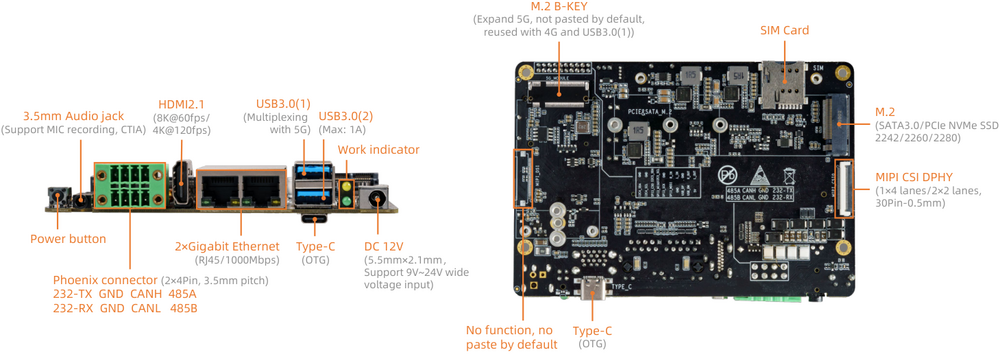

[规格书](https://download.t-firefly.com/%E4%BA%A7%E5%93%81%E8%A7%84%E6%A0%BC%E6%96%87%E6%A1%A3/%E6%A0%B8%E5%BF%83%E6%9D%BF/Core-3588JD4_%E4%BA%BA%E5%B7%A5%E6%99%BA%E8%83%BD%E5%A4%A7%E6%A8%A1%E5%9E%8B%E6%A0%B8%E5%BF%83%E6%9D%BF_%E4%BA%A7%E5%93%81%E4%BB%8B%E7%BB%8D.pdf) | [下载资料](https://community.t-firefly.com/doc/download/290)

# 简介

**Core-3588JD4**采用Rockchip RK3588新一代旗舰级八核64位处理器，采用8nm先进架构，最高主频2.4GHz,最大可配32GB大内存；

集成 ARM Mali-G610 MP4 四核 GPU，内置 AI 加速器 NPU，可提供6 Tops 算力，支持主流的深度学习框架；最大支持32 GB 大内存；支持 WiFi6，5G/4G 等高速无线网络通讯；支持 8K 视频编解码和多种格式的视频输入输出；支持多
种操作系统；可适用于 ARM PC、边缘计算、云服务器、智能NVR 等领域。

AIO-3588JD4 开发板由核心板 Core-3588JD4 + 底板 MB-JD4-RK3588 组成,。AIO-3588JD4 拥有 以太网、CAN、Mini PCIe、USB3.0、HDMI、RS485/232 以及 MIPI-CSI 等丰富接口。可直接应用到各种智能产品中，加速产品落地，详细内容可参考下方接口描述。
  

## 接口描述

AIO-3588JD4 提供了丰富的接口，主要包括：

* 1 x HDMI2.1(最大支持 8K@60Hz 输出)
* 1 x USB Type-C (下载/Debug)
* 2 x USB3.0
* 2 x MIPI-DPHY-CSI (CSI0 和 CSI1 不能同时使用)
* 1 x TF Card
* 1 x Mini PCIe (4G 模块)
* 1 x PCIe M.2 (5G 模块)
* 1 x SIM 卡槽
* 1 x WIFI (外置模块)
* 1 x Bluetooth (外置模块)
* 1 x FAN
* 1 x Headphone （支持MIC录音，美标）
* 1 x CAN  (凤凰端子座)
* 1 x RS232 (凤凰端子座)
* 1 x RS485 (凤凰端子座)
* 1 x Line-Out (由排针引出)
* 1 x Line-In (由排针引出)
* 1 x USB2.0 (由排针引出)
* 1 x SPI  (由排针引出)
* 2 x I2C  (由排针引出)

* 2 x RJ45 (支持 1Gbps 以太网)
* 1 x M2.SATA3.0 或 M2.PCIe2.0 (默认支持M2.SATA3.0)

## 资源与技术支持

* [[技术交流论坛]](https://forum.t-firefly.com/)：超过10万企业客户和用户沟通交流平台

### 联系方式

* 邮箱：sales@t-firefly.com
* 手机：(+86) 186 8811 7175
* 座机：0760-89881218
* 地址：广东省中山市东区中山四路 57 号宏宇大厦 2101 室